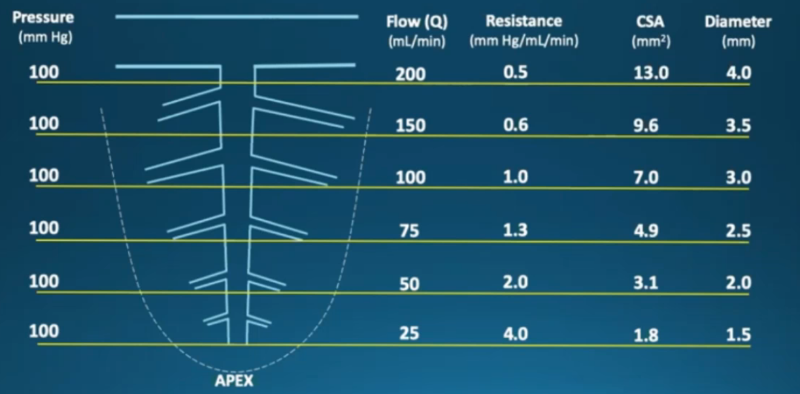
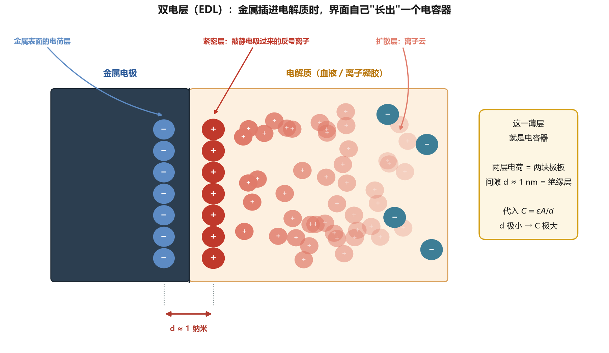
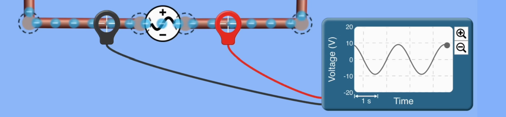
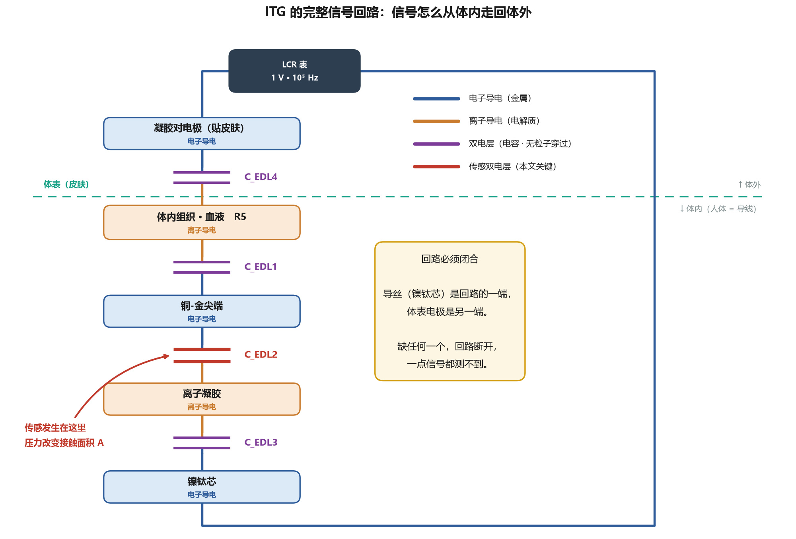
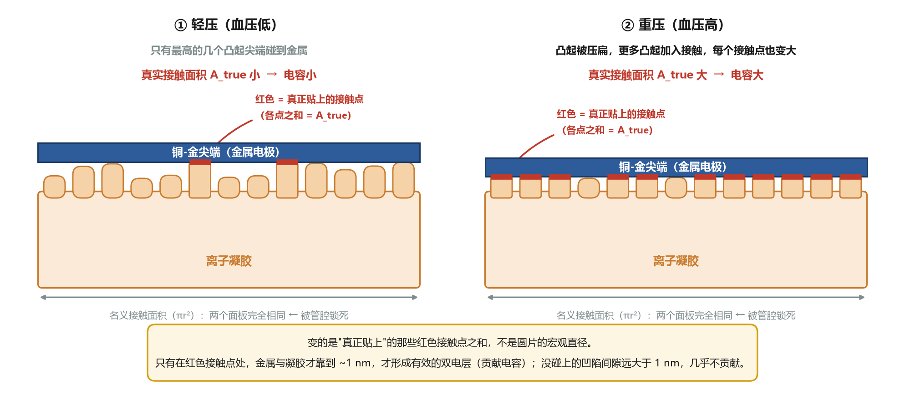
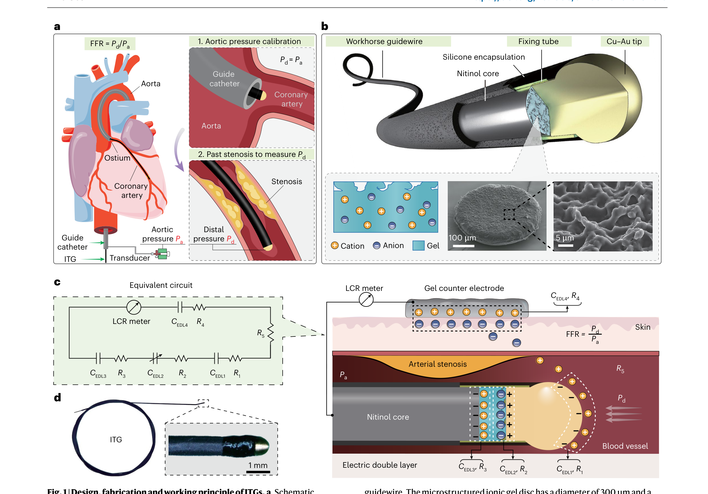
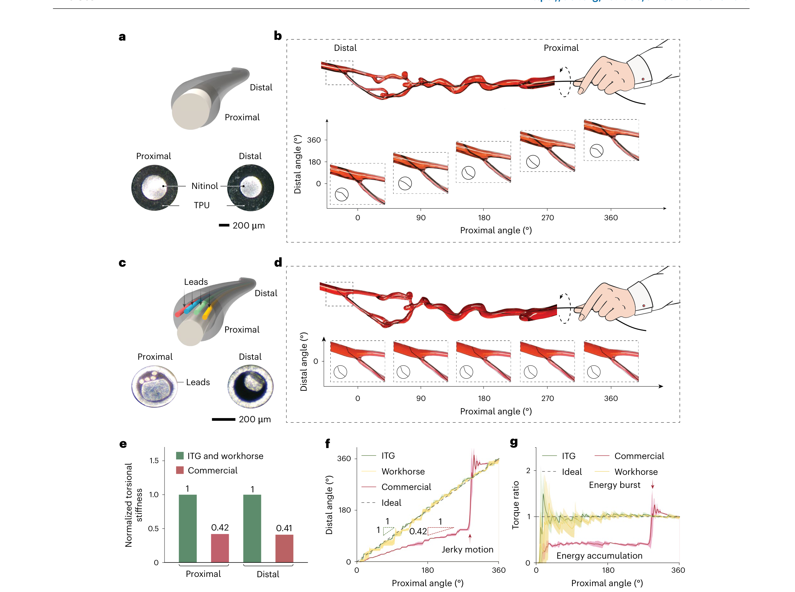
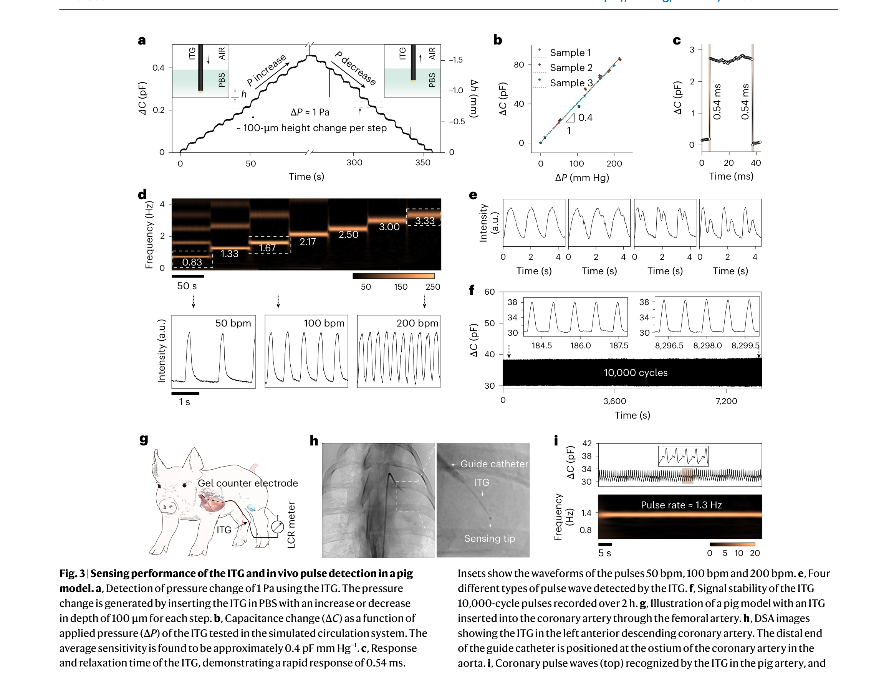
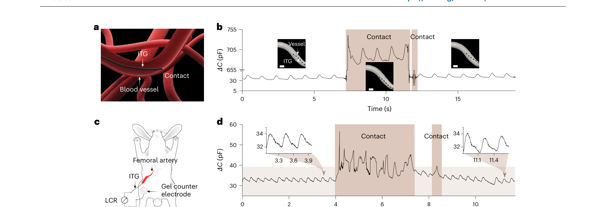
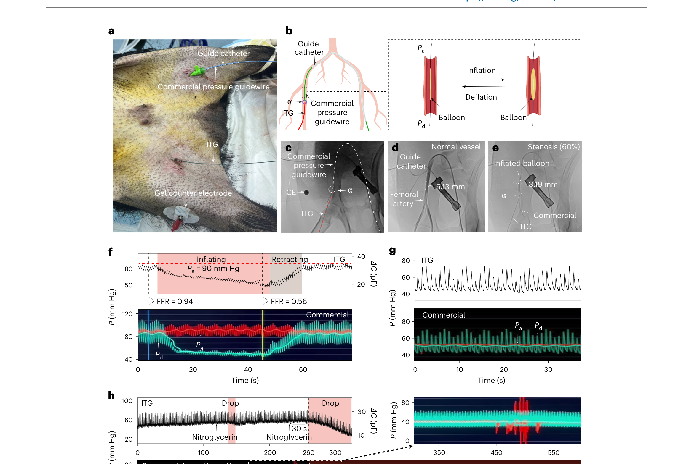

# Iontronic tip-sensing guidewires 精读笔记

> **论文**：Iontronic tip-sensing guidewires（离子电子式尖端传感导丝）
> **作者**：Fangyi Guan, Ningning Bai, Jia Song, Nian Zhang, Jiyu Li, Yizhou Jiang, Zhiliang Han, Hanxin Wang, Junli Shi, Xi Xia, Xudong Chen, Chuan Fei Guo & Liu Wang
> **期刊**：Nature Biomedical Engineering（2025，Accepted 25 Sep 2025；Published online 29 Oct 2025）
> **DOI**：10.1038/s41551-025-01548-9
> **阅读对象**：**电化学、物理学零基础**。
> **数学深度**：只讲原理（每个公式说明"表达什么关系"，不推导）


---

## 一、一句话看懂这篇论文

> 把一个"压力一压就改变电容"的**离子凝胶小圆片**装到普通导丝**尖端**，并且**不埋任何金属导线**——把**人体血液和组织本身当成那根导线**（它们靠离子导电），做成一根"**离子电子式测压导丝**"（ITG, iontronic tip-sensing guidewire）。它用来在心脏冠脉狭窄处测血流压力（FFR），比商用测压导丝**更灵敏（能测 1 Pa）、更快（0.54 ms）、更便宜**，还**顺便**能实时提示"导丝尖碰到血管壁了"。

**核心创新三点**：
1. **尖端传感**：离子凝胶电容式压力传感器（靠**双电层**，见第三节概念 3）。
2. **无导线信号传输**：把人体当导线，信号靠体内的**离子**接力传出来。
3. **保持 1:1 理想扭矩比**：完全没有牺牲普通工作导丝的操控性。

> 💡 **这篇论文最"反常识"的一点**：整篇文章最关键的创新，其实是一个**减法**——把商用导丝里最贵、最难造、最碍事的那部分（埋在导丝里的导线/光纤）**整个删掉**，而不是把传感器做得更小更强。这是"换信道"的思路，不是"精加工"的思路。

---

## 二、背景与动机：为什么做这个

### 1. 冠心病与"狭窄"

- **冠状动脉（coronary artery）**：从主动脉根部（**冠脉开口 ostium**）分出、包在心脏表面、给心肌供血的血管。心脏自己也要吃饭，冠脉就是它的饭管子。
- **斑块（plaque）**：血脂等物质在血管壁里堆积成的"垃圾堆"，让血管**变窄**。
- **冠心病（coronary artery disease, CAD）**：冠脉因斑块堆积变窄 → 心肌供血不足 → 心绞痛，严重时**心梗**。论文给的数据：全球每年约 **1000 万人**因此死亡。
- **狭窄（stenosis）**：就是"血管变窄"这件事本身。

> ⚠️ **一个容易绕进去的点**：血管"看着窄" ≠ "真的影响血流"。有的狭窄看着很吓人，但血流照样够用；有的看着不起眼，却已经严重缺血。所以需要**两个维度**的信息。

### 2. 造影（解剖）vs FFR（功能）—— 两种维度

| | **冠脉造影（X-ray angiography）** | **FFR 测量** |
| --- | --- | --- |
| 看的是 | 血管**形状**窄不窄（解剖） | 血流**受不受影响**（功能） |
| 类比 | 拿尺子量水管的粗细 | 在管子两头装压力表，量水流被堵了多少 |
| 局限 | 只能看形状，猜不出功能 | 需要额外器械、额外时间、额外钱 |

论文的说法是：FFR 用**定量的生理功能评估**去补充造影的**解剖可视化**。两者互补，不是替代。

### 3. FFR —— 全篇最重要的临床概念

**定义**：
```
        Pd
FFR =  ────
        Pa
```
- **Pa（aortic pressure）**：主动脉压力，即狭窄**上游**的压力，由**指引导管**（guide catheter）末端的**压力换能器**（transducer）连续记录。
- **Pd（distal pressure）**：狭窄**远端**（下游）的冠脉压力，由穿过狭窄的压力导丝尖端记录。
- **hyperaemic conditions（最大充血状态）**：用药物（如腺苷）把冠脉血管**扩到最大**，此时血流最大、狭窄的阻碍作用最明显。**必须在最大充血下测**，否则静息状态下身体会自己代偿，测不出真实阻碍。


**为什么这个比值就有意义**：血流通过一段管道时，被堵得越厉害，下游的"剩余压力"就越低。所以"下游 ÷ 上游"直接反映"这段狭窄让最大血流减少了多少"。

**临床判定**：**FFR ≤ 0.80** 一般认为**有血流动力学意义**（即真的缺血），需要考虑放支架或搭桥。

> 🔧 **操作流程（论文引言原文的顺序，读论文时容易乱，这里理一遍）**：
> 1. 从**股动脉**把**指引导管**送到冠脉开口（ostium）；导管接压力换能器，**持续测 Pa**。
> 2. 压力导丝带着尖端传感器，穿过导管送到冠脉开口。
> 3. **在开口处做校准**（导丝传感器 vs 导管换能器）——这一步很关键，保证基线一致。
> 4. 导丝继续前进，**小心穿过狭窄**，测 Pd。
> 5. 算 Pd/Pa。

> 📌 **图 1a 的对应关系**：图 1a 左侧是心脏与冠脉整体示意（标了 Aorta 主动脉、Ostium 冠脉开口、Coronary artery 冠脉、Guide catheter 指引导管、ITG、Transducer 换能器）；右侧两个小图是流程两步：**"1. Aortic pressure calibration"**（校准，标注 `Pd = Pa`）和 **"2. Past stenosis to measure Pd"**（穿过狭窄测 Pd，标注 Stenosis 狭窄）。

### 4. 现有压力导丝 —— 三类传感器，三种致命伤

商用压力导丝的做法是：**在细小的导丝尖端装一个感受压力的元件**，然后**沿导丝把信号传回体外**。元件有三种，传信号的方式有两种：

| 类型 | 原理 | 需要几根引线 | 致命伤 |
| --- | --- | --- | --- |
| **压电式（piezoelectric）** | 压力 → 电压 | **2 根**（一根信号 + 一根地） | 引线降低操控性 |
| **压阻式（piezoresistive）** | 压力 → 电阻变化（**惠斯通电桥**） | **4 根**（激励电压 + 信号） | 引线最多、更硬 |
| **光学式（optical）** | 压力 → 光信号（**光纤芯**） | 光纤 | **光纤脆**、易弯折（kinking） |

> 📖 **两个名词解释（零基础）**：
> - **惠斯通电桥（Wheatstone bridge）**：四个电阻排成"菱形"（两组分压），把"电阻的微小变化"变成"电压差"来读。它需要**激励电压进去**（所以要多两根线），这是压阻式要 4 根线的根本原因。
> - **kinking（打结/折死）**：光纤像玻璃丝，弯得太急会**折出一个永久死角**，光就走不过去了。

**共同矛盾（全篇的关键前提）**：
> 塞进引线或光纤 → 导丝内部的**实心镍钛芯被掏空/挤细** → **扭转刚度（torsional stiffness）下降** → **扭矩比低到约 1:0.5**（近端转 1 圈，远端只跟半圈）→ 在弯曲狭窄、还在跳动的心脏里的冠脉中**极难操控** → 医生只能反复推拉进退 → **增加血管夹层（dissection）或穿孔**的风险。

> 📌 **口径提醒**：`1:0.5` 这个数来自论文引用的 **Supplementary Table 1**（文献值）。本文实测的商业导丝**扭矩比是 0.42**（图 2e/f/g）。两个数别混。

**另外两个痛点**：
- **贵**：商用压力导丝的制造工艺复杂 → 成本高 → 导致 FFR 在全部冠脉介入中**使用率仅 1%–6%**（论文引用多篇文献给的估计）。
- **不能测尖端接触力**：医生**不知道**导丝头有没有顶到脆弱的血管壁。顶过头就可能夹层/穿孔。**商用压力导丝完全没有这个功能。**

### 5. 离子电子学（iontronics）—— 本文的解法

- 传统电子器件靠**电子**导电（金属线里）；离子电子器件靠**离子**导电（血液、组织、离子液体里的钠钾等离子）。
- **人体组织和血液天然富含离子，本身就是导体**。既然如此，**何必在导丝里埋线？直接用人体当那根线。**
- 论文特别强调：这**不是**常见的"人体通信（human body communication）"。后者是把身体当**发射器-接收器之间的耦合介质**（电容耦合，信号本质还是电磁场）；本文是**真的利用体内的离子导电**来传传感信号。两者的物理机制不同。

> 📌 **这篇论文的定位**：论文自己说，以往离子电子传感器**主要用于体外**（比如机器人的电子皮肤，见 Supplementary Table 2——本 PDF 不含 SI）。本文第一次把它**用到体内介入器械**上。

---

## 三、必须先理解的核心概念（从"电荷"开始，零基础版）

> 这一节是整篇笔记的地基。**如果你跳过它，后面所有"电容""双电层""串联"都会变成咒语。** 建议按顺序读。

### 概念 0：电荷、电压、电流、电阻 —— 四个最基础的字

| 名词 | 一句话 | 类比（水管） |
| --- | --- | --- |
| **电荷（charge）** | 物质里带正电或负电的微小粒子。**正负相吸，同种相斥** | 水分子 |
| **电压（voltage, V）** | 推动电荷流动的"压力"。单位**伏特 V** | 水压 |
| **电流（current, I）** | 电荷在流动。单位**安培 A** | 水流量 |
| **电阻（resistance, R）** | 阻碍电荷流动的程度。单位**欧姆 Ω** | 管子有多细 |

**两条导电通道（本文的命门）**：
- **电子导电**：金属里，**自由电子**在跑。铜线、金层里都是这个。
- **离子导电**：盐水、血液、组织、离子液体里，**带电的原子/分子（离子）在跑**。离子比电子大得多、重得多、跑得慢得多，但照样能导电。

> ⚠️ **为什么这个区分是全文的命门**：导线里跑**电子**，血液里跑**离子**。**这两种"电流"不能直接对接**——你不能把一根铜线插进盐水，然后指望电子直接跳进水里继续跑（也不能指望离子跳进铜线里）。所以"用人体当导线"这件事，**必须在电子世界和离子世界之间有一个"接力"的环节**。这个环节就是**双电层（概念 3）**。整个传感器的物理基础，就是从这个"两个世界接不上"的尴尬里长出来的。
>
> 📌 **提前说一句免得误解**：这个"接力"**不是"电子变成离子"**，而是**电荷在界面处被交接，两边各用自己的载流子继续跑，没有任何粒子真的跨界**。这正是"换乘站"这个比喻容易误导人的地方——详见概念 3 的"六件事"。

### 概念 1：电容器与电容 —— 存电荷的容器

**电容器（capacitor）**：两块**导体板**，中间隔一层**不导电的绝缘层**。给它接上电压，两块板上会分别聚起**等量异号**的电荷。

**电容（capacitance, C）**：衡量这个容器"能存多少电荷"。
```
      Q
C = ─────
      V
```
- **Q**：存住的电荷量；**V**：两板之间的电压。**同样的电压下，存得越多，电容越大。**
- 单位：**法拉 F**。**1 pF（皮法）= 10⁻¹² F**，极小极小。本文的电容读数大多在 **几十 pF 到几百 pF** 量级。

**平行板电容器的公式（本文最重要的一条关系）**：
```
      ε · A
C = ─────────
        d
```
| 符号 | 含义 | 怎么影响电容 |
| --- | --- | --- |
| **ε**（介电常数） | 中间绝缘层"让电场通过的能力" | ε 越大 → C 越大 |
| **A** | 两块板**正对（接触）的面积** | A 越大 → C 越大 |
| **d** | 两块板之间的**距离** | d 越小 → C 越大 |

> 🔑 **一句话记住**：**板越大、离得越近，电容越大。**
> - **板子越大** → "对上的面积"越多 → 能存住的电荷越多；
> - **两块板离得越近** → 极板上两种电荷之间的吸引力越强 → 能存住的电荷越多。

**⭐ 本文的传感原理就是把 A 当旋钮**：压力 → 挤压凝胶 → 凝胶和金属的**接触面积 A 改变** → **电容 C 改变** → 测 C 就知道压力多少。（见概念 7）

### 概念 2：电解质、离子液体、离子凝胶 —— "离子导电"的三个层次

| 名词                     | 是什么                                                                          | 类比          |
| ---------------------- | ---------------------------------------------------------------------------- | ----------- |
| **电解质（electrolyte）**   | 含**自由离子**、能靠离子导电的物质。**血液、组织液、盐水（PBS）都是**                                     | 一盆盐水        |
| **离子液体（ionic liquid）** | **完全由离子组成、室温下就是液体**的"盐"。本文用 **[EMIM]⁺[TFSI]⁻**                               | 一盆"不会蒸发的盐水" |
| **离子凝胶（ionic gel）**    | 把离子液体**锁进聚合物骨架**里，做成**可以变形、但不会流走的固体/胶体**。本文是 **[EMIM]⁺[TFSI]⁻ + P(VdF-HFP)** | 吸饱了盐水的海绵/果冻 |

> 📖 **[EMIM]⁺[TFSI]⁻ 到底是什么**：这是一个"阳离子 + 阴离子"配对。
> - **[EMIM]⁺** = 1-乙基-3-甲基咪唑鎓离子（一种有机阳离子，带正电）。
> - **[TFSI]⁻** = 双(三氟甲基磺酰)亚胺离子（一种有机阴离子，带负电）。
> - 常温下这俩凑在一起**就是液体**，而且**几乎不挥发**（不像水会干）、不易燃、离子浓度极高。所以适合封在器件里长期用。
>
> 📖 **P(VdF-HFP)**：一种**含氟聚合物**（偏氟乙烯-六氟丙烯共聚物）。它的作用是当"骨架"，把离子液体固定在凝胶里，让凝胶能像橡皮一样变形而不流出。

**为什么要用离子凝胶，而不是直接让血液接触金属？**
离子凝胶是**可变形**的传感层——压力进来，它形变、接触面积变，电容就变。血液不行，它是流动的。

### 概念 3：双电层（EDL）—— 本文的物理地基 ⭐

**现象**：把一块**金属**插进**含离子的液体**（盐水、血液、离子凝胶）里，在**金属和液体的交界面**上，会**自动**形成这样的结构：



**金属一侧**带一种电荷，**液体一侧**的**反号离子会被静电吸过来、紧贴排成一层**（图中红色）。于是"金属的电荷层 + 液体的离子层"就成了**两层电荷、中间隔极薄**的结构——**这就是双电层（Electric Double Layer, EDL）**。
> 图中右下那几个蓝色 ⊖ 是**体相里的同号离子**——它们被金属表面的电荷排斥，所以在界面附近**浓度很低**，只有远处才有几个（这就是"扩散层"名字的由来）。

> 💡 **关键洞察**：**双电层天然就是一个电容器！** 两层电荷 = 两块极板；中间那 1 纳米级的间隙 = 极薄的绝缘层。
> 把它代进 `C = εA/d`：**d 极小（纳米级）→ C 极大**。所以 EDL 的"电容密度"高得惊人，远超任何普通电容器。
>
> 🚰 **类比**：把带电的金属板丢进一盆盐水，正负离子立刻在板表面排成两排——**你不用自己造电容器，界面自己就长出了一个**。

---

#### ⚠️ 必须澄清一个疑问："中间是绝缘层，电荷不是被隔断了吗？"

> **这个疑问问得对，而且答案是：确实被隔断了，一个电荷都过不去。**

**第一件事：在本文的条件下，EDL 里没有电荷穿过。**

要让电荷真的越过这个界面，只有一条路：**发生氧化还原反应**（比如 `Cu²⁺ + 2e⁻ → Cu`，电子真的跳到某个离子上）。这条路叫**法拉第过程（faradaic process）**。但本文的条件下走不通：
- 激励电压只有 **1 V**，而 [EMIM]⁺[TFSI]⁻ 这类离子液体的**电化学窗口（electrochemical window）约 4 V**——1 V 远远不够触发反应；
- 电极是**金**，化学惰性，不易参与反应。

所以在本文的系统里，EDL 是一个**"理想极化电极"（ideally polarizable electrode）——本质上就是个纯粹的电容器，几乎不导通任何电荷**。电子不进水，离子不出水。

**第二件事：那电流是怎么过电容的？—— 电容器在交流下本来就"通"电流。**

这是最容易被忘掉的一点：
```
      I = C · dV/dt
```
**只要电压在变化，电容器上就有电流。** 这个电流不靠任何电荷穿过绝缘层，它是靠**电场的变化**传过去的。

> 🚰 **正确的类比：管子中间夹一片橡胶薄膜（或活塞）**
> 想象一根装满水的管子，中间夹着一片**弹性橡胶薄膜**，把管子分成左右两段。
> - 你在左段推一下水 → 薄膜向右鼓起 → 右段的水被挤出去一点。
> - 你往回拉 → 薄膜向左凹 → 右段的水被吸回来。
> - **任何时刻，左边流进多少水，右边就流出多少水——两边"流量"完全相同。**
> - **但是：没有任何一个水分子穿过那片薄膜。**
>
> 电容器就是这样。中间的绝缘层（薄膜）**确实挡住了粒子**，但**"推动"照样被原封不动地传到了另一边**。你测到的"电流"，是**两边各自的水在动**，而不是有东西穿了过去。
>
> 📌 这种"没有粒子穿过、电流却照常"的电流，物理上叫**位移电流（displacement current）**——它是麦克斯韦方程组里的基本项，不是本文的特殊现象。
> **所有电容式传感器（包括手机触摸屏）都是靠它工作的。**

**第三件事：那"电子换离子"到底发生在哪一步？**

虽然**没有任何粒子跨界**，但**载流子的种类确实换了**：

| 位置                   | 载流子是谁         | 电荷怎么动                   |
| -------------------- | ------------- | ----------------------- |
| **金属导线 / 镀金层内部**     | **电子**        | 电子在金属里流动                |
| **双电层界面**            | **（没有载流子穿过）** | 电荷不越过；靠**电场变化**把"推力"传过去 |
| **离子凝胶 / 血液 / 组织内部** | **离子**        | 阳离子、阴离子在电解质里迁移          |

所以准确的说法不是"电子在界面换乘成离子"，而是：

> 🔑 **电荷在界面处被交接了，但"跑的人"（电子、离子）各自留在自己那一侧。**
> 金属侧电荷的变化，由**金属里的电子**补上；电解质侧电荷的变化，由**电解质里的离子**补上。两侧电荷的变化量**永远相等**（电荷守恒），所以电流在数值上是**连续**的——**但没有任何一个粒子真的过界。**
>
> 🏃 **类比：接力赛**。接力棒（电荷）被一棒一棒传下去，但跑第一棒的运动员（电子）**不会跟着跑到第二棒的路段上去**。你看到的是"棒一直在往前"，而人已经换了好几拨。

**第四件事：整套系统为什么非用交流不可**

> ⭐ **一句话答案**：**电容器是一个"容量有限的死胡同"。直流会把它灌满，灌满了就没有驱动力了；交流不让它灌满——充一半就反向。**

**直流的情况：充一次，然后就永远停住。**

```
外加电压 V 推着电荷往极板上堆
    ↓
堆上去的电荷自己产生反向电压（因为 V = Q/C）
    ↓
堆到 Q = C·V 时，极板自己的电压 = 外加电压 → 推不动了
    ↓
电流停止。一共只流过了 Q = C·V 这么多电荷，此后永远为零。
```
🔑 **关键：电容器的"容量"是有限的。** 它最多只能装 `Q = C·V` 这么多电荷。装满之后，它自己产生的电压就和电源顶平了——**没有压力差，就没有流动**。
🚰 用薄膜类比：**推一次，薄膜鼓住不动了，水也就不流了。**

**交流的情况：永远充不满。**

```
正半周：往左推 → 薄膜向右鼓 → 极板充电
    ↓ （还没充满！电压方向就反了）
负半周：往右拉 → 薄膜向左凹 → 极板反向充电
    ↓ （又没充满！又反了）
正半周：……
```
🔑 **因为电压永远在反向，电容器永远处在"正在充电"或"正在放电"的状态，从来没机会进入"充满、停止"的稳态。** 电荷在两边**来回振荡**——这就有持续的电流。

|       | **直流（DC-direct current）** | **交流（AC-alternative current）** |
| ----- | ------------------------- | ------------------------------ |
| 电压    | 恒定不变                      | 每秒反向 **10 万次**                 |
| 电容器状态 | 充一次 → **满** → 停           | **永远充不满**（刚充一半就反向）             |
| 电流    | 极短暂的一瞬，然后 **0**           | **持续流动**（来回振荡）                 |
| 电荷去哪了 | 存在极板上，**净单向迁移**           | 两边**来回晃**，净迁移为 0               |
| 薄膜类比  | 推一次，鼓住不动了                 | 持续推拉，水一直在两边晃                   |
交流电的产生基于**法拉第电磁感应定律**：
> 当穿过闭合回路的磁通量发生变化时，回路中就会产生感应电动势。



> 📌 **这张图讲的是"交流电从哪来"**：让线圈在磁场里匀速转动，穿过线圈的磁通量就在**周期性变化** → 按法拉第定律，线圈里感应出**周期性反向的电动势**——这就是交流电。
>
> 🔑 **对本文的意义**：LCR 表输出的 **1 V · 10⁵ Hz 交流**，源头就是这条定律。而它**必须**走交流路线——因为只有**不断变化的电压**才能持续"通过"双电层这个电容器（原因见上表）。

**其实这两件事是同一个公式：**
```
              1
Z = ─────────────────
        2π · f · C
```
- **直流就是 f = 0** → 分母为 0 → **Z = ∞（完全不通）**
- **10⁵ Hz** → Z 是有限值（约 53 kΩ，见第五件事）→ 电流能过

> 🔑 **所以"直流过不去、交流过得去"不是两条规则，而是同一个公式在 `f = 0` 和 `f > 0` 两个取值下的结果。频率越高，电容器越"好过"。**

**⭐ 回到本文的具体数字**（📌 以下为**我根据图 3f 基线电容 30 pF、激励 1 V 做的量级估算**，论文未给分项值）：

| 量 | 值 | 含义 |
| --- | --- | --- |
| 直流最多能流过的电荷 | `Q = C·V = 30 pF × 1 V = 30 pC` | 三十亿分之一库仑，**瞬间就流完，连一次测量都撑不起来** |
| 交流一个周期 | `T = 1/10⁵ Hz = 10 µs` | 每 10 µs 完成一轮"充满 ↔ 放空" |
| 交流电流峰值 | `I = 2πfCV₀ ≈ 19 µA` | **这才是真正在流动的电流** |

> 📌 **和第六节"风险"呼应**：约 19 µA 只有心室纤颤阈值（常引用约 100 µA @ 50 Hz）的**五分之一左右**，且**频率越高心肌越不敏感**（100 kHz 远高于心肌最敏感的低频段）——所以在**正常工作**状态下这个电流本身不危险。但风险一节标的隐患是**另一个场景**：除颤器/电刀向这条通路注入**千伏级脉冲**，工况完全不同，论文未评估。

> ⭐ **所以：10⁵ Hz 的交流不是"优化选项"，而是这套原理能工作的前提。**
> 本文信号链上有 **4 个双电层电容串联**——**通直流的话，几个双电层瞬间充满就彻底停住，一点读数都没有。**
> 📌 这**补充了概念 5 的答案**——概念 5 回答的是"为什么选 10⁵ Hz 这个**具体频率**"（避开法拉第反应和离子扩散），这里回答的是"**为什么必须用交流**"（直流根本过不去）。

> ❗ **最后一点容易搞混的**：**交流电流本身不是"信号"，它是"用来测量电容的探针"。**
> 信号是**电容的变化**（压力 → 接触面积 → 电容）。LCR 表做的是：注入已知的高频小电流 → 测出阻抗 → 反解出电容 C。**没有这个交流电流就没法测电容，但真正承载信息的，是 C 本身。**

**第五件事：既然隔断了，为什么还能把它当"导线的一段"来看待？**

因为电容对交流电的**阻碍大小**（阻抗 `Z = 1/(2πfC)`，见第四件事）是可以算出来的：**f 越高、C 越大 → Z 越小**。代入本文的量级（总电容约 **30 pF**，图 3f 基线读数；频率 **10⁵ Hz**）：
```
Z = 1 / (2π × 10⁵ × 30×10⁻¹²) ≈ 53 kΩ
```
（📌 这是**我根据图 3f 的基线电容做的量级估算**，论文没有给出各双电层的分项电容值。）

> 🔑 **关键**：双电层不是一堵"墙"，而更像电路上一段**可以算出来、也可以补偿的阻抗**。它在电路上占的份额是有限的、确定的——**这正是它能被当作"导线的一部分"来处理的原因。**
>
> ⚠️ 但要诚实地说：**这个阻抗并不小**（约 53 kΩ 量级，而人体那一段的电阻 R5 论文没给数值、通常在千欧或更低）。所以**传感那个双电层是故意做成整条链上"最难通过"的一环**——因为串联电容里**最难通过的那个决定了总电容**（见概念 4）。**这不是缺陷，是设计目标。**

**第六件事：那么身体里的离子电流是从哪来的？**

既然电荷不穿过 EDL，那"身体里有离子在跑"这件事是怎么发生的？答案是：
> **体表那个凝胶对电极（counter electrode）相当于一个"泵"**——它在自己的双电层上反复充放电，**把离子从组织里吸进来、再推回去**（10 万次/秒）。
> 这些离子在体内组织里来回移动，构成了 **R5 那一段真实的离子电流**；到了导丝尖端，再由尖端的双电层"接住"，把电荷变化交给金属侧的电子。

---

> ⭐ **所以 EDL 在本文里一物两用（全篇最妙的一点）**：
> 1. **它是"信号链上的接力段"**：金属里跑电子、电解质里跑离子，两种载流子靠 EDL **接力接起来**。⚠️ **注意：没有任何粒子过界**，电荷是在界面处靠**电场**被交接的（详见上面第三件事）。**"用人体当导线"能成立，靠的就是这种接力。**
> 2. **它同时又是"传感器"**：EDL 是电容器，`C = εA/d` 里有一个 **A（接触面积）**——而 A 正好**会被压力改变**。于是"压力 → 接触面积 → 电容"，传感问题顺带就解决了。
>
> 一件事同时解决"怎么传信号"和"怎么传感"两个问题——这是本文设计上最经济的地方。

### 概念 4：串联电容 —— "最小的那个说了算"

**串联（series）**：几个电容一个接一个串成一条链。总电容的算法是：
```
  1        1      1      1
───── = ───── + ───── + ───── + …
 C总      C₁     C₂     C₃
```
注意是**倒数相加**。这导致一个反直觉但极重要的结论：

> 🔑 **串联电路中，总电容由最小的那个电容主导。** 如果 C₁ ≪ C₂、C₃，那么 `1/C总 ≈ 1/C₁`，即 **C总 ≈ C₁**。其它几个电容几乎不起作用。

**类比（木桶定律）**：几块木板拼成木桶，**最短的那块板决定水位**。串联电容里，**最小的那个电容决定总电容**。

**⭐ 这条关系在本文的作用（非常重要的设计巧思）**：

ITG 的信号回路上一共有 **4 个双电层界面**（4 个串联电容）：

| 电容 | 界面 | 说明 |
| --- | --- | --- |
| **C_EDL1** | 血液 – 铜尖端 | 金属尖端泡在血液里 |
| **C_EDL2** | 铜尖端 – 离子凝胶 | **微结构凝胶，接触面积最小 → 电容最小 → 主导总电容** |
| **C_EDL3** | 离子凝胶 – 镍钛芯 | 凝胶另一面接触导丝芯 |
| **C_EDL4** | 皮肤凝胶对电极 – 皮肤 | 体外那一个电极贴在皮肤上 |

配套还有电阻 **R1–R4**（各界面电阻）和 **R5**（体内离子介质本身的电阻，即血液/组织这段"导线"的电阻）。

**因为 C_EDL2 远小于其它三个（论文写 `C_EDL2 ≪ C_EDL1, C_EDL3, C_EDL4`），所以总电容基本就等于 C_EDL2。** 而 C_EDL2 是**传感凝胶自己的界面**，跟外部电极贴哪儿毫无关系。

> 🎯 **工程后果**：**外部皮肤电极贴左腿、右腿、还是左胸，读数几乎不变。** 论文在兔子身上做了这个实验（Supplementary Fig. 6）：左后腿 / 右后腿 / 左胸三个位置，电容信号几乎不变。
>
> 💡 **这个设计的妙处**：新手会觉得"把电极贴哪儿都行"是运气好。其实是**主动设计出来的**——作者**故意**让传感界面（C_EDL2）成为串联链里最小的那一个，把"外部电极位置"这个本来会干扰读数的变量，**从物理上屏蔽掉了**。这是一个把潜在 bug 变成 feature 的经典操作。

### 概念 5：为什么用 10⁵ Hz 的高频交流电测 —— 而非直流

论文用电感-电容-电阻表（**LCR meter**）在 **1 V、10⁵ Hz（100 kHz）** 下测电容。

> 📌 **归因**：**"1 V、10⁵ Hz"是论文明确给出的实验条件**。下面这段**为什么选高频**的解释属于**我补充的电化学常识**，论文未展开说明。

**为什么要高频而不是直流**：
- EDL 是个电容器，它的**阻抗** `Z = 1/(2πfC)`——**频率 f 越低，阻抗越大**。
- 在**低频**下，除了双电层的"纯电容"行为，还会掺进**离子向电极表面的扩散**（Warburg 阻抗）和**法拉第反应**（电子真的跨过界面、发生氧化还原，也就是"电化学反应"）。这些会让读数**不再是干净的电容**。
- 在**中高频（约 1 kHz – 1 MHz）**，EDL 表现为一个**接近理想的电容器**，测出来的才是真正的"电容"。

所以 **10⁵ Hz 是一个"测纯电容"的标准工作点**，不是随便挑的。

> ⚠️ **顺带解释一个你可能已经在想的疑问**：往身体里通交流电，安全吗？目前只有 **1 V** 的激励电压，看着很小。但"回路穿过心脏"这件事本身在临床上是很敏感的（心室纤颤阈值只有百微安量级）。论文**没有做电安全评估**——这一点记在第六节"风险"里。

### 概念 6：离子型信号传输 —— 整条回路是怎么走通的

> **这一节只回答一个问题：铜尖端测到的信号，没有埋导线，到底是怎么"跑"到体外那台仪器里的？**

#### 6.1 先看整条回路长什么样



把这张图从上往下读，就是信号走的一整圈：

| 顺序 | 经过什么 | 电流由谁承载 | 图里颜色 |
| --- | --- | --- | --- |
| ① | LCR 表 → 凝胶对电极（贴皮肤） | **电子**（金属导线） | 蓝 |
| ② | 跨过 **C_EDL4**（对电极 ↔ 皮肤） | **没有粒子穿过** | 紫 |
| ③ | 皮肤 → 体内组织 → 血液（**R5**） | **离子**（电解质） | 橙 |
| ④ | 跨过 **C_EDL1**（血液 ↔ 铜尖端） | **没有粒子穿过** | 紫 |
| ⑤ | 铜-金尖端 | **电子**（金属） | 蓝 |
| ⑥ | 跨过 **C_EDL2**（铜尖端 ↔ 离子凝胶） | **没有粒子穿过** | **红 ← 传感发生在这里** |
| ⑦ | 离子凝胶 | **离子**（电解质） | 橙 |
| ⑧ | 跨过 **C_EDL3**（凝胶 ↔ 镍钛芯） | **没有粒子穿过** | 紫 |
| ⑨ | 镍钛芯 → 沿导丝伸出体外 → 回到 LCR 表 | **电子**（金属） | 蓝 |

> 🔑 **读这张表只要抓住两件事**：
> 1. **"扛电流的粒子"在电子和离子之间切换了 4 次**，每一处切换都在一个双电层上完成；
> 2. **但没有任何一个粒子真的跨过任何界面**——切换的是"谁来扛这份电流"，不是"粒子跑过去了"。

#### 6.2 为什么铜尖端在体内是"悬空"的？—— 对电极的作用

**这是最容易卡住的一步。** 先看一个很容易被忽略的事实：

铜-金尖端泡在血液里，但它和镍钛芯之间隔着离子凝胶（两个双电层），**两者没有金属接触**。所以：

| 部位 | 和体外的电连接 |
| --- | --- |
| **镍钛芯** | ✅ **直连**——它沿导丝一路从股动脉伸出体外，接到 LCR 表 |
| **铜-金尖端** | ❌ **不直连**——它唯一的对外通路是**经过血液和组织** |

**所以铜尖端的电流必须"从血里走回体外"。** 走回哪去？必须有一个**贴在体表的第二个"金属–电解质"界面**来接住它。**这就是那块凝胶对电极。**

> 🔑 **一句话：导丝是回路的一端，体表电极是另一端。缺一个，回路就是断的。**

**为什么叫"对电极"（counter electrode）？** 这是电化学的标准叫法：

| 名称 | 本文对应 | 作用 |
| --- | --- | --- |
| **工作电极**（working electrode） | 铜尖端 + 镍钛芯 | **发生传感**的界面 |
| **对电极**（counter electrode） | 体表凝胶电极 | **只负责让电流回流**，不发生传感 |

**为什么非要"凝胶"？** 干皮肤最外层（角质层）几乎不导电，金属片直接贴上去接触阻抗很高。导电凝胶能润湿皮肤、大幅降低接触阻抗——**和心电监护（ECG）贴片用凝胶是同一个道理**。（📌 这条理由是我补充的电生理常识，论文只写了 *gel counter electrode*。）

#### 6.3 一个关键区分：体表电极"必需"，但"位置"不重要

这两件事经常被混为一谈，必须分开看：

| 问题 | 答案 | 原因 |
| --- | --- | --- |
| **能不能不贴？** | ❌ **不能** | 回路断开，**一点信号都没有** |
| **贴在哪儿？** | ✅ **几乎无所谓** | 串联电容里最小的 **C_EDL2 主导全局**；而 C_EDL4（皮肤界面）的电极面积大得多、电容大得多，**从串联公式里"掉出去"了**（见概念 4） |

> 💡 论文在兔子身上验证过：**左后腿 / 右后腿 / 左胸** 三个位置，读数几乎不变（Supplementary Fig. 6）。
> 🔑 **"位置不敏感"和"必须贴"是两个不同的问题**：前者是设计巧思（串联电容最小者主导），后者是物理必需（铜尖端在体内悬空，回路必须闭合）。

**那为什么不做成真无线？**

| 方案 | 问题 |
| --- | --- |
| 再加一个体内电极（如用指引导管当回流端） | 需要额外导电通路和连接，增加复杂度与风险 |
| 无线发射（蓝牙/射频） | 需发射电路 + 天线 + 电池，塞不进几百微米的导丝尖端（见设计逆推链第 3 步） |
| **体表凝胶电极**（本文选择） | **非侵入、无额外穿刺、位置不敏感**——用最小代价闭合回路 |

> ⚠️ **但这也是一条局限**：ITG **不是真正的"无线"器械**——仍然需要**体外仪器（LCR 表）+ 体表电极**。电极的贴合状态（出汗、移动、脱落、皮肤干燥）会直接影响信号，是临床护理上的实际问题。（已列入第六节风险第 6 条与第七节局限。）

#### 6.4 论文的等效电路（图 1c）怎么读

论文把上面那条回路画成了电路图（图 1c），整条链路是：

```
LCR 表 → C_EDL4/R4（皮肤-凝胶电极）→ R5（体内离子通路）
       → C_EDL3/R3 → C_EDL2/R2 → C_EDL1/R1 → 回到 LCR 表
```

- **C_EDL1–4**：4 个双电层电容（彼此串联，见概念 4）；
- **R1–R4**：各界面并联的电阻（电荷转移电阻）；
- **R5**：体内离子介质本身的电阻——**它就是"人体这根导线"的电阻**，位于链路中间。

> ⚠️ **最容易卡住的一步：镍钛芯的另一头接哪里？**
>
> 答案：**镍钛芯本身就是电极，不是导线。** 它和铜-金尖端之间隔着离子凝胶，两者都通过凝胶形成 EDL：
> ```
> 铜-金尖端 ──[C_EDL2]── 离子凝胶 ──[C_EDL3]── 镍钛芯
>      (电极一)                                    (电极二)
> ```
> 也就是说，**整块凝胶相当于一个"被两个双电层夹住的电容三明治"**。
>
> 📌 **论文原文可以印证**：*"The metal tip and the nitinol core serve as the electrodes, forming EDLs at the interfaces with the ionic gel"*（金属尖端和镍钛芯**充当电极**，在与离子凝胶的界面上形成双电层）。

#### 6.5 准确的说法：电流连续，载流子切换

```
电子（LCR 表引线）→ 离子（身体组织）→ 电子（铜尖端）→ 离子（凝胶）→ 电子（镍钛芯）
        ↑切换              ↑切换              ↑切换             ↑切换
     （C_EDL4）          （C_EDL1）         （C_EDL2）        （C_EDL3）
```

> 🔑 **电流的大小在每个截面上都完全一样（电荷守恒），但"扛电流的粒子"换了 4 次。**
> 金属里由**电子**扛，电解质里由**离子**扛，界面处靠**电场**把这份"电流"接力传过去——**但没有任何粒子真的跨界**（详见概念 3 第三件事）。
>
> 🏃 **类比：接力赛**。接力棒（电流）被一棒一棒传下去，但跑第一棒的运动员（电子）**不会跟着跑到第二棒的路段上去**。

LCR 表测到的总电容，就是这条链上 **4 个串联 EDL 电容**的合成。

#### 6.6 这不是"人体通信（HBC）"

> 💡 **必须区分清楚**：本文常被误认为属于"人体通信（human body communication, HBC）"，**但不是**。
> - **HBC**：把身体当作**电容耦合的介质**，信号本质是**电磁场耦合**，身体只是"一块会导电的肉"；
> - **本文**：**让离子真的在组织里跑**来承载信号——是**电化学**层面的传导，不是电磁场耦合。
>
> 📌 论文在引言里专门划清了这条界线，并强调以往的离子电子传感器**主要用于体外**（如机器人的电子皮肤，见 Supplementary Table 2），本文是**首次把它用到体内介入器械**上。

### 概念 7：压力 → 接触面积 → 电容（本传感器的完整传感链）

#### 7.1 传感链全景

```
血液压力升高，作用在导丝尖端
    ↓
凝胶被轴向挤压（沿导丝方向压紧）
    ↓
微结构凸起被逐个压平
    ↓
真实接触面积 A_true 增大
    ↓
双电层电容 C_EDL2 = ε · A_true / d 增大
    ↓
LCR 表读到 ΔC 变大 → 反推压力
```

#### 7.2 一个必须回答的疑问：凝胶片直径被管腔锁死，"面积"怎么可能变？

**这是读这一节时最容易卡住的地方**——因为"A"这个词在本文里被用了两次，指的**不是同一件事**。

先看清几何（Methods 给的尺寸）：凝胶片是个**圆柱**，直径 ~415 µm（与镍钛芯匹配，装在 ~450 µm 的管腔里），厚度 ~100 µm。它被夹在**铜-金尖端**和**镍钛芯**之间，两个**端面**各形成一个双电层（分别是 C_EDL2 和 C_EDL3）。

| 名字 | 是什么 | 本文里会不会变 |
| --- | --- | --- |
| **名义接触面积**（nominal / apparent） | 两个面"看起来"重叠了多大 = πr² ≈ 0.135 mm² | ❌ **不变**——被管腔直径锁死（这恰恰是作者**故意**做的，见概念 4） |
| **真实接触面积**（true / real） | 微观上**真正贴到一起**的那部分之和 | ✅ **随压力变 ← `C = εA/d` 里的 A 是这个** |

> 🔑 **一句话：变的是端面上"真正贴上"的面积，不是圆片本身的宏观面积。**

#### 7.3 为什么"真正贴上的面积"会随压力变？—— 微凸体

**任何两个固体表面，在微观尺度上都不是平的。** 用 10,000 目砂纸当模板压出来的凝胶表面，是一层**密密麻麻的微米级凸起**（专业叫法：**微凸体 / asperity**）。图 1b 的 SEM 插图（比例尺 5 µm）拍的就是这层结构。



- **轻压**：只有少数最高的凸起尖端碰到金属，其余都悬空 → **真实接触面积很小**
- **重压**：凸起被压扁变形，**更多凸起加入接触**，同时**每个接触点也变大** → **真实接触面积增大**

而且细节很重要：**只有在真正贴上的那些点上，金属和凝胶才靠到 ~1 nm 以内**——那里才是合法的双电层。凸起之间没碰上的凹陷处，间隙远大于 1 nm，几乎不贡献电容。所以电容是**所有接触点之和**。

> 🪥 **类比：两个牙刷面对面。** 轻轻贴上，只有几根刷毛尖碰到；用力压，接触的刷毛越来越多，而且每根刷毛尖都被压扁、接触点变大。**牙刷的"宏观面积"从头到尾没变，变的只是真正碰上的刷毛。**
>
> 🧻 前面用的"光脚踩地毯"是同一个道理：踩光滑玻璃，接触面积基本不变；踩地毯，越用力被压平的绒毛越多。

#### 7.4 为什么"微结构化"带来的是**线性**？

微结构的功劳不只是"面积会变"，而是"面积**正比于**压力"：

| 表面状态 | 加压时发生什么 | 面积–压力关系 |
| --- | --- | --- |
| **光滑** | 几乎全有或全无（要么没碰上、要么整面贴上） | **台阶式跳变** → 不线性、灵敏度低 |
| **微结构（10,000 目）** | 凸起**一个接一个**被压平，接触点数量连续增加 | **近似线性** ✅ |

> 📐 **这背后有一条成熟的接触力学结论**：粗糙表面的**真实接触面积近似正比于载荷**（在塑性接触下甚至严格成立：`A_real ≈ P / H`，H 是材料硬度）。微结构就是把这个"正比关系"**工程化地做进凝胶表面**。
>
> 📌 **归因**：论文只写了"用 10,000 目砂纸做微结构**以获得线性的电容–压力响应**"（Supplementary Fig. 4a–d），**没有展开讲机制**；上面这段微凸体接触力学是**我补充的常识**。

### 概念 8：扭矩、扭转刚度、扭矩比 —— 为什么"跟手"这么重要

- **扭矩（torque）**：让物体**扭转**的力。医生在导丝近端（手柄端）**旋转**，就是在施加扭矩。
- **扭转刚度（torsional stiffness）**：导线**抵抗扭转**的硬度。越硬，近端的转动越能原样传到远端。
- **扭矩比（torque ratio）**：`远端转角 ÷ 近端转角`。**理想值 1:1**。

| 导丝内部结构 | 扭转刚度 | 扭矩比 | 表现 |
| --- | --- | --- | --- |
| **实心镍钛芯 + TPU 外壳**（工作导丝 / ITG） | 高 | **1:1** | 近端转多少，远端立刻跟多少 |
| **空心腔里塞着多根未固定的引线**（商用压力导丝） | 低 | **0.42** | 远端严重滞后，甚至不动 |

> 🔧 **类比**：拧一根**实心钢管**，另一头马上跟着转；拧一根**塞了软绳的软管**，另一头会延迟、甚至不动。

**为什么商用导丝是 0.42**：它的引线是**偏心地布在中空管腔里、且没有被固定**（论文图 2c、Supplementary Fig. 7）。近端转的时候，引线**在腔里打滑、甚至缠成一团**，转动被"吸收"掉了。

> ⚠️ **比"不跟手"更危险的事：储能后突然释放（jerky motion）**
> 扭不动的时候，近端的旋转能量不会消失，而是**以应变能的形式存在被拧紧的结构里**（图 2g 标注 **Energy accumulation**）。一旦积蓄够了，结构"啪"地一下突然释放（图 2g 标注 **Energy burst**，图 2f 标注 **Jerky motion**）——**远端猛地一跳**。
> 在一根贴着脆弱血管壁、还随着心脏跳动的导丝上，这种突然的一跳**非常容易造成血管夹层或穿孔**。
>
> 🔑 所以扭矩比低**不只是"手感差"，它是实实在在的安全隐患**。这一点是理解本文价值的关键。

### 概念 9：性能指标的"五把尺子"（读结果时用）

| 指标 | 问的问题 | 本文的 ITG |
| --- | --- | --- |
| **灵敏度（sensitivity）** | 单位压力变化，电容变多少？ | **0.4 pF/mmHg**（线性区 10–200 mmHg） |
| **分辨率（resolution）** | 最小能分清多大的变化？ | 能测 **1 Pa**（≈ 0.0075 mmHg） |
| **响应时间（response time）** | 变化发生后多久读数跟上？ | **0.54 ms**（响应与恢复都约 0.54 ms） |
| **漂移（drift）** | 同样条件下，读数会不会自己慢慢跑？ | 72 bpm 连续 2 h / 约 10,000 周期，漂移可忽略 |
| **迟滞（hysteresis）** | 同一把力，加载和卸载读数一样吗？ | 论文用封装和材料把它压低（见设计逆推链第 9 步：三种硅胶的取舍） |

> 📐 **"1 Pa 有多小？"——必须建立物理直觉**：
> **1 Pa = 1 牛顿的力均匀压在 1 平方米上**。大气压约 101,325 Pa。
> **血压的尺度**：人的血压约 80–120 mmHg，而 **1 mmHg ≈ 133 Pa**。也就是说 **1 Pa ≈ 0.0075 mmHg**——**比商用导丝的分辨率（±1 mmHg）还小两个数量级**。
> 论文测"1 Pa"的方法是：把 ITG 尖端**垂直浸入 PBS 缓冲液**，**每下沉 100 µm** 算一步，此时水深增加带来的压力变化就是约 1 Pa（换算见第五节核心关系 4）。这是一个非常干净的"已知小压力"发生方式。

### 概念 10：生物相容性（biocompatibility）与 ISO 10993

**生物相容性**：器械放进身体后，**不引起明显伤害**——不毒细胞、不激活凝血、不溶血、不引起过敏、不引起炎症或发热。

**ISO 10993** 是医疗器械生物评价的国际标准体系，按器械**接触的部位**（皮肤/血液/组织）和**接触时长**（短时/长期/植入）决定要做哪些测试。ITG 是**与血液接触的植入类器械**，所以论文做了这一整套：

| 测试 | 测什么 | 判定标准 |
| --- | --- | --- |
| **细胞毒性（cytotoxicity）** | 材料会不会毒死细胞 | 细胞活性 ≥ 70%（本文 ~100%） |
| **PTT（部分凝血活酶时间）** | 材料会不会激活凝血 | 与对照无统计学差异 |
| **急性全身毒性** | 材料浸提液打进体内，动物会不会中毒 | 72 h 内无异常症状、体重变化小 |
| **溶血（haemolysis）** | 材料会不会把红细胞弄破 | 溶血指数 **0–2 为无溶血**；阈值 **<2%** |
| **致敏（sensitization）** | 会不会引起过敏反应 | 反应等级不超过对照 |
| **皮内刺激（intracutaneous irritation）** | 局部刺激程度 | 刺激指数 ≤ 1.0（本文为 **0**） |
| **致热原（pyrogen）** | 会不会引起发热 | 体温升高 **<0.5 °C** |
| **皮下植入（implantation）** | 长期埋在里面会不会发炎 | 4 周后组织学检查无明显炎症 |

> 📌 论文里几个分组缩写：**SM** = sealing material（封装硅胶 H581）；**BCG** = blank control group（空白对照）；**NCG** = negative control group（阴性对照）；**PCG** = positive control group（阳性对照）；**ECG** = **实验组**（本文的器件组）。
> ⚠️ **一个坑**：论文用 **"ECG"** 指代"实验组"，但它**从未定义过这个缩写**，而且 **ECG 在医学里的通用含义是"心电图"**。读到这里卡住是正常的，不是你的问题。（详见附二）

---

## 四、逐节精读（图文结合）

> 论文正文结构：**引言 → Results（设计/操控性/传感性能/接触力/FFR 实测/生物相容性）→ Discussion → Methods**。本文没有"理论/建模"独立章节（很重要，见第五节开头）。

### 摘要 + 引言

**要解决的问题**：冠脉斑块 → 狭窄 → 血流减少 → 心梗风险；需要量化狭窄对血流（生理功能）的影响。

**现有方法的局限**：
- 商用压力导丝（压电/压阻/光学）——引线降低扭矩比（低至 1:0.5）、光纤脆易折、成本高 → **FFR 使用率仅 1%–6%**。
- **完全没有尖端接触力检测能力** → 无法预警血管损伤。

**本文切入点**：**既然信号非要传出来，那就别埋线**——利用**人体组织与血液的离子导电性**，用"离子电子传感 + 离子型信号传输"直接**省掉埋线**，从而完整保留工作导丝的机械性能。

**贡献（摘要原话拆解）**：
1. 提出 ITG：把薄的离子电子传感器集成到商用工作导丝上，靠离子型信号传输。
2. 血管内压力变化 → 金属与离子凝胶界面产生**电容差** → 检测血流的细微压力变化，**显著优于**商用导丝。
3. **没有任何内置导电引线** → 保证理想 1:1 扭矩比 → 高操控性。
4. 在**兔、羊、猪**三种动物体内验证。
5. 与商用工作导丝兼容 → 可升级介入器械设计。

> ✏️ **摘要里的一处笔误**：摘要最后一句写的是 *"commercial **horsework** guidewires"*——应该是 **workhorse**（工作导丝）。论文摘要原文如此，读到时不必怀疑自己。（详见附二）

---

### 设计 / 原理（图 1，讲透）



**图 1 四个面板逐一看**：

| 面板 | 画的是什么 | 关键标注 |
| --- | --- | --- |
| **1a** | ITG 做 FFR 的临床场景 | 左：心脏/主动脉/冠脉整体，`FFR = Pd/Pa`；右上：**"1. Aortic pressure calibration"**，标注 `Pd = Pa`；右下：**"2. Past stenosis to measure Pd"**，能看到 Stenosis（狭窄）把血管挤窄，导丝穿过去 |
| **1b** | ITG 结构剖面（从近到远） | Workhorse guidewire（工作导丝）→ Silicone encapsulation（硅胶封装）→ Nitinol core（镍钛芯）→ Fixing tube（固定管）→ **Cu–Au tip**（铜镀金尖端）。**放大图**是那块微结构离子凝胶圆片，下方小图：① 离子凝胶示意（Cation 阳离子 ⊕ / Anion 阴离子 ⊖ / Gel 凝胶）；② SEM 照片（**100 µm** 标尺，能看到圆片的粗糙表面）；③ SEM 高倍（**5 µm** 标尺，微结构的凸凹清晰可见） |
| **1c** | 工作机理 + **等效电路** | 左："Equivalent circuit"——LCR 表 + C_EDL4/R4 + R5 + C_EDL3/R3 + C_EDL2/R2 + C_EDL1/R1，全部串联。右：体内剖视图——LCR 表接**皮肤凝胶对电极（Gel counter electrode）**，信号经皮肤→体内（R5）→血管（Blood vessel）→尖端，图上标了 `Pa`、`Pd`、`Arterial stenosis`（狭窄）、以及 **Electric double layer（双电层）** 的电荷分布示意（金色 ⊕ 和蓝色 ⊖ 排成两层） |
| **1d** | ITG 实物照片 | 整根导丝 + 尖端显微特写（**1 mm** 标尺），能看到黑色的尖端区域 |

**核心结构与参数（正文 + Methods）**：

| 部件 | 材料 | 尺寸 |
| --- | --- | --- |
| 金属尖端 | **铜**，电镀 **~3 µm 金**（防腐） | 球径 **约 680 µm**、柱长 **180 µm**、柱径 **435 µm**；形状是"烧瓶状（flask-like）" |
| 离子凝胶圆片 | **[EMIM]⁺[TFSI]⁻ + P(VdF-HFP)** | 厚度 **约 100 µm**；直径见下方"口径不一致"提醒 |
| 固定管 | **3D 打印树脂**（BMF 精密） | 内径 **约 450 µm**、壁厚 **约 100 µm**、长约 **1 mm** |
| 封装 | **H581 硅胶** | 涂层 **约 50 µm** |
| 导丝主体 | 商用工作导丝（**镍钛芯 + TPU 外壳**） | — |

> ⚠️ **凝胶直径：论文里有三个不同的数（引用时必须带口径）**
> - **300 µm** —— 图 1b 图注（*The microstructured ionic gel disc has a diameter of 300 µm and a thickness of 100 µm*）；
> - **约 415 µm** —— 正文"设计"节（*The ionic gel diameter was matched to the nitinol core (~415 µm)*，即**为了匹配镍钛芯而定的成品尺寸**）；
> - **约 550 µm** —— Methods 制造节（*A stainless syringe needle was used to cut the iontronic film into circular rounds with a diameter of about 550 µm*，即**用针头裁切时的尺寸**）。
>
> 这三个数**很可能是同一块凝胶在不同工序阶段的尺寸**（裁切 → 装配 → 成品压缩），但论文没有明确对应关系。**引用时请注明出自哪一节。**

**⭐ 深度解读：从"必须穿过狭窄、又要跟手"逆推出整个设计（完整因果链）**

> 📌 **归因**：下面这条**从需求一步步逆推设计**的因果叙述是**我补充的解读**，帮你理解"作者为什么这么选"。其中每一处**物理机制**和**具体尺寸/材料**都来自论文正文、Methods 与图 1；但"作者是这么想的"这层动机叙述，论文并未逐条写出。

**第 1 步：为什么非要压力导丝？** 因为造影只能看形状，看不出一段狭窄到底影响不影响血流。要拿到"功能"信息，就必须**在狭窄的上下游各测一个压力**。上游靠导管测，下游——**必须把导丝穿过狭窄**去测。所以器械的形态被锁死为"一根要能穿过狭窄的细丝"。

**第 2 步：为什么现有方案必然难用？** 因为"尖端测到的东西要传回体外"，常规做法只有两条：**埋导线**或**埋光纤**。而导丝的性能由它的**芯**决定——**芯被掏空或挤细，扭转刚度就掉，扭矩比就掉**。这不是工艺问题，是**结构上的必然**。所以只要还埋东西，操控性就救不回来。

**第 3 步：能不能不埋？用无线？** 无线方案（比如微型蓝牙、射频）需要**发射电路 + 天线 + 电池**，而导丝尖端尺度只有**几百微米**（图 2 的剖面照标尺是 200 µm）。**塞不进。** 光纤倒是细，但它**又脆又容易折死**，反而更糟。→ **必须重新找一条"信道"。**

**第 4 步：信道在哪？—— 身体自己就是导体。** 血液、组织、细胞外液都是**含离子的电解质**，本来就是导体。既然"线"不用埋，那**就把整条身体当成那根线**。

**第 5 步：但电子和离子接不上，需要一个"接力"的界面。** 金属里跑电子，血液里跑离子，两种电流不能直接对接。这个"接力界面"就是**双电层（EDL）**——金属和电解质接触时自动形成的界面结构。（这是本文能成立的物理前提，见概念 3。）
> ⚠️ 注意"接力"不是"电子变成离子"：**电荷在界面处被交接，但没有任何粒子跨界**。详见概念 3 的"六件事"。

**第 6 步：既然被迫用 EDL 接力，那就"再薅一把羊毛"——顺便用它传感。** EDL 本身就是个电容，公式 `C = εA/d` 里有一个"接触面积 A"。而"压力"恰好能让凝胶形变、改变 A。**同一个 EDL，既负责传信号、又负责测压力。** 这是全篇最经济的一步。

**第 7 步：那 A 怎么才能"跟压力成正比"？—— 微结构化。** 光滑表面的接触面积变化是突变的、非线性的。用**砂纸做模板**压出微结构后，凸起被逐个压平，面积连续线性增长。（见概念 7。）

**第 8 步：凝胶多厚？—— 100 µm，是"灵敏度"和"可制造性"的折中。** 论文实测了 100–250 µm 各种厚度：**薄凝胶机械阻力小、更容易变形 → 灵敏度更高**；厚凝胶阻力大 → 灵敏度下降。但**薄于 100 µm 时制造困难、结构完整性受损**。所以 100 µm 是"能可靠做出来的最薄"。（Supplementary Fig. 4e–i）

**第 9 步：封装多厚？—— 50 µm，同样是折中。** 封装要**防水**（否则体液进来就短路/漏电），但又不能太厚太硬——**厚封装会引入额外的反力，把压力"顶回去"，降低灵敏度**。论文试了三种硅胶：
- **H581**：流动性和低迟滞之间平衡最好 → **选它**；
- H590：迟滞更高 → 淘汰；
- **PDMS**：会**流进固定管内部**、形成不了有效封装 → 淘汰；
- H582：**无法形成均匀涂层** → 淘汰。
最终 **50 µm 是"能可靠密封的最小厚度"**。（Supplementary Fig. 5a–f）

**第 10 步：为什么镀金？** 铜在体液里会腐蚀（离子化、释放铜离子、还可能掉屑）。**金化学惰性、生物相容**，薄薄镀 3 µm 就能把铜封住。但金比铜软、耐磨性一般——**长期反复弯折会不会磨破**，论文没有测（记在风险里）。

**第 11 步：为什么传感器放在"尖端"？** 三个理由叠加：① 要测 Pd，**必须穿过狭窄**，传感器只能在尖端；② 尖端就是"接触力"发生的地方，**压力传感和接触力检测共用同一个位置**；③ 尖端是导丝最柔软的部分，装在那儿对整体柔顺性影响最小。

**第 12 步：为什么用"商用工作导丝"当主体而不是自己造一根？** 因为工作导丝的**弯曲/扭转刚度配比**是几十年临床打磨出来的成熟解（论文原话：*the optimized balance of bending and torsional stiffness inherent in commercial workhorse guidewires*）。**自己造一根八成更差。** 直接"寄生"在成熟产品上，既省事又保证了临床可接受性——这也是论文标题强调"与商用工作导丝兼容"的原因。

> 🎯 **一句话收束**：因为**要穿过狭窄**，所以传感器在尖端；因为**要跟手**，所以不能埋线；因为**不能埋线**，所以把人体当线；因为**人体是离子导电**，所以必须过双电层；因为**双电层是电容**，所以顺便拿它传感；因为**要线性**，所以做微结构；因为**要灵敏又要做得出来**，所以凝胶 100 µm、封装 50 µm。

---

### 操控性对比（图 2，讲透）



**图 2 七个面板**：

| 面板 | 内容 | 看到什么 |
| --- | --- | --- |
| **2a** | ITG / 工作导丝的剖面 | 上方示意 + 下方**实物剖面照**（标尺 **200 µm**）。标注 **Nitinol**（深色实心芯）、**TPU**（外壳）。**关键：芯是实心的** |
| **2b** | ITG 在弯曲血管模型里的操控 | 上方实物：导丝在弯曲血管里；**下方曲线：远端角 vs 近端角是一条 1:1 的斜直线**。小图里能看到尖端每次旋转后**都以同样的角度对齐** |
| **2c** | **商用压力导丝的剖面** | 上方示意 + 下方实物照。**关键：中空管腔里有多根偏心、未固定的 Leads（引线）**（示意中用了红/蓝/绿/黄四色标出），实物照里能看到管腔内的多个亮点（引线截面） |
| **2d** | 商用导丝在同一血管模型里的操控 | **下方曲线呈"台阶状"**——近端转上去，远端**先不动**，到某个角度才**突然跳一下**跟上来。小图里尖端**每次都没对齐** |
| **2e** | 归一化扭转刚度 | 柱状图。**ITG 与工作导丝 = 1（近端）、1（远端）**；**商用 = 0.42（近端）、0.41（远端）** |
| **2f** | 远端角 vs 近端角 | 四条线：**ITG** 与 **Workhorse** 都是 45° 直线；**Commercial** 斜率 **0.42**，且在约 **300°–330° 处有一个向上的突跳**，标注 **"Jerky motion"（抽动）**；**Ideal**（理想）为虚线 |
| **2g** | 扭矩比 | **ITG 与 Workhorse 全程稳定在 1**；**Commercial 长期徘徊在 0.5 附近**（标注 **"Energy accumulation" 能量累积**），在约 **330° 处猛然冲高**（标注 **"Energy burst" 能量爆发**） |

**结论（这就是"操控性"的量化证据）**：

| | ITG | 工作导丝 | 商用压力导丝 |
| --- | --- | --- | --- |
| **扭转刚度（归一化）** | 1 | 1 | **0.42 / 0.41** |
| **扭矩比** | **1:1** | 1:1 | **0.42** |
| **弯曲刚度** | 100% | — | **仅为 ITG 的 43–45%** |
| **运动特性** | 线性跟手 | 线性跟手 | **储能 → 突然爆发（jerky）** |

> 🔍 **弯曲刚度那一条要怎么读**：商用导丝的弯曲刚度**更低**（只有 ITG 的 43–45%），也就是说它**更软**。软不是坏事——更容易弯过复杂血管。但它同时也**损害了"推送性（pushability）"**：太软的导丝**推不动**，医生在近端推，力量传不到尖端、尖端不往前走。
> 🔑 **所以 ITG 的真正优势不是"更硬"，而是"软硬配比是经过临床验证的成熟解"**——它继承了工作导丝那个被验证过的平衡点，既好弯、又推得动。论文的原话就是这个意思。这一点容易被误读成"ITG 更硬所以更好"，**不对**。

> 📌 **归因**：图 2e/f/g 的数字（1、0.42、0.41、43–45%）都是论文实测。但"`1:0.5` 是文献值、0.42 是本文实测值"这个区分，以及"弯曲刚度低 = 更軟但也更推不动"这层解释，属于**我补充的解读**（后者论文正文有明确提及 pushability，见 *compromises guidewire pushability*）。

---

### 传感性能（图 3，讲透）



**图 3 九个面板**：

| 面板 | 内容 | 关键数字 |
| --- | --- | --- |
| **3a** | **能不能测 1 Pa** | 把 ITG 浸入 PBS，**每步改变 100 µm 深度**（≈ 1 Pa）。曲线呈**楼梯状**上升再下降——**升和降两个方向都能测**。ΔC 总变化 **约 0.45 pF**；右轴 Δh（mm）从 0 到 **约 -1.5**。小插图：ITG 在 AIR / PBS 分界处上下移动 |
| **3b** | **灵敏度与线性度** | 在**脉动循环系统**（模拟心脏跳动 + 血管模型）中测。**ΔC vs ΔP 高度线性**，斜率三角形标注 `1` 横 `0.4` 纵 → **灵敏度 ≈ 0.4 pF/mmHg**。三个样本（Sample 1/2/3）重合。范围 **10–200 mmHg**（覆盖人体血压） |
| **3c** | **响应速度** | 阶跃压力（**约 0.76 mmHg**）的响应。**上升沿 0.54 ms，下降沿 0.54 ms**。ΔC 幅度在 **2.5–3 pF** 量级 |
| **3d** | **能覆盖多快的心率** | 小波分析图：频率轴上出现 **0.83 / 1.33 / 1.67 / 2.17 / 2.50 / 3.00 / 3.33 Hz** 七条亮带，对应 **50 / 80 / 100 / 130 / 150 / 180 / 200 bpm** 七种心率。下方三张小图是 50 / 100 / 200 bpm 的波形 |
| **3e** | **能分辨脉搏波形** | 四种不同形态的脉搏波（对应不同的血氧摄取状态，Supplementary Fig. 10） |
| **3f** | **长期稳定性** | **72 bpm 连续 2 小时、约 10,000 个周期**。主图是一条几乎平的带；两个放大小图（x 轴 184.5–187.5 s 和 8,296.5–8,299.5 s）显示波形形态前后一致 |
| **3g** | **猪在体冠脉** | 猪模型示意：Gel counter electrode 贴在右后腿皮肤，ITG 从股动脉进入股动脉→主动脉→冠脉，接 LCR 表 |
| **3h** | **DSA 影像** | 数字减影血管造影，能看到 Guide catheter 从主动脉开口进入、ITG 已深入左前降支（left anterior descending coronary artery），尖端位置（Sensing tip）清晰可见 |
| **3i** | **冠脉脉搏** | 上方 ΔC 波形（能看到 **upstroke 升支**和**收缩峰**），下方小波分析显示 **Pulse rate ≈ 1.3 Hz**（≈ 78 bpm） |

**其他动物模型的数据（正文，图在 Supplementary）**：
- **兔**：细血管（内径 **3–5 mm**）也能测到微弱血流信号，**约 4.0 Hz**；信号里还混着**呼吸（约 0.6 Hz）**和**电源的 50 Hz 工频干扰**（Supplementary Fig. 11）。
- **羊**：股动脉脉搏 **约 1.9 Hz**（Supplementary Fig. 12b）。
- **猪**：从股动脉送入冠脉**仅用 1 分钟**，体现高操控性。

> ⚠️ **一个必须知道的问题：图 3a 和图 3b 的灵敏度差了约 10 倍（我核对时发现的）**
> - **图 3a**：浸入深度变化 **1.5 mm**（按 100 µm 一步，约 15 步 ≈ 15 Pa），对应 ΔC 总变化 **约 0.45 pF** → 约 **0.03 pF/Pa**。
> - **图 3b**：**0.4 pF/mmHg** → 换算 **约 0.003 pF/Pa**。
> - 两者**相差约 10 倍**。
>
> 两次测试的装置不同（图 3a 是**静态 PBS 浸没**，图 3b 是**脉动循环系统 + 血管模型**），灵敏度有差异可以理解，但 10 倍是个不小的差距，**论文没有解释这个差异**。
> **引用"灵敏度"时务必注明出自哪个图/哪种条件**。（另外图 3c 标了 0.76 mmHg 却显示约 2.5–3 pF，按 0.4 pF/mmHg 应为约 0.3 pF，同样对不上——见附二。）

---

### 接触力检测（图 4）



**图 4 四个面板**：

| 面板 | 内容 | 看到什么 |
| --- | --- | --- |
| **4a** | 示意图 | ITG 尖端**顶到血管壁**（Contact）。血管用红色渲染 |
| **4b** | **体外猪动脉**（充 PBS） | 上方 ΔC 时间曲线。**未接触时**：ΔC 稳定在 **约 30 pF**，上面叠着小幅脉动。**接触时（Contact 阴影区）**：ΔC **猛然跳到约 655–755 pF 区间并剧烈振荡**。旋转导丝减轻接触后，信号**恢复**成规则脉动。两侧小插图是导丝在血管里的实拍（Vessel / ITG） |
| **4c** | **在体兔模型**示意 | 股动脉（Femoral artery）、ITG、Gel counter electrode、LCR 表 |
| **4d** | **在体兔实验** | 基线 ΔC 约 **32 pF**，规则脉动。**接触区**：信号变成**大而杂乱**的波动（峰值到 45–55 pF）。两次 Contact 之间信号恢复正常。放大插图（3.3–3.9 和 11.1–11.4）显示**非接触时波形清晰规则** |

**这说明什么**：
- **不需要任何额外硬件**，ITG 就能当"接触报警器"用。异常信号 = 尖端顶到血管壁了 → 医生可以**当场旋转导丝调整方向**，降低夹层/穿孔风险。
- 这是商用压力导丝**完全没有**的功能。

#### ⭐ 这算"设计出来的功能"，还是"白送的副产品"？

**物理上是白送的，但论文的叙述方向是反过来的。**

| 证据 | 说明什么 |
| --- | --- |
| 传感器完全没变：同一片凝胶、同一个 EDL、同一个 LCR 表、同样 4 个串联电容 | **硬件上零新增** |
| 全文**没有任何力的单位**（N / mN / gf 都没有），也没有力标定曲线 | **它不是一条独立的测量通道** |
| 论文说 *"it triggers a **warning**"* | 唯一的"新增"只是**软件层一个阈值判断** |
| **但引言里就把"检测尖端接触力"列为设计需求**：*"real-time monitoring of the tip contact force is of great significance for safe navigation, **yet this capability is not available in commercial pressure guidewires**"*，并称存在 *"an urgent need to develop … guidewires **capable of accurately detecting tip contact forces**"* | 它是**事先声明的需求**，不是事后发现的意外 |
| 讨论里称它为 *"the **added functionality** of contact force detection"*、*"**uniquely incorporates**"* | 这是**修辞策略**——把一个架构红利包装成产品卖点 |

> 🔑 **准确的说法**：**一个在引言里就提出的需求，被选定的离子电子架构以零硬件成本满足了。** 既不是"意外捡到的"，也不是"专门设计的第三条通道"。

#### ⭐ 为什么它只能当"警报"，当不了"测力计"？—— 因为它跑出了标定范围

这不是作者偷懒，是物理上的必然：

| | 血压脉动（标定过的） | 顶住血管壁（没标定的） |
| --- | --- | --- |
| 加载方向 | **轴向**——血液均匀压在尖端截面上 | **侧向**——尖端侧面顶住血管壁 |
| 载荷大小 | 小幅、周期性（落在 10–200 mmHg 内） | 大得多、且持续 |
| 凝胶状态 | 微凸体**小幅逐个**压平（线性区，见概念 7） | **大幅挤压**，线性关系早已失效 |
| 信号 | 干净的脉搏波 | **异常、剧烈跳动（erratic）** |

**两个致命差异**：① **受力几何完全不同**——轴向均匀压和侧向顶，凝胶的变形模式不一样，原来那套标定根本不适用；② **远超线性区间**，`ΔC ∝ P` 早就不成立了。

> 🔑 **所以"异常"本身就是信息**：**信号一旦脱离标定包络，就说明推它的不是血压，而是撞上东西了。** 这恰好是一个完美的二值报警判据——**正因为没法量化，才只能报警；也正因为只做报警，反而不需要标定。**

> 📌 **归因**：论文对"接触力检测"的表述只到"**异常电容信号 = 尖端接触血管壁的判据**，可作报警"。
---

### 猪模型 FFR 实测（图 5）



**实验设计（这一步是本文最漂亮的对照实验，值得单独讲）**：

```
        猪
   ┌────┴────┐
右股动脉      左股动脉
   │             │
  ITG        商用压力导丝
   │             │
   └── 都通过髂动脉 → 右股动脉 → 会合于同一点 α ──┘
                        │
                   球囊在此处充气/放气
                   （模拟狭窄 / 正常）
```
**为什么要绕这么大一圈？** 因为要让 **ITG 和商用导丝测的是"同一个位置的同一个压力"**。ITG 从右腿进，商用导丝从左腿进，经左、右髂总动脉绕到**右股动脉的同一点 α**（图 5c 的 DSA 影像里标出了 α）。**只有位置完全相同，两个读数才能直接对比。**

> 💡 **为什么选股动脉而不是冠脉做这个对照**：冠脉太细、太弯、随心跳剧烈运动，做定量对照实验难度大、失败率高。**股动脉粗且直**，用球囊就能干净地造出可控的狭窄，**把变量控制到最少**。代价是"球囊模拟狭窄"和真实冠脉斑块狭窄不同——这也是论文自己承认的局限。

**图 5 面板**：

| 面板     | 内容                    | 关键数字                                                                                                                                |
| ------ | --------------------- | ----------------------------------------------------------------------------------------------------------------------------------- |
| **5a** | 实拍                    | 猪在手术台上，导丝从右后腿进入；皮肤上贴着 **Gel counter electrode**；左腿插**商用压力导丝**                                                                       |
| **5b** | 示意                    | 血管分叉图，标出 **α 点**（两根导丝的尖端在此重合）；右侧虚线框画了**球囊充气（Inflation）→ 变窄**、**放气（Deflation）→ 恢复**，上下游标 `Pa` / `Pd`                                 |
| **5c** | DSA                   | 两根导丝都到位，标出 **CE**（counter electrode 对电极）、**α 点**                                                                                    |
| **5d** | DSA（正常）               | 正常股动脉管径 **5.13 mm**                                                                                                                 |
| **5e** | DSA（狭窄）               | 球囊充气后管径 **3.19 mm**，图上标注 **"Stenosis (60%)"**                                                                                       |
| **5f** | **核心结果：FFR 对照**       | 上：**ITG** 记录的波形（`Pa = 90 mmHg` 红色虚线为上游）。充气时 **Pd 从 85 mmHg 降到 50 mmHg** → **FFR 从 0.94 降到 0.56**。放气后**两边都恢复**。下：**商用导丝**同步记录，波形几乎一致 |
| **5g** | 正常血压波对照               | 上 ITG、下商用，**波形几乎完全相同**（论文原话：*almost the same waveform*）                                                                             |
| **5h** | **硝酸甘油激发试验（灵敏度的杀手锏）** | 第一次注射 **0.5 ml**：ITG 测到**约 1 mmHg（≈133 Pa）的微降**，而商用导丝**因为分辨率只有 ±1 mmHg，漏掉了**。第二次注射 **1 ml**：两者都测到下降，但**ITG 约 30 s 就响应，商用要约 300 s**  |

> 🎯 **5h 是整篇最有说服力的一组数据**。它做了两件事：
> 1. **用药物造出"极小、可控的压力变化"**（1 mmHg），直接对比两者的**分辨率**——ITG 看得见，商用看不见。
> 2. 用第二次注射对比**响应速度**——**30 s vs 300 s，差 10 倍**。
>
> 🔑 **为什么这个对比设计得好**：测分辨率/响应速度最难的地方是"你没法精确造出一个小压力变化来验证"。**硝酸甘油**（扩张血管、降低血压）提供了一个**真实的、生理性的、幅度已知的**小扰动——比在体外用一个机械装置硬压，**临床相关性高得多**。

**另一组药物实验（Supplementary Fig. 15）**：耳缘静脉注射**去甲肾上腺素（norepinephrine）**后，ITG 迅速检测到**基线压力上升和脉率增加**。（去甲肾上腺素是升压药，与硝酸甘油的降压作用相反——一升一降，双向验证。）

---

### 生物相容性（图 6）


**图 6 八个面板**：

| 面板 | 测试 | 结果 |
| --- | --- | --- |
| **6a** | HUVEC（人脐静脉内皮细胞）**48 h 荧光显微照** | ITG / SM / BCG / NCG 四组，**绿色（活细胞）密度肉眼相当**，死细胞极少。上排标尺 100 µm，下排 50 µm |
| **6b** | **细胞活性（%）** | **ITG 101.5%、SM 97.5%、NCG ~96.8%、BCG 100.0%** —— 全部在 100% 附近，**几乎无细胞毒性** |
| **6c** | **PTT（%）** | SM ≈ 100%、BCG ≈ 100%、NCG ≈ 100% —— 三者几乎重合；**PCG（阳性对照，乳胶手套）只有约 50%**，证明这个测试"真的能测出坏材料"。论文给的具体时间：**SM 110.9 s、BCG 110.5 s、NCG 111.5 s，P > 0.05** |
| **6d** | **急性全身毒性：体重变化 ΔW (g)** | SM-NaCl 与 NCG-NaCl 两组、SM-CO 与 NCG-CO 两组，72 h 内**体重变化都不超过 2 g**，斜率接近、无显著差异。论文原话：体重变化未超过 2 g，无临床症状 |
| **6e** | **溶血率 / 溶血指数** | SM、BCG、NCG 的溶血率**都接近 0**；**PCG 约 100%**。论文数字：**SM 直触 1.1%、浸提 0.4%**，都**远低于 2% 阈值** → 判定为无溶血 |
| **6f** | **致敏反应等级** | SM-NaCl / SM-SO 组**全程为 0**，不超过 BCG；**PCG 升到约 4**（阳性对照有效） |
| **6g** | **皮内反应评分**（红斑 Ery / 水肿 Oed） | SM 与 BCG 组**全部为 0**；PCG 升高。最终**刺激指数为 0** |
| **6h** | **致热原：直肠温度变化 ΔT (°C)** | 3 小时内体温变化幅度**很小**（在 0 到约 -0.3 °C 之间波动），**远低于 +0.5 °C 的判定线** |

**另外（正文 + Supplementary）**：
- **4 周皮下植入（大鼠）**：脾、肺、肾、肝、心做了 **H&E 染色 + Masson 三色染色**的组织学检查，**几乎检测不到炎症反应**（Supplementary Fig. 16/17）。
- 论文的总结：*the ITGs were verified to have high biosafety for implantable applications*（ITG 对植入类应用具有高生物安全性）。

> 🔍 **一个容易被忽略的方法学亮点**：每一组实验里都设了 **PCG（阳性对照）**，而且 PCG 都**如期地表现异常**（PTT 只有 50%、溶血 100%、致敏 4 分、皮内评分升高）。
> 🔑 **为什么这很重要**：如果一组毒性测试里所有样品都"通过"，你怎么知道是"材料真的安全"，还是"这个测试根本测不出问题"？**阳性对照证明了测试体系本身是灵敏有效的**。这是毒理学实验设计的标准要求，也是判断一篇论文生物相容性数据可不可信的关键。**读任何生物相容性章节，先看有没有阳性对照。**

---

### 制造（Methods，讲透）

> **先想清楚这一步在造什么、难在哪**：最终要做的是 **一个铜镀金尖端 + 一片微结构离子凝胶 + 一个 3D 打印固定管 + 一根商用工作导丝的镍钛芯**，四样东西对中装配好，再用 50 µm 硅胶封死。
> **核心难点**：所有部件的**尺度都在几百微米**（尖端球径 680 µm、固定管内径 450 µm、凝胶厚 100 µm），**比一粒沙子还小**，而装配必须保证同轴、密封、且凝胶不能被压坏。

**制造流程（"镀尖端 → 做凝胶 → 装配 → 密封"）**：

**第 1 步：做金属尖端**
铜球，电镀 **~3 µm 金**，由**深圳欧坦探针公司**定制。形状是"烧瓶状（flask-like）"：球径 **约 680 µm**、柱长 **180 µm**、柱径 **435 µm**。
→ *为什么要做成烧瓶状*：球形头负责**和血管壁接触时不易划伤**，柱形尾负责**和固定管/凝胶装配**。两种功能、两种形状。

**第 2 步：配离子凝胶**
1. **P(VdF-HFP)** 溶进**丙酮**，比例 **1:10**；
2. 与 **[EMIM]⁺[TFSI]⁻** 按 **1:4（w/w）** 混合；
3. **搅拌 3 小时**；
4. 把混合液**倒在砂纸（10,000 目）上当模板**；
5. **溶剂挥发后揭下**复合膜 → 膜的一面就**复制了砂纸的微结构**；
6. 用**不锈钢注射针头**裁成直径**约 550 µm** 的圆片。
→ *为什么用砂纸*：10,000 目的砂纸**本身就有一层均匀的微米级磨粒**，是最便宜、最容易获得的"微结构母版"。**不需要光刻、不需要纳米加工**。（Supplementary Fig. 3、4a–d 有 SEM 对照。）

**第 3 步：装配**
- 凝胶圆片塞进固定管（3D 打印树脂管，**内径约 450 µm、壁厚约 100 µm、长约 1 mm**）的管腔里，管子套在金属尖端上；
- **镍钛芯插入管中**；
- 用 **H581 硅胶**密封。
→ *注意*：论文专门提醒*"the diameters of the two openings of the tubes may be different due to gravity during the printing process"*——**3D 打印时重力会让管子的两端开口直径不一样**。这是一个非常实在的工艺坦白，也说明尺寸控制有一定随机性。

**第 4 步：表征**
- **SEM**（场发射扫描电镜，TESCAN）看微结构；
- **LCR 表**（同惠 TH2840B）在 **1 V、10⁵ Hz** 下测电容。

**测试系统（体外）**：
- **体外心脏模拟系统**：脉动泵（Simuheart）+ 血管模型，由**宁波创导三维**提供；
- 压力由**压力变送器**（CRA8013，泰州鹏诺仪器）施加；
- 数据由**多通道记录仪**（JK360）采集显示；
- **DSA**（CGO-2100 Plus，北京万东医疗）用于血管和导丝的影像；
- **导管**：6F，LA6JR35（美敦力），用于骑跨商用导丝和递送球囊。

> ⚠️ **一个工艺上的诚实问题**：论文没有明确说哪几步是**手工**完成的。但从"用针头裁圆片""砂纸当模板""3D 打印管两端开口可能不一致"这些描述看，**装配环节有相当多的手工成分**。这直接影响**批次一致性**——论文全文也**没有报告不同器件之间的重复性数据**（比如做了几根 ITG、性能差异多大）。**这是一个实质性的缺口**（记在局限里）。

---

### 一张表把全文串起来

| 环节 | 干了什么 | 用到的物理 | 核心数字 |
| --- | --- | --- | --- |
| **设计** | 把离子凝胶传感器装到工作导丝尖端，不埋线 | 双电层电容 `C=εA/d`；串联电容 | 凝胶 100 µm；尖端球径 680 µm；封装 50 µm |
| **操控性** | 与商用导丝在同一血管模型里对比 | 扭转刚度 / 扭矩比 | ITG **1:1** vs 商用 **0.42**；弯曲刚度商用仅 **43–45%** |
| **传感** | 测 1 Pa、测线性度、测响应、测长稳 | 压力 → 接触面积 → 电容 | **1 Pa**；**0.4 pF/mmHg**（10–200 mmHg）；**0.54 ms**；**10,000 周期** |
| **接触力** | 看波形是否异常 | 同一原理的"大载荷区间" | 接触时 ΔC 从 **~30 pF** 跳到 **~700 pF** 量级 |
| **FFR** | 猪体内双导丝同点对照 + 药物激发 | Pd/Pa | **0.94 → 0.56**；微降 **1 mmHg**；响应 **30 s vs 300 s** |
| **生物相容** | ISO 10993 全套 | 毒理/血液相容性 | 细胞活性 **101.5%**；溶血 **1.1%**；刺激指数 **0** |

---

### 讨论与结论

**作者自评的五大优势**：
1. **高操控性**：靠离子型信号传输、把人体当"天然导管（natural conduit）"，保证高扭矩比。
2. **快响应**：**0.54 ms**，超过传统压电和压阻导丝 → 能捕捉瞬态血流动力学现象（比如对血管健康评估很关键的细微波形特征）。
3. **高灵敏度**：能测低至 **1 Pa** 的压力变化 → 提高诊断准确性。
4. **新增接触力检测功能**：显著降低术中血管损伤风险——**这是传统压力导丝完全没有的**。
5. **低成本**：简化、无引线的设计不仅保持机械性能，还**降低了制造成本**，有望让 FFR 在资源有限的地区也能普及。

**路线图（论文原话）**：ITG 的这些创新**为介入医疗器械的未来发展提供了基础**，促进安全性、效率和患者预后。（📌 说实话，这句相当空泛——没有给具体的下一步。具体的方向在第八节由我补足。）

---

## 五、数学建模 / 公式：每个"关系"讲清楚

> ⚠️ **先说一件重要的事：这篇论文的物理部分，一个编号公式都没有。**
>
> 对比上一篇光声论文（23 个编号公式，涵盖高斯光束、光声转换、弹性力学、最小二乘解耦），本文正文的**编号公式只有 (1)–(5) 五个，而且全部是生物相容性测试的换算/判定公式**。物理机制（双电层、串联电容、压力→面积→电容）**论文全部用文字和图示表达，没有写成方程**。
>
> **这不是论文的疏漏，而是领域的差别**：光声那篇的贡献在于"用一个新原理做出定量三轴传感器"，所以必须有完整的物理模型和标定算法；本文的贡献在于"**取消一种结构（引线）**"，它的物理原理（EDL 电容）是电化学里的**既有常识**，不需要重新建模。**读的时候不要期待有公式推导——这篇的重点在实验验证和工程实现。**

### 关系来源分类表

| 来源 | 内容 | 性质 |
| --- | --- | --- |
| **领域既有常识**（本文引用，不是发明） | FFR = Pd/Pa；串联电容公式；`C = εA/d`；流体静压 `ΔP = ρgh`；扭矩比定义 | 教科书关系 |
| **原文编号公式 (1)–(5)** | PTT%、血红蛋白浓度换算 ×3、溶血率 | **标准化生物安全测试的换算与判定** |
| **Methods 中的无编号公式** | 细胞活性 (%) | 标准化换算 |
| **纯定义** | 灵敏度、分辨率、响应时间、扭矩比、归一化扭转刚度 | 人为定义 |

---

### 核心关系 1：`FFR = Pd / Pa`（全篇的临床落点）

- **关系**：FFR = 狭窄**远端**压力 ÷ **上游**主动脉压力。比值越低，狭窄对血流的影响越大。
- **符号**：**Pd** = 远端冠脉压力（由导丝尖端测）；**Pa** = 主动脉压力（由指引导管末端换能器测）。**都要在最大充血（hyperaemia）状态下测**。
- **核心**：**FFR ≤ 0.80** 一般认为有血流动力学意义，需要考虑血运重建（支架/搭桥）。
- **为什么 ITG 的整套设计都在服务这个公式**：ITG 存在的唯一理由，就是**可靠地测出 Pd**。所以"能不能穿过狭窄"（操控性）和"测得准不准"（灵敏度/响应）是它的两个核心指标——这正好对应图 2 和图 3。

### 核心关系 2：`1/C_EDL = 1/C_EDL1 + 1/C_EDL2 + 1/C_EDL3 + 1/C_EDL4`

- **关系**：整条回路的等效双电层电容 = 4 个界面电容**串联**的合成。
- **符号**：
  - **C_EDL1** = 血液–铜尖端界面
  - **C_EDL2** = 铜尖端–离子凝胶界面 ← **接触面积最小，电容最小**
  - **C_EDL3** = 离子凝胶–镍钛芯界面
  - **C_EDL4** = 皮肤凝胶对电极–皮肤界面
  - **R1–R4** = 对应各界面的电阻；**R5** = 体内离子介质（血液、组织液）的电阻
- **核心**：`C_EDL2 ≪ C_EDL1, C_EDL3, C_EDL4` → **总电容约等于 C_EDL2** → 传感界面主导全局 → **外部电极贴哪儿都不影响读数**（兔子实验验证：左后腿/右后腿/左胸三个位置读数几乎不变）。
- **一句话**：这条公式**不只是"描述电路"，它是"外部电极位置无关"这一临床便利性的理论依据**，也是全文设计中最有巧思的一条。

### 核心关系 3：`C = εA / d`（压力→电容的桥梁）

- **关系**：双电层电容 ∝ 介电常数 ε × 接触面积 A，反比于电荷层间距 d。
- **⚠️ 这里的 A 是"真实接触面积"，不是凝胶片的宏观直径算出来的面积**——凝胶片直径被管腔锁死、根本不参与变化。详见概念 7.2–7.3。
- **作用**：本文的机制是**改变 A**——压力 → 凝胶变形 → 与金属的接触面积变化 → 电容变化。
  - **d 为什么不参与**：d 是双电层的间距，由电化学性质决定（纳米级、基本固定），压力改不了它。
  - **ε 为什么也不参与**：凝胶配方固定，介电常数固定。
  - **只剩 A 能动**，所以本文所有设计（微结构化、薄凝胶）**都是在优化"压力 → A 变化"这条链路**。
- **核心**：`压力 ↑ → 接触面积 A ↑ → 电容 C ↑`。实验上确实如此（图 3a 深入更深、压力更大、ΔC 更大）。

### 核心关系 4：`ΔP = ρ · g · Δh`（解释"100 µm ≈ 1 Pa"是怎么来的）

> 📌 **归因**：这个公式**论文没有写出来**，是**我补充的换算**，用来解释图 3a 那个"每下潜 100 µm ≈ 1 Pa"的来源。**不解释这一步，你会觉得"1 Pa"是个凭空冒出来的数。**

- **关系**：液体中**深度每增加 Δh，静压强就增加 `ρgΔh`**（这是初中的液体压强公式）。
- **符号**：**ρ** = 液体密度（PBS 缓冲液 ≈ 水，**1000 kg/m³**）；**g** = 重力加速度（**9.8 m/s²**）；**Δh** = 深度变化。
- **代进去算**：
  ```
  ΔP = 1000 kg/m³ × 9.8 m/s² × 100×10⁻⁶ m
     = 0.98 Pa
     ≈ 1 Pa
  ```
- **核心**：**把 ITG 尖端往下挪 100 µm，外界压力就增加约 1 Pa。** 图 3a 用的是**水静压**来产生"已知的极小压力"——这是**最干净、最容易复现**的微小压力发生方式，误差只取决于深度定位精度。
- **顺带建立尺度感**：**1 Pa ≈ 0.0075 mmHg**（因为 1 mmHg ≈ 133 Pa）。对比人的血压约 **100 mmHg ≈ 13,300 Pa**——**ITG 声称能分辨的变化，是血压量级的千万分之七**。这也是图 5h 里"商用导丝分辨率 ±1 mmHg 直接漏掉那个 1 mmHg 微降"的原因。

### 核心关系 5：`扭矩比 = 远端转角 ÷ 近端转角`

- **关系**：衡量近端转动有多少传到了远端。**理想 1:1**。
- **本质**：内部塞了引线/光纤 → 扭转刚度下降 → 扭矩传递效率下降 → **储能 → 突然释放**（jerky motion）。
- **本文实测**：ITG 与工作导丝 **1:1**；商用压力导丝 **0.42**。
- **为什么这个"机械指标"出现在一篇"传感器论文"里**：因为**操控性差本身就是并发症的来源**（反复推拉 → 夹层/穿孔）。所以扭矩比在这里不是一个"手感指标"，而是一个**安全指标**。

### 原文公式 (1)：`PTT% = T(ave-sample) / T(ave-blank) × 100%`

- **关系**：**部分凝血活酶时间**的比值——材料接触血浆后的凝血时间 ÷ 空白对照的凝血时间。**越接近 100%，说明材料越不影响凝血。**
- **符号**：**T(ave-sample)** = 材料接触血浆的平均凝血时间；**T(ave-blank)** = 空白对照的平均凝血时间。
- **判定规则（论文给的）**：
  - **阳性对照（PCG）的 PTT% 应比空白对照低至少 50%**（如果 PCG 都没反应，说明测试失效）；
  - PCG 与 BCG 差异超过 30% 时，PCG 的 PTT% 为 BCG 的 50%–60% 是可接受的；
  - PCG 的 PTT% 应大于 BCG 的 80%；
  - 两次平行测试差异应 <15%，三个平行样应在均值 ±25% 内；
  - **判定通过的条件**：实验组与 BCG 或 NCG **无统计学差异**。
- **本文结果**：SM 约 **110.9 s**，BCG 110.5 s，NCG 111.5 s，**P > 0.05**（无显著差异）→ **不促凝血**。而 PCG（乳胶手套）约 50%，证明测试有效。

### 原文公式 (2)(3)(4)：血红蛋白浓度换算 `C = A × f × 稀释倍数`

- **关系**：用**分光光度法**测血红蛋白浓度。先用已知浓度的标准血红蛋白溶液做一条**标准曲线**（横轴吸光度、纵轴浓度），曲线斜率就是标定系数 **f**。然后测样品的吸光度 A，乘 f、再乘稀释倍数，就得到真实浓度。
- **符号**：
  - **f** = 标准曲线的斜率（标定系数）；
  - **(2) Cpfh** = 血浆游离血红蛋白浓度（×2）；
  - **(3) Ctbh** = 全血总血红蛋白浓度（×251）；
  - **(4) Cbdh** = 稀释血的血红蛋白浓度（×16）。
- **为什么要分三个**：溶血实验需要三个不同的"基准量"——血浆里本来就有的、全血总共的、以及稀释到标准浓度后应该有的。三者配合，才能算出一个**归一化过的**溶血率（公式 5）。
- **核心**：**这一组公式只是"把仪器读到的吸光度，翻译成真实浓度"的换算步骤**，本身不含任何物理洞察。

### 原文公式 (5)：`溶血率% = (C样本 − C空白) / (Cbdh/8 − C空白) × 100%`

- **关系**：**溶血率 = 材料额外造成的游离血红蛋白 ÷ 全血换算出的基准量**。分子是"超出空白对照的那部分"，分母是"如果血全被弄破，理论上应该有多少"。
- **符号**：**C样本** = 样品组的游离血红蛋白浓度；**C空白** = 空白对照；**Cbdh/8** = 按稀释比例（血被稀释到 1/8）换算回来的全血基准。
- **判定**：**溶血指数 0–2 为无溶血；2–5 为轻度溶血；>5 为溶血**。阈值通常取 **<2%**。
- **本文结果**：SM **直触 1.1%、浸提 0.4%**，**远低于 2%** → 判定为**无溶血**。（对照：PCG ≈ 100%，说明测试灵敏。）

### Methods 中的无编号公式：细胞活性 `% = (Ax − AC) / (AB − AC) × 100%`

- **关系**：用 **CCK-8 试剂盒**测细胞活性。试剂被活细胞代谢后显色，**颜色深浅 ∝ 活细胞数量**（在 450 nm 波长测吸光度）。
- **符号**：**Ax** = 样品组（ITG 或 SM 或 NCG）的吸光度；**AC** = 只加 CCK-8 试剂（无细胞）的吸光度——**背景扣减**；**AB** = BCG 空白对照的吸光度——**作为 100% 基准**。
- **核心**：**先扣掉背景（÷ 基准），再把样品归一化成百分比**。这是所有细胞活性实验的标准算法。本文结果是 ITG **101.5%**（超过 100% 在实验误差内很正常，说明没有毒性）。

> **一句话总结这一节**：本文的公式**不是"物理建模"，而是"标准化的生物安全测试换算与判定"**。它们的作用是把"材料会不会伤血、伤细胞、引起炎症"这类定性问题，**翻译成有明确阈值的数字**，并且每一项都卡在安全线以内。真正需要理解的物理（双电层、电容、串联）**论文是用文字和图表达的，不在公式里**。

---

## 六、本研究的风险（Risks）

> ⚠️ 这一节的顺序大致按"严重程度"排列。带 📌 的是**论文没提、我根据原理推断的**；其余是论文已涉及或明确存在的。

1. **📌 电安全（我认为是最大的未评估风险）**：测量回路的电流路径是**皮肤对电极 → 体内组织 → 心脏区域血管 → 导丝尖端**。虽然激励电压只有 **1 V**，但：
   - **心脏对微电流极其敏感**——临床公认的心室纤颤阈值只有**百微安量级**。论文**完全没有做漏电流定量分析**。
   - **除颤器（defibrillator）和电刀（electrocautery）**在术中会向回路注入**千伏级高压脉冲**。如果患者正在被 ITG 监测，这些高压可能沿离子通路直接打到 LCR 表上（烧设备），或造成通过心脏的异常电流。**论文完全没提。**
   - 论文提到了 **50 Hz 工频干扰**（兔实验里观测到），但这只说明"环境电磁噪声会耦合进来"，**完全没有触及"主动注入电流的安全性"**。
2. **📌 MRI 兼容性**：导丝尖端有**铜镀金金属**。在有 MRI 的场景下，金属在射频场中可能**局部加热**并产生**伪影**；长条金属还可能有**天线效应**。论文未评估。
3. **材料风险：离子液体泄漏**。[EMIM]⁺[TFSI]⁻ 是**有机离子液体**，短期生物相容测试全过，但**若封装长期失效、离子液体缓慢渗入血流，其长期毒性是未知数**。整个器件的安全性**完全依赖那 50 µm 硅胶封装的完整性**。
4. **材料风险：铜镀金层破损**。铜本身在体液里会腐蚀。论文的防腐方案是**3 µm 镀金**。但尖端在血管里**反复弯折、摩擦血管壁**，金层会不会磨破、露出铜？露铜之后释放的铜离子有毒性。**论文没有做磨损/疲劳测试。**
5. **封装失效 → 短路/漏电**。50 µm 硅胶是"能可靠密封的最薄厚度"。**手术中导丝被反复弯折**，这个最薄点的可靠性没有经过**弯折疲劳**验证。
6. **电极接触依赖**：整套系统依赖**皮肤上那个凝胶对电极**贴得住。**术中患者出汗、移动、电极脱落、皮肤干燥 → 界面阻抗升高 → 信号质量下降**。论文验证了"贴哪儿都行"，但没验证"贴不牢会怎样"。
7. **电磁干扰**：兔实验中已经**观测到 50 Hz 工频成分**混在信号里。手术室里还有电刀、监护仪、电生理设备、机器人等大量噪声源。**论文没有做 EMI 抗扰度测试。**
8. **单点失效**：整根导丝只有**一个传感点**，没有任何冗余。尖端凝胶破损、封装开裂、皮肤电极脱落——**任何一个环节失效，整个 FFR 测量就没了**，而这时导丝**已经在病人冠脉里**了。
9. **凝血/血栓风险**：PTT 结果正常（不激活凝血），但这是**体外血浆实验**。器械在血流中**持续 1 分钟以上**、表面有微结构和凝胶、还有电流通过——**长期血栓形成风险未评估**。
10. **灭菌兼容性**：论文提到 SM（封装硅胶）用 **⁶⁰Co 辐照**灭菌。但**整根 ITG**（凝胶 + 离子液体 + 铜镀金 + 3D 打印树脂 + 镍钛）的灭菌兼容性、以及辐照对离子液体的影响，**未做验证**。
11. **📌 与植入器械的相互作用**：患者可能装有**心脏起搏器 / ICD / 冠脉支架**。离子通路的电流路径和这些金属器械之间的关系未评估。

---

## 七、局限性（Limitations）

**论文承认的：**
- **凝胶厚度小于 100 µm 时制造困难、结构完整性受损**，所以 100 µm 是"灵敏度 vs 可制造性"的折中（Supplementary Fig. 4）。
- **属于动物实验 + 原理验证阶段**，尚未做人体临床试验。
- **FFR 用球囊模拟狭窄**（在股动脉），不是真实的冠脉斑块狭窄。
- 商业化压力导丝的**弯曲刚度更低（43–45%）**——这虽然让它更容易弯曲，但**损害了推送性（pushability）**。论文用"ITG 继承了工作导丝经过优化的软硬平衡"作为回应。
- **成本优势是定性的**：论文说"简化设计降低了制造成本"，但**没有给任何量化对比**。

**我独立发现的（论文没明说、但客观存在）：**

- **❌ 接触力检测是"定性报警"，不是"定量测力"**。它只能说"碰到了"，**测不出接触力是多少牛顿**。论文在摘要和讨论里都把它列为一项"功能（functionality）"，但没有量化。
- **❌ 同一篇论文里，"灵敏度"的数据差了约 10 倍**（图 3a 约 0.03 pF/Pa vs 图 3b 的 0.4 pF/mmHg ≈ 0.003 pF/Pa），论文未解释。图 3c 的 ΔC 幅度也对不上 0.4 pF/mmHg 的口径。（见附二）
- **❌ ΔC 的绝对量级在不同图之间对不上**：图 3 系列基线约 30 pF、图 4b 接触时约 700 pF、图 4d 接触时约 50 pF。可能与介质、电极配置、接触程度有关，但论文**没有交代测试条件的一致性**。
- **❌ 没有温度补偿**。EDL 电容和离子电导率**都随温度变化**；而介入手术中患者体温、造影剂、冲洗液、缺血都会造成局部温度波动。**论文完全没有讨论温度的影响**。（对比：光声那篇也栽在温度上，是这类传感器的通病。）
- **❌ 没有报告信噪比（SNR）或噪声底**。"能测 1 Pa"这个说法**必须有带宽和噪声底做限定**才有意义——是单次采样能测到，还是平均 100 次后能测到？论文没说。
- **❌ 没有器件间一致性数据**。全文看起来主要围绕**少量样品**（图 3b 有 Sample 1/2/3）展开，但**没有系统报告"做了 N 根 ITG，彼此性能差多少"**。对一个制造涉及手工步骤（针头裁片、砂纸模板、3D 打印管）的器件，**这是一个实质性的缺口**。
- **❌ 没有做弯曲/扭转疲劳测试**。导丝在临床中会被反复弯折、扭转几十上百次。**凝胶、封装、镀金层经过这些操作后性能如何，未知。**
- **❌ 没有验证 ITG 的临床校准流程**。商用压力导丝**必须做"导丝传感器 vs 导管换能器"的校准**（论文引言里也描述了这一步）。但**论文的实验里没有展示 ITG 是如何校准的**，也没有报告校准的重复性。
- **❌ 依赖外部设备，不是"无线"**。虽然省掉了导丝内部的导线，但仍然需要**外部 LCR 表 + 皮肤对电极**。皮肤电极的贴合、消毒、术中固定都是实际的临床护理问题。
- **❌ 长期稳定性数据太短**。2 小时 / 1 万周期对"一次手术"够用，但对**器械复用**（如果设计为可复用）或**长时间监护**远远不够。
- **❌ 没有测血流速度对 R5 的影响**。R5 是"体内离子介质的电阻"，它取决于**血液的离子浓度和流动状态**。充血状态下冠脉血流会**大幅增加**，R5 应该变化——但论文没有分析这对读数的影响。
- **❌ 10⁵ Hz 这个频率没有给出选择依据**。论文只说了"用 10⁵ Hz 测"，但**没有报告频率扫描或优化过程**。这个频率是不是最优、换频率会怎样，读者无法判断。

---

## 八、可进一步发展的方向（Future Work）

**论文提出的：**
- 作为"下一代生物医学应用"的基础，**升级介入医疗器械的设计**。
- （📌 说实话，论文的 future work 只有这一句，非常空泛。**下面的具体方向基本都需要读者自己补。**）

**我补充的：**
1. **电安全评估（优先级最高）**：做完整的**漏电流测试**（IEC 60601-1 / 60601-2-x）、**除颤器放电抗扰测试**、**电刀同时工作测试**、**起搏器/ICD 患者场景分析**。这是从"原理验证"到"能进手术室"的**第一道硬门槛**，比灵敏度重要得多。
2. **温度补偿**：加热敏元件，或者用**双频/参考通道**分离出温度的影响。EDL 电容的温度系数、离子电导率的温度系数都需要先标定出来。
3. **接触力定量化**：从"报告警"升级到"报牛顿"。可能需要：多传感点、或者幅值标定、或者利用大载荷区间的非线性特征反解。
4. **多传感点 / 阵列**：沿导丝布置多个传感点，做**压力梯度成像**或**接触位置定位**（现在只知道"碰到了"，不知道"哪儿碰到了"）。
5. **无线化 / 集成读出**：把 LCR 测量功能做成**专用芯片（ASIC）集成进手柄**，摆脱笨重的外部仪器。这一步能让 FFR 的"低成本"承诺真正兑现。
6. **长期稳定性与疲劳测试**：≥10⁴ 次弯折循环后的性能、数月量级的漂移、反复灭菌循环后的可靠性。
7. **器件一致性工程化**：把手工步骤（裁片、模板、装配）**自动化或半自动化**，把批次差异压到可接受范围。
8. **人体临床试验**：在真实冠脉狭窄患者中验证 FFR 准确性，与商用导丝头对头对比（**这是最终的金标准**）。
9. **扩展到其他介入器械**：同样的原理可以用在**微导管、鞘管、球囊、活检钳**上——任何"需要在体内测压力、又不想埋线"的场景。
10. **与机器人介入系统集成**：把接触力报警接入机器人平台，做成**半自动避碰**（现在只是给医生报警，未来可以直接反馈给机械臂）。
11. **多参数集成**：把**压力、温度、流速**做成一体（参考文献 [4] 就是一篇血管内压力/流速/温度三合一的无电池无线植入物）。

---

## 九、与相近研究的对比

| 技术路线 | 信号原理 | 导线/光纤 | 扭矩比 | 脆性 | 接触力检测 | 主要缺点 |
| --- | --- | --- | --- | --- | --- | --- |
| **本文：离子电子（ITG）** | 压力 → 双电层电容；信号靠**体离子传导** | **无（人体当导线）** | **1:1** | 低 | ✅（**定性报警**） | 需外部 LCR 表 + 皮肤电极；电安全/温度/长期毒性均未评估 |
| **压电式压力导丝** | 压力 → 电压 | **2 根**（信号 + 地） | 低 | 低 | ❌ | 引线降低操控性 |
| **压阻式压力导丝** | 压力 → 电阻变化（**惠斯通电桥**） | **4 根**（激励 + 信号） | **更低** | 低 | ❌ | 引线最多、更硬 |
| **光学式压力导丝** | 压力 → 光信号 | **光纤芯** | 较高 | **高（脆、易 kinking）** | ❌ | 光纤折死风险、成本高 |
| **人体通信（HBC，prior art）** | 人体作**电容耦合介质**，靠电磁场耦合 | 无 | — | — | ❌ | **原理不同**（电容耦合 vs 离子传导）；多为体外应用 |
| **早期离子电子传感器** | 双电层 | — | — | — | ❌ | 主要用于**体外**（如机器人电子皮肤，Supplementary Table 2） |

> 📌 **口径说明**：
> - 压电/压阻的"2 根 / 4 根导线"、光学式的"易 kinking"，来自**论文引言正文**，是论文引用的文献综述结论。
> - "商用扭矩比低至 1:0.5" 来自 **Supplementary Table 1**（**本 PDF 不含 SI**，只能引用正文转述）。
> - "扭矩比 0.42、弯曲刚度 43–45%" 来自**本文实测**（图 2e/f/g + 正文）。
> - **HBC 和早期离子电子传感器的具体参数来自 Supplementary Table 2 / Supplementary Fig. 1，本 PDF 不含 SI**，故上表这几行**只有定性描述**，请回原文 SI 核对。

**一句话对比**：ITG 的核心突破 = **把"信号导线"这个让压力导丝变硬、变脆、变贵、还制造 jerky motion 风险的元凶，直接取消掉**，用人体自身当导线，一次性拿到"好操控 + 不脆 + 能报接触 + 成本潜力"。

**但要诚实地说**：ITG 的每一项优势都伴随一个**尚未验证的风险**——省掉了导线，代价是**多了通过身体的电流通路**；省掉了光纤，代价是**多了离子液体泄漏的风险**；多了接触力报警，代价是**它只是定性的**。

---

## 十、Q&A

### 第一层：理解原理

**Q1：ITG 没有电线，血压信号到底是怎么传出来的？**
答：借**人体自身的离子导电性**。血液和组织是含离子的电解质，本身就是导体。信号在整条链上"接力"传递：
**皮肤凝胶对电极 → 皮肤 → 体内组织/血液（离子导电）→ 血管内血液 → 金属尖端（电子导电）→ 离子凝胶 → 镍钛芯**。
每一处"金属↔离子"的交界，都靠**双电层**完成"电子电流 ↔ 离子电流"的**接力**。
> ⚠️ **关键澄清**：这个"接力"**不是电子变成离子**。双电层的绝缘间隙**确实隔断了电荷**——在 1 V、10⁵ Hz 的条件下，**没有任何电子或离子穿过任何一个界面**。电流之所以照常流动，是因为**电容在交流下本来就"通"电流**：`I = C·dV/dt`。金属侧的电荷变化由电子补上，电解质侧的电荷变化由离子补上，两侧变化量永远相等，所以**电流在数值上连续——但没有一个粒子过界**。（这个"没有粒子穿过、电流却照常"的电流叫**位移电流**。）详见概念 3 的"六件事"。
>
> **人体就是那根导线。**

**Q2：压力是怎么变成电容信号的？**
答：核心是**双电层（EDL）**。金属尖端接触离子凝胶时，界面自动形成两层电荷，天然构成一个电容器，电容 `C = εA/d`。压力挤压凝胶 → 微结构被压平 → **金属与凝胶的接触面积 A 增大** → 电容 C 增大。测 ΔC 就知道压力多少。
⚠️ 注意这里的 A 是**真实接触面积**（微观上真正贴上的那部分之和），**不是**凝胶片的宏观面积——凝胶片直径被管腔锁死，根本不参与变化。详见概念 7.2–7.3。

**Q3：为什么皮肤电极贴哪儿都行，不影响读数？**
答：因为信号链上有 **4 个双电层电容串联**，而**串联总电容由最小的那个主导**（木桶最短的板）。微结构凝胶界面的 **C_EDL2 远小于其它三个**，所以总电容 ≈ C_EDL2，只由传感界面决定，跟外部电极位置几乎无关。
**这不是运气，是设计出来的**——作者**故意**让传感界面成为串联链里最小的那个。

**Q4：为什么凝胶要"微结构化"（用砂纸压花纹）？不做行不行？**
答：不行，或者说会差很多。光滑表面的"压力 → 接触面积"关系是**突变且非线性**的。10,000 目砂纸压出的微结构把表面变成一片小凸起，压力增大时**凸起逐个被压平**，接触面积**连续线性**地增长。**微结构是"电容–压力响应线性化"的关键**（图 3b 的直线就是这么来的）。

**Q5：为什么凝胶越薄越灵敏，但又不做更薄？**
答：**薄凝胶机械阻力小 → 更容易被压变形 → 灵敏度更高**（论文实测 100–250 µm，薄的最好）。但**薄于 100 µm 时制造困难、结构完整性受损**（Supplementary Fig. 4）。所以 100 µm 是"灵敏度 vs 可制造性"的折中。同理，封装 50 µm 也是"能可靠密封的最薄厚度"——再厚就引入额外反力、压灵敏度。

**Q6：为什么用 10⁵ Hz 的高频，不用直流或低频？**
答：**EDL 是电容器，阻抗 `Z = 1/(2πfC)`，频率越低阻抗越大**。更重要的是，**低频**下会掺进**离子扩散（Warburg 阻抗）**和**法拉第反应**（真正的电化学反应），读数就不是干净的电容了。在**中高频（约 1 kHz–1 MHz）**，EDL 才表现为接近理想的电容器。**10⁵ Hz 是"测纯电容"的标准工作点。**
（📌 这个理由是我补充的电化学常识，论文只给了条件、未给理由。）

**Q7：铜尖端为什么要镀金？直接上铜不行吗？**
答：**铜在体液里会腐蚀**——离子化、释放铜离子、还可能剥落碎屑。**金化学惰性、生物相容**，3 µm 就能把铜封住。
（⚠️ 但金比铜软，**长期反复弯折会不会磨破**，论文没测。）

---

### 第二层：追问细节

**Q8：ITG 的"接触力检测"和上一篇光声论文的"三轴力测量"有什么本质区别？**
答：**天差地别。**
- **光声论文是真正的定量测力**：能测出 x/y/z 三个方向各多少牛顿，有完整的物理模型、标定矩阵、解耦算法和精度指标（3.75/4.63/5.37% FSO）。
- **ITG 的接触力检测是定性的**：只能从"波形变得乱七八糟"判断"碰到了"，**测不出接触力是多少牛顿**。它更像一个**安全开关/报警器**，不是力传感器。
- **原因**：ITG 的**主**设计目标是测 **Pd**（几十 mmHg 量级的压力），接触力检测只是**同一套架构顺带满足的一项附加需求**——它**没有独立的传感器、没有力的标定、没有解耦算法**；而光声论文的**全部**设计资源都投在测力上。**投入不同，精度自然差了不止一个量级。**
- ⚠️ **别把"副产品"理解成"论文没打算做"**：接触力检测在**引言里就被列为一条 unmet need**（商用导丝做不到），只是**架构恰好零成本地满足了它**。见第四节"接触力检测（图 4）"。

**Q9：为什么橡胶（凝胶）能被"压出电容变化"？电容不是只跟电压电荷有关吗？**
答：**电容不只跟电荷有关，它是几何的函数**。`C = εA/d` —— A（接触面积）和 d（间距）都是**几何量**。所以只要能改变几何，就能改变电容。**所有电容式传感器（包括手机的触摸屏）用的都是这个原理。**

**Q10：钛芯和尖端都是金属，它们之间隔着凝胶，那不成断路了吗？**
答：**这个问题问到了要害上——如果通的是直流电，它确实就是断路，一点都不通。** 你想的完全对：铜尖端和镍钛芯之间隔着**离子凝胶 + 两个双电层**，而双电层是**电容**，电容**隔离直流**。通直流的话，几个双电层会瞬间充满然后电流彻底停住，**什么也测不到**。

**它能工作，靠的是交流。** 电容器在交流下是"通"的：
- 电容器的电流是 `I = C·dV/dt`——**只要电压在变，就有电流**，不需要任何电荷穿过中间的绝缘层；
- 本文用 **10⁵ Hz、1 V** 的交流，电压每秒来回变 10 万次，这条"电容链"就一直有电流通过。

**那"电子换离子"到底发生在哪？** 没有发生。准确的说法是：
```
电子（铜尖端）→ 〔穿过凝胶的是离子〕→ 电子（镍钛芯）
          ↑                            ↑
    C_EDL2：没有任何粒子跨界     C_EDL3：没有任何粒子跨界
```
- **穿过凝胶中段的，确实是离子**（凝胶是离子导体，这一段真实的载流子是离子）；
- 但在**两个界面上，没有任何粒子跨界**：金属侧的电荷变化由电子补上，凝胶侧的电荷变化由离子补上，两侧变化量相等，所以**电流连续、载流子切换**。两端各有一个双电层负责这个"接力"。
- ⚠️ 所以**不能说"电子跳进凝胶里变成离子"**——电子始终待在金属里，离子始终待在凝胶里。

**所以整块凝胶相当于一个"被两个双电层夹住的电容三明治"**（C_EDL2 + C_EDL3 串联）。论文原话印证：*"The metal tip and the nitinol core serve as the electrodes"*——**镍钛芯本身就是电极，不是导线。**

**Q11：图 5 的 FFR 结果是怎么验证"准"的？**
答：靠**同点对照 + 药物激发**两个手段：
1. **同点对照**：ITG 从右股动脉进、商用导丝从左股动脉进，**绕到右股动脉的同一点 α**，测同一个压力。球囊充气时两者都测到 **FFR 从 0.94 降到 0.56**，波形几乎一致。
2. **药物激发**：注射硝酸甘油造出**约 1 mmHg 的微小血压下降**——ITG 测到了，商用导丝（±1 mmHg 分辨率）漏掉了。第二次注射，ITG **30 s** 响应，商用要 **300 s**。

**Q12：0.4 pF/mmHg 的灵敏度意味着什么？够用吗？**
答：意味着每 1 mmHg 压力变化对应 0.4 pF 电容变化。配合能分辨 1 Pa（≈0.0075 mmHg）的分辨率，它**远超**商用导丝的 ±1 mmHg——**足以捕捉极细微的血流动力学变化**（图 5h 的 1 mmHg 微降就是证明）。
⚠️ 但要提醒：**这个灵敏度数字在不同图之间口径不一致**（图 3a 与图 3b 差约 10 倍），引用时要注明出处。

**Q13：生物相容性为什么做了这么多项？少做几项不行吗？**
答：**不行，这是 ISO 10993 规定的**。需要做哪些项目由**接触部位**和**接触时长**决定。ITG 是**与血液接触的植入类器械**，所以细胞毒性、PTT、溶血、全身毒性、致敏、皮内刺激、致热原、植入后组织学——**一套都要做**。
而且注意：**每项测试里都有阳性对照（PCG），而且 PCG 都如期失效**——这证明测试体系本身是灵敏有效的。**这是判断生物相容性数据可不可信的第一眼。**

**Q14：为什么要在股动脉模拟狭窄，而不是直接在冠脉里做？**
答：**变量控制**。冠脉太细、太弯、随心跳剧烈运动，用球囊做定量对照实验难度高、失败率高。**股动脉粗且直**，球囊能干净地造出可控狭窄，把变量降到最少。
**代价**：球囊造成的"环状均匀狭窄"和真实冠脉斑块的"偏心、不规则、有钙化"的狭窄不同。**这是论文自己承认的局限**，也是下一步人体临床必须解决的问题。

**Q15：为什么不用无线传输？现在蓝牙芯片那么小。**
答：**尺度不允许**。导丝尖端剖面只有 **200 µm**（图 2a 的标尺），整根导丝的可用直径约 **360 µm 量级**。无线方案需要**发射电路 + 天线 + 电池（或能量采集）**，还要考虑体内电磁波衰减、散热、生物相容性。**塞不进，也不划算。**
而"人体导电"这条路**根本不需要额外硬件**——身体本来就在那儿。**这是"用现成条件"胜过"造新硬件"的典型。**

---

### 第三层：挑刺批判

**Q16：这篇论文最大的隐患是什么？（如果只能挑一个）**
答：**电安全完全没有评估。** 回路是"皮肤电极 → 体内组织 → 心脏区域血管 → 导丝尖端"，**电流真的经过了心脏区域**。虽然激励只有 1 V，但：
- 心脏的室颤阈值只有**百微安量级**；
- **除颤器和电刀**会在术中向回路注入**千伏级脉冲**，论文完全没提；
- 论文只观测到"50 Hz 工频干扰进来"，**这恰恰说明外部电信号确实能耦合进这条通路**——但它没有进一步追问"那倒过来的、主动注入的电流呢？"
**这是从"原理验证"走到"能进手术室"的第一道硬门槛，比灵敏度重要得多。**

**Q17：除了电安全，还有哪个风险被严重低估了？**
答：**离子液体的长期泄漏毒性**。[EMIM]⁺[TFSI]⁻ 这类有机离子液体，**短期**生物相容测试全过，但：
- 测试时长只有 4 周（皮下植入）、72 h（全身毒性）；
- 器件在体内**反复弯折**，封装会不会疲劳失效？
- 一旦泄漏，离子液体会**持续、缓慢**地进入血流。
**"短期动物实验通过"到"长期人体植入"之间，这是最难跨的坎。**

**Q18：图 3a 和图 3b 的灵敏度差了 10 倍，说明什么？**
答：说明**论文对"灵敏度"这个核心指标的表述不够严谨**。同一篇论文、同一个指标的两种测试给出相差 10 倍的结果，而论文**没有解释原因**。可能的解释包括：
- 图 3a 是**静态浸没**（水静压均匀作用在尖端），图 3b 是**脉动循环系统**（压力通过血管模型施加），加载几何不同；
- 图 3a 的 ΔC 读数可能包含了基线漂移；
- 也可能是传感器在大变形区间（1.5 mm 浸入）**偏离了线性**。
但**无论哪种解释，论文都应该交代**。这也提醒我们：**读传感器论文时，"灵敏度"这个数必须带测试条件一起看。**

**Q19：没有温度补偿，实际影响有多大？**
答：**可能很大，而且论文完全没提。**
- EDL 的电容**随温度变化**（离子迁移率、介电常数都随温度变）；
- 离子电导率（决定 R5）**对温度极其敏感**，通常**温度每升高 10 °C，电导率增加百分之几十**；
- 介入手术中，**患者体温、造影剂温度、冲洗液、局部缺血**都会造成温度波动。
- 结果就是：**读数漂移，而你分不清是"压力变了"还是"温度变了"**。
📌 顺带一提：上一篇光声论文也栽在同样的问题上（声速和格吕内森参数都随温度变）。**温度是这类"新原理传感器"的集体通病。**

**Q20：这个研究最重要的贡献，一句话怎么说？**
答：**把"信号导线"这个让压力导丝变硬、变脆、变贵、还会造成 jerky motion 风险的元凶，直接取消了，改用人体的离子导电性当"天然导线"**——让一根普通的商用工作导丝在不牺牲操控性的前提下，同时具备测 FFR 和检测尖端接触的能力。

**Q21：那它现在能进医院吗？**
答：**不能，还差得远。** 从"能进手术室"的角度看，至少还缺：
1. **电安全全套评估**（漏电流、除颤/电刀抗扰、MRI）——**这是硬门槛**；
2. **温度补偿**；
3. **长期生物相容性**（离子液体泄漏）；
4. **疲劳/灭菌循环验证**；
5. **器件一致性工程化**；
6. **人体临床试验**。
**它现在的位置是"原理验证 + 动物实验"，属于"证明了这条路能走通"，不是"产品"。**

---

## 十一、几个体现"设计巧妙"的细节

1. **⭐ 最大的减法——把"线"整个删掉。** 所有同类研究都在想"怎么把传感器做得更小、更灵敏、更容易埋进导丝"，本文反过来问："**为什么一定要埋线？**"把人体本身当成那条线。**这是全篇最反常识、也最有价值的一步。**

2. **让"最小的电容"成为屏蔽外部干扰的盾牌。** 串联电容中最小者主导总电容，这个性质本来只是个"麻烦"（说明别的地方电容太大没用了）。作者**主动把传感界面做成最小的那一个**，反而让"外部电极位置"这个临床变量**从物理上被屏蔽掉了**——把 bug 变成 feature。

3. **一个双电层同时干两件事。** EDL 既负责"电子电流 ↔ 离子电流"的接力（解决传输），又本身就是可变的电容器（解决传感）。**同一块界面、同一份物理，解决两个独立问题**——这是最经济的工程设计。
   > ⚠️ 语言上要小心：这里是"**电流接力**"而不是"**电子换乘成离子**"——**没有任何粒子跨过界面**，两侧各用自己的载流子（电子/离子）承载同一份电流。

4. **用砂纸当微结构模板。** 10,000 目的砂纸本身就有一层均匀的微米级磨粒，是最便宜、最容易获得的"微结构母版"。**不需要光刻、不需要纳米加工、不需要洁净室。** 对一个号称"降低成本"的器件来说，这个选择非常贴合主题。

5. **压力传感和接触力检测共用一个原理，零额外硬件。** 血压脉动是"小幅轴向周期加载"，顶住血管壁是"侧向持续大载荷"——**同一个电容式传感器跑出标定范围后的自然反应**。所以"接触力报警"这个功能，**硬件成本为零**（唯一新增的只是软件层一个阈值判断）。⚠️ 但注意：**它出现在论文引言的需求清单里**，是"架构顺带满足的需求"，不是事后捡到的意外——详见第四节"接触力检测（图 4）"。

6. **用硝酸甘油造"已知的微小压力变化"。** 测分辨率最难的地方是"没法精确造出一个小压力变化来验证"。硝酸甘油提供了一个**真实的、生理性的、幅度已知（约 1 mmHg）**的扰动——**临床相关性远高于在体外用机械装置硬压**。这是整个实验设计里最聪明的一步。

7. **双导丝同点对照（α 点）。** 让 ITG 和商用导丝从**两侧股动脉进入、绕到同一点**，保证测的是同一个位置的同一个压力。**只有位置完全相同，两个读数才能直接对比。** 方法学上非常干净。

8. **用 PCG（阳性对照）证明测试有效。** 每一组生物相容性测试都设了阳性对照（乳胶手套、聚乙烯等），而且 **PCG 都如期表现异常**（PTT 50%、溶血 100%、致敏 4 分）。这证明测试体系本身灵敏——**这是判断生物相容性数据可信度的第一眼。**

9. **"寄生"在成熟产品上。** ITG 不自造导丝主体，而是直接用商用工作导丝——因为工作导丝的软硬配比是**几十年临床打磨出来**的。**自己造一根八成更差。** 这个"寄生"策略既省事又保证了临床可接受性。

10. **"低弯曲刚度"的双面性——一个容易被误读的点。** 商用导丝的弯曲刚度只有 ITG 的 43–45%，看起来"更软"，好像更灵活。但论文指出：**太软会损害推送性（pushability）**——医生在近端推，力量传不到尖端。**所以 ITG 的优势不是"更硬"，而是"软硬配比经过验证"。** 读论文时容易把它误读成"ITG 更硬所以更好"。

---

## 十二、自测清单（检验你是否真的懂了）

- [ ] 一个人被电到，是因为电子流过了他吗？那"用人体导电"传的又是什么？（概念 0）
- [ ] 电容 `C = εA/d` 里，本文改变的是哪个量？另外两个为什么动不了？
- [ ] 什么是双电层（EDL）？它为什么天然就是一个电容器？
- [ ] 双电层中间是绝缘层，电荷过不去——那电流是怎么通过它的？（提示：`I = C·dV/dt`）
- [ ] 为什么这套系统**非用交流不可**？如果用直流会怎样？
- [ ] 用"容量有限的死胡同"解释：为什么直流只能流一下、交流能一直流？
- [ ] 电容器阻抗公式 `Z = 1/(2πfC)` 是怎么把"直流不通"和"交流能通"统一起来的？
- [ ] "电子在那里换成了离子"这个说法错在哪？正确的说法是什么？
- [ ] 位移电流是什么？为什么"没有粒子穿过"却"有电流"？
- [ ] 串联电容为什么是"最小的说了算"？这条性质在本文里被用来干什么？
- [ ] 为什么皮肤电极贴哪儿都不影响读数？
- [ ] **为什么体表电极又"绝对不能少"？**（提示：铜尖端在体内是不是悬空的？）
- [ ] "位置不敏感"和"必须贴"这两件事，为什么是两回事？
- [ ] 什么是"对电极"？它和"工作电极"的分工是什么？为什么用凝胶？
- [ ] **凝胶片直径和镍钛芯一样、被管腔锁死了，"接触面积"怎么可能还会变？**（提示：名义 vs 真实）
- [ ] 什么是微凸体？为什么"真实接触面积近似正比于压力"这件事，恰好就是线性度的来源？
- [ ] 为什么凝胶要"微结构化"？不做会怎样？
- [ ] 为什么凝胶 100 µm、封装 50 µm，都是折中？折的是哪两端？
- [ ] FFR 的定义是什么？为什么必须在最大充血状态下测？判定阈值是多少？
- [ ] 扭矩比是什么？ITG、工作导丝、商用压力导丝各是多少？
- [ ] 商用导丝为什么扭不动？"Energy accumulation / burst"是什么意思？为什么它危险？
- [ ] "每下潜 100 µm ≈ 1 Pa"是怎么算出来的？
- [ ] ITG 的灵敏度、分辨率、响应时间各是多少？⚠️ 灵敏度为什么有两个不同的口径？
- [ ] 接触力检测是"定量"还是"定性"？和光声论文的区别在哪？
- [ ] 为什么生物相容性要测这么多项？每一项的判定阈值是多少？
- [ ] 为什么每组测试都要有阳性对照（PCG）？
- [ ] 这篇论文最大的未评估风险是什么？
- [ ] 为什么这篇论文物理部分没有编号公式？

---

## 附一：核心概念词汇表

| 中文 | 英文 | 一句话解释 |
| --- | --- | --- |
| **电荷** | charge | 物质里带正电或负电的粒子，同种相斥、异种相吸 |
| **电压** | voltage | 推动电荷流动的"压力"（类比水压） |
| **电流** | current | 电荷在流动；金属里是电子流，体液里是离子流 |
| **电容** | capacitance | 存储电荷的能力，`C = Q/V`，单位法拉 F |
| **电容器** | capacitor | 两块被绝缘层隔开的导体；`C = εA/d` |
| **介电常数** | permittivity (ε) | 绝缘层"让电场通过的能力" |
| **双电层** | electric double layer (EDL) | 金属与电解质界面上自动形成的两层电荷，构成天然电容器 |
| **位移电流** | displacement current | "没有粒子穿过、电流却照常"的电流，由电场变化产生；电容通交流的机制 |
| **法拉第过程** | faradaic process | 电荷真正跨过界面的途径（氧化还原反应）；本文条件下不发生 |
| **理想极化电极** | ideally polarizable electrode | 几乎不导通电荷、只表现为电容的电极；本文双电层的性质 |
| **电化学窗口** | electrochemical window | 电极不发生氧化还原反应的电压范围；[EMIM]⁺[TFSI]⁻ 约 4 V |
| **阻抗** | impedance (Z) | 电路对交流电的阻碍；电容器阻抗 `Z = 1/(2πfC)` |
| **电荷转移电阻** | charge transfer resistance (R_ct) | 界面处电荷穿越的难易程度；本文中很大（近乎断路） |
| **电解质** | electrolyte | 含自由离子、能靠离子导电的物质（血液、组织液、盐水） |
| **离子液体** | ionic liquid | 全部由离子组成、常温为液体的盐，如 [EMIM]⁺[TFSI]⁻ |
| **离子凝胶** | ionic gel | 把离子液体锁进聚合物骨架的凝胶，可变形且导电 |
| **离子电子学** | iontronics | 用离子而非电子承载信号的器件体系 |
| **名义接触面积** | nominal / apparent contact area | 两个面"看起来"重叠的面积（=πr²）；本文被管腔锁死、**不随压力变** |
| **真实接触面积** | true / real contact area | 微观上真正贴到一起的面积之和；`C = εA/d` 里的 A 就是这个，**随压力变** |
| **微凸体** | asperity | 微观尺度上的表面凸起；压力使其逐个被压平，从而改变真实接触面积 |
| **串联** | series connection | 元件首尾相连；串联电容中最小者主导总电容 |
| **LCR 表** | LCR meter | 测电感、电容、电阻的仪器；本文在 1 V、10⁵ Hz 下测 |
| **血流储备分数** | FFR | 狭窄远端与主动脉压力之比（Pd/Pa），≤0.80 提示显著狭窄 |
| **最大充血** | hyperaemia | 药物诱导的最大血流状态，测 FFR 的标准条件 |
| **冠状动脉疾病** | coronary artery disease (CAD) | 冠脉斑块堆积导致狭窄、心肌供血不足 |
| **狭窄** | stenosis | 血管管腔变窄 |
| **斑块** | plaque | 堆积在血管壁里、造成狭窄的物质 |
| **冠脉开口** | ostium | 冠脉从主动脉分出的入口；FFR 校准就在这里做 |
| **压力导丝** | pressure guidewire | 尖端带压力传感器的微创介入导丝 |
| **工作导丝** | workhorse guidewire | 常规高扭矩比、高操控性的冠脉导丝 |
| **指引导管** | guide catheter | 从股动脉送到冠脉开口的粗导管，用于测 Pa 和递送器械 |
| **扭矩比** | torque ratio | 远端转角 ÷ 近端转角，理想值 1:1 |
| **扭转刚度** | torsional stiffness | 抵抗扭转变形的能力，决定扭矩传递效率 |
| **弯曲刚度** | bending stiffness | 抵抗弯曲变形的能力，过低会损害推送性 |
| **推送性** | pushability | 近端推力传到尖端的能力 |
| **抽动** | jerky motion | 扭矩衰减导致储能后突然释放，是血管损伤风险 |
| **数字减影血管造影** | DSA | 注射造影剂后数字减影显示血管的影像技术 |
| **惠斯通电桥** | Wheatstone bridge | 压阻式传感器用于把电阻变化转成电压差的电路 |
| **光纤折死** | kinking | 光纤弯得过急形成永久死角，光传输中断 |
| **灵敏度** | sensitivity | 单位输入变化引起的输出变化，本文 0.4 pF/mmHg |
| **分辨率** | resolution | 能分辨的最小输入变化；商用导丝约 ±1 mmHg |
| **响应时间** | response time | 输入变化到输出稳定所需时间，本文 0.54 ms |
| **迟滞** | hysteresis | 加载/卸载曲线不重合的程度 |
| **漂移** | drift | 同条件下读数随时间的自发变化 |
| **信噪比** | signal-to-noise ratio (SNR) | 有用信号与噪声的比值 |
| **流体静压** | hydrostatic pressure | 液体中深度产生的压强，`ΔP = ρgΔh` |
| **体外部分凝血活酶时间** | PTT | 评估材料是否激活凝血的血浆凝固测试 |
| **溶血** | haemolysis | 材料把红细胞弄破；溶血指数 <2% 视为无溶血 |
| **细胞毒性** | cytotoxicity | 材料毒害细胞的程度 |
| **致敏** | sensitization | 材料引起过敏反应的性质 |
| **致热原** | pyrogen | 引起体温升高的物质 |
| **皮内刺激** | intracutaneous irritation | 材料在皮肤内引起的局部刺激程度 |
| **生物相容性** | biocompatibility | 器械在体内不引起明显伤害的性质 |
| **ISO 10993** | ISO 10993 | 医疗器械生物评价的国际标准体系 |
| **镍钛合金** | nitinol | 超弹性形状记忆合金，导丝芯的常用材料 |
| **热塑性聚氨酯** | TPU | 导丝外壳常用的柔性高分子材料 |
| **人脐静脉内皮细胞** | HUVEC | 生物相容性测试中常用的细胞系 |
| **PBS 缓冲液** | phosphate-buffered saline | 模拟体液离子环境的生理盐水缓冲液 |

---

