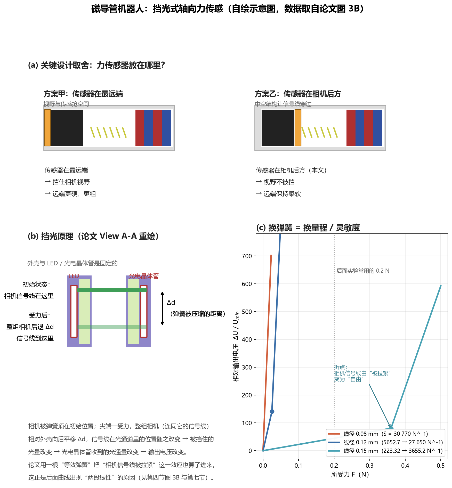
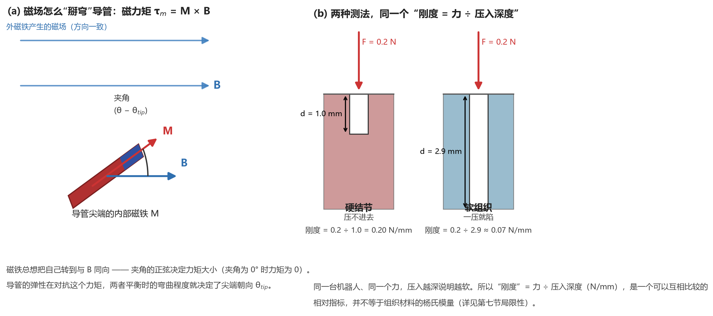

# Magnetic Catheter Robot with Dynamic Force Feedback 精读笔记

> **论文**：Magnetic catheter robot with dynamic force feedback for stiffness identification and abnormality detection（带动态力反馈的磁导管机器人：用于刚度识别与异常检测）
> **作者**：Haolan Shen, Zhengwei Li, Shixiong Fu, Mingguo Jiang, Mingxue Cai, Zhiqiang Chen, Hongwei Wang, **Long Cheng\***, **Tiantian Xu\***（前三作者共同一作）
> **期刊**：Fundamental Research（Elsevier / KeAi，中国主办），DOI: [10.1016/j.fmre.2026.03.014](https://doi.org/10.1016/j.fmre.2026.03.014)，**CC BY 4.0 开放获取**
> **投稿时间线**：2025-04-02 收稿 → 2026-03-23 修回 → 2026-03-26 接收
> **单位**：中科院深圳先进技术研究院（SIAT）、中国科学院大学、中科院自动化所（IA-CAS）、阜外云南医院
> **阅读对象**：**磁学、光学、机器人学零基础**。
> **数学深度**：只讲原理（每个公式说明"表达什么关系"，不推导）
>
---

## 一、一句话看懂这篇论文

**做的事**

现有的支气管镜、胃镜只能看，不能测力。判断一块组织是硬是软，全靠医生的手感估计，没有数字，也无法重复。本文把一套微型力传感器集成到磁控软导管的远端，让导管一边成像、一边以恒定的力按压组织，再用"接触力 ÷ 压入深度"算出局部组织的刚度，从而定位那些表面形态正常、刚度却偏高的早期病灶。

**传感器怎么测力**

导管远端有一根预压紧的微弹簧。尖端受力，弹簧被压缩，装在弹簧后方的相机连同它的信号线一起后移；信号线在一条对射光路里多挡住一部分光，对面的光电晶体管收到的光减少，输出电压随之改变。

这一步的本质是把"力"换成"位移"，再把"位移"换成"光通量的变化"，最后换成"电压"。三级都是线性的，所以输出电压与受力成正比（ΔV = J(L−D)F/k）。论文报告的有效力分辨率约 0.01 N。

**三个关键设计**

1. **传感器后置**：传感器不放最远端，而放在相机之后。这样既不遮挡成像光路，也让刚性件远离尖端，远端保持柔顺。
2. **中空走线**：相机的信号线从传感器外壳中心穿过。这根线是必须存在的零件，本文让它同时充当光路的遮挡件——**把必须存在的零件变成了功能零件**。
3. **弹簧可换**：线径 0.08 / 0.12 / 0.15 mm 三种微弹簧，同一套结构对应不同量程与灵敏度，灵敏度跨 223.32 – 30 770 N⁻¹，量程覆盖 0.025 – 0.5 N。

**最需要用实验守住的一步**

传感器后置带来一个直接质疑：力必须穿过一段会弯曲的管身才能到达传感器，导管弯曲会不会影响轴向力的传递？

论文用图 3E 回答：在 15° / 30° / 60° / 90° 四个弯曲角下分别做标定，论文报告四个角度的力-输出关系保持单调、灵敏度相当（monotonic 与 comparable sensitivity；我从图上读到四条曲线高度贴近）；图 3F 再与商用 ATI 力传感器做动态对比，波形与峰值吻合。**这是全文最扎实的工作，也是"后置布局"这个设计能否成立的支点。**

**学术定位**

本文属于"系统集成 + 严格验证"型工作，不是传感原理的首创。论文自述是 building upon the previously developed optoelectronic sensor [45]——遮挡式光电传感原理来自课题组此前的成果；本文的新意在于远端结构适配、弹簧可换的档位设计，以及三级递进的实验验证。在 BME 器械类论文里这是完全成立的一类贡献，但需要清楚它属于哪一类。

---

## 二、背景与动机：为什么做这个

### 1. 微创手术（MIS）与柔性内镜

- **微创手术（minimally invasive surgery, MIS）**：不开大刀，通过人体天然孔道（口、鼻、尿道、肛门）或几个小孔伸入器械做诊断和治疗。好处是创伤小、恢复快。
- **柔性内镜（flexible endoscopy）**：一根可以弯的软管子，前端带摄像头和灯，从口鼻伸进气管/胃/肠里看。**支气管镜**看肺，**胃镜**看胃，**肠镜**看肠。

**问题**：现在的内镜**几乎全靠"看"**。医生看到的是图像，手上**没有"力"的数字**。

### 2. 为什么"光看"不够：早期病变表面没线索

论文引言的原话意思是：呼吸、消化、泌尿三大管腔里那些**扁平、黏膜下、只有硬度改变**的早期病灶，**表面形态往往没有明显线索**，因此光凭视觉很难发现或定性。

- **黏膜下（submucosal）**：长在管腔最内层（黏膜）**下面**的病灶。上面盖着一层正常的黏膜，从里面看是**平的**。
- **但**：病理组织（肿瘤、纤维化、结节）通常**比周围健康组织更硬**。

所以医生在做内镜时，本能地会用器械去**戳一戳、按一按**——这就是"触诊（palpation）"。问题在于：**这个"戳"全凭手感，没有数字、不可重复、高度依赖经验**。不同医生按的力不一样，同一个医生两次按的也不一样。

> 🔧 **论文的因果链，理一遍**：
> 看得见但摸不着 → 早期病灶（平的、硬的）漏诊 → 需要"力"这个新信息通道 → 但普通导管没有力传感器 → 需要把力传感器装到能进管腔的机器人尖端。

### 3. 磁连续体机器人（MCR）—— 先把三个词拆开

| 词                           | 意思                              | 一句话类比        |
| --------------------------- | ------------------------------- | ------------ |
| **连续体机器人**（continuum robot） | 没有关节、整根都能弯的机器人，形状是连续曲线          | 像章鱼手，而不是像机械臂 |
| **磁**（magnetic）             | 靠**体外**磁铁产生的磁场远程驱动，**体内不放任何电机** | 用磁铁隔空拨动指南针   |
| **导管**（catheter）            | 细长的软管子，本来就是介入手术的标准器械            | 一根很细的软吸管     |

合起来 **MCR = magnetic continuum robot（磁连续体机器人）**：一根细软管，里面埋了几颗小磁铁，外面用大磁铁一晃，它就跟着弯。

**为什么这个方向诱人**：
- **体内没有电机、没有电池、没有传动丝** → 可以做得很细、很软、很安全。
- **远程驱动** → 医生在大磁铁旁边操作，不用手直接推导管。

论文的引言把 MCR 的发展梳理成几条线（结构创新、反向磁化、遥操作导航、多功能介入等），并点名了若干团队的工作（Nelson 组的变刚度磁导管、Liu 组的反向磁化结构、Zhao 组的磁导丝神经介入、Xu 组的磁导航+推进、Zhang 组的主动运动、Xie 组的内镜+活检+变刚度、Pittiglio 组的肺部磁内镜+光热治疗）。这些是文献综述，读的时候知道"这个领域很热闹"就够了。

### 4. 力从哪来？两条路线

论文把"在 MCR 尖端拿到接触力"的做法**明确分成两类**：

|        | **路线甲：模型间接估计**                                           | **路线乙：传感器直接测量**                                                              |
| ------ | -------------------------------------------------------- | ---------------------------------------------------------------------------- |
| 做法     | 不装传感器。量机器人自身的变形（形状），用数学模型**反推**尖端受力                      | 在尖端装微型力传感器，直接读数                                                              |
| 论文举的例子 | Wang 等用有限差分法同时解连续体变形与末端接触力；Dreyfus 等用拉格朗日乘子仿真法建模接触       | 压阻式（Chuang）、液态金属电阻式（Wang）、电容式（Lee、Nagatomo）、光纤光栅 FBG（Gonenc）、法布里-珀罗 FP 腔（Li） |
| 优点     | 不增加尖端硬件，不占空间                                             | 直接、量纲清楚、不受模型误差影响                                                             |
| 致命伤    | **精度极度依赖建模假设、材料参数、边界条件**。而 MCR 的变形又大又随姿态变化，模型在真实工况下很容易不准 | 结构层 / 电极图案 / 流体通道**塞不进**"远端磁铁 + 成像通道"占满的截面积；输出还受大弯曲下的局部变形与迟滞影响               |

论文对 **FBG（光纤布拉格光栅）** 的批评最详细，值得单独记住：

1. **FBG 测的是"应变"，不是"力"**。大弯曲本身就产生应变，会和接触产生的应变**混在一起**，必须用多根光栅/多根光纤 + 复杂解耦模型才能分开——而解耦要用的空间，正是本来就不够的截面积。
2. **FBG 的解调要靠又大又贵的光学仪器**（解调仪），这和"内镜器械要便宜、要一次性"的临床要求**直接冲突**。

> 📌 **一句话总结这一节**：路线甲"不占地方但不可靠"，路线乙"可靠但塞不进去"。本文要做的，就是**在路线乙里找一个"塞得进去"的方案**。

### 5. 本文的取舍：只测轴向力

论文非常明确地写了它的判断依据（这是本文设计上最关键的取舍）：

> "In many lumen-based diagnostic tasks, clinicians primarily rely on **axial contact force** rather than full three-axis loads. Consequently, the added complexity of multi-axis FBG architectures does not necessarily yield proportional benefits."

翻译：**在很多管腔诊断任务里，医生主要关心"顺着管轴方向按下去的力"，而不是完整的三维力。** 既然三轴 FBG 带来的复杂度换不来成比例的收益，那就**只做单轴**。

> 💡 **我的理解（标注：这是我的解读，不是论文原话）**：这个取舍不是"我们做不到三轴"，而是"我们先论证了三轴没必要"。这是把工程约束**转化成需求论证**的写法——先立论"临床只要单轴"，再顺理成章地做单轴。这种写法在答辩时很占优势，但也要小心：**单轴意味着无法区分"压到了"和"侧向擦到了"**（后面第七节我会展开）。

---

## 三、必须先理解的核心概念（从"力"开始，零基础版）

### 概念 0：力、压强、刚度 —— N 和 N/mm 在读什么

- **力（force）**：推或拉的作用，单位**牛顿（N）**。
  手感标尺：一个鸡蛋大约 0.5 N 重；你用手指轻轻按桌面，大约 1～5 N。
  **本文工作在 0.01～0.5 N 量级**——比"一个鸡蛋重"还小两个数量级，是**极轻的触碰**。
- **压强（pressure）**：力除以面积，单位**帕（Pa）= N/m²**。同样的力，接触面积越小压强越大。
- **刚度（stiffness）**：让物体变形 1 个单位需要多大的力，单位 **N/mm**（或 N/m）。
  刚度 0.2 N/mm 的意思是：**每压进去 1 毫米，需要 0.2 牛顿的力**。

### 概念 1：胡克定律与弹簧刚度 k

- **弹簧**：你压它，它就缩；你松手，它弹回来。
- **胡克定律（Hooke's law）**：在一定范围内，弹簧的**压缩量**和**所受的力**成正比。
  **压缩量 Δd = 力 F ÷ 弹簧刚度 k**
- 弹簧**越软（k 越小）**：同样的力压下去，缩得越多。
- 弹簧**越硬（k 越大）**：同样的力压下去，几乎不动。

**这就是本文的第一层"翻译"**：把"力"翻译成"位移"。
**为什么用弹簧**：因为**位移比力好测得多**——你没法用一个小电子元件直接读出 0.01 N 的力，但你可以很容易地测出 0.01 N 让一根软弹簧缩了多少微米。

> 论文用的是 **304 不锈钢微弹簧**，外径 2 mm、长 3 mm，线径有 **0.08 / 0.12 / 0.15 mm** 三种。
> **线径越细 → 弹簧越软（k 越小）→ 同样力缩得越多 → 越灵敏，但量程越小。**这是本文"换弹簧换档位"的物理基础。

### 概念 2：LED 与光电晶体管 —— 把"亮暗"变成"电压"

- **LED（发光二极管）**：通电就发光的半导体。本文用 **940 nm 波长**的红外 LED（型号 XL-1608IRC940，0603 封装——"0603"指长 0.06 英寸×宽 0.03 英寸，约 1.6 mm × 0.8 mm 的贴片尺寸）。
- **光电晶体管（phototransistor）**：反过来，**照到光就导电**的半导体（本文型号 MPT60363T，同为 0603 封装）。
  - 光越强 → 通过它的电流越大；
  - 接一个电阻就变成电压：**光越强 → 输出电压越大**。

**这一对组合就是最简单的"光开关"**：中间不挡东西，光全过去，输出大；中间挡一半，输出小。
**打印机、电梯门、自动感应水龙头**用的都是这个原理。

> 📌 论文还引用了一个前提（文献 [46]）：**在一定范围内，光电晶体管的输出电压与光通量成线性关系**。这句话很重要，它是后面所有线性公式的合法性来源。

### 概念 3：挡光式位移传感 —— 本文的物理地基 ⭐

把概念 1 和概念 2 拼起来，就是本文的传感器：

```
  受力 F
    ↓
微弹簧被压缩 Δd          （概念 1：力 → 位移）
    ↓
相机（连同它的信号线）相对外壳后移 Δd
    ↓
信号线在光通道里的位置变了，挡住的光量变了   （概念 2 的"挡光"）
    ↓
光电晶体管收到的光通量变化
    ↓
输出电压变化 ΔV          （能被电脑读到的电信号）
```



**论文图 1 左下角那张"View A-A"（我按它重画在自绘图 (b) 里）**画的正是这个：

- 紫色的两瓣是**传感器外壳**，外壳上开了**光通道**（图中浅绿色）；
- 通道里嵌着 **LED（左）** 和 **光电晶体管（右）**，二者隔着中间的**空心腔**相对；
- 中间那根**深绿色的线**，是**相机的信号线**——也就是内窥镜摄像头把图像传回后端的电缆；
- 相机被弹簧顶在初始位置；尖端一受力，**整组相机连同信号线向后平移 Δd**，信号线在光通道里的位置随之改变，遮住的光量也就变了。

**论文给出的定量关系**（原文公式 2）：

> **输出电压的变化量 ΔV = Δd × (L − D) × J**
> 其中 **L** 是外壳上光通道的宽度，**D** 是相机信号线的直径，**J** 是"输出电压 ↔ 光通量"的线性系数。

- **(L − D)** 可以理解为**光通道的"净开口宽度"**（通道宽度减去被信号线本身占掉的宽度）。它是一个由设计尺寸决定的**常数**。
- 因为 Δd 又和 F 成正比（概念 1），所以最终 **ΔV 与 F 成正比**——**这就是为什么传感器输出是线性的**。

> ⚠️ **一个论文没有讲透的点（我读出来的，供你带着问题去读原文）**：
> 论文正文对机理只给了一句概括——"弹簧压缩 → 相机座位移 → 部分挡住发出的光 → 接收光通量下降"，然后就给出了公式 (2)。至于**"一根沿轴方向的信号线，沿轴移动 Δd，为什么会让横向的光路被挡得多/少"这个三维细节，正文没有展开**。论文把这一原理追述到它自己的参考文献 **[45]**（Li 等人 2023 年发表在 *Soft Robotics* 上的"有意遮挡式光电柔性压力传感器"）。
> **所以我的判断是**：传感链（力→位移→光→电）和线性关系是清楚的、工程上可复现的；但如果你要把光路几何**一比一复原**，需要去读 [45]。
> **这不是论文的漏洞，而是主刊篇幅的取舍**——但读的时候要知道边界在哪里，不要自己脑补一个"信号线像闸门一样平移"的动画。

### 概念 4：从力到位移再到电压：完整传感链 + "两段线性"是怎么来的

把概念 1 和概念 3 串起来，得到论文的**核心公式**：

> **ΔV = Δd × (L − D) × J = J(L − D)/k × F**

各符号：**F** 力；**k** 弹簧刚度；**Δd** 弹簧压缩量；**L** 光通道宽度；**D** 信号线直径；**J** 电压-光通量系数；**ΔV** 输出电压变化。
因为 S、L、D、k 都是常数，**输出电压与所受力成正比**。

**那"两段线性"又是怎么回事？** 这是本文一个很真实、很值得学的工程细节：

- 装配完成后，弹簧是**预压缩**的（先被压了一点，才能顶住相机）；
- 于是**相机的信号线是被拉紧的**——论文说，这时候**信号线本身可以看成"另一根弹簧"（等效弹簧）**；
- 外力出现时：
  - **第一阶段**：主弹簧继续被压 + 那根"信号线等效弹簧"被放松 → 两者共同变形 → 得到**第一段斜率**；
  - **第二阶段**：信号线回到自由状态，"等效弹簧"消失了 → 只剩主弹簧 → 得到**第二段斜率**（更陡）。

> 论文的实验数据完全对得上这件事（图 3B）：
> - 线径 0.15 mm：0–0.36 N 段斜率 **223.32 N⁻¹**（R² = 0.6869），0.36–0.5 N 段斜率 **3655.2 N⁻¹**（R² = 0.9779）
> - 线径 0.12 mm：0–0.025 N 段 **5652.7 N⁻¹**（R² = 0.8572），0.025–0.05 N 段 **27650 N⁻¹**（R² = 0.6923）
> - 线径 0.08 mm：0–0.025 N 段 **30770 N⁻¹**（R² = 0.9724）
>
> **第二段的 R² 明显比第一段高**，正是因为第二段是"纯弹簧"，行为更干净。

**论文承认这是缺陷，并给出了修法**：未来在相机信号线表面加上**不可拉伸的纤维（non-stretchable fibers）**，把"等效弹簧"这个效应消掉。

> 💡 **我补充的**：这个"等效弹簧"的细节，暴露了一个更深的问题——**传感器的读数依赖于"信号线当前被拉紧多少"**。而这根线在体内会被反复弯折、反复拉紧放松。论文只做了 1000 次小量程（0–0.02 N）的循环测试，**没有报告"线被长期反复弯折后，这个等效弹簧会不会变"**。这是第七节我要提的一条独立局限。

### 概念 5：磁场对磁铁的两种作用 —— 磁力与磁力矩 ⭐

**这是全篇最需要从零补背景的地方。** 下面按顺序一步步推，每一步只解决一个问题。

#### 第 1 步：磁场是什么

磁场是磁铁周围的一层"作用空间"。你往里面放另一块磁铁，它就会受到作用。这个作用只有两种表现形式：**被推（或拉）**，**被扭转**。本文整篇的磁学部分，就是在处理这两种作用。

#### 第 2 步：怎么描述一块小磁铁的"强弱与朝向"—— 磁矩 M

一块磁铁有 N、S 两个极。如果只关心它在远处产生什么作用，那么不管它的形状多复杂，都可以用一个箭头来代表：**箭头方向从 S 极指向 N 极，箭头长度代表它有多强**。这个箭头就叫**磁矩（magnetic moment），记作 M**。

- **为什么一个箭头就够了**：因为距离足够远时，一块有限大小的磁铁与"一个理想化的点磁偶极子"产生的作用几乎一样。这正是后文公式 (7) 的**磁偶极子模型**。
- 本文有两处用到 M：导管尖端内埋的 IPM 有它的 M；体外大磁铁（EPM）也有它的 M。

#### 第 3 步：力矩是什么

**力矩（torque）**是"能使物体转起来的作用"，等于**力 × 力臂**，单位 N·m。

- **力臂**：力的作用线到转轴之间的**垂直距离**。
- **为什么门把手装在离铰链最远的地方**：同样的推力，力臂越长，产生的力矩越大，门越容易开。
- **关键区分**：**力和力矩是两个不同的量**。力使物体平移，力矩使物体转动。一个物体可以受到很大的力却完全不转，也可以**合力为零却转得很厉害**——第 4 步马上就会遇到后一种情况。

#### 第 4 步：为什么磁铁在磁场里会被扭转

把磁矩为 M 的磁铁放进磁场 B 里。磁场对 N 极有一个作用力，方向沿 B；对 S 极有一个作用力，方向与 B 相反。于是：

- 这两个力**大小相等、方向相反** → **合力为零** → 磁铁整体不会被推走；
- 但这两个力**不作用在同一条直线上** → 它们构成一对**力偶** → 产生一个**纯扭转作用**。

这就是磁铁在磁场里"总想转到与 B 同向"的原因。**指南针指北，本质上就是地球磁场对指南针指针施加了这个扭转作用，指针转到与地磁场同向后就停住了。**

#### 第 5 步：这个扭转作用有多大 —— τ = M × B

论文写作：

> **τ = M × B**

- **M**：磁铁的磁矩（第 2 步）；
- **B**：该处的磁感应强度；
- **×**：**叉乘**。两个矢量做叉乘，结果仍是矢量：方向由**右手定则**确定（右手四指从 M 转向 B，拇指所指即 τ 的方向），大小等于 M·B·**sin θ**，θ 是 M 与 B 的夹角。

**为什么大小里会出现 sin θ**，这一点值得单独说清：**只有 M 中"垂直于 B"的那个分量，才真正参与扭转。**

- **θ = 0°**（M 与 B 已同向）：M 全部沿着 B，垂直分量为 0 → **力矩为 0**，磁铁稳定不动；
- **θ = 90°**（M 与 B 垂直）：M 全在垂直方向上 → **力矩最大，等于 M·B**；
- 中间角度：介于两者之间，正比于 sin θ。

#### 第 6 步：什么时候磁铁会被"推动"，而不只是被扭转

第 4 步的结论建立在一个前提上：**N 极和 S 极受到的力大小相等**。什么时候会不相等？**当磁场在空间上不均匀的时候。**

- **均匀磁场**：空间中每一点的 B 方向一致、大小处处相同。此时两极受的力必然大小相等 → **合力为零，只有力矩**。
- **不均匀磁场**：B 的大小或方向在空间中变化。此时两极所在位置的 B 不同 → 受力大小不等 → **合力不为零 → 磁铁整体被推动**。

论文把这个净推力写作：

> **F_m = (M · ∇) B**

- **∇**（读作 nabla）是**梯度算子**，含义是"某个量在空间中的变化率"；
- 整个式子的意思是：**如果磁铁所在位置的磁场在空间上有疏密变化或方向变化，磁铁就会受到一个净推力**。

> 📌 **一句话结论**：**磁场均匀 → 只有扭转，没有推拉；磁场不均匀 → 既有扭转，也有推拉。**



#### 第 7 步：本文怎么用这两条

论文在第 2.2 节说明了两点：

1. 在**转向工作区（steering workspace）**内，体外永磁铁产生的磁场**梯度很小，接近均匀**。所以在导管尖端处，**磁力主要沿导管轴向，几乎不参与弯曲**；
2. 因此，**弯曲模型里只保留力矩项 τ = M × B**，磁力项被略去。

> 📌 **分工记住这一句**：**使导管弯曲，靠磁力矩（M × B）；沿轴向拉动导管，靠磁力（(M·∇)B）。** 本文的转向工作区里磁场接近均匀，所以弯曲是主角、拉动是配角。

#### 第 8 步：数学上的一个替代（论文自己说明的）

论文说，体外磁铁的位姿是**直接在笛卡尔空间里下命令的**，UR10 机械臂**内部自行求解逆运动学**。因此，**磁场的 B(P) 与梯度 ∇B(P) 完全由"命令的磁铁轨迹"决定**，作者**不需要在自己的模型里推导逆运动学**。

> 💡 **我补充的**：这是把运动学难题外包给商用机械臂平台的做法。UR10 自己会算逆解，作者只需关心"磁铁在哪 → 尖端感受到什么场"。这让模型干净很多，但也意味着**本文的磁学部分是"半开环"的**——磁铁实际是否到位、磁场标定是否准确，正文没有展开（这是第七节的一条独立局限）。

### 概念 6：磁连续体机器人（MCR）—— IPM 与 EPM

本文的术语表里有两个必须分清的缩写：

| 缩写 | 全称 | 是什么 |
| --- | --- | --- |
| **IPM** | internal permanent magnet，**内部永磁体** | 埋在**导管尖端**里的那几颗小磁铁。本文是**多段环形钕铁硼（NdFeB）磁铁**，直径 2 mm、高 1 mm 一片，串成一串 |
| **EPM** | external permanent magnet，**外部永磁体** | 体外的**大磁铁**。本文是一块 **N52 圆柱形钕铁硼，直径 60 mm、厚 60 mm**，装在 **UR10 机械臂**上 |

**工作原理**：
- 大磁铁（EPM）产生磁场 **B**；
- 尖端小磁铁（IPM）感受到 B，**被力矩掰转**，想与 B 同向；
- 但 IPM 是**焊死在软导管里**的，它转不了 → **只能带着整根导管一起弯**；
- 导管弯曲的弹性在对抗这个力矩，**两者平衡时，导管的形状就定了**。

**所以"控制导管形状" = "控制大磁铁的位置和姿态"**。大磁铁移到哪、转到哪，导管就跟着摆到哪。

> 💡 **那么"位置和姿态"到底是几个数？论文里那个"12 个控制按钮"又是怎么来的？** 论文没有解释，但这是理解整个操控接口的地基，值得从头说清。

#### 第 1 步：先说"位姿"这个词

**位姿 = 位置 + 姿态**（英文 pose）。

- **位置**：这个东西**在哪**；
- **姿态**：这个东西**朝哪**。

这两件事**互相独立**——一个物体可以待在原地只转个方向，也可以朝向不变只换个地方。所以要完整描述一个物体的状态，这两件事都得说。

#### 第 2 步：位置要用几个数？—— 3 个

我们生活的空间是三维的，定位一个点需要**三个互相垂直的方向**各给一个数：

| 数 | 方向 | 通俗说法 |
| --- | --- | --- |
| **x** | 前 ↔ 后 | "往前一点" |
| **y** | 左 ↔ 右 | "往左一点" |
| **z** | 上 ↔ 下 | "往上一点" |

**类比**：告诉别人你的座位在哪，只说"在教室里"不够，得说"**第 3 排、第 5 列、2 楼**"——三个方向各一个数，位置就唯一确定了。**少一个说不清，多一个也是多余。**

#### 第 3 步：姿态要用几个数？—— 也是 3 个

知道物体在哪还不够。同样放在桌上的一台相机，可以镜头朝前、朝上、或者整个歪着——**位置完全一样，姿态完全不同**。

姿态怎么用数字描述？办法是：**把它拆成"绕三根互相垂直的坐标轴各转了多少度"**，记作 **rx / ry / rz**。

**类比（最好用的一个）：你的头。**

头的位置是 3 个数（脖子在哪）。而头**朝哪**，也正好是 3 个数——因为头能做三种**互相独立**的转动：

| 动作 | 通俗说法 |
| --- | --- |
| 左右转头 | "向左看 / 向右看" |
| 上下点头 | "抬头 / 低头" |
| 往肩膀歪头 | "把头歪向左边 / 右边" |

这三种动作互相独立：你可以**不点头就摇头**，也可以**不摇头就歪头**。三个角一定，头的朝向就唯一确定了。

> 📌 **一个反直觉但重要的事实**：**任何**姿态——不管多刁钻——都能用"绕三根轴各转一个角度"达到。所以姿态**不多不少，正好 3 个数**。
> （具体哪根坐标轴对应哪种转动，取决于你怎么建坐标系；**关键的是恰好三个、且互相独立**。）

#### 第 4 步：所以"位姿" = 3 + 3 = 6 个数

> **位置 3 个（x, y, z） ＋ 姿态 3 个（rx, ry, rz） ＝ 6 个数**

这 6 个数就是"**6 自由度（6-DOF）**"的字面意思：

> **要完全确定一个刚体在空间里的状态，需要且只需要 6 个数。**

图 6A 图注里写的 "the **6-DOF** actuation magnet"，说的就是这块磁铁**需要 6 个数才能说清它处在什么状态**。

#### 第 5 步：为什么这块磁铁恰好需要全部 6 个？

因为**尖端感受到的磁场，是被磁铁的"位置"和"姿态"一起决定的**：

| 磁铁的什么              | 主要影响尖端的什么                   |
| ------------------ | --------------------------- |
| **在哪**（x, y, z）    | 该处**磁场的强弱与梯度** → 决定**力的大小** |
| **朝哪**（rx, ry, rz） | 该处**磁场的方向** → 决定**导管被掰向哪边** |

关键在于这块磁铁是**轴向充磁（axially magnetized）**的——N 极和 S 极就在圆柱的上下两个端面上，磁力线从一端穿出、从另一端穿回。所以磁铁的**朝向直接就是磁场的方向**：朝向一变，尖端被掰的方向就变。

> ⚠️ **准确一点说**：位置和姿态其实**互相影响**（把磁铁挪个地方，该处的场强和场方向都会变）。上表是"主要作用"的简化，用来建立直觉，**不是严格的解耦**。

**结论**：要想独立地设定"尖端受多大的力"和"尖端往哪个方向被掰"，就得能独立设定这 6 个数——**一个都不能少**。

#### 第 6 步：手动点动 —— 为什么每个数要配两个按钮

现在问题变成：**操作者怎么实时地改这 6 个数？**

论文用的办法叫**点动（jog）**，这是工业机器人示教器上的标准操作：

> **按住按钮 → 这个数按固定步长持续地加（或减）；松开按钮 → 停。**

**为什么用点动，而不是让操作者输入数值？** 因为操作者必须**一边盯着内镜画面、一边调**。如果改成低头敲键盘输数字，眼睛就离开了画面，**"看—调—再看"这个闭环就断了**。点动是"手不离按钮、眼不离画面"的最笨但最合用的方案。

而**每个数既要能变大、也要能变小**，所以每个数配**两个按钮**：

> **6 个数 × 2 个方向 ＝ 12 个按钮**

这也正好和论文那句话对上了：**"twelve independent control buttons adjusted the magnet pose"**——十二个按钮，调的是**磁铁的位姿**。

#### 第 7 步：把这 12 个按钮列出来

| 按钮 | 作用 |
| --- | --- |
| **x+ / x−** | 磁铁往前 / 往后挪一点 |
| **y+ / y−** | 磁铁往左 / 往右挪一点 |
| **z+ / z−** | 磁铁往上 / 往下挪一点 |
| **rx+ / rx−** | 磁铁绕 x 轴正转 / 反转一点 |
| **ry+ / ry−** | 磁铁绕 y 轴正转 / 反转一点 |
| **rz+ / rz−** | 磁铁绕 z 轴正转 / 反转一点 |

> ⚠️ **这个"6 × 2"的分解是我从两块拼图拼出来的，论文没有写出这一步。**
> 论文只给了：① 3.4 节"twelve independent control buttons **adjusted the magnet pose**"（按钮调的是**磁铁的位姿**）；② 图 6A 图注"**6-DOF** actuation magnet"。**6 个自由度 × 2 个方向 = 12，是唯一自然凑得上的解释。**
> 也存在另一种可能：12 个按钮对应 UR10 机械臂的 **6 个关节 × 2 个方向**（关节空间点动）。
> **两种读法都不影响结论**——不管是笛卡尔空间的 6 个位姿量，还是关节空间的 6 个关节角，这 12 个按钮都是**与解剖无关的通用接口**，换个器官一个都不用改。

#### 第 8 步：但"这 6 个数"是磁铁的，不是尖端的 —— 这才是这个接口真正的短板

到这里正好能回答一个很自然的问题：**"6×2 够不够用？是不是该 6×4？"**

**要先分清问的是哪一件事：**

| 问题 | 答案 |
| --- | --- |
| **"能不能到达任意位姿？"** | **够。** 这 6 个数张成完整的 6 维空间，按任意序列组合这 12 个按钮，**任何位姿都到得了**（这跟工业示教器上的六轴点动是一回事） |
| **"能不能自由、连续地移动？"** | **不够。** 见下面三条 |

**"不够"的三条具体原因**：

1. **一步一格**——松开按钮就停，目标点落在格子中间时只能停"附近"，不能停在任意位置；
2. **一个鼠标按不了两个按钮**——想斜着走（比如同时 x+ 和 rz−）只能**交替按**，轨迹是**锯齿状的折线**，不是直线；
3. **点动步长论文一字未提**——"按一下磁铁挪多远"直接决定转向的分辨率，这个数不给，"这接口能有多细、多快"就无从评估。

**但比"按钮够不够"更根本的问题是这个**：

> **按钮调的是"磁铁的位姿"，而操作者真正想控制的是"尖端"。这两者之间不是一回事。**

尖端怎么动，取决于**尖端当前相对磁铁在哪个位置**——**同一个"x+"按钮，尖端在不同位置会往不同方向动、动不同的量**。这个映射是**非线性、且随构型变化**的。

后果：**哪怕换成 6×4、7×4 个按钮，或者给你一个完美的 6 自由度连续主手，操作者仍然要实时补偿这个非线性。多几个按钮一点忙都帮不上。**

**正确的修法不是加按钮，而是把控制变量从"磁铁"换成"尖端"**：

> 操作者说"**尖端往前 1 mm**""**尖端往左偏 5°**"，
> 系统**反解**出磁铁该挪到哪、转到什么角度，然后执行。

这样操作者面对的接口就是**线性、直观**的，所有非线性都藏在机器的反解里。

**而论文其实已经这么做过一次**——那个"接触目标后**自动前进 2 mm**"的专用按钮，做的就是这件事：操作者不说"推进器怎么转"，只说"**尖端要动 2 mm**"，剩下的交给编码器反馈。**但只做了这一条轴。**

> 详见第七节 **B15**（导航自主化这条局限性的完整版）与第八节 **B8**（改进方向）。

### 概念 7：欧拉-伯努利梁与常曲率（PCC）—— 为什么作者要先建模

#### 第 1 步：为什么必须先建模型

导管伸进体内之后，**你无法直接测量它弯成了什么形状**——里面没有形状传感器。但有两件事你必须知道：**尖端现在在哪**、**尖端现在朝哪个方向**。不知道这两件事，就没法控制它，也没法知道你按到了哪里。

系统里唯一"已知"的输入是：**体外磁铁的位置和姿态**（这是你用摇杆和按钮下命令的）。所以模型要回答的问题是：

> **给定外部磁铁的位姿 → 求出导管远端弯成什么形状、尖端在哪、朝哪。**

#### 第 2 步：把这个问题拆成两小步

这一步很关键，拆开之后就都不难了：

- **子问题 A：这一段管弯得有多"急"？** —— 磁场提供的力矩与导管自身的抵抗两者平衡，决定了弯曲的急缓程度。答案是一个叫**曲率 κ** 的量。
- **子问题 B：一段弯成这样的管子，尖端转了多少、跑到哪里去了？** —— 这是一个纯几何问题，和力无关。

论文的做法是：**先用常曲率假设解决 B（几何），再用梁理论解决 A（力学），最后把两者接到一起。**

#### 第 3 步：子问题 B —— 常曲率假设（PCC）

**曲率（curvature）κ 是什么**：描述一条曲线"弯得有多急"的量。直管 κ = 0；κ 越大，弯得越急。它与"圆弧半径 R"是倒数关系：**κ = 1/R**。半径 50 mm 的圆弧，曲率就是 1/50 = 0.02 mm⁻¹。

**常曲率假设（piecewise-constant curvature, PCC）**：把导管分成若干段，**假设每一段都弯成一段标准圆弧**（也就是这一段上 κ 处处相等），段与段之间可以有不同的 κ。

这个假设让几何变得极简单。对一段圆弧，只要知道三个量——**曲率 κ、这段弧长 L、以及起点朝向**——就能算出终点的一切：

> **θ_tip = κ · L**（公式 9）—— **尖端转过的角度 = 曲率 × 弧长**
> **x = (1/κ)(1 − cos(κL))**，**y = (1/κ)sin(κL)**（公式 10、11）—— **尖端相对起点的位置坐标**

公式 9 最直观：**"单位长度上转多少弧度"乘以"一共多长"，就是总共转过的角度**——这正是"曲率"这个词的字面含义。公式 10、11 只是把圆弧的几何关系写成坐标形式，不需要背，知道它们是"由 κ 和 L 算出尖端坐标"就够了。

#### 第 4 步：子问题 A —— 力矩决定弯曲的急缓，但导管自身会抵抗

现在需要回答："力矩 τ 加在这段管子上，它弯到什么程度？"

这里需要一个量来描述**导管自身有多不情愿被弯**。论文用的是：

> **κ = τ_m / (E·I)**（公式 8）

- **E**：材料的**杨氏模量（Young's modulus）**，衡量材料"被拉伸或压缩时有多不情愿"，单位 MPa；
- **I**：截面的**二次矩（second moment of area）**，只由**截面的几何形状**决定、与材料无关，单位 mm⁴。截面越粗，或材料分布得越"远离中轴"，I 越大；
- **E·I** 合起来叫**抗弯刚度（bending stiffness）**，描述这根管子在整体上有多难被弯。

公式 8 的意思就是：**弯曲的急缓程度 = 施加的力矩 ÷ 管子的抗弯刚度**。力矩越大弯得越急；管子本身越难弯，同样的力矩下弯得越轻。

#### 第 5 步：但这里出现了一个循环

公式 8 需要知道力矩 τ。而力矩是多少呢？回到概念 5 第 5 步——**力矩大小正比于 sin θ，θ 是磁矩 M 与磁场 B 的夹角**。

本文里，磁矩 M 固定在导管尖端、**跟着导管一起转**。所以：

> **τ_m = B · M · sin(θ − θ_tip)**（公式 12）

- **θ**：磁场 B 在弯曲平面内的方向；
- **θ_tip**：**导管尖端当前的朝向**——正是我们想求的那个未知量；
- **(θ − θ_tip)**：磁场方向与尖端朝向之间的夹角。

**看清这里的循环**：

- 想知道尖端朝向 θ_tip，需要先知道力矩 τ（公式 8、9）；
- 想知道力矩 τ，需要先知道尖端朝向 θ_tip（公式 12）。

**未知量出现在了自己的计算路径上。**

#### 第 6 步：合成隐式方程

把公式 12 代入公式 8，再代入公式 9，就得到论文的公式 (13)：

> **θ_tip = (L·B·M / E·I) · sin(θ − θ_tip)**

读它的方式：**等号左边是尖端最终的朝向，等号右边是"磁场能提供的力矩 ÷ 导管抗弯刚度"经过几何换算后的结果。两边相等，才叫平衡。**

**物理含义**：磁力矩要把导管尖端转到与磁场 B 同向，导管的弹性在把它往回拉。这两个作用在某个角度上正好打平——**那个角度就是导管最终的形状**。

**为什么叫"隐式（implicit）"**：因为**未知量 θ_tip 同时出现在等号两边**（左边一次，右边的 sin 里面一次），不能一步解出来。求解靠数值迭代：猜一个 θ_tip → 代入右边算出一个新值 → 用新值再算一遍 → 反复几轮，直到前后两次结果几乎不变（收敛）。

> **一个直观的类比**：两个人拔河，绳子最后停在哪？——**两边的力都取决于绳子停在哪**。所以只能"假设一个位置 → 分别算两边的力 → 看是否相等 → 调整 → 再算"，反复逼近。

#### 第 7 步：欧拉-伯努利梁在这里起什么作用

上面第 4 步用到了 E·I，但还没有解释为什么**只有力矩才会使导管弯曲**——而本文整篇设计的合法性，恰好取决于这一点。

**欧拉-伯努利梁理论（Euler–Bernoulli beam theory）**是梁力学里最基础的一套模型，核心假设是：

> **梁的横截面在变形过程中始终保持为平面，并且始终垂直于变形后的中轴线。**

"横截面保持为平面"意味着**同一横截面上各点的轴向变形沿截面高度线性分布**；"保持垂直于中轴"意味着**不计剪切变形**。合起来，它描述的是一种"干干净净地弯"的变形——管子弯曲时不会发生斜向的错动或扭转。

**从这条假设推出的两条结论，正是本文的地基**：

- **轴向加载（沿管子方向压或拉）不会产生弯曲**；
- **弯曲只由力矩造成**。

**为什么轴向力不会造成弯曲**（这一步论文没有展开，是我补充说明的）：轴向力作用在截面的**形心**上，力臂为零，**对截面形心的力矩为零**；而按"横截面保持为平面"的假设，截面上的正应力分布均匀，也不会产生额外的力矩。**没有力矩，就没有曲率**——所以轴向力只让管子受压或受拉，不会让它弯。

> 📌 **这一条对本文有多重要**：
> 它正是本文敢把力传感器**放在相机后面**、并且**只测轴向力**的依据——**"压"不会污染"弯"，"弯"也不会污染"压"，两者在理论上可以分开处理。**
> 但理论成立不等于装配体上也成立。所以论文用**图 3E（15°/30°/60°/90° 弯曲角下的标定）**在实验上验证这个假设在真实结构上是否成立：四个角度的力-输出关系保持单调、灵敏度相当（论文原话是 monotonic 与 comparable sensitivity）。**严格说这只是影响小，不是影响为零——详见下一步。**

#### 第 8 步：弯曲到底影不影响轴向力测量 —— 以及一个合理的反驳

**先把这个反驳摆出来**（这是读到这里最自然会产生的疑问）：

> 导管弯了，弹簧不也跟着弯了吗？光路不也歪了吗？凭什么说弯曲不影响轴向力的测量？

这个质疑是合理的，值得逐条回答。弯曲的影响只可能通过三条路径进来：**弹簧**、**光路**、**力的传递方向**。

**① 弹簧确实会随导管一起弯，但弯矩不由弹簧承担**

要看清结构：**相机的支架套在传感器外壳的孔里，只能沿轴向滑动，弹簧把这个滑动副顶住。** 于是两者的受力分工是明确的：

- **轴向力**只能通过弹簧传递——这是唯一的轴向约束；
- **横向力与弯矩**由**外壳孔壁与相机支架的接触**承担，**不经过弹簧**。

也就是说，导管弯曲时弯矩走的是"外壳—孔壁"这条路，弹簧并不会被施加一个弯矩。**它只感受到轴向力，与整体弯不弯无关。**

再补一个量级：90° 弯曲、弯曲半径 R ≈ 50 mm 时，跨越整个弹簧长度（3 mm）的转角只有 3/50 ≈ **3.4°**。这个量级下，弹簧的轴向刚度基本不变——**弹簧的 k 只由剪切模量 G、线径 d、中径 D 和有效圈数 n 决定（k = Gd⁴/(8D³n)），弯曲不改变其中任何一个。**

> ⚠️ **但有一个例外要记住**：如果弯曲到**弹簧内侧的圈与圈相互贴死**，有效圈数 n 会变，k 就会变。本文的弯曲最大到 90°、R ≈ 50 mm，属于温和弯曲，不会出现这种情况。**这一句是我补充的判断，论文没有讨论圈间接触。**

**② 光路其实没有被"弄乱"——因为 LED 和光电晶体管在同一块刚体上**

这一点是理解光路的关键：**LED 和光电晶体管都装在传感器外壳上**（图 2B(iii)：把嵌有这两者的柔性电路弯折后固定进外壳的槽位）。它们之间的相对位置**由外壳这块刚性件锁定**。

导管弯曲时，整个外壳作为一块刚体一起转——**LED 与光电晶体管之间的相对几何完全不变，光轴也不会弯**。真正会相对移动的，只有那根**相机信号线**：它装在可滑动的相机支架上，沿轴向移动。

再看量级。光学通道沿轴向的长度约 2.4 mm（就是外壳的直径量级）。在 R ≈ 50 mm 下，这 2.4 mm 跨越的转角是 2.4/50 ≈ 0.048 rad ≈ **2.7°**，弦与弧的最大偏离（拱高）：

> 拱高 = R(1 − cos(θ/2)) = 50 × (1 − cos(0.024)) ≈ **0.014 mm = 14 µm**

而且这 14 µm 是"外壳和信号线**一起**整体旋转"造成的，**两者之间的相对关系几乎没变**。所以光路并没有变得不规则——它只是被整体转了一下。

**③ 真正该担心的第三条：滑动副的摩擦**

上面①说弯矩由"孔壁接触"承担，但这有个代价：**接触就有法向压力，有法向压力就有摩擦，而摩擦力是沿轴向的。** 于是：

> **弯得越厉害 → 侧向接触压力越大 → 滑动副摩擦越大 → 测出的力里混进一个与弯曲程度相关的摩擦项。**

后果不是"标定曲线完全不能重合"，而是引入一个**与弯曲角相关的迟滞（hysteresis）**——加载和卸载路径不再重合。

> 💡 **我认为这是本文最该测、但没有测的一项。**

不过要说明，论文的实验协议在一定程度上把这个影响压住了：

- **图 6 的触诊是准静态的**，而且**测力期间磁铁保持静止**，一次测量内弯曲程度基本不变；
- **图 5 是沿同一条路径逐点比较**，摩擦项在整条路径上近似为常数，**在相对比较中会被抵消**。

**这也正是"相对比较"是这个系统的正确用法的又一个理由。**

**④ 还有一条与"弹簧被弯"直觉直接相关的机制：信号线张力**

真正会因为弯曲而吃亏的，其实是那根**相机信号线**。

论文自己承认（见第四节图 3B 与本节第 5 步）：装配后弹簧预压缩，把相机信号线拉紧，这根线成了一个**"等效弹簧"**，这正是输出出现**两段线性**的原因。而**线缆的张力取决于它走过的路径长度，路径长度会随弯曲改变**。于是：

> **弯曲可能改变信号线的张力 → 改变"等效弹簧"的状态 → 使零点或斜率发生偏移。**

这条路径是真实存在的，论文**没有单独测过它**。它也正指向论文自己给出的改进方向——**在相机信号线表面加不可拉伸纤维，把这个效应消掉。**

**⑤ 所以论文到底证明了什么、没证明什么**

| | 内容 |
| --- | --- |
| **证明了** | 在 15° / 30° / 60° / 90° 四个角度下，力-输出关系**保持单调、灵敏度相当**（论文原话是 monotonic 与 "comparable sensitivity"） |
| **没证明** | "comparable"不等于"相同"——**论文没有给出每个角度下的灵敏度数值**，读者无法判断曲线究竟重合到什么程度（我从图 3E 读到的曲线高度贴近，但**那是读图，不是论文给的数**） |
| **没测** | **扭转**；**"弯曲 + 侧向载荷"的复合工况**；**反复弯曲后的标定漂移**——而第④点说的信号线张力问题，恰恰对反复弯曲最敏感 |

> 📌 **本步结论**：弯曲对轴向力测量的影响，**理论上可以被抑制**（弯矩走外壳、光路由刚性件锁定），**实验上被证明是小的**（四角度单调且灵敏度相当），**但没有被证明是零**。剩下的主要嫌疑是**滑动副摩擦**与**信号线张力**——这两项都与弯曲程度相关，**都没有被单独测量**。

### 概念 8：闭环力控（PD 控制）

#### 第 1 步：要控制的量和能操作的手段

- **目标**：让导管尖端以**恒定的力**压住组织，比如始终是 0.2 N。
- **能操作的手段**：推进器的**前进 / 后退**（由线性电机驱动）。

于是问题变成：**每一步该让推进器走多少？**

#### 第 2 步：为什么不能"事先算好推多少"（开环）

假设你已经在空气里标定出：推进 1 mm 会产生 0.5 N 的力。但到了体内，同样的 1 mm 推进量，压在**软组织**上可能只产生 0.05 N，压在**硬结节**上可能产生 0.4 N。**接触对象每次都不一样，你无法事先知道该推多少。**

这就是**开环（open-loop）**控制的根本问题：**发了命令，却不知道结果**。它不是"控制得不好"，而是**根本没有形成控制**。

#### 第 3 步：闭环的基本结构 —— 读、比、改

闭环（closed-loop）的想法很简单：**既然算不出来，那就边做边测、边测边改。**

1. **读**：用传感器读当前的力 F_now；
2. **比**：和目标值比，算出**误差 e = F_target − F_now**；
3. **改**：根据 e 决定推进器下一步的动作。

剩下唯一的难点是第 3 步：**怎么根据 e 决定动作？** 论文用的 PD 控制，就是这个"决定规则"——它由两项相加构成。

#### 第 4 步：P 项 —— 误差越大，动作越大

> **P 项的输出 = Kp × e**

- **e**：当前的误差（目标力 − 当前力）；
- **Kp**：一个可调的正系数，叫**比例增益**。

含义：**离目标越远，推得越猛**。如果现在力还差 0.15 N，就往前多推一些；如果只差 0.01 N，就轻轻往前挪一点；如果力已经超了（e 变负），P 项输出也变负，推进器往回退。**这一项提供了"朝着目标走"的基本动力。**

**Kp 选得合不合适很关键**：

- **太小** → 每次只纠正一点点，**反应迟钝，要很久才接近目标**；
- **太大** → 每次纠正过头，**在目标附近来回震荡**。

#### 第 5 步：为什么只有 P 项不够 —— 会过冲

原因是**延迟**。整个回路里存在无法消除的滞后：组织被压缩需要时间、力要传到后面的传感器需要时间、信号采样和计算也需要时间（本文采样率 90–100 Hz，即每约 10 ms 一次）。

于是会出现这样的情形：你读到"力还差一点"就继续推，但**在你读到的这一刻，和力真正传到传感器的那一刻之间，导管已经又前进了一段**。等下一次读到时，力已经超过了目标。控制器再命令回退，同样的延迟又让它退过了头——**系统就这样在目标附近来回荡**。

这就是**过冲（overshoot）与震荡**的来源。

#### 第 6 步：D 项 —— 看误差"变化得多快"，提前刹车

> **D 项的输出 = Kd × (de/dt)**

- **de/dt**：误差随时间的变化**速度**（误差正在快速减小，还是在快速增大）；
- **Kd**：另一个可调的正系数，叫**微分增益**。

含义：**如果误差正在很快地缩小，说明"快到了"，就提前减小动作量，避免冲过头。**

- **类比**：开车接近红灯。只看"离停止线还有多远"来决定刹车时机（只有 P 项）会冲过线；有经验的司机会看"接近的速度"——**速度越快，越早松油门、踩刹车**。这就是 D 项做的事。
- D 项的作用是**阻尼（damping）**：抑制震荡，让系统更快稳定下来。

#### 第 7 步：缺的那一项 —— I 项，以及为什么缺了它就一定有残余误差

完整的 PID 控制还有第三项：

> **I 项的输出 = Ki × ∫ e dt**

- **∫ e dt**：误差随时间的**累积**；
- **Ki**：积分增益。

I 项的作用是：**只要误差还没有彻底为零，就持续累积、不断加大动作量，直到误差被完全消除。** 它专门对付**稳态误差（steady-state error）**。

**为什么 PD（没有 I）一定会有稳态误差**，用一个具体情形说明：

假设组织在持续回弹（或导管因重力下垂），存在一个**恒定的反向干扰**，相当于要把力稳住就必须持续输出一个 0.02 N 的额外推力。

- P 项的输出是 Kp × e。要想让 P 项不断输出这 0.02 N，**就必须让 e 一直保持在一个非零的值上**——因为一旦 e 变成 0，P 项的输出也变成 0，这 0.02 N 的推力就没了。
- 所以系统最终会稳定在"**离目标差一点点**"的位置上，永远差这一点点。

**I 项正是来解决这个的**：它把"持续存在的那一点点误差"一点点累积起来，最终补上那 0.02 N，让误差真正归零。

#### 第 8 步：本文的选择与代价

论文用 PD 控制推进器的前进后退，来实现恒力按压。**它没有积分项**，因此：

- **好处**：结构简单、响应快，不会因为积分项累积而出现大幅超调；
- **代价**：存在稳态误差，即实际保持的力与设定值之间会有一个小偏差。

> 💡 **我补充的**：论文**没有报告稳态误差的量化数值**。我从图 4D 的 'S' 字力曲线上观察到上升沿有轻微过冲（峰值略高于 0.2 N 的虚线），但过冲幅度与稳态偏差各是多少，正文没有给出。

### 概念 9："刚度"到底测的是什么 —— 表观刚度 vs 杨氏模量 ⭐

**这是全文最容易被误读的一点**：论文里到处出现"刚度"，但它和材料学课本里那个"刚度"不是同一个东西。下面一步步讲清。

#### 第 1 步：回到概念 1 —— 弹簧的 k 是固有属性吗？

概念 1 里说过，弹簧的 k 是它自己的属性：线径、圈数、材料定下来了，k 就定下来了，压多少次都一样，跟谁去压它无关。

**那么，组织的"k"也是这样吗？——不是。**

原因在于：**你测到的"压入深度"里面，混进了太多不属于组织的东西。**

#### 第 2 步：把"压入深度"拆开看

本文实验里的"压入深度"来自**编码器记录的导管推进量**，也就是"推进器把整根导管往前送了多远"。而这个位移，是由**好几个串联的柔度环节**共同分担的：

| 位移的去处 | 说明 |
| --- | --- |
| ① 组织表面下沉 | 组织表面被压得凹下去 |
| ② 组织内部压缩 | 表面以下的组织被压实 |
| ③ 导管自身的弯曲与松弛 | 推进时导管不是绝对刚性的，会弯、会被拉直 |
| ④ 支撑结构与传动链的柔度 | 推进器、夹持机构本身的微小变形与间隙 |

**这四项加起来，才是编码器读到的那个数。**

#### 第 3 步：串联柔度 —— 最软的那一环说了算

这几个环节是**串联**的（位移依次传递），它们的柔度会叠加：

> **1 / k_总 = 1 / k_组织 + 1 / k_导管 + 1 / k_支撑 + …**

（柔度 = 1/k；串联时柔度相加，等价于刚度的倒数相加。）

这个式子的含义很直接：**总柔度是各项柔度之和，因此最软的那一项对总柔度贡献最大。** 如果你要测的组织很软、而导管很硬，读到的主要是组织；但如果导管本身在推进中发生了明显的弯曲或松弛，**这个环节就会混进结果，且无法从读数中分离出来**。

#### 第 4 步：那材料学里的"刚度"为什么是固有属性

材料学里描述软硬用的量是**杨氏模量 E（Young's modulus）**，定义是**应力 ÷ 应变**：

> **E = σ / ε**，其中 **σ = 力 ÷ 面积**，**ε = 变形量 ÷ 原始长度**

关键在于：**它把几何因素除掉了。** 同样的材料，做成一根细长杆和做成一个粗短块，用同样的力去压，位移会差很多；但换算成应力和应变之后，比值是同一个数——**那个数才是材料本身的性质。**

- **单位对照**：杨氏模量 = N/mm² = MPa，是一个**"每单位面积"**的量；
- 本文的刚度 = N/mm，**没有除以面积**，所以它必然包含几何信息。

#### 第 5 步：为什么本文不去测杨氏模量

要算出 E，必须知道**接触面积**和**组织的原始厚度**。这两件事在内镜下都做不到：

- **接触面积**：导管尖端与柔软、弯曲、有褶皱的管腔壁之间的真实接触面积无法确定；
- **厚度**：不知道从黏膜表面到"底层刚性"之间有多厚，而且组织是多层结构（黏膜、黏膜下层、肌层），各层模量不同；
- **边界条件无法控制**：在体内，组织后面连着的是什么（软骨？肌肉？空气？）你控制不了，而边界条件会直接影响测出的表观刚度。

#### 第 6 步：所以本文的指标是什么，能用到什么程度

论文用的指标是：

> **局部刚度 = 施加的力 ÷ 压入深度**（单位 N/mm）
>
> - **图 5（3D 曲面）**：**控力测位移**——恒力 0.2 N 压下去，用编码器记录推进了多少 → 刚度 = 0.2 ÷ 位移；
> - **图 6（支气管）**：**控位移测力**——固定压入 2 mm，用传感器记录力 → 刚度 = 力 ÷ 2 mm。

两种做法方向相反（一个控力测位移，一个控位移测力），但算的是同一个量，单位都是 N/mm。

| | **本文测的"刚度"** | **材料学的杨氏模量 E** |
| --- | --- | --- |
| 单位 | N/mm | N/mm²（MPa） |
| 是否固有属性 | **否**——依赖于具体组织块 + 这一台机器人 + 这一次的接触姿态 | **是**——只取决于材料本身 |
| 换算所需 | — | 需要**接触面积**与**组织厚度** |
| 能否跨设备比较 | **不能** | 能 |
| 类比 | "这台沙发坐下去陷了 3 cm" | "这种海绵的材质本身有多硬" |

> 💡 **准确的结论（我补充的）**：
> 本文的"刚度"是一个**"机器人 + 组织"系统的表观刚度（apparent stiffness）**，**不是组织材料的固有属性**。
> **但它作为临床指标依然成立**——因为**同一台机器人、同一个力、同一个位置重复测量时，各环节的贡献是稳定的，所以横向比较有效**。它回答的问题是"**相对于周围组织，这里是否明显更硬**"，而不是"这块组织的杨氏模量是 12 kPa"。
> **相对比较成立，绝对标定不成立。**

#### 第 7 步：用论文自己的数字验证这个说法

论文在 3D 曲面体模上测到 Path 1 三个位置分别是 **0.067 / 0.137 / 0.078 N/mm**（起点 / 硬球处 / 终点）。

- 这个数值**不能拿去和别的论文比**——换一根更软的导管、换一个推进器，同样的组织会测出不同的数；
- 但**这一组内部的比较是可靠的**：硬球处比两端高了约一倍（0.137 对 0.067 / 0.078），**"这里更硬"这个判断站得住**。
- 论文也正是这么用的：它找的是**刚度分布图上的峰值位置**，而不是峰值的绝对值。

### 概念 10：体模（phantom）—— 医学工程里的"假人"

- **体模（phantom）**：**模仿人体组织的实验替身**。可以是硅胶、Ecoflex、明胶，里面埋入"假肿瘤"（硬球）。
- **为什么要体模**：
  1. **伦理**：不能拿真人练；
  2. **可控**：可以精确知道"哪里有硬球、多大、多深"，所以能算**检出率、定位误差**；真人身上你不知道真值；
  3. **可重复**：同一个体模反复测，条件不变。
- **代价**：**体模不等于真人**——没有血流、没有呼吸运动、没有黏液、温度不同。所以体模上的成功**只是第一步**。

本文用了三个层次的样品，**递进关系很清楚**：

| 层次 | 用什么 | 测什么 |
| --- | --- | --- |
| 第 1 层 | **软陶土（soft clay）** | 平面上的**力控精度**（能写出 S-I-A-T 四个字母） |
| 第 2 层 | **Ecoflex 拱形体模 + 硬硅胶球** | 3D 曲面上的**刚度测绘**（能找出硬球在哪） |
| 第 3 层 | **支气管体模**、**离体猪肾** | 接近真实解剖的**结节触诊** |

> **Ecoflex 00-30** 是一种**铂催化双组分硅胶**，固化后极软、可拉伸。"00-30"是邵氏硬度标号（00 标度下的 30，约等于邵氏 A 的 5 度左右）——**比橡皮筋还软得多**，用来模拟人体软组织。
> 论文用它做两件事：浇 **0.2 mm 厚的防水弹性膜**（25 °C 固化 4 小时），以及做**拱形软组织体模**。

---

## 四、逐节精读（图文结合）

### 摘要 + 引言

**摘要**给出一句话定位和三个结果：

1. 集成**轴向光学力传感器 + 微型内窥镜 + 环形永磁体**于紧凑的远端结构；
2. **亚 0.01 N 的力分辨率**，且**在大弯曲变形和不同偏转角下依然稳健**；
3. 三类验证：**力控平面书写**、**3D 曲面触诊（形状感知 + 刚度测绘）**、**内镜引导的支气管触诊**。

**引言**的逻辑顺序（读论文时按这个骨架走就不会乱）：

1. MIS 与柔性内镜普及，但**主要靠视觉，缺定量力反馈**；
2. 早期/隐匿病灶**表面线索少**，纯视觉难发现；
3. MCR 是突破口：**体内无驱动部件，靠外部磁场主动转向**；
4. **但现有 MCR 普遍缺尖端力感知**（引用 [23]）；
5. 现有取力方案两大类（**模型间接估计** vs **传感器直接测量**）各自的致命伤（见第二节第 4 点）；
6. **本文的方案**：LED-光电晶体管**遮挡式单轴光学力传感器**，只用一个 LED、一个光电晶体管、一个廉价 ADC；**最可检测力 0.01 N**；**中空结构兼容 3–4 mm 外形尺寸**；
7. 建立**闭环控制框架**，实现"实时可视化 + 定量力反馈"同步；
8. 应用场景（图 1）：**支气管结节触诊、胃部病灶检测、肠道息肉定位、子宫病灶检查、膀胱肿瘤检查**。

> 📌 **图 1 的右半部分**（我看了原图）：中间一个半透明人体，四周五个圆形插图分别是——**Bronchial Nodule Palpation（支气管结节触诊）、Gastric Lesion Detection（胃部病灶检测）、Intestinal Polyp Localization（肠道息肉定位）、Uterine Lesion Inspection（子宫病灶检查）、Bladder Tumor Examination（膀胱肿瘤检查）**。图注特别声明：**所有器官与人体模型图片由 BioRender 制作后处理**（BioRender 是生物医学插图平台）。

### 设计 / 原理（图 1，讲透）

**图 1 左上有两个虚线框，分别讲两件事**（我看了原图逐项确认）：

**上面框 —— Magnetic actuation steering（磁驱动转向）**：
标了 **Target capture（目标捕获）**、**Magnetic torque τ_m（磁力矩）**、**Magnetic force F_m（磁力）**、**Pathological tissue（病变组织）**、**V Propulsion speed（推进速度 V）**，以及一块红蓝两色的磁铁示意和 **Magnetic field（磁场 B）** 箭头。
→ **这张图讲的是"怎么把导管开到目标旁边"。**

**下面框 —— Dynamic force feedback（动态力反馈）**：
- 左边是**两张剖面图对比**："Initial state（初始状态）" vs "Under external force（受力状态）"，中间标 **Δd**，还有一个 **View A-A** 的横截面小图，标了 **Optical channel（光通道）**；
- 右边画出导管伸进组织按压，标 **Tissue palpation（组织触诊）**、**Force sensing F（力感知 F）**、**Closed-loop force control（闭环力控）**、**Catheter advancing（导管推进）**。
→ **这张图讲的是"怎么摸到、并且把力变成数字"。**

**逐项拆解这几个尺寸（论文正文给出）**：

| 部件 | 尺寸 | 说明 |
| --- | --- | --- |
| 微型内窥镜 | 直径 **2 mm** | OVM6946，含 **RGB 相机 + 4 颗远端照明 LED** |
| 相机支架 / 传感器外壳 | **PEEK**，**CNC 加工** | PEEK = 聚醚醚酮，绝缘、轻、好加工、自润滑 |
| 传感器外壳外径 | **2.4 mm** | 见自绘图 2B(ii) |
| 感应弹簧 | 外径 **2 mm**、长 **3 mm** | 304 不锈钢，线径 0.08 / 0.12 / 0.15 mm |
| FPC（柔性电路板） | 板厚 **0.11 mm** | 聚酰亚胺（PI）基材 + **镀金铜箔**导线 |
| 环形磁铁 | 直径 **2 mm**、高 **1 mm** | 多段钕铁硼（NdFeB）串联 |
| 硅胶帽 | 外径 **3 mm** | 罩在内窥镜尖端，上面开孔保证视野 |
| 防水弹性膜 | 厚 **0.2 mm** | Ecoflex 00-30，25 °C 固化 4 h |
| 硅胶管 | 外径 **4 mm** | 最外层管身 |
| **相机头 → 传感器模块底部轴向长度** | **约 7.5 mm** | 关键指标，见下 |

**"传感器放在相机后面"这件事，论文给了三段论证**（这是本文的核心设计决策，值得逐句读）：

1. **解决空间冲突与信号完整性**：采用**中空结构**，为相机信号线提供**集中的走线通道**；
2. **平衡性能与柔顺性**：把传感器放在相机后方、并把**一部分内窥镜嵌入传感器外壳**，使**刚性部件不在最远端**；
3. **代价可控**：相机头到传感器模块底部的轴向长度**约 7.5 mm**，**相对于导管直径仍然紧凑，只引入有限的额外刚度**。**结论是：弯曲柔顺性足以支撑管腔内导航，同时尖端直径维持在临床可接受范围内。**

> 💡 **为什么"刚性部件不在最远端"这么重要**（我补充的背景）：
> 导管要在**又细又弯的管腔**（比如支气管的分叉）里走。如果最尖端是一坨硬东西，**过弯时就会"卡住"、戳伤管壁**，而且**尖端越硬，医生越难通过触感判断"是不是顶到墙了"**。把刚性件后移，**尖端保持"软头"**，这是内镜器械设计的通用准则。
> **但代价是**：力必须**从尖端穿过那段"软脖子"传到后面的传感器**。如果那段软脖子在大弯曲下把力"吃掉"了（比如自己被弯变形、产生了分力），测出来的力就不准。
> **——这正是论文后面要用图 3E（弯曲角标定）和 3F（与 ATI 对比）去回应的质疑。**

### 结构与制造（图 2，讲透）

**图 2A 是爆炸图**，从尖端到根部依次是（我看了原图）：
**Silicone cap（硅胶帽）→ Endoscope（内窥镜）→ Endoscope holder（内窥镜支架，绿色）→ Induction spring（感应弹簧）→ Sensor shell（传感器外壳）→ Multi-segment magnets（多段磁铁）→ Elastic membrane（弹性膜）→ Silicone tube（硅胶管）**。

旁边还有一个**剖面小图**，标注了 **The hollow structure（中空结构）**、**Photosensitive element（光敏元件）**、**LED**、**Flexible circuit（柔性电路）**。
我放大看这张剖面图：**绿色的相机信号线从正中间竖直穿过**，**紫色的是传感器外壳/FPC 支架，分布在信号线左右两侧**，**橙色的就是 LED 与光电晶体管**，下方是**红蓝相间的多段磁铁**，右侧边缘一条黄色是 FPC 的走线。
→ **这就是"中空结构"的字面意思：中间留一个孔，专门给相机信号线走。**

**图 2B 是六步制造流程**（论文图注原文 + 我看图核对）：

| 步骤 | 图注原文 | 我看到的图上细节 |
| --- | --- | --- |
| **(i) Fix endoscope** | 先固定内窥镜，作为整个传感器集成的基础 | 标注 **D = 2 mm**、**Cable**（线缆），绿色套筒是 endoscope holder |
| **(ii) Assemble the sensor shell** | 装上保护壳容纳传感元件，同时插入多段磁铁作为磁驱动单元 | 标注 **Magnetic moment m**（磁矩箭头指向尖端）、**D = 2 mm**、**Thread（螺纹）**、**Induction spring**、**L = 1 mm**（单片磁铁高 1 mm）、**Multi-segment magnets**；虚线框内是传感器外壳，**D = 2.4 mm**，并标出 **Mounting slots of LED and PD**（LED 与光电探测器的安装槽） |
| **(iii) Install force sensing flexible circuit** | 把嵌有 LED 和光电晶体管的 PI 基 FPC 弯折后固定到外壳槽位里 | 画了 **Bend（弯折）** 标记，标出 **LED**、**Photosensor element**、**Flexible circuit** |
| **(iv) Fabrication of elastic membrane** | 用 3D 打印模具撑住硅胶帽，把 Ecoflex 复合材料均匀浇上去 | 标注 **3D printed mold**、**Ecoflex composite**、**Pour（浇注）**、**D = 2 mm** |
| **(v) Slip silicone cap and elastic membrane** | 把硅胶帽与弹性膜套到内窥镜尖端做保护 | 标注 **Slip（套入）** |
| **(vi) Insert silicone tube** | 最后插入柔性硅胶管，完成整根机器人 | 标注 **Force sensor**、**D = 4 mm**、**Thread** |

**最外层封装**：最后把整个集成好的传感器**用医用级粘合剂嵌进外径 4 mm 的硅胶管**，并保证**传感器外壳与硅胶管端面齐平**。

**防水为什么要单独做一张膜？** 因为传感器光通道必须**透光**，但整个尖端又必须**防水**（管腔里有黏液、体液）。所以用**透明的超软硅胶膜**罩住——**既挡住液体，又不挡光，还能跟着弹簧一起变形**。膜厚 0.2 mm 也是权衡：太厚会限制变形、太薄会破。

### 传感标定（图 3，讲透）—— 全文最扎实的一节

**测试平台**：一个自建测试台 + **ATI 六轴力传感器**作参考基准（图 3A）。
**环境控制**：**25 ± 1 °C，相对湿度 50 ± 5 %**（正规的传感器标定都要控温控湿，因为温度和湿度都会影响输出）。

**指标定义（论文给的）**：
- **灵敏度（gauge factor）**：**S = (ΔU / U_min) / ΔF**
  - ΔU 是输出电压变化量；**U_min 是"传感器最小输出时的稳定电压"**（相当于分母归一化，把不同批次的零点差异消掉）；ΔF 是所加力。
  - 单位 **N⁻¹**。S 越大越灵敏。
- **线性度**：用线性拟合的**决定系数 R²** 表示，**在每个工作力区间内分别算**。

**（1）灵敏度与量程 —— 换弹簧就是换档位（图 3B）**

我看了原图，横轴 Force(N) 0–0.5，纵轴 ΔU/U_min 0–800，图例为红圆点 = Wd 0.08 mm、蓝三角 = Wd 0.12 mm、青方块 = Wd 0.15 mm。论文正文给的数字：

| 线径 Wd | 工作区间 | 灵敏度 S | 线性度 R² |
| --- | --- | --- | --- |
| **0.08 mm** | 0–0.025 N | **30 770 N⁻¹** | 0.9724 |
| **0.12 mm** | 0–0.025 N | 5652.7 N⁻¹ | 0.8572 |
| **0.12 mm** | 0.025–0.05 N | 27 650 N⁻¹ | 0.6923 |
| **0.15 mm** | 0–0.36 N | 223.32 N⁻¹ | 0.6869 |
| **0.15 mm** | 0.36–0.5 N | 3655.2 N⁻¹ | 0.9779 |

论文的原话："线径被视为**可调的设计参数，而不是固定的最优选择**"，不同线径是**有意选来覆盖不同力量程与实验需求**的。

> 📌 **注意一个反直觉的地方**：**线径越细（0.08 mm）越灵敏，但量程越小**。
> 0.08 mm 在 0.025 N 就把输出打到 700 上限了；0.15 mm 能一路撑到 0.36 N、再到 0.5 N。
> **灵敏度和量程是一对天生的矛盾**——这就像相机的 ISO：调高感光度，暗处能拍，但亮处就过曝。**换弹簧 = 换 ISO 档位。**

> ⚠️ **我发现的数字异常**：线径 0.12 mm 的第一段灵敏度（5652.7 N⁻¹）**比第二段（27 650 N⁻¹）小了约 5 倍**，但论文对 0.12 和 0.15 都解释成"**第一段 + 等效弹簧并联 → 更软 → 斜率小；第二段等效弹簧消失 → 更硬 → 斜率大**"。
> **逻辑是自洽的**，但请注意：**0.08 mm 那根弹簧并没有报告"两段"**（只给了 0–0.025 N 一段，R²=0.9724）。**论文没有解释为什么细弹簧没有出现两段行为**。我看图 3B 时，红点几乎是垂直上冲的一条直线——可能是因为 0.08 mm 太软，**在第一段就冲出了量程上限**，压根没来得及进第二段。**这个推测是我加的，论文没这么说。**

**（2）稳定性（图 3C）**

- 测试内容：**循环按压/释放 1000 次**，范围 **0–0.02 N**；
- 对照组：**ATI nano 17** 商用六轴力传感器；
- 结果：
  - **本文传感器**：输出信号**上界漂移 4.34%**，**下界漂移 4.41%**；
  - **商用 ATI**：上界漂移 **43.4%**，下界漂移 **44.1%**。
- 论文结论：本文传感器稳定性好。

我看原图核对：**上面板是 ATI（黄色），下面板是本文传感器（蓝色）**。ATI 那条曲线确实有肉眼可见的整体漂移，本文传感器的蓝色带基本是平的。**方向与论文一致。**

> ⚠️ **一个我必须提醒你的数字巧合**：正文的 **43.4% / 44.1%** 和 **4.34% / 4.41%**，**正好差 10 倍，而且每一位数字都相同**。
> 这种"整十倍 + 数字全同"的模式，在数据里也可能是真的巧合，但也**很可能是百分比换算时的量级问题**（比如 43.4% 实际该写成 4.34%，或者反过来）。
> **我能确认的只有**：从图 3C 看，"ATI 漂移明显大于本文传感器"这个**定性结论是成立的**。**具体的 10 倍差异，建议你对照原图纵轴刻度或向作者确认。**

**（3）分辨率（图 3D）**

论文的描述（我原样转述）：在极低力值下观察到**轻微的非单调响应**；一旦所加力**超过约 0.0069 N**，就得到**稳定且单调**的电压响应。因此**有效力分辨率优于 0.01 N**，足以分辨软组织触诊中的细微力变化。

我看了原图：上面板是本文传感器的 ΔV/V_min（接近 0 的平坦区，约 13 s 后开始明显上升）；下面板是参考力传感器的 Force(N)，纵轴是**倒置的**（0 在上，0.01 在下），有一条标了 **0.0069 N** 的虚线，紫色参考力曲线在约 13 s 处穿过这条线。

> 📌 **一个必须讲清楚的方法论细节（我补充的）**：
> 这里的"分辨率"**严格说不是"分辨率"**。真正的**分辨率（resolution）**要求：**两个相邻的、有明确差值的力，能否被稳定区分**。而论文这里的判据是"**输出从非单调变成单调**"——这是**"可检测性阈值（detection threshold）"**，不是分辨率。
> **而且注意三个说法的并存**：
> - **摘要**写 "**sub-0.01 N** force resolution"（亚 0.01 N）
> - **引言**写 "minimum detectable force of **0.01 N**"
> - **3.2 节**写 "effective force resolution ... **better than 0.01 N**"，并且阈值是 **0.0069 N**
> - **结论**又写 "high resolution of **0.01 N**"
>
> **这四处说法并不完全一致**（0.01 / 亚 0.01 / 优于 0.01 / 0.0069）。**论文没有解释这些说法的口径差异。** 我的建议是：**记住"约 0.01 N 量级"这个结论就够了，不要引用具体的小数位。**

**（4）弯曲角下的标定（图 3E）—— 这是回应质疑的关键实验**

- **为什么做**：传感器放在相机后面，力要穿过一段会弯曲的管身才能传到传感器。**如果弯曲会"吃掉"或"扭曲"力的传递，测出来的力就是错的。**
- **怎么做**：用 **3D 打印的弧形导轨**把导管约束成**预设曲率**，同时**保持轴向加载**；测试 **15°、30°、60°、90°** 四个弯曲角。
- **结果**：**所有工况下力-输出关系保持单调，灵敏度相当**；**即使弯到 90°，标定曲线也与小角度高度贴近**（论文表述为 comparable sensitivity，未给出各角度的灵敏度数值）。
- **结论**：**轴向载荷向后置传感器模块的传递在显著弯曲下得到良好保持。**

我看了原图：横轴 Force(N) 约 0–0.3，纵轴 ΔU/U_min 0–700，蓝/红/绿/黑四条曲线（对应 15°/30°/60°/90°）几乎重叠，并有一张导轨实物照片的小插图。

> 💡 **为什么这个实验有分量（我补充的）**：这是**用实验直接验证理论假设**。
> 概念 7 里的欧拉-伯努利梁假设说"**轴向加载不产生弯曲**"。如果这个假设在真实装配体上不成立（比如导管弯曲时内部发生了"手风琴效应"，信号线被拉长/压短），那么图 3E 的曲线就会**随角度散开**。**它们没有散开**——这就是实验对理论的背书。**需要说明的是：这一条证明的是“影响小”，不是“影响为零”；剩下的主要嫌疑（滑动副摩擦、相机信号线张力）论文没有单独测量，详见概念 7 第 8 步。**

**（5）与 ATI 的动态对比（图 3F）**

- 做法：动态轴向压入（循环触诊），本文传感器 vs ATI 参考传感器；
- 结果：**波形形状与峰值幅值都高度一致**。

我看原图：横轴 Time(s) 0–40，纵轴 Force(N) 从 0 到 **−0.5**（**纵轴以负值表示受压**），蓝色实线 = Proposed sensor，红色虚线 = ATI force data，**4 个完整循环**，峰值约在 0 附近、谷值约在 **−0.45 N**（这个数值是我从图上读的，**论文正文没给具体数字**）。
两条曲线**形状与峰值吻合得很好**；本文传感器在**下降沿略微滞后**，波谷处**略窄一点**。

论文的总结是：这**建立了后续实时力控实验（图 4D）中力信号的准确性**。

**（6）弹簧选型与采样率（论文的一段收尾说明）**

- **选 0.15 mm 弹簧做后续所有实验**，因为它在 **0–0.36 N** 有标定过的单调响应（还有一段延伸到 0.5 N），**完整覆盖了组织触诊、刚度探测、导管-组织相互作用中出现的工作力范围**；
- **采样率选 90–100 Hz**，论文说这是在**实时响应性与系统稳定性之间取平衡**，足以捕捉触诊、导航和受控压入中的力变化。

> 💡 **90–100 Hz 是什么概念（我补充的）**：相当于每秒采 90–100 个点，**每点间隔约 10 毫秒**。人的心跳是 1 Hz 量级、手动触诊是 1–5 Hz 量级，所以 100 Hz **对触诊绰绰有余**。但它**远低于**振动力测量（需要 kHz 级）——**这意味着本文系统只能做"准静态"测量，测不了快速冲击或振动。**

### 平面书写（图 4）—— 验证"力控准不准"

**实验设计**：用**软陶土（soft clay）**模拟人体软组织（论文说它有**黏弹塑性**，受力能留下可靠的塑性变形痕迹），用磁铁远程操控导管尖端，在陶土表面**按恒定力"写字"**。

**结果**：

- 在 **0.2 N / 0.3 N / 0.4 N / 0.5 N** 四档力下，分别写出 **S、I、A、T** 四个字母（**SIAT = 深圳先进技术研究院的缩写**，是作者单位的小彩蛋）；
- 每个字母的接触点数分别是 **11、6、14、10** 个，每个接触点**停留 1 秒**保证压痕成形；
- 图 4C 显示：**随着力增大，压痕深度和痕迹清晰度递增**（我看了原图，确实 S 最浅、T 最深）；
- 图 4D 给出闭环力控曲线：横轴 Time(s)，纵轴 Force(N)，带虚线的目标力，'S' 是 0.2 N / 四个代表点 t1=4 s、t2=23 s、t3=42 s、t4=69 s，'I' 是 0.3 N，'A' 是 0.4 N，'T' 是 0.5 N。

> ⚠️ **读图时的一个细节**：图 4D 每个字母**只展示了 4 个代表接触点**（论文原话是 "highlights representative points"），而实际接触点是 11/6/14/10 个。**不要以为整条轨迹只有 4 次接触。**
> 我还放大看了 'S' 的力曲线：上升沿有**轻微过冲**（峰值略高于 0.2 N 的虚线），然后回落——这是 PD 控制的典型特征（无积分项，靠 D 项阻尼，会有小过冲）。**论文没有量化这个过冲。**

**定量指标**：每个字母的**平均误差与 RMSE** 汇总在 **Table S2**（补充材料），叠加可视化在 **Fig. S6**。完整流程见 **Supplementary Movie S1**。

> ⚠️ **诚实说明**：**Table S2 和 Fig. S6 都在补充材料里，不在正文的 11 页中**（我拿到的 PDF 只有正文）。所以**"写字的位置精度到底是多少毫米"这个数字，我无法给你**。正文只说了"定量验证了实时力控精度"。

### 3D 曲面刚度测绘（图 5）—— 验证"能不能找到硬疙瘩"

**实验设计**（论文给得很细）：

- **体模**：**Ecoflex 拱形软组织体模**，垂直装在一块透明支撑板上；
  - **最大凸起高度 16 mm**，**总长度 120 mm**；
- **两条触诊路径**：**Path 1 与 Path 2**，各由 **20 个等间距接触点**组成，路径长 **80 mm**；
- **埋入的"病灶"**：**刚性红色小球**
  - **Path 1**：直径 **10 mm**，埋在**弧长四分之三处**，**表面下 2 mm**；
  - **Path 2**：直径 **12 mm**，埋在**弧长四分之一处**，**表面下 2 mm**；
- **探测方式**：**恒力 0.2 N 闭环控制**，同时用**编码器记录导管推进的绝对位移**；
- **刚度怎么算**：**力 ÷ 压入深度**。具体做法是**从 0 N 逐渐加压到 0.2 N**，压入深度 = **0.2 N 时的绝对位移 − 0 N 时的初始位移**。

**结果**：

- **成功检出两个硬球**；
- **颜色越深 = 刚度越低；越亮的黄色 = 刚度越高**（图 5C 的色标范围 0.06–0.13 N/mm）；
- **刚度最大值出现在：Path 1 的第 12 个接触点；Path 2 的第 8 个接触点**；
- **Path 2 的硬化区域明显比 Path 1 大**，因为 Path 2 埋的球**直径更大**（12 mm > 10 mm）→ 论文的解读是"**更大的肿块引起更显著的刚度变化**"；
- **通过记录各接触点的编码器绝对位移、并相对最高凸起点算差值，成功重建了整条触诊路径与体模表面轮廓**（轮廓精度指标 RMSE / MAE 在 **Fig. S7**，我看不到）；

**关键点的数值（图 5D / 5E）**：

| 路径 | 起点刚度 | 结节处刚度 | 终点刚度 | 最大压入深度 | 最小压入深度 |
| --- | --- | --- | --- | --- | --- |
| **Path 1**（硬球 Ø10 mm） | 0.067 N/mm | **0.137 N/mm** | 0.078 N/mm | 3.0 mm | 1.5 mm |
| **Path 2**（硬球 Ø12 mm） | 0.057 N/mm | **0.133 N/mm** | 0.086 N/mm | 3.5 mm | 1.5 mm |

> ✅ **我去做了一次内部一致性验算（这是个好消息）**：
> 刚度 = 力 ÷ 深度。用论文自己的数验证：
> - Path 1：0.2 ÷ 0.067 = **2.99 mm**（论文说最大 3.0 mm）✅；0.2 ÷ 0.137 = **1.46 mm**（论文说最小 1.5 mm）✅
> - Path 2：0.2 ÷ 0.057 = **3.51 mm**（论文说最大 3.5 mm）✅；0.2 ÷ 0.133 = **1.50 mm**（论文说最小 1.5 mm）✅
> **四组数全部对得上。这是一篇数据自洽的论文。**

> ⚠️ **但有两处小对不上，我据实报告**：
> 1. **图 5C 的色标上限是 0.13 N/mm，而正文报告的最大刚度是 0.137 N/mm**。**色标"装不下"最高值**。这可能是色标刻度取整，也可能是我看错了色标最大值——**建议你对照原图确认**。
> 2. **正文说硬球埋在"四分之三弧长处（Path 1）"和"四分之一弧长处（Path 2）"**。20 个点的路径里，3/4 处约是第 15 点、1/4 处约是第 5 点；而**实测刚度峰值在第 12 点和第 8 点**。考虑到弧长与直线路径的换算、以及拱形曲面的投影关系，**这个偏差是合理的**，但论文**没有解释"弧长分数"与"接触点编号"之间的对应关系**。

> ⚠️ **一个读图时容易误会的点（我核对过原图）**：图 5D/5E 里每张照片上标注的**红色数字（0.067 / 0.137 / 0.078 …）是局部刚度**，而照片右上角小图里的**红色曲线是 Force、黑色虚线是 Displacement**。**红色数字和红色曲线不是一回事**，别混。

**结论**：论文说这证明了"带集成光学力传感器的磁驱动导管能**有效定位异常组织区域并重建组织轮廓**，为早期腔内病灶诊断提供了有价值的思路"。

### 支气管体模触诊（图 6）—— 最接近临床的一步

**体模**：**高保真支气管体模**（图 6B）。外层是**软弹性体**模拟人支气管组织触感，内部**嵌了刚性结节**，制造出与周围软组织的**明显力学对比**。

**三条路径**：
- **Path 1**：中央支气管**隆突（bifurcation）处的正常组织**；
- **Path 2**：**左支气管分支的刚性结节**；
- **Path 3**：**右支气管分支的刚性结节**。

**操作方式（论文交代得很重要）**：
- 操作者用**遥操作摇杆**控制导管推进速度；
- 推进器保证稳定导航到目标区域；
- **12 个独立控制按钮**调整磁铁位姿，实现沿分叉的精确转向。
  - ⚠️ **这 12 个按钮不是给支气管定制的。** 它们调的是**磁铁的位姿**，而图 6A 图注写明这块磁铁是 **6-DOF** 的——所以 **12 = 6 个自由度 × 2 个方向（+/−）**，是一个**与解剖无关的通用遥操作点动接口**。换个器官，按钮一个都不用改。**（“6×2”这个分解是我从 6-DOF 推出来的，论文没有写出这一步。）**
  - **真正跟解剖绑定的不是按钮，是“往哪点”。** 那一步由操作者盯着内镜画面实时判断，是**人的工作**——见第七节 **B15**。
  - 📖 **这 12 个按钮是怎么数出来的**（为什么 6 个数、为什么每个数要两个按钮、以及这个接口真正的短板在哪），在**概念 6 第 1–8 步**里有从零开始的完整推导。
- **一个专门的按钮**：接触目标组织后**自动把导管尖端前进 2 mm**（利用编码器的绝对位移反馈）；然后**导管回撤，记录力峰值**来量化组织刚度。

**关键结果**：

| 路径 | 目标 | 力峰值 | 压入量 | **刚度** | 触诊总时长 |
| --- | --- | --- | --- | --- | --- |
| **Path 1** | 正常组织 | **0.071 N** | 2 mm | **0.0355 N/mm** | **26 s** |
| **Path 2** | 左支结节 | **0.355 N** | 2 mm | **0.1775 N/mm** | **57 s** |
| **Path 3** | 右支结节 | **0.307 N** | 2 mm | **0.1535 N/mm** | **65 s** |

> ✅ **一致性验算（再次通过）**：0.071 ÷ 2 = 0.0355 ✅；0.355 ÷ 2 = 0.1775 ✅；0.307 ÷ 2 = 0.1535 ✅。**三组全对。**
> **而且时长也对得上**：论文说这三个时长分别是 26 s / 57 s / 65 s，而图 6C/D/E 里标注的 t3 恰好是 **26 s / 57 s / 65 s**。✅

**论文强调的实验台控制条件（这段很重要，读的时候别跳过）**：
- 所有支气管触诊实验都在**准静态（quasi-static）条件**下进行；
- **受控轴向压入 2 mm，由编码器直接测量**；
- **内镜视觉保证是轴向接触，避免侧滑**；
- **磁驱动在触诊前就已完成，测力期间保持静止**。

**论文的理由**：这些条件**保证测到的力-位移曲线主要反映轴向压入响应**，从而给出**稳定、可重复的刚度估计**。
**并且**：**所有测得的力（含最大值 0.355 N）都落在所选弹簧标定的线性范围内**，所以观察到的刚度对比能可靠区分刚性结节与周围软组织。局部力峰**直接对应刚度升高区**，而**刚度正是支气管镜检查中用于病灶检出和评估的力学线索**。

> 📌 **"准静态 + 磁铁静止"这个条件，是本实验最强的护城河，也是最大的局限**（见第七节）：
> **好处**：把所有干扰项都摁住了，所以测出来的刚度对比干净、可重复。
> **代价**：**真实支气管里，患者在呼吸，管腔一直在动**。而且真实操作中，**磁铁不会允许你"停稳了再测"**。
> **论文自己写明了这些条件**，这是诚实的做法；但读者要自己意识到——**这是"实验室条件下成立"，不是"临床上已经成立"。**

**补充实验：离体猪肾**

论文还做了**离体猪肾（ex vivo porcine kidney）**的初步触诊：在猪肾组织里**嵌入不同尺寸的硬硅胶块**模拟局部刚度异常。结论是**系统能根据力响应差异，区分有硬块埋入的区域与周围正常组织**。详细设置、样品制备与定量结果在 **Fig. S9**（补充材料，我看不到）。

> 📌 **为什么"离体猪肾"这一步重要**：它把验证从"纯合成材料"推进到了"**真实生物组织**"。合成体模再像，也不是蛋白质、脂肪、筋膜构成的。**但"离体（ex vivo）"仍然不等于"在体（in vivo）"**——没有血流、没有体温、没有免疫反应、没有呼吸运动。**论文没有做在体动物实验**（这一点我在第七节会列为独立局限）。

### 结论

论文结论段的关键句（我照实转述）：

1. 提出了**带集成动态力反馈的新型磁导管机器人**，"改进了 MCR 力感知的固有局限"；
2. 创新地在**光学力传感、内镜成像、磁驱动**三者之间做结合，实现**异常检测、定量刚度表征、增强磁导航**；
3. **中空结构设计解决了传感与成像模态之间的空间冲突**；**可调微弹簧增强了对不同临床载荷的适应性**；
4. 实验验证了 **0.01 N 的高分辨率**，并确认机器人在复杂环境中**做定量组织力学评估的能力**；
5. 平面书写确认了精确力调节；3D 曲面形状感知与肿块检测成功区分硬块与软组织；支气管结节触诊验证了磁转向能力与评估病理刚度变化的能力；
6. **未来工作**：传感器进一步小型化、增强自动化组织表征、以及在临床需要时把光电架构**扩展到多轴力传感**。

### 一张表把全文串起来

| 环节      | 论文的做法                                 | 关键数字                                      | 对应图     |
| ------- | ------------------------------------- | ----------------------------------------- | ------- |
| **能看**  | 2 mm 微型内窥镜（OVM6946，RGB + 4 颗照明 LED）   | Ø2 mm                                     | 图 2     |
| **能摸**  | LED + 光电晶体管"挡光式"轴向力传感器                | 力分辨率约 0.01 N，阈值 0.0069 N                  | 图 1、2、3 |
| **能弯**  | IPM（Ø2×1 mm 多段磁铁）× EPM（Ø60×60 mm N52） | 90–100 Hz 控制频率                            | 图 1、4   |
| **空间解** | 传感器后置 + 中空走线                          | 相机头到传感器底 ≈ 7.5 mm；外形 3–4 mm               | 图 2     |
| **档位**  | 换弹簧（0.08 / 0.12 / 0.15 mm）            | S 从 223.32 到 30 770 N⁻¹                   | 图 3B    |
| **抗弯**  | 15°/30°/60°/90° 弯曲角标定                 | 灵敏度相当                                      | 图 3E    |
| **准不准** | 软陶土上写 SIAT                            | 0.2–0.5 N，接触点 11/6/14/10                  | 图 4     |
| **找硬块** | Ecoflex 拱形体模 + 埋 Ø10/Ø12 mm 硬球        | 结节处 0.137 / 0.133 N/mm                    | 图 5     |
| **近临床** | 支气管体模三条路径                             | 0.0355 vs 0.1775 / 0.1535 N/mm（约 4–5 倍对比） | 图 6     |
| **跨材料** | 离体猪肾 + 硬硅胶块                           | 论文未给具体数字（在 Fig. S9）                       | 补充材料    |

---

## 五、数学建模 / 公式：每个"关系"讲清楚

> **本节规则**：只说明**每个公式表达了什么关系**，不推导。所有符号都现场定义。
> **【力学部分】原文公式 (1)(2)**；**【磁学与运动学部分】原文公式 (3)–(13)**。

### 关系来源分类表

| 公式 | 领域 | 是谁的 | 本文的角色 |
| --- | --- | --- | --- |
| (1) | 力学 | **胡克定律**（教科书结论） | 把"力"翻译成"位移" |
| (2) | 光学/电学 | **本文的核心传感关系** | 把"位移"翻译成"电压" |
| (3)(4) | 磁学 | **教科书结论** | 磁场怎样给磁铁施力与力矩 |
| (5)(6) | 磁学 | (3)(4) 的矩阵写法 | 便于编程计算 |
| (7) | 磁学 | **磁偶极子模型**（近似） | 算 EPM 在尖端产生的磁场 |
| (8) | 固体力学 | 梁理论结论 | 力矩 → 曲率 |
| (9) | 几何 | PCC 假设结论 | 曲率 → 尖端转角 |
| (10)(11) | 几何 | PCC 假设结论 | 曲率 → 尖端位置 |
| (12) | 磁学 | (4) 在弯曲平面上的投影 | 力矩大小的实际值 |
| (13) | 综合 | (8)+(9)+(12) 合并 | **隐式平衡方程**：磁场 → 尖端朝向 |
| S | 计量 | 本文定义 | 灵敏度指标 |
| 刚度 | 计量 | 本文定义 | 临床指标 |

---

### 【原文公式 (1)】Δd = F / k —— 力变成位移

> **Δd = f / k**

- **Δd**：相机支架与传感器外壳之间的**相对位移**（单位 mm）；
- **F**：施加在尖端的力（单位 N）；论文这里写的是小写 *f*，和 F 是同一个量；
- **k**：所选弹簧的**刚度系数**（单位 N/mm）。

**它在说什么关系**：**弹簧被压缩的距离，正比于受到多大的力；比例系数就是弹簧刚度 k 的倒数**。
**这是整个传感器的第一级"翻译器"**：把不好直接测的"力"，翻译成好测的"位移"。
**前提**：论文明确写了"选定的弹簧是线性的"，即 k 是个常数（不随压缩量变化）。

---

### 【原文公式 (2)】ΔV = Δd(L−D)J = J(L−D)F/k —— 位移变成电压 ⭐

> **ΔV = Δd (L − D) J = J(L − D) F / k**

- **ΔV**：光敏元件输出电压的变化量（单位 V）；
- **Δd**：同上，弹簧压缩产生的相对位移（mm）；
- **L**：传感器外壳上**光通道的宽度**（light-passing slot 的宽度）；
- **D**：**相机信号线的直径**；
- **J**：输出电压与光通量之间的**线性系数**（来自文献 [46]：在一定范围内，输出光电压与光通量成线性）；
- **F**：所受力（N）；**k**：弹簧刚度（N/mm）。

**它在说什么关系**：
1. **位移越大，电压变化越大**（因为 Δd 在正比位置）；
2. **(L − D) 是"光通道的净开口宽度"**——一个由设计尺寸决定的常数，它决定了**每单位位移能换来多少光通量变化**；
3. 把 Δd = F/k 代进去 → **ΔV 与 F 成正比**；
4. **因为 S、L、D、k 都是常数，传感器输出与所受力是"直接线性相关"的**（论文原话）；
5. **想调灵敏度和量程，就改弹簧刚度 k**（论文原话）。

> 📌 **这一条是本文的心脏**。读懂它就懂了这篇论文：**力 → 位移 → 挡光 → 电压**，四步全线性。

---

### 【原文公式 (3)(4)(5)(6)】磁力与磁力矩

> **(3) F_m = (M · ∇) B**
> **(4) τ_m = M × B**
> **(5) F_m = [∂B/∂x, ∂B/∂y, ∂B/∂z]ᵀ M** —— (3) 的矩阵写法
> **(6) τ_m =[ [0, B_z, −B_y], [−B_z, 0, B_x], [B_y, −B_x, 0] ]M** —— (4) 的矩阵写法

- **M = [M_x, M_y, M_z]ᵀ**：IPM 的**磁偶极矩**矢量；
- **B = [B_x, B_y, B_z]ᵀ**：该处的**磁感应强度**矢量；
- **∇**：梯度算子；
- **×**：叉乘。

**它在说什么关系**：
- **(3)**：**磁力**来自"磁场在空间上的不均匀"。**磁场均匀 → 磁力为 0**。
- **(4)**：**磁力矩**来自"磁矩与磁场不平行"，方向由右手定则给出。**平行 → 力矩为 0**。
- **(5)(6)**：只是把 (3)(4) 写成**矩阵形式**，为了**方便用程序计算**。物理含义完全一样，**不要被矩阵吓到**。

论文原话：这是"应用麦克斯韦方程并做标准简化"后的结果。**在我的笔记里，你把 (5)(6) 理解成 (3)(4) 的"编程版"就够了。**

---

### 【原文公式 (7)】B(r, M_E) = (μ₀ / 4πr⁵)(3 r rᵀ − r² I₃) M_E —— 体外磁铁产生的磁场 ⭐

- **r = P_I − P_E**：从 **EPM（外部大磁铁）**指向 **IPM（尖端小磁铁）**的位置矢量；
- **r = ‖r‖**：它的长度（两者间距）；
- **P_I、P_E**：IPM、EPM 的位置；
- **μ₀ = 4π × 10⁻⁷ T·m·A⁻¹**：**真空磁导率**，一个物理常数（决定"磁作用有多强"）；
- **I₃**：3×3 单位矩阵；
- **M_E**：EPM 的磁偶极矩。

**它在说什么关系**：这是一条**磁偶极子模型**，用公式描述"**一块磁铁在空间某点产生的磁场，随距离和方向怎么变化**"。
关键点：
1. **1/r⁵ 那一项前面还有 r 的因子**，实际衰减大致是 **1/r³ 量级**——**距离稍微拉开一点，磁场掉得非常快**。这是磁驱动手术机器人的根本物理约束：**磁铁必须靠得很近**。
2. 论文明确声明这是"**在非均匀场假设下的近似**"（引用文献 [48]）。

**论文紧接着的一段话非常重要（我原样转述意思）**：
EPM 的位姿是**直接在笛卡尔空间里下命令的**；**UR10 机械臂内部算逆运动学**。因此 **B(P_I) 和 ∇B(P_I) 完全由命令的磁铁轨迹决定**，**作者不需要在自己的建模框架里推导解析逆运动学**。

> 💡 **我补充的（这是一个真实的工程取舍）**：
> 这意味着**"磁场从哪来"这件事，被交给了商用机械臂和磁铁本身**。作者只需要知道"磁铁在哪个位姿"，磁场就确定了。
> **优点是模型干净**；**代价是**：整个链路里**没有磁场实测环节**。如果 UR10 的绝对定位有误差、或者磁铁的实际磁化方向/强度与标称有偏差、或者附近有铁磁性物体扰动磁场，**模型不会知道**。**论文没有讨论这些误差源。**

---

### 【原文公式 (8)】κ = τ_m / (E I) —— 力矩变成弯曲

> **κ = τ_m / (E · I)**

- **κ**：导管的**曲率**（弯得有多急），单位 1/mm；
- **τ_m = |τ_m|**：施加的**磁力矩大小**（由公式 (4) 算出）；
- **E**：导管材料的**杨氏模量**（MPa）；
- **I**：导管横截面的**二次矩**（mm⁴），只看截面形状。

**它在说什么关系**：**"弯得多急" = "弯矩有多大" ÷ "管子有多不情愿被弯"**。
- 力矩越大 → 弯得越急（κ ↑）；
- **E·I 越大（材料更硬、截面更抗弯）→ 相同力矩下弯得越轻（κ ↓）**。

> 📌 **注意这一条的适用前提**（论文明确写了）：
> **轴向加载不会引起曲率，只有磁力矩导致的弯矩才负责远端段的弯曲。**
> **这句话直接支撑了本文"传感器后置 + 只测轴向力"的整个设计**——理论上，"压"和"弯"是解耦的。

---

### 【原文公式 (9)(10)(11)】曲率 → 尖端朝向与位置（PCC 假设）

> **(9) θ_tip = κ L**
> **(10) x = (1/κ)(1 − cos(κL))**
> **(11) y = (1/κ) sin(κL)**

- **θ_tip**：尖端相对近端段**转过的角度**；
- **L**：导管的**有效弯曲长度**；
- **x, y**：在弯曲平面内，**尖端相对弯曲起点的位置坐标**。

**它在说什么关系**：**只要知道曲率 κ 和弯曲段长度 L，就能算出这一段圆弧的形状——尖端转到哪、末端在多远。**
- (9) 是**角度**：转角 = 曲率 × 弧长（就像"单位长度转多少度 × 多长"）；
- (10)(11) 是**位置**：把圆弧的几何关系写成坐标。

**这三个公式的意义**：它们是**从"曲率"到"机器人形状"的最后一块拼图**。有了它们，整条链就通了：
**磁场命令 → B 与 ∇B（公式 7）→ 力矩 τ_m（公式 4）→ 曲率 κ（公式 8）→ 尖端朝向 θ_tip 与位置 x,y（公式 9–11）。**

> 💡 **为什么这里用的是"分段常曲率"（PCC）而不是一条连续曲线**（我补充的）：
> 真实的连续体机器人弯曲起来，曲率沿长度其实是变化的。PCC 是一个**"用折线逼近曲线"式的简化**：把管子切成若干段，**每段都假设是完美的圆弧**，段与段之间可以不同。
> **好处**：数学简单、计算快、在实时控制里够用。
> **代价**：在曲率变化剧烈的工况下（比如尖端碰到硬障碍物后局部反弯），PCC 会失真。**论文没有讨论 PCC 假设在触诊接触时的适用性。**

---

### 【原文公式 (12)】τ_m = B M sin(θ − θ_tip) —— 力矩的实际大小

> **τ_m = B M sin(θ − θ_tip)**

- **B = ‖B‖**：磁场大小；
- **M = ‖M‖**：磁矩大小；
- **θ**：**磁场在弯曲平面内的方向**；
- **θ_tip**：**导管尖端的朝向**（由公式 (9) 定义）。

**它在说什么关系**：这是公式 (4) 的**大小版**——把叉乘的模长写出来，**只取在弯曲平面内的分量**。
- **夹角 (θ − θ_tip) 是"磁场方向"与"尖端朝向"之间的差**；
- **差为 0（尖端已经与磁场对齐）→ sin = 0 → 力矩为 0**，导管不再继续弯；
- **差为 90° → sin = 1 → 力矩取最大值**。

**物理直觉**：**这个公式描述的是"还有多少劲儿没使完"。** 尖端越接近对齐，剩余力矩越小——这就是为什么**平衡点会稳定存在**，也是为什么**导管的最终角度不会正好等于磁场角度**（总差那么一点）。

---

### 【原文公式 (13)】θ_tip = (L B M / E I) sin(θ − θ_tip) —— 隐式平衡方程 ⭐

> **θ_tip = (L·B·M / E·I) · sin(θ − θ_tip)**

**它是怎么来的**：把 (12) 代入 (8) 得到 κ，再代入 (9)——论文原话是 "Substituting Eq. (12) into the curvature expression Eq. (8) and then into the PCC orientation relation Eq. (9)"。

**它在说什么关系**：**这是整篇论文磁学建模的收官公式。**
- **左边**：尖端**实际**转过的角度；
- **右边**：**磁场最多能提供的力矩**（B·M）乘以一个 sin 项，再除以抗弯刚度（E·I）/L 的某种组合；
- **两边相等 = 平衡**：**磁力矩想把磁铁掰到与 B 同向，导管的弹性想把自己掰直，两者在某个角度上打平。**

论文的原话：**这个方程描述"试图让 IPM 与外场对齐的磁力矩"和"导管的弹性恢复力矩"之间的平衡**，并且给出了**从"施加的磁场方向与大小"到"尖端朝向"的完整映射**。

> ⚠️ **为什么叫"隐式（implicit）"**：**未知量 θ_tip 同时出现在等号两边**（左边一次，右边的 sin 里面一次）。所以**不能一步解出来**，必须用数值方法迭代求解。
> **通俗类比**：这就像"我知道两个人拔河，绳子最后停在哪"——**两边的力都取决于绳子停在哪**，所以要"猜一个位置 → 算两边的力 → 看平不平 → 调整 → 再算"，反复直到收敛。

---

### 【无编号公式】灵敏度 S = (ΔU / U_min) / ΔF

- **ΔU**：输出电压的变化量；
- **U_min**：传感器最小输出时的稳定电压（用来**归一化**，消掉批次间零点差异）；
- **ΔF**：所加力的变化量；
- **单位 N⁻¹**。
- **计算方法**：论文说 S 由**线性拟合的斜率**确定；**R² 是每个工作力区间内线性拟合的决定系数**。

**它在说什么关系**：**每加 1 牛顿的力，归一化输出电压涨多少个单位。** S 越大 → 同样力变化引起的信号变化越大 → 越灵敏。

---

### 【无编号公式】刚度 = 力 ÷ 压入深度

- **单位 N/mm**；
- **两种测法**（论文都用了）：
  - **控力测位移**（图 5）：恒力 0.2 N，记录推进位移；
  - **控位移测力**（图 6）：固定压入 2 mm，记录力峰值。
- **边界条件**：**必须同一台机器人、同一个力或同一个位移，横向对比才有意义**。
- **特别注意**：这里的"压入深度"取自**编码器记录的导管推进量**，**不是组织表面的真实压痕深度**（概念 9 详述）。

---

## 六、本研究的风险（Risks）

> 这里的"风险"特指**安全 / 伤害性风险**。局限性（做不到的地方）放在第七节。

### 1. 电安全 —— 40 V 级电压进人体？

**这是一条我必须点出来的风险（论文正文没有讨论，属于我独立提出的）**：
传感器用的是 **LED + 光电晶体管 + FPC + ADC**，这些都需要**供电和信号线**。整根导管**从体外穿过管腔伸到体内**，也就是说，**有电气线路进入人体**。

- 一旦**防水膜破损、绝缘层失效**，就有**漏电流**风险；
- 论文的防水方案是 **0.2 mm 的 Ecoflex 膜**罩住尖端 + 医用级粘合剂把传感器嵌进硅胶管；
- **论文报告了膜的存在，但没有报告任何电气安全测试**（如漏电流测试、耐压测试、ISO 60601 相关的电气安全验证）。

> ⚠️ **我认为这是本文最需要补的一块**。对比同类的介入器械论文，通常会有明确的"漏电流 < 10 µA"之类的数据。**本文没有。**

### 2. 磁安全 —— 一大块 N52 磁铁的"顺带伤害"

**体外那块 Ø60 mm × 60 mm 的 N52 钕铁硼磁铁**，是一个**非常强的永磁体**。论文正文**没有讨论它的安全边界**（我补充的）：

- **对体内金属植入物**：心脏起搏器、血管夹、骨科钢板、牙科种植体、胰岛素泵——**强磁场可能使其移位、失磁或功能异常**；
- **对铁磁性异物**：体内若有金属碎片，会被"吸"向磁铁；
- **对操作者与周边设备**：强磁场会吸走附近的铁质工具、**使磁卡/机械手表/部分电子设备失效**，并对显示器、精密仪器造成干扰；
- **对导管本身**：导管里的钕铁硼磁铁在体外强场中同样受力，**如果装配胶失效，磁铁可能脱落留在体内**（论文用了"医用级粘合剂"，但**没有报告磁铁的固定力测试**）。

> 📌 **论文对 MRI 兼容性、磁场暴露限值、操作区安全距离，一个字都没提。**

### 3. 单个传感器 = 单点失效（single point of failure）

- 整个力感知**只有一组 LED–光电晶体管**。**这个通道一旦失效（LED 烧了、光通道被血/黏液/碎屑糊住、FPC 断裂），机器人就没有任何力反馈了**；
- 而**力反馈正是这个系统用来保证"安全接触"的核心**。**没有冗余**。
- 论文**没有报告任何失效模式分析（FMEA）或冗余设计**。

### 4. 光学通道被污染的风险

- 光通道在尖端，**直接暴露在管腔环境中**（黏液、血液、冲洗液、组织碎屑）；
- 虽然有 Ecoflex 膜挡住液体，但**膜表面同样会被污染、刮花、起雾**，**直接影响光通量**——而**光通量正是测量基准**；
- **论文没有做"污染后性能"的测试**，也没有**自校准/基线漂移补偿**机制。

### 5. 组织损伤 —— 力控失效的直接后果

- 这个系统的临床卖点之一是"**安全的力控制**"，但**一旦闭环失效（传感器漂移、控制发散、通信中断），推进器仍在持续前进**；
- 支气管壁是非常脆弱的结构，**穿孔会导致气胸**；
- 论文**没有报告任何"失效安全（fail-safe）"机制**，比如力上限硬保护、机械限位、断线自动回撤。

> 💡 **我补充的**：这在医疗器械里是硬要求。**如果传感器读数和真实力偏离，系统应当如何降级？** 论文没有答案。**这是从实验室原型到临床器械之间最典型的一道鸿沟。**

### 6. 消毒 / 灭菌 —— 一次性还是复用？

- 导管接触黏膜/血液，**必须是无菌的**；
- 论文**完全没有讨论灭菌方式**（环氧乙烷？辐照？低温等离子？）以及**灭菌后的性能变化**；
- 里面有 **PEEK、304 不锈钢、PI、Ecoflex、NdFeB 磁铁、LED/光电晶体管、粘合剂**——**这么多材料组合，能否承受标准灭菌流程是个真问题**（尤其是 **LED 和光电晶体管的辐照耐受性**、以及 **Ecoflex 在高温下的稳定性**）；
- 论文也**没有讨论成本与可抛弃性**——虽然引言里提到了"临床管腔器械的成本与可抛弃性要求"，但**本文自身的成本未报告**。

---

## 七、局限性（Limitations）

> 严格分成两块：**论文自己承认的** 和 **我读出来的**。

### A. 论文承认的局限

| # | 论文原文意思 | 出处 |
| --- | --- | --- |
| A1 | **两段线性（非线性）**：因为初始阶段弹簧预压缩、相机信号线被拉紧，形成"等效弹簧"，导致 0.12 mm 和 0.15 mm 弹簧出现分段线性。**未来会在相机信号线表面加不可拉伸纤维来消除这个非线性。** | 3.2 节 |
| A2 | **只做单轴（轴向）力**，不做三轴。理由：管腔诊断任务主要依赖轴向力，多轴 FBG 架构的复杂度换不来成比例的收益。**未来在临床需要时再扩展到多轴。** | 引言 + 结论 |
| A3 | **验证只在体模和离体组织上**（软陶土、Ecoflex 体模、支气管体模、离体猪肾），**没有在体（in vivo）动物实验**。 | 全文 |
| A4 | **支气管实验是遥操作的**（摇杆控制推进速度 + 12 个按钮调磁铁位姿），**不是自主控制**。 | 3.4 节 |
| A5 | **需要进一步小型化**，以及增强自动化组织表征能力。 | 结论 |
| A6 | **PCC 是假设**（"widely adopted in continuum-robot kinematics"），不是实测验证的。 | 2.2 节 |
| A7 | 磁偶极子模型是**"在非均匀场假设下的近似"**。 | 2.2 节 |

### B. 我独立发现的局限（论文没明确提、但客观存在）

#### B1. 所谓"刚度"其实是表观刚度，不是组织固有的力学属性

**现象**：论文的刚度 = 力 ÷ **编码器记录的导管推进量**。这个位移里混着：组织表面下沉 + 组织内部压缩 + **导管自身弯曲/松弛** + **支撑结构柔度**。

**为什么这是问题**：
- 换一根更软的导管，同样的组织会测出**不同的刚度值**；
- 导管在管腔里被管壁约束，**推进阻力本身就会贡献位移**；
- 因此**测得的数值不能在设备之间、甚至不能在同设备不同姿态之间横向比较**。

**论文没有讨论这一点。** 论文只在实验内部做**相对比较**（起点 vs 结节 vs 终点），这在方法上是成立的——**但读者不应把 0.137 N/mm 当成"这个肿瘤的刚度"去引用。**

#### B2. 传感器的核心标定，依赖"相机信号线"这个非标定件的行为

**现象**：论文自己承认信号线会被拉紧、可以当成"等效弹簧"（A1）。这意味着**传感器的零点与斜率依赖于"信号线当前处于什么张紧状态"**。

**为什么这是问题**：
- 这根线在**导管反复弯曲**的过程中会被反复拉紧/放松；
- 论文的 1000 次循环稳定性测试是在**0–0.02 N 的小量程、且没有大弯曲**的条件下做的；
- **没有报告"信号线在大弯曲循环后，等效弹簧是否变化"**——而这**正好是真实临床工况**。
- 也就是说：**论文最担心的那个非线性来源（信号线的张紧），恰恰是它测得最少的一个环节。**

#### B3. 稳定性测试的范围太窄，无法支撑"长期稳定"的结论

**现象**：1000 次循环，力范围只有 **0–0.02 N**。而实际工作是 **0–0.5 N**，比测试范围大 **25 倍**；而且真实使用时还伴随着弯曲、体液、温度变化。

**为什么这是问题**：0–0.02 N 是传感器**最灵敏段**（0.08 mm 弹簧在此量程），这个区间内弹簧几乎没怎么动，**磨损和迟滞都很小**。**用一个几乎不动的工作点去证明耐久性，说服力不足。**

#### B4. "0.0069 N 阈值"不等于分辨率，且全文对分辨率的表述不一致

**已在第四节详述**：摘要说 "sub-0.01 N"，引言说 "0.01 N"，3.2 节说 "better than 0.01 N"、阈值为 "0.0069 N"，结论又说 "0.01 N"。**四处口径不统一**。

而且**判据是"输出变得单调"**，这是**可检测性阈值**，不是**能分辨两个相邻力的分辨率**。**严格的传感器论文会给出"在噪声水平下可分辨的最小力增量"。**

#### B5. 没有温度补偿

**现象**：标定在 **25 ± 1 °C** 的恒温环境做的。但：

- **LED 的输出光功率随温度变化**（半导体发光效率对温度敏感）；
- **光电晶体管的暗电流与灵敏度随温度变化**；
- **Ecoflex 的模量随温度变化**；
- **304 不锈钢弹簧的剪切模量随温度变化**。

**为什么这是问题**：**人体体温是 37 °C，管腔内部还可能更高**（炎症部位），而且操作环境温度也不恒定。**12 °C 的温差对上面每一项都是可观的变化。** 论文**完全没有提温度补偿**，也没有测不同温度下的输出。

#### B6. 单轴力无法区分"压到了"和"侧向擦到了"

**现象**：传感器只测轴向力（A2 承认了单轴，但**没有讨论单轴带来的信息缺失**）。

**为什么这是问题**：
- 导管在分叉处转弯、沿弯曲管壁滑动时，会产生**显著的侧向/摩擦接触力**；
- 单轴传感器**读不出这些**——它只会显示"轴向力很小"，而实际**管壁正被侧向挤压**；
- 内镜视觉（"内镜视觉保证轴向接触"）在**视野被遮挡或管腔塌陷**时会失效；
- 论文 3.4 节靠"内镜视觉确保轴向接触、避免侧滑"来保证测量有效性——**这等于承认了单轴传感器本身无法判断接触方向**。

#### B7. 支气管实验的"准静态 + 磁铁静止"条件与真实临床差距很大

**现象**：论文明确写了"所有支气管触诊实验都在准静态条件下，磁驱动在触诊前完成并保持静止，测力期间磁铁不动"。

**为什么这是问题**：
- **真实患者在呼吸**，支气管会起伏、管径会变化、位置会移动；
- 真实操作中，**医生需要"边走边测"**，不可能每次都"停稳 → 磁铁静止 → 按压 2 mm → 回撤"；
- 也就是说，**这个实验验证的是"静态标定精度"，不是"动态触诊能力"**。

**论文诚实地写明了条件**（这是好的），但**没有讨论这些条件在临床上能否满足**。

#### B8. 磁铁-导管之间的磁学部分完全是"开环"的，没有任何磁场实测

**现象**：论文用磁偶极子模型（公式 7）计算磁场，并说"磁场完全由命令的磁铁轨迹决定，不需要推导逆运动学"。

**为什么这是问题**：
- **模型磁场 ≠ 真实磁场**：磁铁实际磁化方向/强度与标称的偏差、相邻铁磁物体的扰动、UR10 的绝对定位误差，**模型全都不知道**；
- 从公式 (7) 可知磁场按 **1/r³ 量级**衰减——**位置误差会被放大成立方级**的磁场误差；
- **论文没有报告任何磁场实测验证**（比如用高斯计扫场来核对模型）。

#### B9. SIAT 书写实验缺少关键精度指标，且这两项指标在补充材料里

**现象**：论文说"每个字母的平均误差与 RMSE 汇总在 Table S2，叠加可视化在 Fig. S6"。

**问题**：
- 这两项**在正文 11 页里都没有**（我能看到的正文里没有 Table S2 的内容）；
- 而"**写字的位置精度是多少毫米**"恰恰是"力控精度"最直接的证据；
- 论文正文只给了"力控曲线看起来不错"和"肉眼看到痕迹清晰度递增"，**这两条都是定性的**。

> ⚠️ **诚实说明**：这两项指标**可能确实在补充材料里做得很扎实**，只是我没有拿到。**我在这里指出的是"正文无法自证"，不是"作者没做"。**

#### B10. 一个可能的数字量级问题（需核对）

**现象**：图 3C 的稳定性对比中，论文报告本文传感器漂移 **4.34% / 4.41%**，商用 ATI 漂移 **43.4% / 44.1%**——**恰好 10 倍，且每位数字相同**。

**我的处理**：定性结论（ATI 漂移明显更大）**与图 3C 一致**，可以放心引用；**但具体的 10 倍这个量级，我建议你核对原图纵轴刻度，或标注"论文报告值"而不是"实测值"。**

#### B11. 图 5C 色标上限（0.13）低于正文报告的最大刚度（0.137）

**现象**：图 5C 是刚度分布图，色标标称 0.06–0.13 N/mm；而正文报告 Path 1 结节处的刚度是 **0.137 N/mm**。

**可能解释**：色标刻度取整，或者我看错了色标最大值。**建议核对原图。**

#### B12. 应用场景图（图 1）远超实际验证范围

**现象**：图 1 列出了**五个**应用场景：支气管结节触诊、胃部病灶检测、肠道息肉定位、子宫病灶检查、膀胱肿瘤检查。
**而实际实验只做了**：**支气管体模** + **离体猪肾**。
**胃、肠、子宫、膀胱四个场景，论文没有任何实验支撑**，纯属示意图。

> 💡 **这不是"造假"**（BME 论文的应用前景图都是这个写法），**但读的时候必须分清**：**"论文演示过的" ≠ "论文画在图上的"**。**答辩时老师如果追问"消化道你有没有验证"，答案是"没有，那是展望"。**

#### B13. 未讨论"力反馈与内镜图像的时间同步"

**现象**：论文说采样率 90–100 Hz，传感器后置"不引入可感知的延迟"。
**但**：**力信号与内镜图像的时间对齐**（也就是"我看到这个画面时，对应的力是多少"）**论文没有报告**。这对"视觉-触觉融合"的自动化应用是关键的。

#### B14. “弯曲不影响轴向力测量”的证据强度有限，且两个与弯曲相关的机制未被单独测量

**现象**：论文用图 3E（15°/30°/60°/90° 弯曲角标定）支撑“后置布局成立”这一核心论断，但：

- **只报告了“单调”与“灵敏度相当”（monotonic / comparable sensitivity），没有给出各角度下的灵敏度数值**，因此读者无法判断曲线究竟重合到什么程度；
- **没有测扭转**，也没有测“弯曲 + 侧向载荷”的复合工况；
- **没有测反复弯曲后的标定漂移**——而“两段线性”的来源（相机信号线被拉紧形成的等效弹簧）恰恰对线缆张力敏感，线缆张力会随弯曲路径长度变化。

**更重要的两个机制没有被单独测量**：

1. **滑动副摩擦**：弯矩由外壳孔壁与相机支架的接触承担，接触产生法向压力，法向压力产生**沿轴向的摩擦力**。即**弯曲程度越大，混进力读数里的摩擦项越大**，会引入与弯曲角相关的**迟滞**。
2. **相机信号线张力**：弯曲改变信号线走过的路径长度，从而改变其张力，进而改变论文自己承认的那个“等效弹簧”状态，**可能使零点或斜率偏移**。

**论文没有讨论这两项。** 它们不会推翻结论（实验协议——准静态、测力期间磁铁静止、沿同一路径做相对比较——在相当程度上把影响压住了），但**它们意味着这个传感器目前是“弯曲下影响很小”，而不是“弯曲下不受影响”**。

> 详见概念 7 第 8 步的完整拆解。

#### B15. 导航与路径选择完全依赖人工，且人工接口是“离散点动”、点动步长未报告

**现象**：论文的三个应用实验，其实是**三种不同的自主程度**：

| 实验 | 磁铁怎么走 | 自主性 |
| --- | --- | --- |
| **图 4 平面书写** | 走**预先设计好的轨迹**（predefined trajectory） | 预编程 |
| **图 5 三维曲面** | 磁铁位姿走**预定路径**（图 5B 标题即 “Desired path of the magnet pose”） | 预编程 |
| **图 6 支气管触诊** | **人**看内镜画面，摇杆控推进 + 12 按钮点动磁铁 | **全人工** |

**而三者中最接近临床的那一个（图 6），恰恰是自主性最低的那一个。**

**为什么这是问题**：

1. **“12 个按钮”不是本文真正的推广障碍——它比这更基础地不可推广。** 按钮调的是**磁铁位姿**，图 6A 图注写明磁铁是 **6-DOF**，所以 12 = **6 个自由度 × 2 个方向**，是**与解剖无关的通用点动接口**。换个器官、换套体模，按钮一个都不用改。**（“6×2”是我的推断，论文没有写出这个分解。）**
2. **不可推广的是“往哪走、往哪按”——这部分整个外包给了人。** 换一套解剖，需要的是**重新训练一个操作者**，而不是重新设计界面。论文没有提出任何自动转向控制。
3. **触诊路径是“已知答案之后”选的。** Path 1/2/3 是在**已经知道结节埋在哪里**的前提下设计的。真实临床里医生并不知道病灶位置——**“发现异常”这一步本文没有验证，它验证的是“到了已知位置，能不能测出更硬”。**
4. **接口本身很粗**：用离散按钮点动一个 6 自由度磁铁，等于让操作者**一格一格地挪**。
5. **点动步长完全没有报告**——“按一下磁铁挪多远”直接决定转向的分辨率，论文对此一字未提。

**论文没有讨论导航的自主化。** 结论里的未来工作只提了**传感器小型化、自动化组织表征、扩展到多轴**，**没有一条是关于“把导航自动化”的**。

> 💡 **一个更根本的说法**：这个接口的问题不只是“按钮太少”，而是**控制变量选错了层**——它在**磁铁层**给了操作者 6 个自由度，而操作者脑子里想的其实是**尖端**那两三个自由度（往左拐还是往右拐、拐多少）。同一个“x+”按钮，尖端在不同位置会往不同方向动，操作者必须**实时补偿这个非线性**。**加按钮救不了它，把控制变量从“磁铁”换成“尖端”才能救。** 完整推导见**概念 6 第 8 步**，改进方向见第八节 **B8**。

> 💡 **这一条和另外两篇论文是同一个诊断**：**器件和控制回路做出来了，自主性还没有。** 详见《三篇远端力传感论文横向对比与可复用的研究与写作模式》的“相通点 5”与第二章。

---

## 八、可进一步发展的方向（Future Work）

### A. 论文提出的

1. **传感器进一步小型化**；
2. **增强自动化的组织表征**（从"显示力/刚度曲线"走向"自动判断这是什么组织"）；
3. **在临床需要时把光电架构扩展到多轴力传感**；
4. **在相机信号线表面加不可拉伸纤维，消除两段线性**（这条在 3.2 节，是论文给的具体修法）。

### B. 我补充的

#### B1. 温度补偿

既然标定是在 25 °C 做的、而临床是 37 °C，**至少应该做一次"25–40 °C 扫温标定"**，看输出漂多少。如果漂得多，就需要：
- 加一颗**参考光电二极管**（不经过光通道，只监测 LED 自身光功率）做差分补偿；
- 或加**温度传感器 + 查表修正**。

#### B2. 沿导管布置多组传感器，做"连续刚度剖面"

现在的做法是**一个点一个点地测**（20 个点、每条路径）。如果沿导管**等间距布置 3–5 组挡光传感器**，就能**在导管推进的过程中连续得到整条路径的刚度剖面**，而不是"停-按-退-挪-再按"。
**这会把触诊时间从"逐点"降到"一趟过"**——对临床上"减少操作时间"是实打实的收益。
**成本**：需要多几根走线、FPC 上多几组元件，空间上要重新分配。

#### B3. 磁-力联合估计（真正解耦"力"与"形状"）

现在力与形状是**分开处理**的：磁场 → 模型 → 形状；传感器 → 力。
但**导管形状**其实**也会影响力的传递路径**（见 B2 局限性）。**把两者放到一个联合估计框架里**（例如用磁场命令先算出理论形状，再用测到的力去修正形状估计，反之亦然）会显著提升鲁棒性。**这是控制/估计方向很好的课题。**

#### B4. 失效安全机制

- **力上限硬保护**（软件 + 硬件双重限位）；
- **通信中断自动停止推进**（watchdog）；
- **传感器异常检测**（比如输出突变/超量程时自动降级为"仅视觉"模式并报警）。

#### B5. 视觉-触觉融合的自动异常识别

现在"发现异常"是靠人看刚度曲线的峰。**完全可以训练一个模型**：输入是（内镜图像块 + 局部位移 + 力曲线），输出是"正常/异常"的概率。**这样能同时用上"颜色、纹理、形状"（视觉）和"软硬"（触觉）两个模态。**

#### B6. 在体动物实验

从体模 → 离体 → **活体动物（比如猪）**，是必经一步。要回答：
- 呼吸运动下能不能测准？
- 黏膜摩擦、黏液污染对光通道的影响有多大？
- 长时间操作后传感器是否漂移？

#### B7. 可抛弃化设计

把**传感元件（LED/PT/FPC）+ 导管**做成**低成本可抛弃件**，把**解调电路（ADC/单片机）**做成**复用件**（通过标准接头连接）。
**这是 BME 器械论文里最常见的"临床落地路径"**——论文没有展开，但它引言里自己提了"成本与可抛弃性要求"。

#### B8. 导航自主化（对应 B15 那条局限性）

现在从"到病灶附近"到"按下去"这一段**全是人在做**。至少有三步可以逐步自动：

1. **自动沿腔道前进**：用内镜图像做管腔分割 + 中心线提取，让磁铁位姿跟着中心线自动走，人只在需要时接管。这样**操作者从"一格一格点按钮"变成"监督"**。
2. **自动扫描找异常**：不预设路径，而是让尖端**沿管腔自动逐点触诊**，把刚度曲线实时画成一张"刚度地图"，让算法标出峰值点。这样"发现异常"就不用依赖医生事先知道病灶在哪（**这正是 B15 第 3 条说的那个缺口**）。
3. **点动接口的替代**：离散按钮 → **主从随动（master-slave）或速度映射摇杆**，把 12 个按钮的"格"变成连续控制。**顺带必须报告点动步长**（B15 第 5 条）。

> 📌 **这一条比"再提高一点灵敏度"重要得多。** 论文当前形态是一个**相当好的传感器 + 一套相当初级的人机接口**；把接口这一端补上，临床价值提升的空间比把分辨率从 0.01 N 做到 0.005 N 大得多。

---

## 九、与相近研究的对比

> **数据来源说明**：下表的技术路线与代表文献**全部来自论文引言**；其中**本文那一列的所有数字来自论文正文**；**其他方法那一列，如果论文没有给出具体性能数字，我一律标"论文未给"**，不凭空填数字。

| 方案 | 原理 | 代表工作 | 论文指出的问题 | 本文相对优势 |
| --- | --- | --- | --- | --- |
| **模型间接估计** | 从机器人变形逆推接触力 | Wang（有限差分法）；Dreyfus（拉格朗日乘子仿真） | 精度**高度依赖建模假设、材料参数、边界条件**；MCR 的变形大且随姿态变化，可靠性差 | **不依赖模型**，直接测 |
| **压阻式（piezoresistive）** | 受力 → 电阻变化 | Chuang（内镜黏膜下肿瘤检测） | 结构层与电极图案**塞不进**远端截面积；大弯曲下输出受局部变形与迟滞影响 | 只需要 **LED + 光电晶体管 + ADC**，结构极简 |
| **液态金属电阻式** | 液态金属通道受力变形 → 电阻变化 | Wang（心脏介入用磁导管力传感） | 同上，且有**流体通道**，更难集成 | 无流体、无通道 |
| **电容式（capacitive）** | 受力 → 极板间距变化 → 电容变化 | Lee（腹腔镜抓钳）；Nagatomo（微流控液态金属三轴） | 电极图案 + 微流控通道**与"远端磁铁 + 成像通道"抢空间** | 中空结构不与成像冲突 |
| **光纤光栅 FBG** | 应变 → 波长漂移 | Gonenc（玻璃体视网膜手术三轴力传感器）；Lv | **测应变而非测力**，形状应变与接触应变耦合，需要多光栅 + 复杂解耦；**解调需要又大又贵的光学硬件**，与成本、可抛弃性冲突 | **不需要光学解调仪**，成本低 |
| **法布里-珀罗 FP 腔** | 腔长变化 → 干涉信号 | Li（磁软体机器人原位生物力学力传感） | 同上属光纤路线，系统级集成受限 | 同上 |
| **本文：光电遮挡式单轴** | 弹簧压缩 → 信号线挡光 → 光通量变化 → 电压 | —— | 本文自己承认的代价：**只测单轴**；**存在两段线性** | **结构最简、成本最低、抗弯曲（90° 下灵敏度相当）、分辨率约 0.01 N、兼容 3–4 mm 外形** |

> 📌 **这张表最关键的一行是 FBG**。本文把 FBG 作为最主要的"对照靶子"，理由有三层：
> ① **物理层**：FBG 测应变，不测力，在大弯曲下会被形状应变污染；
> ② **结构层**：解耦要空间，而空间恰恰不够；
> ③ **系统层**：解调仪又大又贵，和"一次性耗材"的商业模式冲突。
> **这三层论证是本文"为什么选光学遮挡而不是光纤"的完整答案**，值得记住。

**本文与同类"光学遮挡式"传感器（文献 [45][46]）的关系**：
论文明确说本文是"**building upon the previously developed optoelectronic sensor [45]**"——即**沿用课题组自己之前的光电传感器原理**，本文的贡献是**把它改造得能装进磁导管尖端**（改变结构、后置、中空走线、加防水膜、适配磁铁与内窥镜）。

> 💡 **所以一个诚实的定位是（我补充的）**：**本文的核心贡献是"系统集成与工程改造"，不是"发现新传感原理"。** 这在 BME 器械类论文里是完全正常且有价值的一类贡献，但你要清楚它是哪一类——**答辩时如果被问"你的传感原理新在哪"，正确答案是"原理沿用 [45]，新在结构适配、后置布局与磁导航集成"。**

---

## 十、Q&A

### 第一层：理解原理

**Q1：这个传感器到底在测什么？为什么用一个 LED 和一个光电晶体管就能测力？**

A：它测的是**力的"代理量"——位移**。完整链条是：**尖端受力 F → 微弹簧被压缩 Δd = F/k → 相机（连同相机信号线）相对外壳后移 Δd → 信号线在光通道里挡住的光量改变 → 光电晶体管收到的光通量改变 → 输出电压变化 ΔV**。因为每一步都是线性的（胡克定律 + 光通量-电压线性），所以最终 **ΔV 和 F 成正比**。一句话：**它把"不好测的力"翻译成"好测的光"，再翻译成"更好测的电压"。**

**Q2：为什么弹簧线径要准备 0.08 / 0.12 / 0.15 mm 三种？**

A：因为**灵敏度和量程是一对天生的矛盾**。
- **线径细（0.08 mm）→ 弹簧软 → 同样的力缩得多 → 位移大 → 信号大 → 灵敏**（S = 30 770 N⁻¹），但**一点点力就把输出打满**（量程只到 0.025 N）；
- **线径粗（0.15 mm）→ 弹簧硬 → 量程大**（能到 0.5 N），但**灵敏度低**（S = 223.32 N⁻¹）。
论文把线径定位成"**可调的设计参数**"——像相机的 ISO 档位，按场景挑。

**Q3：为什么把力传感器放在相机后面？直接放最前端不是更准吗？**

A：**理论上放最前端最直接，但装不下。** 尖端已经被**内窥镜（Ø2 mm）+ 多段磁铁（Ø2 mm）+ 走线**占满了，还要保证**相机视野不被挡**。
论文的解法是**用"位置"换"空间"**：
① 传感器后移到相机后面，**视野不受影响**；
② 采用**中空结构**，让相机信号线从中间穿过；
③ 让**刚性部件离开最远端**，**保住尖端的柔顺性**（尖端太硬的导管过不了急弯、还容易戳伤管壁）。
代价是**力要穿过一段可弯曲的管身**，所以论文专门用**图 3E（15°/30°/60°/90° 弯曲角标定）**证明"弯曲对轴向力传递的影响很小"。

**Q4：磁场怎么把导管"掰弯"的？**

A：靠**磁力矩 τ = M × B**。导管尖端埋了磁铁（IPM），它在体外磁铁（EPM）产生的磁场 B 里**总想转到与 B 同向**。但磁铁是固定在软导管里的、转不了 → **只能带着整根导管一起弯**。导管自身的弹性在对抗这个力矩，两者平衡时的角度就是导管的最终朝向（公式 13）。
注意：**"掰弯"靠力矩（M×B），"拉动"靠磁力（(M·∇)B）**。转向时磁场梯度很小、接近均匀，所以磁力主要沿轴向、几乎不贡献弯曲，**弯曲模型里只保留力矩项**。

**Q5：什么是"刚度"？跟"硬度"是一回事吗？**

A：本文的**刚度 = 力 ÷ 压入深度**，单位 **N/mm**。
- **刚度大 = 硬**（要很大力才压得下去）；
- **刚度小 = 软**（一按就陷）。
它和日常说的"硬度"方向一致，但**和材料学的"杨氏模量"不是一回事**——杨氏模量是**材料本身的属性**（单位 MPa），而本文的刚度是**"机器人 + 组织"这个具体系统的表观属性**（单位 N/mm），换一根导管就会变。**详见第七节 B1。**

**Q6：为什么要用"闭环"控制？开环不行吗？**

A：开环就是"命令推进 2 mm，推完不管"，**实际力是多少完全不知道**——因为每次接触的组织软硬不同，同样的推进量产生的力可能差好几倍。而本文的临床目标恰恰是**"在安全的力范围内接触"**，所以必须**边做边读力、边纠**（PD 控制）。这也是整篇论文的立论基础：**没有力反馈，就没有安全的力控制。**

---

### 第二层：追问细节

**Q7：图 3B 里 0.12 mm 和 0.15 mm 的曲线为什么会"折"一下？**

A：因为**装配时弹簧是预压缩的**，导致**相机的信号线被拉紧**——论文把这段被拉紧的线**当成"另一根等效弹簧"**。
- **第一段**：外力一来，主弹簧继续压缩 + 等效弹簧被放松 → **两者并联，整体更软 → 斜率小**；
- **第二段**：信号线回到自由状态，"等效弹簧"消失 → **只剩主弹簧 → 斜率变大**。
**论文给的修法**：在相机信号线表面加**不可拉伸的纤维**，把这个效应消掉。
**注意**：论文**没有解释为什么 0.08 mm 弹簧没有报告两段行为**（我推测是它太软、在第一段就冲出量程了，但这是我的推测，论文没说）。

**Q8：图 3E 为什么要测 15°/30°/60°/90° 四个弯曲角？**

A：因为**传感器放在相机后面**这件事有一个天然质疑：**力要穿过一段会弯曲的管身才能传到传感器，弯曲会不会"吃掉"力？**
论文用 **3D 打印的弧形导轨**把导管约束成预设曲率，**同时保持轴向加载**，然后测四个角度下的标定曲线。结果是**四个角度的灵敏度相当**，说明**弯曲对轴向力传递的影响很小**（是“小”，不是“零”；见概念 7 第 8 步）。
**这条实验在理论上对应欧拉-伯努利梁的一个结论**：**轴向加载不产生弯曲，弯曲也不影响轴向**。所以图 3E 是**用实验给理论假设背书**——但要记住，它背书的是“影响小”，不是“影响为零”。

**Q9：图 5 和图 6 测刚度的方式看起来不一样？**

A：**方向相反，但算的是同一个东西。**
- **图 5（3D 曲面）**：**控力测位移**。恒力 0.2 N 压下去，用编码器看推进了多少 → 刚度 = 0.2 ÷ 位移；
- **图 6（支气管）**：**控位移测力**。固定压入 2 mm，看力峰值是多少 → 刚度 = 力 ÷ 2。
两种都得到 N/mm。
**为什么图 6 要换成控位移？**（我的推测）因为支气管体模在分叉处，**恒力控制下尖端容易打滑或位置漂移**，而**固定压入量更容易保证"每次按压的几何条件相同"**，让不同路径之间的对比更公平。**论文没有解释为什么两个实验用了不同的控制方式。**

**Q10：论文里的 PD 控制为什么没有积分项（I）？**

A：论文只说了用的是 PD 控制，**没有解释为什么不用 PID**。
**PD 的特点**：靠 P 项去纠误差、靠 D 项去"提前刹车"防止过冲。
**没有 I 项 → 无法消除稳态误差**：如果存在一个恒定的"反向干扰"（比如组织在持续回弹、或者重力让导管下垂），系统会稳定地停在"离目标差一点"的地方。
**论文没有报告稳态误差的量化数据。** 我从图 4D 的 'S' 曲线看到**上升沿有轻微过冲**，但过冲多大、稳态差多少，**正文没给**。

**Q11：支气管实验为什么每条路径的时间差这么多（26 s vs 57 s vs 65 s）？**

A：论文**没有直接解释**。但图 6C/D/E 给出了操作时序：Path 1 t1=6 s（推进）、t2=16 s（捕获目标）、t3=26 s（触诊）；Path 2 t1=19 s、t2=41 s、t3=57 s；Path 3 t1=6 s、t2=39 s、t3=65 s。
**观察**：Path 1 目标是中央隆突（**主气道，路最短**），Path 2/3 目标是**左右分支深处的结节**——**推进距离更远、还要在分叉处转向**，所以耗时更长。
**但这个因果关系是我从图上推的；论文正文没有分析时间差异的来源。**

**Q12：论文的"离体猪肾"实验到底证明了什么？**

A：证明**这套系统在真实生物组织上也能区分"有硬块"和"没硬块"**。
**为什么这一步重要**：之前的验证都在**合成体模**（软陶土、Ecoflex、硅胶支气管）上。合成材料再像，也不是蛋白质、脂肪、筋膜构成的多层结构。**换到真实组织，是"跨材料泛化"的一步。**
**但局限**：**离体（ex vivo）≠ 在体（in vivo）**——没有血流、没有体温、没有呼吸运动、没有免疫/炎症反应。**论文没有做在体动物实验。**

---

### 第三层：挑刺批判

**Q13："力分辨率优于 0.01 N"这个说法站得住吗？**

A：**部分站得住，但口径是模糊的。**
- **论文实际的判据是**：所加力超过 **0.0069 N** 后，输出电压从"非单调"变成"稳定单调"；
- **这是"可检测性阈值"，不是"分辨率"**。真正的分辨率要求**两个相邻的力能被稳定区分**；
- **而且全文对分辨率的说法有四处不一致**（摘要 sub-0.01 N / 引言 0.01 N / 正文 better than 0.01 N / 结论 0.01 N）；
- **正确引用方式**：说"**约 0.01 N 量级**"，**不要引用具体小数位**。

**Q14：论文报告"本文传感器漂移 4.34%，ATI 漂移 43.4%"——这个 10 倍可信吗？**

A：**定性结论可信，定量数字建议核对。**
- **定性**：我看了图 3C 原图，ATI 那条黄色曲线确实有肉眼可见的整体漂移，本文传感器的蓝色带基本是平的——**方向与论文一致**；
- **定量**：**43.4% 和 4.34% 恰好差 10 倍，且各位数字完全相同**（44.1% 和 4.41% 也是）。这种模式**可能是真巧合，也可能是百分比换算的量级问题**。
- **我的建议**：引用时说"论文报告……"，**不要当成自己核实过的数字**；或者去核对图 3C 的纵轴刻度。

**Q15：论文测的"刚度"能用来诊断吗？**

A：**目前不能直接用于诊断，只能用于"相对比较"。**
- **原因**：它测的是"机器人+组织"系统的**表观刚度**，混入了导管柔度、管腔约束、推进阻力；
- **它成立的地方**：**同一台机器人、同一个力、同一条路径上，横向比较"这里 vs 周围"**——论文就是这么用的（起点 0.067 → 结节 0.137 → 终点 0.078 N/mm，**相对差异清晰**）；
- **它不成立的地方**：**跨设备比较、跨患者比较、把 0.137 N/mm 当成肿瘤的固有属性**。
- **要真正做诊断，还需要**：把测得的力-位移曲线拟合成**组织力学模型**（比如弹性/黏弹性模型），或者建立**大样本的"刚度-病理"对照数据库**。**论文没有做这两件事。**

**Q16：图 1 列了五个临床应用，论文到底验证了几个？**

A：**验证了 1 个（支气管），另外 4 个（胃、肠、子宫、膀胱）是展望。**
- **实际做过的实验**：软陶土（平面力控）、Ecoflex 拱形体模（3D 刚度测绘）、**支气管体模（结节触诊）**、**离体猪肾**；
- **图 1 里画的**：支气管结节触诊、胃部病灶检测、肠道息肉定位、子宫病灶检查、膀胱肿瘤检查；
- **两者的差集就是"展望"**。论文图注也写了器官/人体图是 **BioRender 制作**的，即示意图。
- **答辩时如果被问"消化道验证了吗"，正确答案是"没有，那是应用前景"。**

**Q17：这套系统离临床还有多远？**

A：**中间隔着至少五道坎**（我的判断）：
1. **在体动物实验**（论文只做到离体和体模）；
2. **电气安全验证**（有源器件进人体，论文完全没有报告漏电流等测试）；
3. **灭菌与一次性化**（论文没提；材料组合复杂，灭菌耐受性存疑）；
4. **失效安全设计**（单传感器、无冗余、无硬件力上限保护）；
5. **温度补偿**（标定在 25 °C，临床是 37 °C，论文没做温度扫描）。
**另外**：体外那块 **Ø60 mm × 60 mm 的 N52 强磁铁**是个巨大的实用障碍——它需要一台 UR10 机械臂 + 专门的手术空间，**对已植入心脏起搏器、血管夹等金属器械的患者有禁忌风险**（论文未讨论）。

**Q18：这篇论文的核心创新，到底新在"原理"还是"集成"？**

A：**新在集成。**
论文自己写得明白：本文是 "**building upon the previously developed optoelectronic sensor [45]**"。也就是说，**LED–光电晶体管遮挡式传感原理是课题组之前的成果**。
**本文真正的新东西是**：
① 把传感器**后置到相机之后**，并用**中空结构**解决走线（解决"传感与成像抢空间"）；
② 用**可换弹簧**适配不同力档位；
③ **在实验上系统验证了**"弯曲 90° 下轴向力传递的影响很小"（图 3E）；
④ 把它**集成进磁连续体机器人**并完成**三级验证**（平面力控 → 3D 刚度测绘 → 支气管触诊）。
**这类"系统集成 + 严格验证"的贡献在 BME 器械论文里是完全成立的**——但**要诚实地说它是哪一类贡献**。

**Q19：论文里"12 个按钮调磁铁位姿"——这是给支气管模型专门设计的吗？换个器官是不是要重新设计一套？**

A：**不是专门设计的，换器官一个按钮都不用改。**

**为什么**：这 12 个按钮调的是**磁铁的位姿**，不是"支气管的动作"。图 6A 的图注写明这块磁铁是 **6-DOF** 的（6 自由度 = 3 个位置 + 3 个姿态），所以 **12 = 6 个自由度 × 2 个方向（+/−）**——每个自由度配"增/减"两个按钮，正好十二个。**这是一个与解剖无关的通用遥操作点动接口**，和旁边那个"控制推进速度的摇杆"是同一类东西。**（"6×2"这个分解是我从 6-DOF 推出来的，论文没有写出这一步。）**

**但提问者的直觉指向了一个真问题，只是位置差了一层。** 真正的推广障碍不在按钮，在按钮**上面**：

| 实验 | 磁铁怎么走 | 自主性 |
| --- | --- | --- |
| 图 4 平面书写 | 走**预先设计好的轨迹** | 预编程 |
| 图 5 三维曲面 | 磁铁走**预定路径** | 预编程 |
| 图 6 支气管触诊 | **人**看内镜画面 + 摇杆 + 12 按钮**手动点动** | **全人工** |

**三者中最接近临床的那一个，恰恰是自主性最低的那一个。** 而且既然图 4、图 5 都能预编程，说明预编程路径本身不难——难的是**"不知道病灶在哪"**：支气管实验里 Path 1/2/3 是实验者**已知结节埋在哪里**之后选的。真实临床里医生不知道，得自己找。

所以准确的结论是：**通用的是"硬件 + 12 按钮这个接口"；不通用的是"知道往哪走、往哪按"——这部分整篇论文外包给了人。** 详见第七节 **B15** 与第八节 **B8**。

---

## 十一、几个体现"设计巧妙"的细节

1. **中空结构：把"走线"从问题变成结构**
   相机必须有信号线出来，传感器必须放在相机后面，两者之间必须有弹簧——**这三件事天然互相打架**。作者的做法是在传感器外壳里留一个**通孔**，让信号线**从正中间穿过去**。结果：**这根线本身反而成了挡光元件**（它就是那个"挡住光的 D"）。**把"必须存在的零件"变成"功能零件"，这是很好的设计思路。**

2. **"把力翻译成位移，再把位移翻译成光，再把光翻译成电"**
   力是难测的；**位移好测**；**光通量好测**；**电压最好测**。整个传感器就是**三级"翻译"**，每一级都在往"更容易测量的物理量"上走。这个思路可以直接迁移到别的传感器设计上。

3. **用"换弹簧"实现多档位，而不是换整支传感器**
   线径 0.08/0.12/0.15 mm 三根弹簧，**同一套结构覆盖了 0.025 N 到 0.5 N 的量程**。**用最便宜的零件（几毛钱的弹簧）换来了整个量程的灵活性**——这是很经济的设计。

4. **把刚性部件从最远端挪开**
   尖端越软越安全、越容易过弯。作者把传感器后移，让**尖端保持在"柔顺区"**。这个决策的代价（力要过一段弯脖子）**被图 3E 的实验正面回应了**——**知道代价在哪、并且用实验回答它**，这是好的工程习惯。

5. **防水用"透明超软薄膜"而非硬壳**
   光通道必须透光，但整个尖端必须防水。**Ecoflex 0.2 mm 膜同时满足三件事：防水、透光、跟随变形。** 硬度也选得对——**太硬会限制弹簧运动，太软会破**。

6. **在图 1 里用一句"临床需要"给"只做单轴"背书**
   论文引言写："**在很多管腔诊断任务里，医生主要依靠轴向接触力，而不是完整三轴载荷**，因此多轴 FBG 架构的复杂度换不来成比例的收益。"
   **这是把工程上的"做不到/不想做"，转化成"临床上的不需要"。** 这种论证方式在答辩里非常有效，但读者要自己判断这个"临床需求"有多强的证据支撑（论文**没有引用临床调研数据来支持这句话**）。

7. **实验设计的"三层递进"很清晰**
   **软陶土（平面、纯力控）→ Ecoflex 拱形体模（3D 曲面、刚度测绘）→ 支气管体模 + 离体猪肾（接近真实解剖）**。每一层只增加一个变量，**失败时容易定位问题**。这是写实验章节的标准范式，值得学。

8. **用 SIAT 四个字母当测试图案**
   **SIAT = Shenzhen Institutes of Advanced Technology**（作者单位）。测试图案选得好——**S 有曲线、I 是直线、A 有斜线和尖角、T 有横竖交叉**，四种笔画形态都覆盖到了，**既是签名也是有效的测试图形**。

---

## 十二、自测清单（检验你是否真的懂了）

- [ ] 我能用一句话说清"为什么用 LED + 光电晶体管就能测力"（提示：**挡光**）
- [ ] 我能画出完整传感链：**力 → 弹簧压缩 → 相机后移 → 挡光改变 → 光通量改变 → 电压改变**，并说出每一级的公式
- [ ] 我能解释公式 (2) 里 **(L − D)** 的物理含义（光通道净开口宽度）和它为什么是常数
- [ ] 我能说清"**两段线性**"的成因（预压缩的弹簧 + 被拉紧的信号线等效弹簧），以及论文给的修法（不可拉伸纤维）
- [ ] 我能解释为什么**线径越细越灵敏但量程越小**，并能说出 0.08 / 0.12 / 0.15 mm 三档的大致量程
- [ ] 我能区分 **磁力 (M·∇)B** 和 **磁力矩 M × B**，并说出"转向"用哪一个
- [ ] 我能说出 **IPM 和 EPM** 分别是什么，各自在本系统里的尺寸
- [ ] 我能解释为什么**弯 90° 也不影响轴向力测量**（提示：欧拉-伯努利梁假设 + 图 3E 的实验验证）
- [ ] 我能说清"**传感器放在相机后面**"的三个理由（不挡视野 / 走线空间 / 尖端保柔顺）和它的**代价**
- [ ] 我能解释本文"刚度"和"杨氏模量"的**区别**，并说清为什么它只能做**相对比较**
- [ ] 我能说出**图 5 和图 6 测刚度的两种方式**（控力测位移 vs 控位移测力）以及它们为什么都得到 N/mm
- [ ] 我能背出支气管实验的三个关键数字：**正常 0.071 N / 左结节 0.355 N / 右结节 0.307 N**，对应刚度 **0.0355 / 0.1775 / 0.1535 N/mm**（且它们之间约差 **4–5 倍**）
- [ ] 我能说出"**亚 0.01 N**""**0.01 N**""**优于 0.01 N**""**0.0069 N**"这四种说法分别出现在哪里
- [ ] 我能分清**中空结构**（走线用）和 **Ecoflex 防水膜**（透光 + 防水用）是两件不同的事
- [ ] 我能列出本文**没有做**的三件事（在体动物实验 / 温度补偿 / 灭菌验证）
- [ ] 我能解释为什么 **FBG（光纤光栅）**在磁导管里不好用（测应变不测力 / 要解耦空间 / 解调仪贵）
- [ ] 我能说出**图 1 的五个应用场景里，论文真正验证过的是哪一个**
- [ ] 我能说清**12 个控制按钮是怎么来的**（6-DOF 磁铁 × 2 个方向），以及**为什么它不是给支气管定制的**；并能说出论文里**哪种实验是自主的、哪种是人工的**
- [ ] 我能说出本文的推广障碍**不在按钮上**，而在**导航与路径选择依赖人工、且触诊路径是"已知答案后"选的**

---

## 附一：核心概念词汇表

### 临床与解剖

| 中文 | English | 一句话解释 |
| --- | --- | --- |
| 微创手术 | minimally invasive surgery, **MIS** | 通过天然孔道或小切口做诊断/治疗，创伤小 |
| 柔性内镜 | flexible endoscopy | 可弯曲的软管状内窥镜，从口鼻/肛门等进入管腔 |
| 支气管镜 | bronchoscopy | 专门看气管/支气管的内镜 |
| 管腔 | lumen | 管道（气管、血管、肠道）内部的空腔 |
| 触诊 | palpation | 用手或器械"按一按"，通过手感判断组织状态 |
| 结节 | nodule | 组织里的小硬块，可能良性也可能恶性 |
| 病灶 | lesion | 组织异常的区域（泛指） |
| 黏膜 | mucosa | 管腔最内层的湿润衬里 |
| 黏膜下 | submucosal | 黏膜**下面**的层次，这里的病灶表面看不出来 |
| 隆突 | bifurcation / carina | 气管分为左右主支气管的分叉处 |
| 体模 | phantom | 模仿人体组织的实验替身（硅胶/明胶/软陶等） |
| 离体 | ex vivo | 从活体取出后在体外做实验 |
| 在体 | in vivo | 在活体身上做实验 |

### 力与力学

| 中文 | English | 一句话解释 |
| --- | --- | --- |
| 力 | force | 推/拉的作用，单位 N（牛顿） |
| 压强 | pressure | 力 ÷ 面积，单位 Pa（帕） |
| 刚度 | stiffness | 变形单位长度所需的力，单位 N/mm |
| 弹簧刚度系数 | spring stiffness k | 胡克定律里的比例常数，k 越大越难压 |
| 胡克定律 | Hooke's law | 弹性范围内，弹簧压缩量 ∝ 所受力 |
| 位移 | displacement | 位置的变化量，单位 mm |
| 杨氏模量 | Young's modulus, E | 材料本身的"多难被拉伸/压缩"，单位 MPa |
| 二次矩 | second moment of area, I | 截面形状对抗弯的贡献，单位 mm⁴ |
| 抗弯刚度 | bending stiffness, E·I | 梁有多"不情愿被弯" |
| 曲率 | curvature, κ | 弯得有多急，单位 1/mm |
| 欧拉-伯努利梁 | Euler–Bernoulli beam theory | 假设横截面始终为平面且垂直于中性轴的梁理论 |
| 常曲率假设 | piecewise-constant curvature, **PCC** | 把每段弯曲近似成圆弧 |
| 准静态 | quasi-static | 变化足够慢、可以当成静止处理的工况 |
| 迟滞 | hysteresis | 加载和卸载路径不重合的现象 |
| 漂移 | drift | 长时间使用后零点或量程缓慢偏移 |

### 磁学

| 中文 | English | 一句话解释 |
| --- | --- | --- |
| 磁场（磁感应强度） | magnetic field, **B** | 磁作用的方向与强弱，单位 T（特斯拉） |
| 磁矩 | magnetic moment, **M** | 描述磁铁"有多强、朝哪"的矢量 |
| 磁力矩 | magnetic torque, τ_m | 磁场把磁铁"掰正"的力矩，τ = M × B |
| 磁力 | magnetic force, F_m | 磁场把磁铁"往强场推"的力，F = (M·∇)B |
| 梯度 | gradient, ∇ | 描述某量在空间上变化快慢的算子 |
| 磁偶极子模型 | magnetic dipole model | 把磁铁近似成一个"点偶极子"来算空间磁场 |
| 真空磁导率 | vacuum permeability, μ₀ | 物理常数 4π×10⁻⁷ T·m·A⁻¹ |
| 永磁体 | permanent magnet | 不需要通电就自带磁性的材料（如钕铁硼） |
| 钕铁硼 | NdFeB | 最常用的高性能永磁材料 |
| N52 | N52 grade | 钕铁硼的一个牌号，磁能积等级（数字越大越强） |
| 内部永磁体 | internal permanent magnet, **IPM** | 埋在导管尖端的磁铁 |
| 外部永磁体 | external permanent magnet, **EPM** | 体外的驱动大磁铁 |
| 磁连续体机器人 | magnetic continuum robot, **MCR** | 靠外部磁场驱动的连续体机器人 |
| 变刚度 | variable stiffness | 同一根器械可以在"软"和"硬"之间切换 |

### 光学与电子

| 中文 | English | 一句话解释 |
| --- | --- | --- |
| 发光二极管 | light-emitting diode, **LED** | 通电发光的半导体，本文用 940 nm 红外 |
| 光电晶体管 | phototransistor, **PT** | 照到光就导电的半导体 |
| 光通量 | luminous flux | 单位时间通过的光的量 |
| 遮挡 / 挡光式 | occlusion-based | 用物体挡住光路来测量位移 |
| 灵敏度 | sensitivity / gauge factor, S | 每单位力引起的输出变化，单位 N⁻¹ |
| 线性度 | linearity, R² | 拟合直线与数据点的吻合程度，越接近 1 越好 |
| 分辨率 | resolution | 能区分的最小变化量 |
| 可检测阈值 | detection threshold | 能可靠检出信号的最小输入 |
| 量程（测量范围） | measurement range | 传感器能正常工作的输入区间 |
| 柔性电路板 | flexible printed circuit, **FPC** | 可以弯折的电路板 |
| 聚酰亚胺 | polyimide, **PI** | FPC 常用的耐高温柔性基材 |
| 模数转换器 | analog-to-digital converter, **ADC** | 把模拟电压转换成数字量的芯片 |
| 采样率 | sampling rate | 每秒采样的次数，单位 Hz |
| 闭环控制 | closed-loop control | 边测边纠的控制方式 |
| 开环控制 | open-loop control | 只发命令、不读反馈 |
| 比例-微分控制 | proportional-derivative, **PD** | 只用 P 和 D 的控制器，无积分项 |
| 稳态误差 | steady-state error | 稳定后仍残留的偏差 |
| 过冲 | overshoot | 超过目标值再回落的现象 |
| 单点失效 | single point of failure | 一个部件坏了整个系统就失效 |

### 材料与制造

| 中文 | English | 一句话解释 |
| --- | --- | --- |
| 聚醚醚酮 | polyether ether ketone, **PEEK** | 高性能工程塑料，绝缘、轻、好加工、自润滑 |
| 数控加工 | CNC machining | 计算机控制的精密机加工 |
| 硅胶 | silicone | 柔软、生物相容的弹性体 |
| Ecoflex 00-30 | Ecoflex 00-30 | 铂催化双组分超软硅胶，固化后极软可拉伸 |
| 不锈钢 | stainless steel | 304 是常用牌号，耐腐蚀 |
| 弹性膜 | elastic membrane | 本文用 0.2 mm Ecoflex 做防水透光层 |
| 生物相容性 | biocompatibility | 材料植入/接触人体不引起有害反应 |
| 灭菌 | sterilization | 杀灭所有微生物的工艺 |
| 一次性 / 可抛弃 | disposable | 用完即弃，避免交叉感染 |

### 建模与验证

| 中文 | English | 一句话解释 |
| --- | --- | --- |
| 隐式方程 | implicit equation | 未知量出现在等式两边、需迭代求解的方程 |
| 逆运动学 | inverse kinematics | 由"想去的位姿"反推"各关节该转到哪" |
| 笛卡尔空间 | Cartesian space | 用 x/y/z 坐标描述位置 |
| 参考传感器 | reference sensor | 用来当基准的商用传感器（本文是 ATI） |
| 均方根误差 | RMSE | 衡量预测与真值偏差的常用指标 |
| 平均绝对误差 | MAE | 同上，用绝对值平均 |
| 六轴力传感器 | six-axis force sensor | 能同时测 3 个方向的力和 3 个方向的力矩 |

---

## 附二：图-文核对

> **说明**：我逐页渲染了 PDF 并**直接看了每一张图的像素内容**，下面列出**图里看到的**与**正文/图注说的**之间的核对结果。
> **背景知识**：这是 Elsevier 的 "ARTICLE IN PRESS" 版本（页眉有 `JID: FMRE [m5GeSdc;July 17, 2026;10:13]`），**页码和排版在正式出版时还会变**。

| 图 | 我看到的（直接从像素确认） | 核对结果 |
| --- | --- | --- |
| **图 1** | 左上"磁驱动转向"（Target capture / τ_m / F_m / V / Pathological tissue / Magnetic field）；左下"动态力反馈"（Initial state vs Under external force / Δd / View A-A / Optical channel / Tissue palpation / Force sensing F / Closed-loop force control / Catheter advancing）；右侧人体 + 5 个圆形应用插图 | ✅ 与图注一致。图注注明器官/人体图由 **BioRender** 制作 |
| **图 2A** | 爆炸图顺序：Silicone cap → Endoscope → Endoscope holder → Induction spring → Sensor shell → Multi-segment magnets → **Elastic membrane** → Silicone tube；剖面小图标 The hollow structure / Photosensitive element / LED / Flexible circuit；中央一根绿色线竖直穿过 | ⚠️ **弹性膜在爆炸图里排在磁铁之后**，但制造流程 (iv)(v) 与正文都说膜是**浇在硅胶帽上、装到内窥镜尖端**的。**疑似排版顺序问题，建议以制造流程 (i)–(vi) 为准。论文未说明该排列含义。** |
| **图 2B** | 六步流程；(ii) 标 **Magnetic moment m**（箭头指向尖端）、**D=2mm**、**Thread**、**L=1mm**、虚线框内 **D=2.4mm** + **Mounting slots of LED and PD**；(iv) 标 **Ecoflex composite**、**3D printed mold**、**Pour**、**D=2mm**；(vi) 标 **D=4mm** | ✅ 与图注和正文一致。**注意 (ii) 的 2.4 mm 是传感器外壳外径**，别和管身 4 mm 混 |
| **图 3A** | 测试台实物照，标注 **ATI sensor** 与 **Proposed sensor**，垂直加载结构 | ✅ 与图注一致 |
| **图 3B** | 横轴 Force(N) 0–0.5、纵轴 ΔU/U_min 0–800；图例：红圆 Wd=0.08、蓝三角 Wd=0.12、青方 Wd=0.15；标注 5 组 (R², S) 数值 | ✅ **图例颜色/符号与正文完全对应**：R²=0.9724/S=30770（红）；R²=0.8572/S=5652.7 与 R²=0.6923/S=27650（蓝）；R²=0.6869/S=223.32 与 R²=0.9779/S=3655.2（青）。**五组数字全部核对一致** |
| **图 3C** | 上面板 ATI（黄）、下面板 Proposed（蓝）；各带 t=5–10 s 与 t=990–995 s 两个放大插图 | ✅ 定性一致：ATI 明显漂移，本文传感器基本平。⚠️ **但正文的 43.4%/44.1% vs 4.34%/4.41% 恰好差 10 倍且数字全同**，**建议核对原图纵轴刻度**（详见第七节 B10） |
| **图 3D** | 上：ΔV/V_min（本文传感器输出）；下：Force(N)（参考力，**纵轴倒置**）；标注 **0.0069N** 虚线；横轴 Time(s) 0–20 | ✅ 与正文描述一致：约 13 s 后本文传感器输出开始单调上升。**注意"0.0069 N"是参考力曲线的穿越点，不是本文传感器的读数** |
| **图 3E** | 纵轴 ΔU/U_min 0–700、横轴 Force(N) 0–0.3；四条曲线（15°/30°/60°/90°）高度贴近；插图是弧形导轨实物照，标 **R:50mm** | ✅ 与"曲线重合"方向一致（论文表述为 comparable sensitivity，未给出各角度灵敏度数值）。**我读到的导轨曲率半径约 50 mm**（正文未提这个数字） |
| **图 3E（证据强度）** | 见上一行 | ⚠️ **论文结论“弯曲不影响轴向力传递”的证据强度有限**：只证明了“单调 + 灵敏度相当”，未给出各角度的灵敏度数值；且**未测扭转、未测“弯曲 + 侧向载荷”的复合工况、未测反复弯曲后的标定漂移**。与弯曲直接相关的两个机制——**滑动副摩擦**与**相机信号线张力**——**都未被单独测量**。详见概念 7 第 8 步 |
| **图 3F** | 横轴 Time(s) 0–40、纵轴 Force(N) **0 到 −0.5（倒置）**；蓝实线 Proposed、红虚线 ATI；4 个循环，谷值约 **−0.45 N** | ✅ 与"波形与峰值高度一致"一致。⚠️ **纵轴以负号表示受压；峰值约 0.45 N 是我从图上读的，论文正文未给具体数值** |
| **图 4A** | 软陶土模型 + 力传感器 + 磁驱动磁铁 + 磁导管 + 推进器，实物照 | ✅ 与图注一致 |
| **图 4B** | 3D 轨迹图，能看到 **"SIAT"** 字形轨迹；坐标轴 Z(mm) 240–320、X(mm) 80–95、Y(mm) −400 到 −550 | ✅ 与图注一致。**这是机械臂末端的期望轨迹，不是导管尖端轨迹** |
| **图 4C** | 陶土表面四个字母 **S / I / A / T**，下方依次标 **0.2N / 0.3N / 0.4N / 0.5N** | ✅ 与"随力增大压痕深度和清晰度递增"一致 |
| **图 4D** | 四组力曲线；'S' 目标 0.2 N（t1=4/t2=23/t3=42/t4=69 s）、'I' 0.3 N、'A' 0.4 N、'T' 0.5 N；每个字母**只画了 4 个代表点** | ✅ 与正文一致。⚠️ **实际接触点是 11/6/14/10 个**，图 4D 只是代表点，别误会。**'S' 曲线上升沿有轻微过冲（论文未量化）** |
| **图 5A** | 拱形体模 + 硬块 + 磁铁 + 导管，实物照 | ✅ 与图注一致 |
| **图 5B** | 俯视图：**80 mm 路径**、**120 mm 总长**、**Path1（上）** + **Ø10mm 红球**、**Path2（下）** + **Ø12mm 红球**、**Movement direction** | ✅ 与正文一致（Path1 四分之三处、Path2 四分之一处） |
| **图 5C** | 3D 等高线/刚度分布图，Z(mm) 0–40、X(mm) 100–180、Y(mm) −420 到 −480；色标 **Stiffness (N/mm) 0.06–0.13**；Path1、Path2 标出，两个 **Maximum stiffness** 箭头 | ⚠️ **色标上限 0.13 N/mm，而正文报告最大刚度 0.137 N/mm**——色标"装不下"最高值。**建议核对原图色标刻度** |
| **图 5D/5E** | 各三张照片（Point 1 / Point 12 / Point 20；Point 1 / Point 8 / Point 20），每张标**局部刚度数字**（0.067 / 0.137 / 0.078；0.057 / 0.133 / 0.086 N/mm），右上角小图是 **Force 曲线（红）+ Displacement 曲线（黑）** | ✅ **六组刚度数字与正文完全一致**。✅ **一致性验算全通过**（0.2÷0.067≈2.99≈3.0mm；0.2÷0.137≈1.46≈1.5mm；0.2÷0.057≈3.51≈3.5mm；0.2÷0.133=1.50mm）。⚠️ **照片上的红色数字（刚度）与右上角红色曲线（力）不是一回事，读图时别混** |
| **图 6A** | 实验台：**6 自由度驱动磁铁**、**导管推进器**、**支气管体模**；下方放大图标 **Endoscope / Annular magnets / Force sensor / Flexible printed circuit** | ✅ 与图注一致 |
| **图 6B** | 支气管体模俯视：**Normal tissue**（中央上方）、**Path1**（中间）、**Path2**（左）、**Path3**（右）、**Bronchial nodule1**（左下）、**Bronchial nodule2**（右下） | ✅ 与正文一致（Path1 正常组织、Path2 左结节、Path3 右结节） |
| **图 6C/6D/6E** | 三条路径各三张照片（Catheter Advance / Target Capture / Tissue Palpation）+ 力曲线与位移曲线。**Path1：t1=6/t2=16/t3=26 s，Normal force peak 0.071 N**；**Path2：t1=19/t2=41/t3=57 s，abnormal force peak 0.355 N**；**Path3：t1=6/t2=39/t3=65 s，abnormal force peak 0.307 N**；三张图都标 **2mm indentation depth** | ✅ **三个力峰值与正文完全一致**（0.071 / 0.355 / 0.307 N）。✅ **三组时长与正文一致**（26 / 57 / 65 s）。✅ **一致性验算全通过**（0.071÷2=0.0355；0.355÷2=0.1775；0.307÷2=0.1535） |

### 我看不到的内容（诚实声明）

| 内容 | 状态 |
| --- | --- |
| **Table S1**（磁导管详细参数表） | ❌ 在**补充材料**里，我拿到的 PDF 只含正文 11 页 |
| **Table S2**（写字实验的平均误差与 RMSE） | ❌ 在**补充材料**里 |
| **Fig. S1**（两段线性的机理分析） | ❌ 在**补充材料**里 |
| **Fig. S2**（封装原型与尺寸） | ❌ 在**补充材料**里 |
| **Fig. S3**（控制框图） | ❌ 在**补充材料**里 |
| **Fig. S4 / S5**（磁驱动系统与推进器细节） | ❌ 在**补充材料**里 |
| **Fig. S6**（写字轨迹叠加可视化） | ❌ 在**补充材料**里 |
| **Fig. S7**（曲面轮廓的 RMSE / MAE / 形状感知精度） | ❌ 在**补充材料**里 |
| **Fig. S9**（离体猪肾实验的设置与定量结果） | ❌ 在**补充材料**里 |
| **Supplementary Movie S1 / S2 / S3** | ❌ 视频文件，PDF 里没有 |

> **凡是标 ❌ 的，本笔记里我都没有编造内容。** 如果你要引用这些数据，请去 [DOI: 10.1016/j.fmre.2026.03.014](https://doi.org/10.1016/j.fmre.2026.03.014) 下载补充材料。
