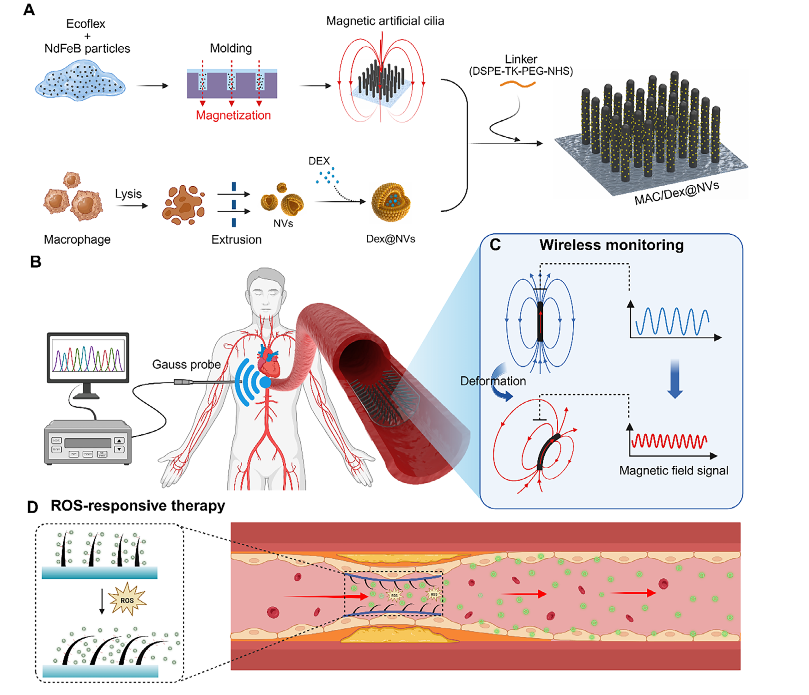
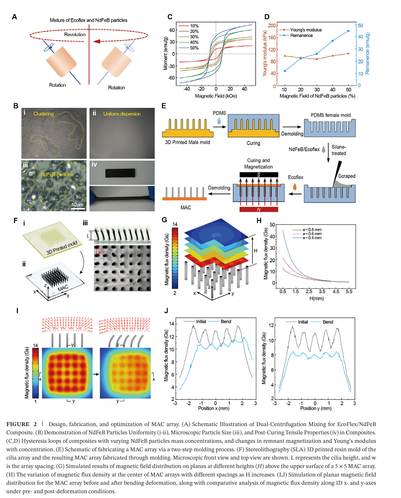
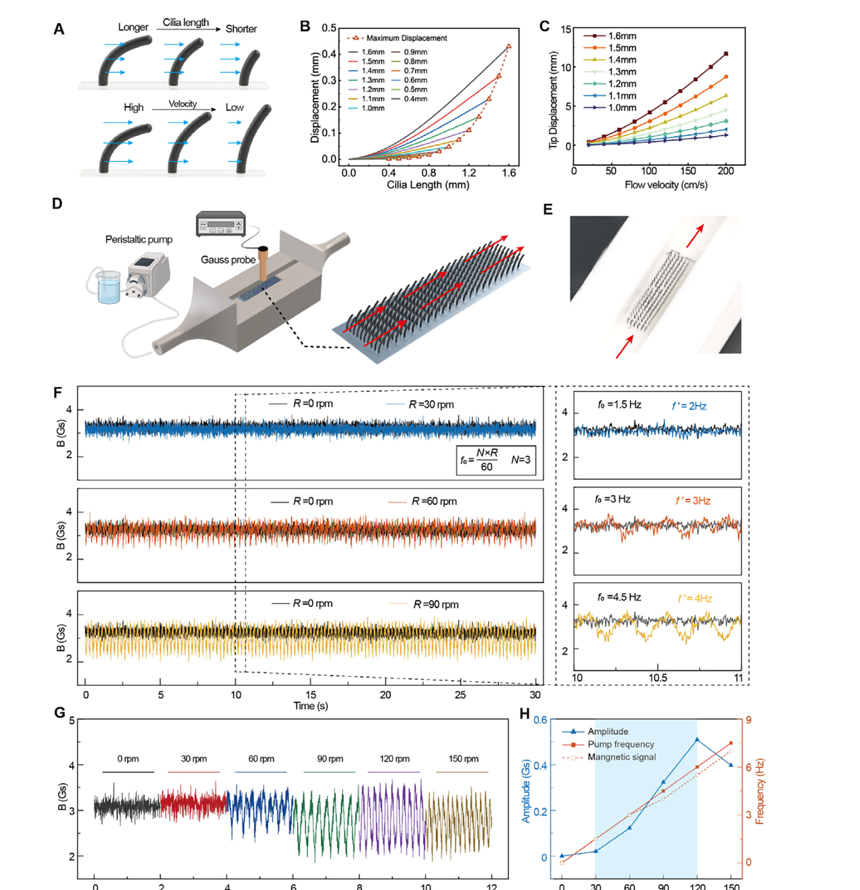
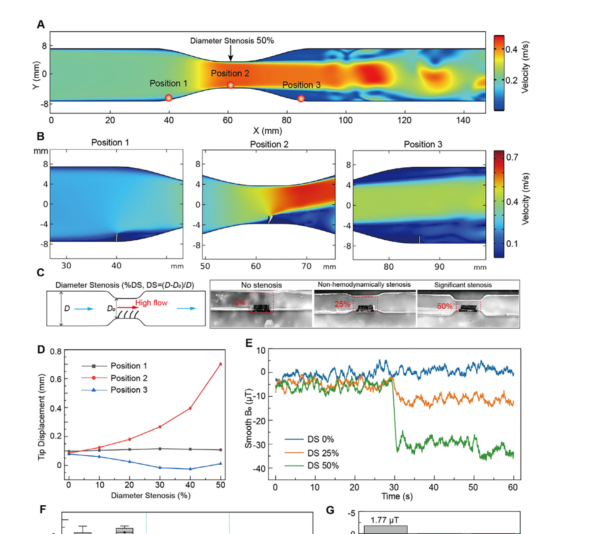
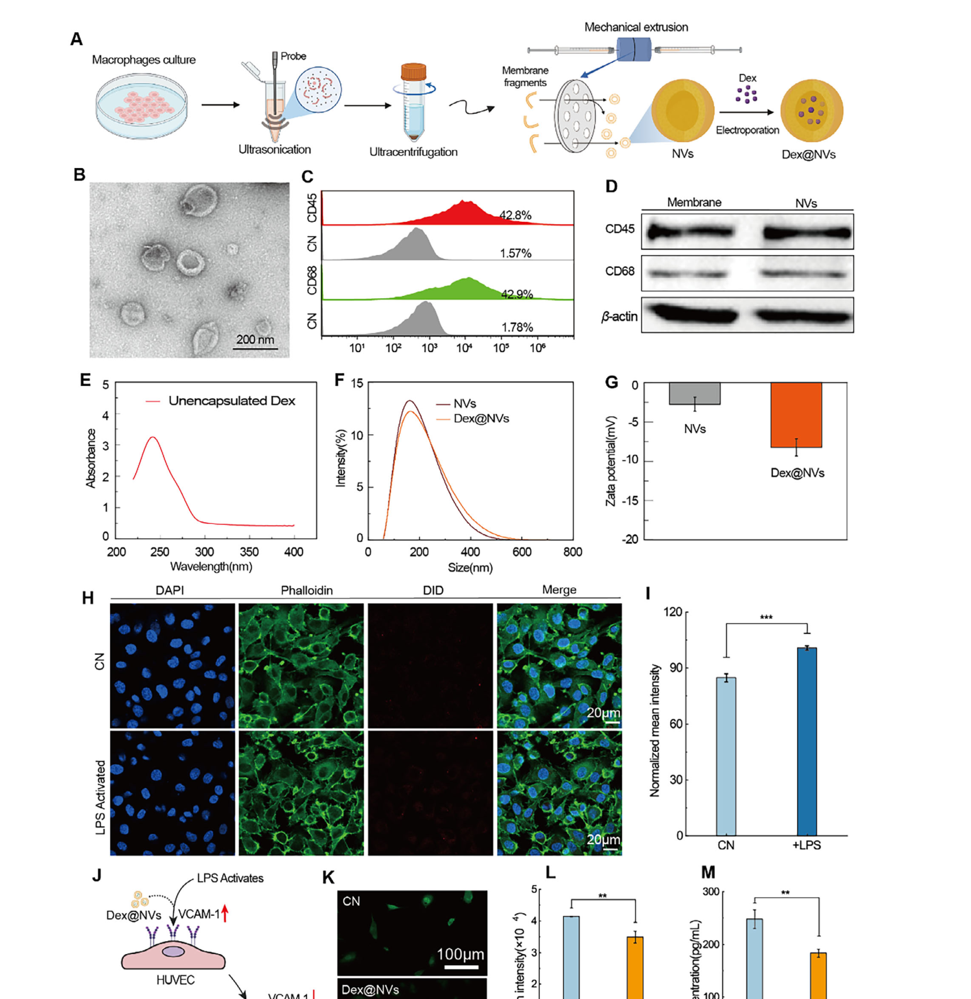
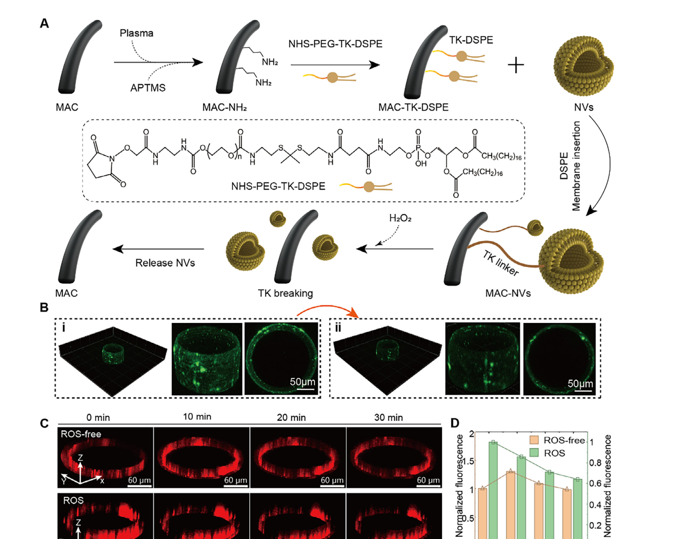
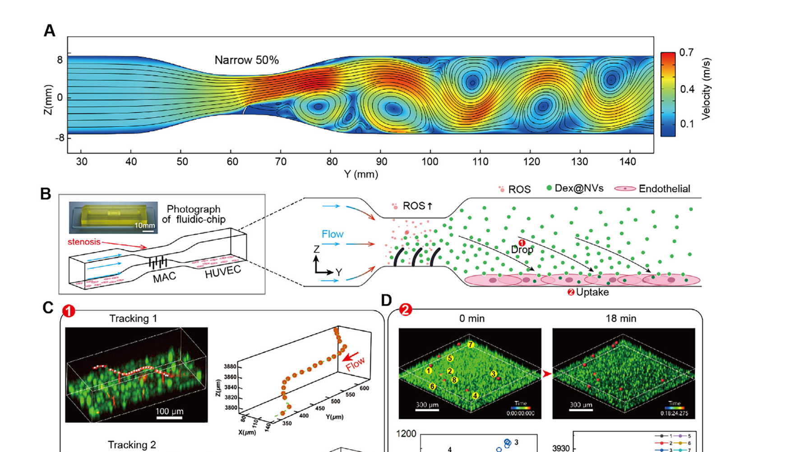

# Nature-Inspired Magnetic Cilia for Detection and Early Intervention of Vascular Stenosis 精读笔记

> **论文**：Nature-Inspired Magnetic Cilia for Detection and Early Intervention of Vascular Stenosis（受自然启发的磁性人工纤毛：用于血管狭窄的检测与早期干预）
> **作者**：Lei Li、Qianhui Wang、Tianfeng Zhou、Mengjie Song、Juncai Song、Xianbing Zeng、Jiatian Chen、Ruijue Duan、Baiqian Xu、Xiang Xiao、Hongyou Zhao、Defu Chen、Yue Yin、Guanghao Wu、Yubing Guo（李磊等；通讯作者为周天丰、吴光豪、郭玉冰）
> **期刊**：Advanced Materials（Wiley-VCH），2026, 38, e20941。DOI: [10.1002/adma.202520941](https://doi.org/10.1002/adma.202520941)
> **投稿时间线**：2025-10-22 收稿 → 2026-03-11 修回 → 2026-03-18 接收
> **单位**：北京理工大学 医学技术学院；机械工程学院；先进光场显示芯片与系统全国重点实验室
> **基金**：国家自然科学基金 52375560；北京市自然科学基金 7252290
> **阅读对象**：**材料学、磁学、流体力学、细胞生物学零基础**。
> **数学深度**：只讲原理（每个公式说明"表达什么关系"，不推导）
> **数据与代码**：论文声明"数据见本文补充材料"（Data Availability Statement），未提供代码仓库；补充图 S1–S12 与影片 S1–S4 不在本 PDF 内

---

## 一、一句话看懂这篇论文

**一句话**

在血管里"种"一片比果冻还软的磁性小柱子（高 1.5 mm，直径 0.2 mm，像一层绒毛），血流一冲它就弯；一弯，它自己带的磁性方向就跟着偏，于是**在体外拿一个测磁场的探头，就能隔着管壁读出"里面的血流是不是不对劲"**；同时，柱子表面挂着的载药纳米小囊泡，会在血管发炎（局部活性氧升高）的地方自动断裂脱落、释放抗炎药。

**两条并行的链条**

| 链条 | 触发 | 中间过程 | 输出 |
| --- | --- | --- | --- |
| 感知链 | 血流异常（狭窄导致的扰动流） | 纤毛弯曲 → 剩磁方向重排 → 空间磁场分布改变 | 体外的霍尔探头读到磁场变化（ΔB） |
| 治疗链 | 血管发炎（局部 ROS 升高） | 硫缩酮键被氧化断裂 | 载药囊泡脱落 → 被内皮细胞摄取 → 炎症指标下降 |

**这条链为什么能成立（把每一环拆到物理层面）**

| 环节 | 发生什么 | 用到的物理/化学 |
| --- | --- | --- |
| ① 流动 | 血液在血管里流动 | 流体力学 |
| ② 受力 | 流动对贴在壁上的纤毛施加**剪切力**，把它推弯 | 黏性流体的剪切应力 |
| ③ 变形 | 纤毛是软的（杨氏模量 102 kPa，和软组织一个量级），被推弯 | 弹性力学（悬臂梁） |
| ④ 磁化重排 | 纤毛内部原本"齐刷刷朝上"的磁化方向，随纤毛一起转过去 | 铁磁体的剩磁方向随几何体刚性旋转 |
| ⑤ 磁场改变 | 每根纤毛相当于一根小条形磁铁；都歪了，则整片阵列上方空间的磁场分布跟着变 | 静磁场叠加 |
| ⑥ 外部读取 | 磁场能穿过人体组织几乎不衰减，体外探头测到变化 | 生物组织对静磁场几乎不屏蔽 |
| ⑦ 判断 | ΔB 的大小随狭窄程度单调变化 | 经验标定，暂无可解析模型 |
| ⑧ 释药 | 炎症处 ROS 多，把硫缩酮键氧化切断，囊泡脱落 | 氧化还原响应化学 |

**和前面几篇笔记的定位差别**

- Photoacoustic / Iontronic / Magnetic catheter / MMF 那四篇，核心都是"**器件**"：怎么设计一个结构去传感。
- 这一篇的核心是"**材料**"：它没有做任何电子器件，而是**让材料本身同时承担"受力—变形—发出可测信号"三个角色**。全篇的关键词是复合材料、剩磁、ROS 响应化学。
- 一个必须一开始就说清楚的前提：**这篇论文从头到尾只做了体外（in vitro）实验**——仿真 + 流动台架 + 细胞培养 + 一块 3D 打印的"狭窄流体芯片"。没有动物、没有活体。所以它是一篇**原理验证（proof-of-concept）**文章，而不是一个接近临床的器件。这一点在第四节和第七节会反复用到。

---

## 二、背景与动机

### 2.1 论文想解决的具体临床问题

**问题一：血管狭窄的"早期"根本发现不了。**

血管被斑块堵住，叫**狭窄（stenosis）**。放支架把血管撑开是标准治疗，但支架放进去之后，血管内壁可能又慢慢长回来，这叫**支架内再狭窄（In-Stent Restenosis, ISR）**。

现在怎么查？两种主流手段：

- **血管造影（angiography）**：从血管里打进去造影剂，用 X 光拍。能看到管腔的形状，但只能看"形状"，看不到管壁内部到底在发生什么；而且是有创的（要插导管）。
- **血管内超声（Intravascular Ultrasound, IVUS）**：把一根很细的超声探头伸进血管里拍。信息比造影丰富，但更贵、更侵入。

论文的原话意思是：这些检查**必须"临床有指征"时才做**，也就是"等到病人已经有症状了才去查"——那就已经晚了。

**问题二：药物洗脱支架（Drug-Eluting Stent, DES）的给药方式是"一刀切"。**

DES 就是表面带药的支架，放进去之后药物按固定的曲线缓慢释放。问题在于：**它不知道这个病人将来会不会发生再狭窄**。如果不会，那这个病人就等于白白吃了一轮局部药物；如果会，那又可能药量不够或时间不对。

**问题三："智能支架"想解决，但引入了新问题。**

思路是在支架上嵌入微型传感器，实时读血流，再配无线传输和能量收集模块。但论文指出两个死结：

1. **生化腐蚀 + 反复变形**：血管每天要搏动约 10 万次，微电子器件长期泡在含盐、含蛋白、含细胞的血液里，又一直被弯曲拉扯，长期稳定性很差。
2. **刚性**：电子元件是硬的（硅、金属），贴在柔软的内皮上会造成力学失配，引发内皮炎症和异物反应。

### 2.2 论文从自然里借来的答案

**生物纤毛（cilia）**是细胞表面伸出来的头发状突起。其中一类叫**初级纤毛（primary cilia）**，几乎每个内皮细胞上都有。它的作用不是"扫水"（那是呼吸道的运动纤毛），而是**当机械感受器**：血流冲它，它弯，弯曲触发细胞内的生化信号通路。也就是说，**细胞自己就是用一根软毛来"感觉"血流的**。

论文的逻辑是三步接力：

1. 既然细胞用软毛感流，那我们也可以做一根软毛来感流；
2. 既然细胞在机械刺激后还会**启动下游生化反应**（这才是关键的第二半），那我们也可以让这根软毛在感受到异常之后**顺便释放药物**；
3. 但软毛不能有线——有线的意思是要埋导线，就又回到"植入电子器件"的老路上了。所以必须让**变形本身直接产生一个可以从外部读到的信号**。

**于是"磁性"登场**：把软毛做成带永久磁性的软材料，它一弯，外部磁场就变，外部探头就能读。**这就是整篇论文的核心创意。**

### 2.3 论文的自我定位

论文在引言末尾的定位是：把 MAC 定位为一种"**器件辅助的纤毛治疗（device-assisted cilia-based therapy）**"模态——提供一个可编程的机械感受界面，把局部流场读数与"病灶局部、反馈控制"的干预耦合起来。

**注意**：这里说的是"**potential**（潜在可能）"，不是"已实现"。它的验证方式是"体外流动仿真 + 内皮细胞共培养"，这个措辞在论文里很一致，没有夸大。

---

## 三、必须先理解的核心概念

下面 16 个概念，是从零到能读懂这篇论文的最小集合。每一个都从"为什么需要它"讲起。

### 概念 0：血管狭窄与"狭窄度 DS"

**血管**是一根管子。**狭窄**就是这根管子的某一段被堵得变细了。

**狭窄度（Diameter Stenosis, DS）**衡量"细了多少"，论文给的公式是：

```
DS = (D − D0) / D × 100%
```

- `D`：健康处的管径（论文的体外模型里 D = 4 mm）
- `D0`：最窄处（论文叫"喉部，"throat"）的管径
- 单位是百分数

举例：D = 4 mm，最窄处 D0 = 2 mm → DS = (4−2)/4 = 50%。

论文选了三个等级，并给了它们各自的临床含义（这是论文自己的措辞）：

| DS | 论文的定性描述 |
| --- | --- |
| 0% | 无狭窄 |
| 25% | 非血流动力学显著的狭窄（意思：还没明显影响血流） |
| 50% | 显著狭窄 |

**为什么要区分这三个**：因为如果传感器在 0% 和 25% 之间就读出差别，那它才有"早期发现"的价值；如果非要到 50% 以上才有差别，那和现有的造影手段没有区别。这是这篇论文实验设计的核心动机。

### 概念 1：剪切应力与壁面剪切应力（WSS）

**黏性**是什么：你把手放进流动的水里，会觉得水在"拖"你的手。这个拖拽力来自液体的黏性——流体各层之间速度不同，快的层会"拉着"慢的层走，这个拉扯就表现为力。

**剪切应力（shear stress）**就是这种"平行于表面、想让物体顺着流走"的单位面积上的力。它的定义式（论文没有写，但这是标准定义）：

```
τ = μ · (du/dy)
```

- `τ`：剪切应力
- `μ`：流体的黏度（血液的黏度大约是水的 3–4 倍）
- `du/dy`：垂直于流动方向上，速度变化得有多快（速度梯度）

**为什么需要速度梯度**：如果整个流道里所有流体的速度完全一样，那层与层之间就没有"相对滑动"，也就没有拖拽力。正因为管壁处流速为零（贴壁无滑移）、管中心最快，才产生了梯度，也就产生了对管壁的拖拽。

**壁面剪切应力（Wall Shear Stress, WSS）**：就是指作用在血管**内壁**上的那个剪切应力。

**单位 dyn/cm²（达因每平方厘米）**：这是流体力学里习惯用的 CGS 单位。

> 换算：1 dyn/cm² = 0.1 Pa（帕斯卡）。1 Pa = 1 N/m²。
> 所以 5 dyn/cm² = 0.5 Pa。这个值是"小得离谱"的——比一张纸压在手心的压强小几万倍。

**这个尺度必须有数量级概念**（否则读不出论文的紧张感）：

| 场景 | WSS 数量级 |
| --- | --- |
| 正常动脉 | 约 10–70 dyn/cm² |
| 低剪切区（易生斑块） | 低于约 4 dyn/cm² |
| 静脉 | 约 1–4 dyn/cm² |
| 本文体外"生理相关"流动实验 | ≈ 5 dyn/cm² |
| 本文狭窄流体芯片实验 | ≈ 0.1 dyn/cm²（论文自己承认远低于生理值） |

**最后一行是个必须记住的弱点**：论文在最重要的那个实验（图 7，内皮化狭窄芯片）里，把 WSS 设到了 0.1 dyn/cm²，只有生理值的几十分之一，因为它要保证内皮细胞单层不被冲掉。论文自己明确写了"Although lower than physiological levels"，这是诚实之处，但也意味着这个实验的流动条件离真实血管差得很远。

### 概念 2：生物纤毛——自然界的流速计

**纤毛（cilium，复数 cilia）**：细胞表面伸出的、直径约 0.2 µm、长度几微米到几十微米的毛状结构，由微管骨架支撑。

两类要分清：

- **运动纤毛（motile cilia）**：会主动摆动，用来推动液体或颗粒。例如呼吸道里把黏液和灰尘往外扫的那些。
- **初级纤毛（primary cilia）**：不动，每个细胞通常只有一根，**当"天线"用**。血管内皮细胞上的就是这一类。

**初级纤毛怎么当传感器**：

1. 血流冲刷 → 纤毛被推弯（机械变形）
2. 弯曲改变了纤毛根部膜上的离子通道（例如多囊蛋白复合体）的开闭
3. 钙离子等信号分子进/出细胞
4. 触发一系列生化通路，最终改变基因表达、改变细胞行为

这个"把机械力变成生化信号"的过程叫**机械转导（mechanotransduction）**。

**论文借用这个"二段式"结构**：第一段是"机械→信号"（它用磁性来实现，是物理信号）；第二段是"信号→生化反应"（它用 ROS 响应释药来实现，是化学过程）。**一篇论文同时做了自然纤毛这两半，这是它结构上的巧思。**

### 概念 3：杨氏模量（Young's modulus）——材料"软不软"的度量

**是什么**：把一根材料拉一下，它会伸长约多。杨氏模量 `E` 就是"要给它多大的应力，才能让它伸长一个单位比例"。

```
E = 应力 / 应变
```

- 应力：单位面积上受的力（单位 Pa）
- 应变：长度变化的百分比（无量纲，例如伸长 1% 就是 0.01）

**单位**：Pa（帕斯卡），常用 kPa（10³ Pa）和 GPa（10⁹ Pa）表示。

**为什么这个是关键参数**：`E` 越大，材料越"不情愿"变形。这里的因果链是——**纤毛越软，同样的血流推力就能把它推得越弯；推得越弯，磁化方向变化越大，外部信号越强**。所以论文从一开始就追求"极软"。

**数量级对照表**（这里没有直觉就没法读论文）：

| 材料 | 杨氏模量 |
| --- | --- |
| 钢 | 约 200 GPa = 200,000,000 kPa |
| 骨头 | 约 10–20 GPa |
| 橡胶轮胎 | 约 10 MPa = 10,000 kPa |
| **本文的磁性复合纤毛** | **约 102 kPa** |
| 人体软组织（肌肉、血管壁） | 约 10–100 kPa |
| 果冻 | 约 10 kPa |
| Ecoflex 00-30（本文的基体硅橡胶） | 约几十 kPa |

也就是说：**本文的纤毛比果冻略硬一点，和人体软组织同级，比橡胶轮胎软 100 倍。**

**顺带一个重要的直觉**：把纤毛做软了，好处是"容易弯"，坏处是"容易塌"。太软的柱子放在血管里，血流稍微一冲就贴到壁上去了，反而失去分辨能力。这就是后面"用 50 wt% 磁性颗粒、间距 0.6 mm"这些参数取值的由来——它们都是在**"更软更灵敏"和"还能站得住"之间取平衡**。

### 概念 4：复合软材料——弹性体基体 + 磁性颗粒填料

**为什么必须用复合材料**：自然界没有"又软又强磁性"的材料。软的（橡胶）不导磁，导磁的（铁、钕铁硼）又硬又脆。所以只能把二者混起来：

- **基体（matrix）**：Ecoflex 00-30，一种双组分硅橡胶，固化后极软、透明、已有生物相容性使用记录。它提供"软"和"可以做成任何形状"。
- **填料（filler）**：钕铁硼（NdFeB）微粒，平均粒径 5 µm，密度 7.61 g/cm³。它提供"磁性"。

**一个反直觉但很重要的实测结论**（论文图 2D 的关键）：

论文把 NdFeB 的质量分数从 10% 加到 50%（**加了 5 倍**），测量结果：

- **剩磁**：从约 11 emu/g 升到约 45 emu/g（**涨了约 4 倍**）——这是好事，磁性更强了
- **杨氏模量**：只在约 91–106 kPa 之间来回晃（**基本没变**）

论文的解释是：微米级颗粒填料对复合材料模量的影响主要取决于它的**体积分数**，而 NdFeB 密度大（7.61 g/cm³，约为硅橡胶的 7 倍），所以"50 wt%"换算成"体积分数"并不高，对刚度贡献很小。

**这意味着什么**：**加磁性颗粒几乎免费。** 你可以一直加，直到"加工性"不允许为止。论文最后选 50 wt%，给出的理由不是"再高就变硬了"，而是"**再高就没法正常固化了**"（excessively high particle loading impedes proper curing）。

**这对读者是个很好的方法论示范**：先用实验找出"哪个旋钮只影响我想要的性质、不影响我不想要的性质"，然后把这个旋钮拧到头。

### 概念 5：磁化、剩磁与磁滞回线——材料怎么"记住"磁性

这是本篇最需要从零讲清的一组概念。

**（1）磁畴**

铁磁材料（铁、钴、镍、钕铁硼）内部，原子磁矩会自动排成一个个小区域，每个区域内所有磁矩方向一致，这叫**磁畴（magnetic domain）**。没有外加磁场时，各个磁畴的方向随机分布，宏观上互相抵消，整体不显磁性。

**（2）磁化（magnetization）**

把一个强外磁场加上去，磁畴会转向外场方向。外场足够强时，几乎所有磁畴都朝一个方向排——材料就被**磁化**了。

**（3）剩磁（remanent magnetization / remanence）**

**把外磁场撤掉之后，还剩多少磁性，就是剩磁。** 这是永磁体的本质。

- 有些材料的磁畴一旦排好就"卡"住了，外场撤掉后仍然保持（矫顽力高）→ **硬磁材料（hard magnetic）**，如钕铁硼，用来做永磁体。
- 有些材料的磁畴很容易被扰动、很快又散开（矫顽力低）→ **软磁材料（soft magnetic）**，如纯铁、坡莫合金，用来做变压器铁芯。

**本文用的是硬磁的钕铁硼微粒**，理由就是：**它剩磁高，才能产生强到能被外部探到的磁场。**

**（4）磁滞回线（hysteresis loop）**

把"加的外磁场"作为横轴、"材料的总磁矩"作为纵轴，从 0 开始加场→加到场很大→再减回来→反向加场→再回来，画出一个闭合的环，这就是磁滞回线。

- 环的**高度**：能达到多大的磁化
- **纵轴上与横轴的交点**（外场为 0 时剩下的磁矩）：**剩磁**
- 环的**宽度**（要把磁性归零需要施加的反向磁场大小）：**矫顽力**

**图 2C 就是五条这样的回线**（10%、20%、30%、40%、50% 五种颗粒浓度）。可以看到：五条线的形状都相似（都很"宽"，说明是硬磁行为），但随浓度增加整体向上抬，即剩磁在增大。

**（5）单位 emu/g**

- `emu`（电磁单位，electromagnetic unit）是 CGS 制下的磁矩单位
- `/g` 表示"**每克材料**有多少磁矩"，所以这是一个**比磁化强度**（单位质量的磁性）
- 为什么要除质量：同样磁性的材料，密度大的颗粒自然"更重"，除质量才能公平比较

> 补充换算（论文没写，读文献时有用）：本论文的复合材料密度约 1860 kg/m³（= 1.86 g/cm³，论文 4.3 节给的是 FSI 仿真里用的密度）。所以 45 emu/g 对应约 45 × 1.86 ≈ 84 emu/cm³。若按 SI 制换算，1 emu/cm³ = 1000 A/m，则约 8.4 × 10⁴ A/m。论文在仿真里直接用了**剩磁磁通密度 0.1 T** 这个参数，可以理解为"这个材料在纤毛上表现出的等效磁化强度"。

**（6）论文的磁化工艺**

制造过程的最后一步是：整个阵列在**均匀 2.0 T 的轴向磁场**里被磁化（磁场方向与纤毛轴向一致）。2.0 T 是什么概念——临床 MRI 典型是 1.5 T 和 3.0 T，所以这是"用 MRI 量级的磁场把纤毛充磁"。结果就是**每根纤毛都像一根竖直的小条形磁铁，全是同一个方向**。

### 概念 6：磁场与磁通密度——T、Gs、µT 的换算

**磁通密度 B**（也叫磁感应强度）是描述磁场"强弱"的量。单位有好几套，这篇论文里**同时出现了三套**，必须能互相换算，否则读不懂它到底在说多强的信号：

| 单位 | 名称 | 关系 |
| --- | --- | --- |
| T | 特斯拉（SI 制） | 基准 |
| Gs | 高斯（CGS 制） | 1 T = 10⁴ Gs |
| µT | 微特斯拉 | 1 T = 10⁶ µT |

**换算链条**：`1 T = 10,000 Gs = 1,000,000 µT`；反过来 `1 Gs = 100 µT`。

**本文出现的数值都换算一遍**（这一步很关键）：

| 论文中的量 | 原值 | 换算 | 说明 |
| --- | --- | --- | --- |
| 纤毛阵列外部磁场的振荡基线 | 约 3.3 Gs | ≈ 330 µT | 图 3F，探头距 3 mm |
| 图 3H 提取得出的信号振幅 | 最大约 0.55 Gs | ≈ 55 µT | 随泵转速上升 |
| 图 4E 的磁场基线 | 约 −5 µT | ≈ −0.05 Gs | 图 4 实验量级小得多 |
| 图 4G 的 ΔB（50% 狭窄） | −25.02 µT | ≈ −0.25 Gs | 这是论文最核心的"可测差异" |
| 探头分辨率 | 0.001 Gs | = 0.1 µT | 远小于 ΔB，不是瓶颈 |
| 仿真用的纤毛剩磁 | 0.1 T | = 1000 Gs | 这是材料属性，不是测到的信号 |

**一个值得注意的数量级落差**：图 3 实验里信号在**几百 µT** 量级，图 4 实验里信号却在**几十 µT** 量级，相差约 10 倍。这两个实验用的是同一批纤毛，差别应该来自阵列尺寸和探头距离的不同——但论文**没有报告图 4 实验用的阵列规模和探头距离**。这是笔记附二里记录的一处信息缺失。

**再做一次尺度的直觉校准**：

- 地磁场：约 50 µT。也就是说，本文最有价值的信号（ΔB = 25 µT）**只有地磁场的一半**。
- 冰箱贴表面的磁场：约 5,000–10,000 µT（5–10 mT）。
- 临床 MRI 主磁场：1.5–3.0 T = 1,500,000–3,000,000 µT。

**所以：这是一个非常微弱的磁场信号，必须在几乎没有其他磁干扰源的环境里、用高灵敏探头贴近测量。** 这是它"检测距离受限"这个首要局限的物理根源，也是第七节要展开的最重要的问题之一。

### 概念 7：为什么磁场能穿过人体，而光/超声/X 光不行

这是本文"无线"两个字的物理基础，值得单独讲。

**电磁波/声波穿过组织时为什么衰减**：

- **光**：组织里的水、血红素、脂质会吸收；细胞和细胞器会散射。所以光在组织里走几毫米就散光了。
- **超声**：靠机械振动传播，遇到声阻抗不同的界面（骨头/软组织/空气）会强烈反射，走不深或畸变严重。
- **X 光**：靠电离吸收，能穿透，但有电离辐射，不能长期反复做。

**静磁场（或低频磁场）为什么不一样**：

- 人体组织的**磁导率 μ 与真空几乎相同**（μ ≈ μ₀），也就是说**人体对磁场来说"和空气一样，几乎是透明的"**。磁场不被吸收、不被散射。
- 磁场衰减的原因是"离源越远越弱"（几何扩散），不是"被组织吃掉了"。

**论文自己也强调了这一点**（2.1 节）："Although biological tissues impose minimal shielding on magnetic fields, detecting signals from deeper vascular structures through tissue layers requires highly sensitive external hardware."

**所以它的瓶颈不是"穿透"，而是两个别的东西**：

1. **源头太弱**：源头的磁矩小（微米尺度材料），所以场本身就小。
2. **距离衰减太快**：磁场随距离衰减得非常快（见第五节，约按 1/r³ 的规律）。从 3 mm 挪到 30 mm，信号会掉大约一千倍。

这解释了为什么它的检测距离只有 3 mm，以及为什么它把"更灵敏的外部探测器（磁阻传感器取代霍尔探头）"列为最重要的改进方向。

### 概念 8：霍尔探头（高斯计）——怎么把磁场变成电信号

**霍尔效应**：把一块薄薄的导电（或半导体）片放在磁场里，再让它通上电流，磁场会把运动中的电荷往侧面推，于是在片的两个侧面之间出现一个**电压**。这个电压正比于磁场强度。测这个电压，就测出了磁场。

**探头（probe）**：把这块霍尔片做在细杆的顶端，方便伸到要测的位置去，这根杆就叫探头。

**高斯计（Gaussmeter）/ 特斯拉计**：连上探头、把电压换算成磁场读数显示出来的仪器。

**本文用的设备**（实验部分）：CH-Magnetoelectricity CH-1800 特斯拉计，配一根轴向霍尔探头，分辨率 0.001 Gs（= 0.1 µT）。

**为什么这个细节值得记**：因为**"能测多小的变化"直接决定了这套系统能不能用**。探头分辨率 0.1 µT，而它的信号 ΔB 是几十 µT，信噪比还算有余量；但如果目标是探测更远处或更轻度的狭窄，分辨率就会成为第一道墙。

### 概念 9：为什么"纤毛一弯"，外面的磁场就变了

这是全文的物理核心，只用一个画面就能想清楚。

**画面**：想象桌面上竖着一片整齐排列的**小条形磁铁**（每根纤毛就是一根）。每根磁铁周围都有自己的磁力线，从 N 极出发、绕一圈回到 S 极。

- **全部竖直时**：所有磁铁的形状一样、方向一样，它们上方的磁力线是**叠加后很规整的一个图案**——就像一个方阵的士兵齐步走，整体看起来是一片均匀的纹理。
- **全部被推歪同一个角度后**：每根小磁铁周围的磁力线都跟着**刚性旋转**了那个角度。叠加起来的图案就整体"平移/倾斜"了。

**关键点**：**磁铁本身没变强也没变弱（剩磁大小不变），变的只是它的"朝向"**。但外部某一点测到的磁场是"所有纤毛贡献的矢量和"，方向一变，这个矢量和的**大小和方向都会变**。所以外部探头读到的数值就变了。

**论文是怎么验证这一点的**（图 2I、2J，这一步很扎实）：

- 用有限元仿真算出整片 5×5 阵列在"全部竖直"和"全部弯曲"两种状态下的磁场分布图（图 2I 的两张彩色云图）
- 再沿 x 轴和 y 轴各取一条线，把两种状态下的磁通密度画在同一张图上对比（图 2J）

**结果**：弯曲之后，两个方向上的磁通密度都**下降**了，而且**沿"弯曲的方向"下降得更多**（"with more pronounced reduction along the direction of deformation"）。

**为什么方向性很重要**：这说明这套系统**不只是"感觉到有变形"，还带有"变形朝哪个方向"的信息**。从一根信号线变成两条（x 和 y），信息量就翻倍了。这是论文用"阵列"而不是"单根纤毛"的真正价值所在——**单根纤毛只能告诉你"弯了"，阵列能告诉你"往哪弯"**。

### 概念 10：长径比与悬臂梁弯曲——为什么"细长的柱子"更灵敏

**长径比（aspect ratio）**：长度 ÷ 直径。本文纤毛是 1.5 mm ÷ 0.2 mm = 7.5。

**悬臂梁（cantilever beam）**：一端固定、一端自由、受到横向力就会弯的梁。纤毛贴在血管壁上，根部固定、尖端自由，被血流推——**它就是一根悬臂梁**。

**为什么长径比大就灵敏**，可以从"力"和"抵抗力"两头看：

- **力那头**：血流作用在纤毛上的总推力，大致正比于**侧面积**（长度 × 直径）。柱子越长，受力的面积越大，推力越大。
- **抵抗力那头**：柱子抗弯的"截面惯性矩" `I = πr⁴/4`（r 是半径），它对弯曲的抵抗正比于 `r⁴`——**半径缩小一半，抗弯能力掉到 1/16**。

两头一合：**把柱子做细做长，受力变大、抵抗变小，弯曲就剧烈增大。**

论文的仿真（图 3B、3C）就是在验证这件事：固定流速下，纤毛越长，尖端位移越大；固定长度下，流速越大，尖端位移越大。**趋势与上述推理一致。**

> **但这里有个必须提醒的细节**：论文图 3C 纵轴给出的数值（1.6 mm 长的纤毛在 200 cm/s 流速下"尖端位移约 12 mm"）在几何上是不可能的——**一根 1.6 mm 长的柱子，尖端跑出去 12 mm，等于跑到自己长度的 7.5 倍以外**。而图 3B（同样 1.6 mm 纤毛，最大位移 ≤ 0.5 mm）和图 4D（0.72 mm）彼此一致，都在亚毫米量级。所以**图 3C 的数量级应当存疑**，只能看它的"趋势"（越长越敏感），不能引用它的具体数值。详见附二。

### 概念 11：狭窄之后会发生什么——射流、分离与回流区

**这一节是理解图 4 和图 7 的地基。** 图 4 用它决定"纤毛放在哪"，图 7 用它解释"药为什么留得住"。这一段没想清楚，后面两张图就只能靠背。

先把"狭窄"翻译成一句流体力学的话：**一条 4 mm 宽、4 mm 高的水道，中间有一小段被压扁了。**

#### 11.1 先看清楚几何：这是一条"二维"流道

论文的体外流道**宽度始终是 4 mm，只把高度压小**。所以 DS 在这个具体装置里的含义是：

> DS = (D − D₀)/D × 100%，其中 D 是正常段的**高度**（4 mm），D₀ 是喉部的**高度**。

| DS | 喉部高度 D₀ | 喉部截面积（宽 4 mm） | 平均流速（入口 300 mL/min） | 相对倍数 |
| --- | --- | --- | --- | --- |
| 0% | 4 mm | 16 mm² | 0.31 m/s | 1× |
| 25% | 3 mm | 12 mm² | 0.42 m/s | 1.33× |
| 50% | 2 mm | 8 mm² | 0.63 m/s | **2×** |

这张表可以直接和论文对上：图 4B 里 Position 1 的中心速度约 0.3 m/s、Position 2 约 0.6 m/s——**恰好是 0% 与 50% 两行的数**。（流速是我按"流量 ÷ 截面积"算的，不是论文给的；它和图上色标一致，可以互相印证。）

> **这里埋着一个关键点**：因为宽度不变、只有高度缩小，截面积**随高度线性**缩小。所以 50% DS 只让流速变成 2 倍。**换成真实的圆血管，截面积随直径平方缩小，同样的 50% DS 会让流速变成 4 倍。** 本文的二维模型因此**低估**了狭窄后的加速——这在 11.9 节单独展开。

#### 11.2 第一件事：喉部射流（jet）

**原理只有一条：流量守恒。** 单位时间流进多少水，就必须流出多少水。写成式子就是**连续性方程**：

`A₁ · v₁ = A₂ · v₂`

（A 是截面积，v 是平均流速。管子不漏水、水不可压缩，所以左边必等于右边。）

**意思**：水管变细，水就必须流得更快。**地铁闸机的比喻**：同样的客流要通过，闸口越窄，每个人必须走得越快。

于是喉部出现一束**高速射流**。图 4A 里喉部那片橙红色就是它（色标标到 0.4 m/s，顶部深红已经超过这个值）。

**必须知道的第一个后果：压力在喉部会降低。** 这是**伯努利原理**的定性版本——同一条流线上一路走过来，**流速快的地方压力低，流速慢的地方压力高**（能量在"动能"和"压力能"之间分配）。所以喉部是一个**低压区**。这一条在 11.4 节解释"流为什么脱开壁面"时要用。

**第二个后果：壁面剪切应力（WSS）在喉部升高。** 因为 τ 正比于"近壁的速度梯度"，而流速变快、通道变窄，梯度被两头一起推高。按论文的流量和几何、以水的黏度粗算（层流），**50% DS 时喉部 WSS 约为上游的 3 倍（约 19 dyn/cm² 对 6 dyn/cm²）**。这是**我的估算**，用来建立量级感；论文本身只报告了入口处的"约 5 dyn/cm²"。

#### 11.3 第二件事：边界层——为什么"贴着壁的那层水"很弱

**无滑移条件（no-slip condition）**：流体紧贴固体壁面的那一层，速度必须等于壁面的速度。壁面不动，所以**紧贴壁面的流速恒等于 0**。

**为什么"必须相等"？** 水分子一直在撞壁面、和壁面交换动量，撞完再弹回来的分子，平均上就带着壁面的速度。这个交换又快又密：水分子之间只隔约 **0.3 nm**，一纳米厚度里就挤着三层；每个分子大约 **一皮秒（10⁻¹² 秒）就撞上一次。快到根本维持不住"相对滑动"。打个比方：一群人紧紧挤在一个站着不动的人身上，挤得够密，谁也没法相对他滑过去。

**它不是推导出来的定理，是实验测出来的事实。** 19 世纪人们就发现：按"贴壁速度为零"算出来的管内流量，和实测几乎一模一样。所以它是一条**边界条件**，不是从牛顿定律推出来的结论。

**什么时候会滑？** 用"滑移长度"衡量——把速度剖面直线外推、下降到零的那个位置，离真实壁面有多远。普通水在普通表面上约 **1 nm**；超疏水表面（困住一层空气）可达 **10–100 µm**。本文流道 4 mm，1 nm 只有它的千万分之二，**完全可以当 0**。

**反过来想：如果这条不成立会怎样？** 水会从纤毛表面"滑"过去，不传力，纤毛就不会弯；`τ = μ·du/dy` 里的速度梯度也没了。**"血流 → 纤毛弯曲 → 磁场变化"这条因果链，第一环就是它。**

离壁面一点点远，速度才逐渐升到主流值。**这个"从 0 过渡到主流值"的薄层，叫边界层（boundary layer）。**

这件事为什么重要：**边界层里的流体，动能是所有流体里最低的。** 后面所有"流不动了""倒流了"的现象，都发生在这薄薄一层里。

#### 11.4 第三件事：流为什么会"脱开"壁面——逆压梯度

把 11.2 的结论连起来看：

1. 流体在喉部**加速** → 压力**降低**
2. 出了喉部，管腔变宽 → 流体**减速** → 压力**回升**（伯努利是双向的：流速降，压力就升）

于是出现一个关键局面：**沿着流动方向，压力在升高。** 这叫**逆压梯度（adverse pressure gradient）**——"逆"是相对"正常情况下压力沿流动方向降低"而言的。

**为什么逆压梯度会把流"顶回去"**：

- 对**主流**（管腔中央、速度快、动能大）来说，这点压力回升不算什么，照样往前冲
- 对**边界层**（贴壁、速度低、动能小）来说，**这股"上坡"的压力正是它爬不过去的**

打个比方：一队人从窄巷跑出来冲上一段缓坡。跑在前面的（主流）惯性大，一冲就上去了；**贴着墙走的那几个（边界层）本来就慢，坡没爬完就停住了**。

**停住的位置叫分离点（separation point）。** 从分离点开始，主流不再贴着壁面走，**在壁面和主流之间留下了一片"死水"**。图 4B 的 Position 2 面板里，射流后方的**深蓝色近壁区**就是这片死水；画面上那条从壁面拐出去的流线，标的就是分离位置。

#### 11.5 第四件事：回流区与再附着

死水区不是静止的。主流像一条快速移动的传送带，**通过黏性"拖"着死水区里的流体转圈**，于是形成**漩涡**。漩涡靠壁的一侧，**流体是往回走的**——这就是**回流（recirculation）**。

漩涡在下游某处闭合，主流重新贴回壁面，这个位置叫**再附着点（reattachment point）**。

- 分离点到再附着点之间这一段，叫**回流区 / 分离泡**
- **回流区的长度通常有好几倍管径，并随狭窄度增大而变长**
- 图 4A 里 X ≈ 70 mm 之后、贴着上下壁面的一串蓝色块，就是回流区的漩涡

**一个反直觉、但必须记住的事实**：回流区里**管腔中央**仍然是向前的高速流，**只有贴壁的那一薄层**是低速甚至倒流的。所以"回流"两个字容易被误解成"血不流了"——**不是，是近壁一薄层在倒流。**

#### 11.6 四个区的 WSS 画像（这张表要背下来）

| 区域 | 近壁流速 | WSS 大小 | WSS 方向 | 生物学含义 |
| --- | --- | --- | --- | --- |
| **上游**（Position 1） | 正常层流剖面 | 参照值（≈5 dyn/cm²） | 顺流、恒定 | 健康状态 |
| **喉部**（Position 2） | 最高 | **最高**（约 3 倍，见 11.2） | 顺流、恒定 | 高而稳定的剪切：**对纤毛是最好的信号源**；对血管，长期过高会损伤内皮 |
| **分离点附近** | 降到 0 | **≈ 0** | — | 无剪切 |
| **回流区**（Position 3） | 低，方向来回摆 | **低且振荡**（方向周期性反转） | 顺流 ↔ 逆流 | **低振荡剪切 → 内皮功能障碍、促炎、促斑块**；再狭窄和动脉粥样硬化好发于这类区域 |

**最后一行不是我的推测，是本文引用的文献主题**：论文参考文献里那篇的标题就是《扰动流区域的原纤毛是动脉粥样硬化的基础》。**"狭窄下游最容易再长斑块"这件事，就是低振荡剪切造成的。**

#### 11.7 用这张画像读懂图 4D

图 4D 是纤毛尖端位移随狭窄度的变化——**它其实是对 11.6 那张表的一次仿真翻译**：

| DS | Position 1（上游） | Position 2（喉部） | Position 3（下游） |
| --- | --- | --- | --- |
| 0% | 0.09 | 0.09 | 0.085 |
| 10% | 0.10 | 0.11 | 0.07 |
| 20% | 0.105 | 0.18 | 0.03 |
| 30% | 0.11 | 0.26 | **−0.01** |
| 40% | 0.105 | 0.40 | **−0.02** |
| 50% | 0.10 | **0.70** | +0.02 |

（单位 mm。数值是我从图 4D 上逐点读的，读数误差约 ±0.02 mm。）

**逐条解释**：

- **Position 1：一条几乎水平的线（0.09–0.11 mm）。** 上游流场没有被狭窄扰动，WSS 基本恒定，所以无论狭窄多严重，纤毛都只弯这么多。**这就是"位置选错，信号为零"。**

- **Position 2：单调上升，而且越往上翘得越陡（超线性）。** 两层原因叠加：
  1. 喉部流速上升（11.1 表：0% → 50% 是 2 倍），同时**通道高度减半**，而 τ 正比于"速度 ÷ 高度"，所以 **WSS 涨得比流速更凶**（约 3 倍）
  2. 纤毛弯到较大幅度后，**几何本身也变成非线性的**（弯得越多，同样的力带来的额外位移越多）

  所以 0→10% 只涨了 0.02 mm，而 40→50% 一下涨了 0.30 mm。**曲线在"上翘"，意味着器件对已经较重的狭窄敏感，对早期狭窄反而不敏感。**

- **Position 3：不但不涨，反而一路下降，30–40% 时穿过零点变成负值。**

  **这是这张图里最有信息量、也最容易被看漏的一笔。**

  **负值是什么意思？** 位移坐标定义的是"顺着流向的偏移"。位移变成负数，意味着**纤毛被反方向推——近壁的水在倒流**。这正是 11.5 那个回流区的直接证据：**仿真不只是"预测"了回流，它让纤毛真的朝反方向弯了过去。**

  **为什么后来又在 50% 回到零附近？** 随着 DS 增大，回流区变长、变强、并向下游延伸。Position 3 离喉部只有约 20 mm，先被"卷入"回流区，所以反向位移增大；到 50% DS，回流区可能已经把 Position 3 推到了边缘或再附着点附近，那里的近壁速度又回到较低的正值，位移就贴近零。**这一段解释是我自己的推断**——论文只写了"likely due to downstream recirculation and reduced near-wall velocity"（可能是下游回流与近壁流速降低所致），没有解释回零点。

  **顺便更正一个很容易犯的误读**：把 Position 3 说成"先升后降"。按图上的点，它是**从 0.085 mm 单调下降、穿过零点、再回到零附近**——**没有峰值**。这个区别很重要：**穿过零点才是"倒流"的证据**；"先升后降"只说明"信号变弱"。

#### 11.8 这份物理被论文用了两次，方向完全相反

**第一次（图 4）用于"选位置"**：三个候选位置里，只有**喉部（Position 2）同时做到"信号大 + 随狭窄度单调"。上游信号几乎为零；下游不但弱，还会反向，**非单调就意味着无法反推狭窄度**——测到 0.1 mm 时你不知道它对应 15% 还是 45%。所以**植入位置选定喉部**。

**第二次（图 7）用于"留住药"**：药囊从纤毛释放后，最怕被高速射流直接冲走。但论文的 FSI 流线分析（图 7A）显示：**狭窄下游的分离与回流涡，造出了一个"近壁低流速 + 扰动"的区域**，这个区域的**局部停留时间更长**，有利于释放出来的囊泡在近壁富集、再沉到内皮上。

论文给出的实验证据是：

- **图 7C**：**两条**囊泡的单粒子轨迹，都表现为"向下游输运的同时持续向壁面漂移"——Z 坐标单调变化，直到贴近内皮，然后**停滞在壁面附近**
- **图 7D**：更大视野、0 与 18 min 两个时间点对比，囊泡位置**没有明显变化**，说明已被内皮摄取

所以同一个"回流区"，**作为传感位置是负面的**（信号弱、方向还会反转），**作为给药位置却是正面的**（药留得住）。**把病理生理里典型的"坏东西"改造成递送助手——这是我认为全文最漂亮的一处。**

> **但证据强度要说清楚**：这里真正定量的只有**两条**粒子轨迹。它们能证明"存在这种输运行为"，但撑不起"多大比例的囊泡能被留住"这个定量结论。而且芯片实验的 WSS 只有约 **0.1 dyn/cm²**，是生理值的 1/50——**流越弱，越容易滞留**。在真实动脉的强射流下，冲走的风险会比芯片里高得多。论文没有讨论这个差异。

#### 11.9 这些数字能不能搬到真实血管？（我补充的）

**不能直接搬，有三层原因：**

**（1）二维流道 vs 三维圆管——最容易被忽略的一层**

| | 本文的二维流道 | 真实的三维圆血管 |
| --- | --- | --- |
| 50% DS 时的截面积 | 50%（∝ 高度） | 25%（∝ 直径²） |
| 喉部流速倍数 | **2×** | **4×** |
| 喉部 WSS 倍数 | **约 3×** | **约 8×** |

WSS 的倍数来自 τ ∝ 速度 ÷ 尺寸：流速涨上去、通道尺寸掉下来，两头同向叠加。**结论：本文的二维模型系统性低估了狭窄后的射流与回流强度，图 4D 的位移数值不能直接换算成真实血管里的位移。**

**（2）流体不是血**

用论文自己的参数反推：入口 300 mL/min、截面 4 × 4 mm → 平均流速 0.31 m/s。**按水的黏度（约 1 mPa·s）算，WSS 约 6 dyn/cm²——与论文报告的"约 5 dyn/cm²"吻合。** 若换成血（低剪切下黏度 3–5 mPa·s），同样流量下的 WSS 会是**3 倍以上**，就不会是 5 了。

**所以循环介质几乎可以确定是水或稀水溶液，不是血液。**（这是**我的推算**；论文从头到尾没有说明循环介质是什么。）**这直接意味着标定曲线不能直接用在血液里**——血流中的同一根纤毛，在同一流量下会弯得明显更多。

**（3）几何不是真实的病变**

本文的狭窄是一条**光滑、对称、规则**的收缩。真实的内膜增生（ISR）是不规则的、表面粗糙的、沿周向不均匀的，而且**狭窄段与健康段的顺应性不同**（斑块更硬）。这些都会改变分离点的位置和回流区的形状。**"标准狭窄"适合做原理验证，不适合做定量外推。**

#### 11.10 读这类流场图的三条经验

1. **先看色标**：颜色代表速度还是压力？上限多少？——不看色标就讨论"红得厉害"没有意义。图 4A 的色标标到 0.4 m/s，图 4B 标到 0.7 m/s，**两张图的颜色不能直接比**。
2. **盯着近壁看，不要盯着中心看**：纤毛站在壁面上，**决定它弯不弯的是近壁速度，不是管腔中央的高速射流**。这是读这类图的第一个陷阱。
3. **找流线是否贴壁**：流线离开壁面 = 分离；流线绕圈 = 回流区。

#### 11.11 三个常见误解

| 误解 | 为什么错 |
| --- | --- |
| "狭窄处流速最快，所以那里最容易长斑块" | 斑块好发于**低而振荡的剪切**区，即狭窄**下游的回流区**，而不是高剪切区 |
| "流速越快，纤毛弯得越多，所以下游信号也应该更大" | 下游管腔中枢确实流速不低，但**纤毛站在近壁**，那里被回流区"屏蔽"了 |
| "回流 = 血不流了" | 回流只发生在**贴壁的一薄层**；管腔中央仍是向前的高速射流 |

### 概念 12：三种数值仿真——FEM、CFD、FSI

论文用了三套仿真，各自解决不同的问题，不能混为一谈：

| 简称 | 全名 | 算什么 | 本文用来做什么 |
| --- | --- | --- | --- |
| FEM | 有限元法（Finite Element Method） | 把连续物体切成许多小单元，逐单元求解偏微分方程，主要算**固体/场的分布** | 算纤毛阵列周围的**磁场分布**（图 2G–J） |
| CFD | 计算流体动力学（Computational Fluid Dynamics） | 同上，但算**流体的速度场、压力场** | 算狭窄流道里的**流速场**，找出高速射流与回流区（图 4A、4B、7A） |
| FSI | 流固耦合（Fluid–Structure Interaction） | 把上面两者**双向耦合**：流体推固体，固体变形又反过来改变流体域 | 算**纤毛被流冲弯了多少**（图 3B、3C、4D） |

**为什么 FSI 非做不可**：如果用简单模型，会假设"纤毛只弯曲、不改变流场"。但纤毛弯下去之后，它的形状变了，流体绕流的形态也跟着变，于是作用在它上面的力又变了。**这是一个循环的相互影响，必须反复迭代求解。** 这就是"耦合"的意思。

**论文用的软件**：COMSOL Multiphysics（一个可以同时做 FEM/CFD/FSI 的通用平台）。材料参数来自实测（E = 102 kPa、密度 1860 kg/m³、剩磁磁通密度 0.1 T）。

**一个方法论上的说明**：论文的"纤毛位移随长度/流速/狭窄度如何变化"这类核心结论，**全部来自仿真**，实验只做了"能不能在外部测到对应的磁场变化"这一件事。这不是缺陷（仿真验证机制、实验验证可行性是合理分工），但读者要知道**这些曲线是算出来的，不是量出来的**。

### 概念 13：纳米囊泡（NV）与"细胞膜伪装"

**细胞膜（cell membrane）**：包在细胞外面的一层磷脂双分子层，上面插着各种蛋白质。

**纳米囊泡（Nanovesicle, NV）**：从细胞膜上取下来的、重新闭合成的小圆球（直径约 100–200 nm）。里面是空的，所以可以往里装药。

**本文怎么造**（图 5A）：

1. 培养小鼠巨噬细胞（RAW264.7 细胞系）
2. **超声破碎（ultrasonication）**：用高频声波把细胞震碎
3. **差速超速离心**：先低速甩掉没破的细胞，再高速（80,000 × g，1 小时）把细胞膜碎片沉下来
4. **机械挤出（mechanical extrusion）**：把膜碎片反复挤过 800 nm 和 400 nm 的滤膜，强制它们重组成大小均一的小囊泡
5. **电穿孔（electroporation）**载药：给一个瞬时高压电脉冲（100 V），把膜暂时打出小孔，药分子趁机进去，然后恢复

**为什么选巨噬细胞**：巨噬细胞天然会往炎症部位聚集（这是免疫系统的功能），所以用它的膜做出来的囊泡，**继承了"往炎症跑"的黏附分子特征**。这叫"**仿生伪装**"——把细胞自己的"身份证"披到载体上。

**一个必须注意的实测细节**：论文用流式细胞术测了囊泡上是否带巨噬细胞标志物 CD45 和 CD68，结果是：

- CD45：**42.8%** 的囊泡为阳性（对照组 1.57%）
- CD68：**42.9%**（对照组 1.78%）

**也就是说，超过一半的囊泡并不携带这两个标志物。** 论文的表述是"confirmed the presence of macrophage-specific surface markers"（确认了标志物的存在），这句话本身没错，但**没有提"只有约 43% 带"**。这是附二里记录的一处表述完整性问题。

**为什么要测这两个蛋白**：CD45 是所有白细胞共有的标志物，CD68 是巨噬细胞特有的标志物——两者同时阳性，才能说明"这确实是巨噬细胞来源的膜，而不是随便什么细胞的膜"。论文还用了**免疫印迹（western blot）**（图 5D）来从"蛋白质总量"的角度复核这件事。

### 概念 14：ROS 与硫缩酮键——一个"氧化还原开关"

**ROS（Reactive Oxygen Species，活性氧）**：一类含氧的、化学性质很活泼的分子或离子，例如过氧化氢（H₂O₂）、超氧阴离子、羟自由基。

- **正常情况**：细胞代谢会持续产生少量 ROS，同时也有抗氧化系统清除它，两者平衡。
- **炎症情况**：免疫细胞被激活后会大量产生 ROS（这是它杀灭病菌的武器）。所以**炎症部位的 ROS 浓度显著高于正常组织**。
- **这就是一个天然的"疾病信号"，而且是化学信号。**

**硫缩酮键（thioketal, TK）**：一种含有 `−S−C(CH₃)₂−S−` 结构的化学键（论文图 6A 中间画出了它的完整化学式）。

**它的特殊性质**：**平时很稳定，但遇到 ROS 会被氧化切断。**

为什么：ROS 会攻击硫原子，把 `C−S` 键氧化成亚砜/砜，整个结构随之裂解成两个片段。这是一个氧化反应，所以是"**氧化响应（ROS-responsive）**"。

**由此得到的开关逻辑**：

- 正常血流（ROS 低）→ 键不断 → 药囊老老实实挂在纤毛上
- 炎症血管（ROS 高）→ 键被切断 → 药囊脱落 → 就近进入内皮细胞

**论文怎么把它装上去**（图 6A，典型的三步表面化学）：

1. **氧等离子体处理（oxygen plasma）**：用带电的氧气把纤毛表面"啃"出羟基（−OH）
2. **硅烷化**：用 APTMS（3-氨丙基三甲氧基硅烷）和表面羟基反应，接上**氨基（−NH₂）**
3. **NHS 酯偶联**：用的接头分子叫 **DSPE-TK-PEG-NHS**，用它的 NHS 酯端和表面氨基反应形成酰胺键，把它挂到纤毛上

**这个接头分子的三段式设计，每一段各司其职，是本文化学设计上最清晰的一笔**：

| 片段 | 作用 |
| --- | --- |
| **NHS 酯** | 负责"钉住"——和纤毛表面的氨基形成稳定的酰胺键 |
| **PEG（聚乙二醇）** | 中间一段柔软的水溶性链，把囊泡"撑离"表面，同时减少非特异性吸附 |
| **TK（硫缩酮）** | 中间的"可断点"，ROS 一来就断 |
| **DSPE** | 两条长脂肪酸尾巴，**会自己插进囊泡的磷脂双分子层里**——这就是"挂住药囊"的那只手 |

**最后一步不需要任何化学反应**：只把改造好的纤毛和囊泡放在一起孵育过夜，DSPE 的脂尾会**自发**嵌入囊泡膜（疏水作用驱动）。这叫"膜插入（membrane insertion）"。**用自组装代替共价反应，是生物偶联里非常常用也很聪明的做法。**

**必须验证的一件事**：这套"挂上去"的机制，在**流动**中会不会自己掉下来？如果血流一冲药就掉了，那"ROS 响应"就是假的。

**论文做了这个对照实验（图 6C、6D，这是我认为最扎实的一个实验）**：

- 在**同样的剪切应力（≈5 dyn/cm²）**下，把 MAC-NVs 放在共聚焦显微镜下连续看 30 分钟
- **无 ROS 组**：荧光信号基本不变
- **含 ROS 组**：荧光信号随时间下降

**结论**：药囊的丢失**主要是 ROS 引起的，不是流动冲掉的**。这一条排除了最容易被质疑的伪影，实验设计是对的。

### 概念 15：地塞米松与炎症读数——VCAM-1、IL-6、LPS、HUVEC

**（1）药物：地塞米松（Dexamethasone, Dex）**

一种**糖皮质激素**，临床上广泛使用的强效抗炎药。本文用的是它的钠盐（地塞米松磷酸钠，水溶性更好），通过电穿孔装进囊泡。

**（2）实验用的细胞：HUVEC**

**人脐静脉内皮细胞（Human Umbilical Vein Endothelial Cells）**。这是血管内皮研究的标准细胞系——容易获得、容易培养、能代表内皮细胞的一般行为。

**为什么用内皮细胞**：血管内壁就是一层内皮细胞。药物要抑制的炎症、纤毛要贴附的表面，都是它。

**（3）怎么"制造"炎症：LPS**

**脂多糖（Lipopolysaccharide, LPS）是革兰氏阴性菌外膜上的成分。免疫系统一见到它就拉响警报。所以**在培养皿里加 LPS，就能让内皮细胞"以为"自己被细菌感染了，从而进入炎症状态。

论文用 1 µg/mL LPS 处理 24 小时。这是一个**标准化的、可重复的假炎症模型**——不是真实血管里的炎症，但它能把细胞切换到一个确定的炎症状态，便于做对照。

**（4）读出炎症的三个指标**

怎么知道"治疗有效"？要测下游的分子。论文测了三个：

| 指标 | 是什么 | 为什么要测它 |
| --- | --- | --- |
| **VCAM-1**（血管细胞黏附分子-1，也叫 CD106） | 炎症时内皮细胞表面大量出现的黏附蛋白 | 它一多，白细胞就会黏上来、钻进血管壁。**它是"炎症正在进行"的直接标志** |
| **ICAM-1**（细胞间黏附分子-1，CD54） | 同上，另一类黏附蛋白 | 论文补充测了（放在补充图 S12） |
| **IL-6**（白介素-6） | 一种分泌到细胞外的促炎细胞因子 | **它是"细胞在喊发炎"的信号**，可以测上清液（细胞外的液体）来定量 |

**测法**：

- VCAM-1：用**带荧光的抗体**去标记它，然后用共聚焦显微镜拍（看细胞上亮不亮）和用**流式细胞术**测（把每个细胞的荧光强度一个个数出来，得到定量分布）
- IL-6：用 **ELISA（酶联免疫吸附测定）**测上清液里的浓度

**（5）本文的实测数字**

| 实验 | 指标 | 对照 | 加药 | 显著性 |
| --- | --- | --- | --- | --- |
| 图 5（静态培养） | VCAM-1 平均强度 | 4.0 ×10⁴ | 3.3 ×10⁴ | ** (p<0.01) |
| 图 5（静态培养） | IL-6 | 约 233 pg/mL | 约 180 pg/mL | ** (p<0.01) |
| 图 7（流动芯片，释药来自 MAC） | VCAM-1 平均强度 | 4.1 ×10⁴ | 2.7 ×10⁴ | * (p<0.05) |
| 图 7（流动芯片，释药来自 MAC） | IL-6 | 约 205 pg/mL | 约 90 pg/mL | * (p<0.05) |

**怎么读这张表**：

- 都是"下降"，方向一致，说明有效。
- 图 7 的 IL-6 降了一半以上（205 → 90），效果看起来很大；但统计显著性只有 **（p<0.05），比图 5 的 **（p<0.01）**弱**。原因是每组只有 **n = 3**（三个独立重复），样本量很小。
- **样本量 n = 3 意味着什么**：任何一个数据点的偶然波动都会显著影响均值，误差棒（图中灰色的标准差条）也比较宽。这是体外细胞实验的常见规模，但读者应当把它看作"**方向性的证据**"，而不是"精确的效应量"。

**（6）NS 与 CN 的命名陷阱**

图 5 和图 7 里都出现了 "CN" 这个标签，但含义**不完全一致**：

- 图 5I：CN = **未经 LPS 激活**的对照（用来证明"炎症细胞吃囊泡吃得更多"）
- 图 5K–M、图 7E–G：CN = **经 LPS 激活但未加药**的对照（用来证明"药物有效"）

读图时如果不注意这一点，会误以为是在比较同一个"CN"。这是附二里记录的一处标注问题。

---

## 四、逐节精读

### 4.1 摘要：论文自己怎么概括自己

摘要里值得逐字拆的是这三句话：

> **"Under pathological hemodynamic disturbances, MAC deformation reorients the programmed remanent magnetization and redistributes the stray magnetic field, enabling near-field external detection without implanted electronics."**

拆开看：

- `pathological hemodynamic disturbances`（病理性的血流动力学扰动）：不是测"流速多少"，而是测"异常"。这是一个**定性到半定量**的目标。
- `reorients the programmed remanent magnetization`（使预先编程的剩磁方向重新取向）：`programmed` 这个词很关键——磁性不是天然长出来的，是**在制造时用 2 T 均匀磁场"写"进去的**。这是一个"预置基准，再看它偏了多少"的测量范式。
- `redistributes the stray magnetic field`（重新分布杂散磁场）：`stray`（杂散）指漏出到材料外部的磁场。对外部探头来说，能测到的正是这部分。
- `near-field external detection`（**近场**外部探测）：`near-field` 是论文自己给自己划的边界——**它承认这是近场，不是可以在几十厘米外隔空读取的。**
- `without implanted electronics`（无需植入电子器件）：这才是真正的卖点。

> **"Concurrently, thioketal-functionalized NVs release anti-inflammatory agents in response to elevated ROS at stenotic sites."**

注意 `at stenotic sites`（在狭窄处）——这是**设计目标**，而实现方式是"ROS 高就断键"。论文自己也知道这中间有一个逻辑跳跃：ROS 高 ≠ 一定在狭窄处（任何炎症部位 ROS 都高）。所以严格说，这个系统实现的是"**炎症部位选择性**"，而不是"狭窄部位选择性"。这是读这篇文章时要一直握在手里的一个判断。

> **"In vitro flow simulations and endothelial cell co-culture experiments validate the platform's dual capacity..."**

**一整句里只有两种验证：体外流动仿真 + 内皮细胞共培养。** 摘要自己就说清了这篇论文的证据边界。

### 4.2 引言：论文如何一步步把自己"逼"出来

引言的推进逻辑是一个典型的"排除法"，值得学：

**第一步，先立一个更大的命题**：生物流体（血液、组织间液、淋巴）携带组织健康的关键信息，而现有可穿戴/无创器件只能测**体表附近**的信号（汗液代谢物、呼吸、脉搏、血氧）。**体内的信息拿不到。**

**第二步，找一个最有代表性的体内场景**：血管系统。因为血流动力学参数（剪切、压力波动、温度）已被验证是血管疾病的标志物。

**第三步，具体到临床痛点**：支架内再狭窄（ISR）的诊断滞后 + 药物洗脱支架"一刀切"给药。

**第四步，排除第一条技术路线（微电子智能支架）**：生化腐蚀 + 循环变形 → 长期稳定性差；刚性 → 内皮炎症和异物反应。

**第五步，转向仿生**：自然界的初级纤毛，柔性器官级机械传感器。但已有的"人工纤毛传感器"多数**仍依赖有线传输**，功能单一，在体内或复杂微流控环境里受限。

**第六步，提出一个"更高一层"的洞察**（这是本文真正的立意）：

> 生物纤毛不只感测，它感测之后还会**启动下游生化通路**。这个"感测 + 启动生化响应"的**双重能力**，才是仿生设计真正应该模仿的东西。

**所以本文模仿的对象不是"纤毛的形状"，而是"纤毛的功能结构"。** 这一点把它和之前所有"仿生纤毛传感器"区分开了：别人仿的是形态，本文仿的是**信息流**——从机械输入到化学输出。

**最后一步，给自己加一个临床落点**：论文引用文献指出"cilia-based therapy is transitioning from theory to clinical application"，然后把自己的系统定位为"device-assisted cilia-based therapy"的一个具体形态。

### 4.3 结果 2.1：设计与优化——从材料到阵列



**图 1 是全篇的地图**，四个面板各管一件事：

- **图 1A**：把两条制备工艺并列画出。
  - 上半支：Ecoflex + NdFeB 颗粒 → 模具成型（Molding）→ 磁化 → **磁性人工纤毛（MAC）阵列**
  - 下半支：巨噬细胞 → 裂解（Lysis）→ 挤出（Extrusion）→ **纳米囊泡（NVs）** → 电穿孔载入 DEX → **载药囊泡（Dex@NVs）**
  - 两条支路最后用一根 `DSPE-TK-PEG-NHS` 接头（Linker）连起来，形成 `MAC/Dex@NVs`
  - **这张图的信息是：它是两种成熟技术的"对接"，而不是发明了一种全新材料。** 这决定了它的技术风险主要在"对接处"（界面化学和长期稳定性），而不在各自环节。

- **图 1B**：临床场景想象图。一片软纤毛阵列贴在动脉壁内侧，人体外放一台高斯计 + 一根探头，探头贴在体表。
  - **注意这张图里的一个隐含前提**：探头是**贴着体表**画的。也就是说，论文想定的是"浅表血管"。但如果真是冠脉（在心脏表面、胸腔深处），探头就不可能这么近。这是图 1B 与全文实验条件（3 mm 检测距离）之间的落差，属于附二里的观察项。

- **图 1C**：**全文最重要的机制示意**。上下两张小图对比：
  - 上图（`Deformation` 之前）：纤毛笔直，磁力线上下对称，输出的 `Magnetic field signal` 是一条**等幅的正弦波**
  - 下图（`Deformation` 之后）：纤毛被推歪，磁力线图案倾斜，输出的信号**振幅变大了**
  - **这张图想说的是：变形改变的是信号的"振幅"，而不是"形状"。** 后面图 3F 的实验正好验证了这一点（波形不变，振幅变大）。

- **图 1D**：治疗链。左侧小图是"纤毛表面挂着囊泡"→ ROS 刺激 → 囊泡脱落散开。右侧大图是血管剖面，显示狭窄处发炎、ROS 升高，囊泡在那里脱落并被内皮摄取。
  - 图中用了三层图例：`ROS`（粉色小圆点）、`Dex@NVs`（绿色小囊泡）、`Endothelial`（粉红色内皮细胞层）。

**接着是材料优化（图 2）：**



**图 2A（混合工艺）**：双离心混合（dual-centrifugation mixing）。画的是一个绕中心轴**公转（Revolution）的容器，同时容器自己还在**自转（Rotation）**。

> **为什么要"双离心"**：NdFeB 颗粒密度 7.61 g/cm³，是硅橡胶前驱体（约 1 g/cm³）的 7 倍多，静置时必然沉降。单纯的搅拌只能"一时混匀"，停手就会分层。行星式离心混合同时提供两种运动：公转产生离心力把材料压向杯壁和底部（**同时脱泡**），自转又把材料不断翻回来（**同时混合**）。论文原话是"high-shear mixing, systematically dispersing the magnetic particles while maintaining polymer structural integrity"。
>
> **图 2B 就是"混匀了没有"的对照证据**：`i. Clustering`（团聚）那张显微图里，用黄色虚线圈出了几片明显的颗粒团块；`ii. Uniform dispersion`（均匀分散）那张则是干净均匀的视野。这一对图是**用图说话**地证明"双离心混合解决了团聚"。

**图 2C、2D（材料表征）**：

- 图 2C：五种颗粒浓度（10%–50%）的磁滞回线。五条线形状相似（都是宽的硬磁回线），随浓度升高整体上抬。
- 图 2D：把图 2C 的剩磁和拉伸实验的杨氏模量放在同一张图上。
  - 蓝色（Remanence，右轴 0–50 emu/g）：约 11 → 22 → 26 → 38 → **45** emu/g
  - 红色（Young's modulus，左轴 0–200 kPa）：约 101 → 95 → 91 → 100 → **106** kPa
  - **读法**：横轴加 5 倍，蓝线涨 4 倍，红线在 ±8% 内晃。**这就是"加磁性几乎免费"的图证据。**
  - 注意红色曲线**不是单调的**，在 30% 处有个小凹陷（101→95→91→100→106）。这不是错误，只是说明在实测误差范围内它确实是平的。

> **一处标注问题**：图 2D 的横轴写的是 "Magnetic Field of NdFeB particles (%)"。但从上下文（图注说 "changes in remnant magnetization and Young's modulus with concentration"，正文说 "particle mass concentration"）看，横轴显然是**颗粒的质量分数（wt%）**，不是"磁场"。`Magnetic Field ... (%)` 这个写法把"颗粒含量"误写成了"磁场"，而磁场没有用百分数表示的习惯。属于图轴标注错误，已记入附二。

**图 2E（制造工艺，两步成型）**是这部分最值得细看的一张流程：

1. **3D 打印阳模**：用面投影微立体光刻（PµSL，nanoArch S140）打印出一片"柱子森林"的树脂阳模（图 2Fi）。
2. **翻阴模**：把 PDMS 浇在阳模上，固化后脱模，得到一片带深孔的 PDMS 阴模。
3. **表面处理（关键一步）**：PDMS 阴模先氧等离子体处理 2 分钟（提高亲水性，让后续溶液能润湿），再浸泡在 2 wt% 的全氟硅烷乙醇溶液里 2 小时，110 ℃ 烘 1 小时固化。
   - **为什么要做这一步**：磁性复合材料和 PDMS 都是疏水的，脱模时容易被撕坏。全氟硅烷在孔壁上铺一层极低表面能的"不粘涂层"，让固化的纤毛能干净地拔出来。**这是"能不能做出来"和"做出来会不会断"之间的分水岭。**
4. **浇注**：把 NdFeB/Ecoflex 前驱体注入深孔，用抽真空-加压循环把高黏度材料压进底部（**"deep cavities"是难点：孔深 1.5 mm、孔径 0.2 mm，深径比 7.5，黏稠材料很难自己流到底**），再用刮刀刮掉多余材料。
5. **铺基底层**：在填满的模具表面再浇一层**纯 Ecoflex**（不含磁性颗粒），固化后就是"纤毛的根"。
6. **在模具里直接磁化**：60 ℃ 固化 1 小时后，在**均匀 2.0 T 轴向磁场**下磁化。
7. **脱模**，得到带预置磁化方向的纤毛阵列（图 2Fii、2Fiii）。

**图 2F 给出了两个关键几何参数**：

- `L`（纤毛高度）= **1.5 mm**
- `w`（阵列间距）= **0.6 mm**

**图 2G、2H（阵列尺寸的取舍）**：

- 图 2G：5×5 阵列上方不同高度 H 处的二维磁场分布。结论：**离表面越近磁场越强，随 H 迅速衰减**；而且**磁场图案"长得像阵列本身"**（每个纤毛位置对应一个热点），但这个对应关系随距离增大而模糊。
- 图 2H：中心轴上磁通密度随 H 的变化，三条线对应三种间距（0.4、0.6、0.8 mm）。结论：**间距越小（阵列越密），外部磁场越强**。

**但论文没有选最小的 0.4 mm，而选了 0.6 mm**，理由写在正文里：**过密的排列会让相邻纤毛在弯曲或静电作用下"粘"在一起**（physical adhesion between adjacent cilia）。

> **这是一个非常真实的工程权衡**：从"信号强度"这一个指标看，0.4 mm 最好；但从"纤毛能不能各自独立弯曲（这直接决定信号里有没有方向信息）"看，太密就失效了。**选 0.6 mm 是在"信号强度"和"独立性"之间折中。** 论文还在补充图 S4 里给了粘附的照片证据。

**图 2I、2J（机制验证）**：前面概念 9 已详细讲过。要说的是它的**验证思路**：先用 FEM 算"未弯曲"和"弯曲"两种状态的空间磁场云图（2I），再沿 x、y 轴取剖面线做定量对比（2J）。**从二维图像落到一维曲线，才可量化**——这是仿真结果的标准呈现方式。

### 4.4 结果 2.2：体外流体感测与狭窄监测

#### （1）先验证"能不能测到流动"（图 3）



**实验台架（图 3D）**：蠕动泵 → 矩形流道（3D 打印，内截面 10 mm 宽 × 2 mm 高）→ 里面固定一片 **9 × 21 = 189 根**的纤毛阵列 → 流道外侧**距离 3 mm**处放一根高斯探头。

**关于蠕动泵（peristaltic pump）**：它的工作原理是用几个滚轮（论文里 N = 3）依次挤压一根软管，把液体一段段推出去。**它天然产生的是"脉动流"而不是恒定流**——每一次滚轮压过去就是一个脉冲。论文正是利用这一点来"模拟主动脉的搏动血流"。

**论文给出的泵脉动频率公式**（这是图 3F 里那个白色小框的内容）：

```
f0 = (N × R) / 60
```

- `f0`：脉动频率（Hz，次/秒）
- `N`：滚轮数（本文 N = 3）
- `R`：转速（rpm，转/分钟）
- `÷60`：把"每分钟"换成"每秒"

**验算**：R = 60 rpm、N = 3 → f0 = 3 × 60 / 60 = 3 Hz。图 3F 中间那张小图标的正是 `f0 = 3 Hz`。**公式与图对得上。**

**图 3F 的三行实验**（分别在 R = 30、60、90 rpm 下记录 30 秒）：

- 每一行都是"黑线（R = 0，泵停）"和"彩色线（泵转）"的对比
- **看波形**：泵停时是一条平直的噪声带；泵转起来后，信号上叠出了规则的周期性振荡
- **看振幅**：泵速越高（30 → 60 → 90 rpm），振荡幅度越大

**为什么振幅随泵速增大**：泵速升高 → 体积流量升高 → 流速升高 → 剪切应力升高 → 纤毛弯得更厉害 → 剩磁方向偏得更多 → 外部磁场变化更大。**这条因果链就是概念 9 的机制。**

**图 3F 右侧的三个放大图（重要，见附二）**：论文在 10–11 s 这一秒的窗口里放大了波形，并在图上标了输入脉动频率 f0 和"从信号中提取出来的频率" f′：

| 行 | 转速 | 输入 f0 | 标注的输出 f′ | 是否吻合 |
| --- | --- | --- | --- | --- |
| 第 1 行 | 30 rpm | 1.5 Hz | **2 Hz** | ✗ |
| 第 2 行 | 60 rpm | 3 Hz | **3 Hz** | ✓ |
| 第 3 行 | 90 rpm | 4.5 Hz | **4 Hz** | ✗ |

**而正文写的是**："the magnetic signal frequency f′, which **matched** the input pulsation frequency f0, confirming the system's capability for real-time synchronized flow sensing."

**三行里只有一行严格吻合，正文却说"matched"。** 这是本文最明显的一处图文不符。

**但这里也有一个合理的解释**（我补充的分析）：看数字本身——f′ 的值是 2、3、4，全是**整数**。而放大图的横轴窗口宽度是 **1 秒**（10 s 到 11 s）。对 1 秒长的信号做傅里叶变换，频率分辨率就是 **1 Hz**——它只能分辨出"整数赫兹"。1.5 Hz 在这个分辨率下会被分到 2 Hz 那一格，4.5 Hz 会被分到 4 或 5 Hz。**所以 f′ 与 f0 的偏差很可能不是物理失同步，而是"用来做频谱分析的窗口太短"造成的分辨率极限。**

**佐证**：图 3H 用的是**整段 12 秒**的记录，提取出的频率是 1.5、3、4.5、6、7.5 Hz——**与 f0 完全一致**。同一个系统、同一种信号，仅因为分析窗口变长就吻合了，这正好印证"分辨率"这个解释。

**所以对这件事的判断是**：系统的频率跟随性在更长的数据上是成立的（图 3H 证明），但**图 3F 只标 f′ 而不说明它的分辨率上限，会让读者误以为已经做到了精确的频率同步**，正文用"matched"也压缩掉了这个条件。属于"表述不够严谨"，而不是"数据造假"。已记入附二。

**图 3G、3H（连续扫描）**：转速每 2 秒升高 30 rpm，从 0 一路加到 150 rpm，共 12 秒。

- 图 3G：原始信号，肉眼可见分段性——每一段颜色不同，振幅逐段增大。
- 图 3H：把每段做滤波 + 傅里叶变换，提出两个特征：
  - **频率**（红色方块，右轴）：0 → 1.5 → 3 → 4.5 → 6 → 7.5 Hz，**与 f0 = R/20 完全成线性**。这是系统"忠实传递频率"的证据。
  - **振幅**（蓝色三角，左轴，单位 Gs）：0 → 0.03 → 0.2 → 0.33 → 0.55 → 0.53

**图 3H 里最值得学的一件事，是"量程"的存在**：论文的解读是——**30 rpm 以下，剪切力不足以让纤毛产生可测的变形；120 rpm 以上，纤毛已经弯到头了（saturation），再加流速振幅也不再涨。**

这带来一个非常实用的结论（论文原话）：**"both the Young's modulus and aspect ratio of the magnetic composite cilia can be tuned to optimize sensitivity and adjust the effective detection range"**——**软硬和长径比就是两个可调旋钮：想让它在很小的剪切下就灵敏，就把纤毛做软做长；想让它在很大的流速范围内都不饱和，就把它做硬做短。** 任何一个传感器都有这个"灵敏度 vs 量程"的取舍，本文的价值在于它**把这个取舍做成了材料参数**（而不是电路参数）。

#### （2）再验证"能不能分辨狭窄程度"（图 4）



**这是全文的核心结果。** 分四步走：

**第一步：用 CFD 找出"该把纤毛放在哪"（图 4A、4B）**

管子做了 50% 的狭窄，仿真给出速度场（图 4A）。三件事看得很清楚：

- 喉部有一束**深红色的高速射流**（色标标到 0.4 m/s，最高速的深红区已超过这个值）
- 射流下游是**青蓝色（低速）的紊乱区**
- 三个候选位置标在图上：Position 1（狭窄前）、Position 2（喉部）、Position 3（狭窄后）

图 4B 把三个位置的局部速度场放大对比：Position 1 是均匀的（蓝），Position 2 是高速射流撞壁（红黄），Position 3 是低速扰动（青黄杂色）。

**第二步：用 FSI 把"流速场"翻译成"纤毛弯多少"（图 4D）**

图 4D 是这张图里信息量最大的一张。横轴是狭窄度 0/10/20/30/40/50%，纵轴是纤毛尖端位移（mm），三条线是三个位置：

| 位置 | 趋势 | 50% 时的位移 |
| --- | --- | --- |
| **Position 1（上游）** | 从 0.09 到 0.11 mm，**几乎不变** | 约 0.11 mm |
| **Position 2（喉部）** | 单调快速上升，**且越到后面涨得越快** | **约 0.72 mm** |
| **Position 3（下游）** | 从 0.085 mm **单调下降**，30–40% 时**穿过零点变负**（约 −0.02 mm），说明近壁流体已经倒流；50% 回到零附近 | 约 +0.02 mm（反向，接近零） |

**这张图说明了三件事**：

1. **"放在哪里"比"传感器多灵敏"更重要**——同一片纤毛，位置选错，信号几乎为零。这是一个**布局问题**，而不是器件问题。
2. **喉部是唯一能做到"单调"的位置**。单调性是"能不能反推狭窄程度"的前提：如果信号是非单调的（比如下游那样），那么测到 0.1 mm 的位移时，你不知道它对应 15% 还是 40% 的狭窄——**信号就失去了定量意义**。
3. **Position 2 的曲线是"上翘"的（凹向上）**，意味着在高狭窄度区间灵敏度更高。这对"发现已经比较严重的狭窄"有利，但对"发现早期狭窄"不算有利——**0% 到 10% 之间，位移只从 0.09 变到 0.11 mm（约 +20%）**。这一点在第七节会再提。

**第三步：做出真实的狭窄流道并测量（图 4C、4E）**

图 4C 左是狭窄度的定义示意（`DS = (D − D0)/D`），右是三张实物照片：0%、25%、50% 三种狭窄流道，纤毛都植在喉部。**照片里能直接看出纤毛的弯法不同**——这是很直观的一张证据图。

**实验条件**（必须记住）: 入口流量固定 **300 mL/min**，对应 WSS ≈ **5 dyn/cm²**，**三种狭窄度用完全相同的入口流量**。

> **为什么"入口流量相同"是关键**：这样三个实验之间唯一的差别就只有"几何形状"，把流量这个变量控住了。如果流量也变，就无法判断信号变化是来自狭窄还是来自流量。**这是这个实验设计上最正确的一步。**

图 4E 是核心数据：连续记录 60 秒，**0–30 秒无流动（基线），30 秒时通流（flow-on）**，三条曲线对应三种狭窄度。

看 30 秒处那个跳变：

- **蓝线（DS 0%）**：在 30 s 处几乎看不出跳变，只是**略微上升**（ΔB = +1.77 µT）
- **橙线（DS 25%）**：从约 −4.5 µT **下降到约 −11.5 µT**
- **绿线（DS 50%）**：从约 −5 µT **骤降到约 −30 µT**，落差最大

**第四步：提取 ΔB（图 4F、4G）**

图 4F 是箱线图，把 0–30 s 和 30–60 s 两个窗口各算一个"平均磁通量 BM"，一共 6 个箱子。图 4G 把差值 ΔB 画成柱状图：

| DS | ΔB |
| --- | --- |
| 0% | **+1.77 µT** |
| 25% | **−6.71 µT** |
| 50% | **−25.02 µT** |

**这张图有两个必须指出的问题**（详见附二，这里先讲影响）：

**问题一：正文说的"step-like decrease"（阶梯式下降）只对 2/3 的曲线成立。**
正文写："Upon initiating the same flow at t = 30 s, the MAC signal exhibits a clear step-like decrease, with the largest drop observed for the 50% DS."
但 0% 那条线是**上升**的（ΔB = +1.77 µT）。**所以正确的表述应该是"0% 轻微上升，25% 和 50% 下降，且下降幅度随狭窄度单调增大"。**

**问题二：三条曲线的"无流动基线"并不相同。**
从图 4F 读：0–30 s 的中位数分别约为 **−0.1 µT（0%）、−4.1 µT（25%）、−5.3 µT（50%）**。
**这在物理上是个疑点**：0–30 s 是"无流动"状态，三种情况下纤毛都没有被吹弯，几何状态应当相同，那么在同一个探头位置测到的磁场也应当相同。但三个基线差了最多 5 µT，**而箱子的误差范围只有 ±2 µT 左右**——也就是说这个差异是系统性的，不是随机噪声。
**最可能的解释**是三次实验之间重新装配了流道、重新摆放了探头，位置有微小变化。但这意味着 **ΔB 这个"做差"的操作并没有完全消掉装配带来的偏差**，因为三次的偏移量不同。论文没有讨论这一点。

**论文自己主动加的一句边界声明（值得称赞）**：

> "It is important to note that MAC signals are intended for continuous hemodynamic monitoring, when absolute quantification of the degree of stenosis is required, complementary imaging (e.g., angiography, Doppler ultrasound, etc) is still necessary."

**即：它定位成"连续监测的报警器"，不是"取代造影的定量工具"。** 这是一个非常克制、非常诚实的定位——作者主动把"能不能替代影像"这个问题挡住了。**在评价这类论文时，作者自己划出的边界应该被认真对待，而不应被拿来当"局限"来批评。**

### 4.5 结果 2.3：载药纳米囊泡的制备与表征



**图 5A（制备流程）**：巨噬细胞培养 → 超声破碎（Probe 探头式超声）→ 超速离心 → 收集膜碎片 → 机械挤出 → 得 NVs → 电穿孔载入 Dex → Dex@NVs。流程已在概念 13 讲过。

**结构表征：**

- **图 5B（TEM 透射电镜）**：放大看囊泡形态。论文描述为"well-dispersed, cup-shaped vesicles approximately 200 nm in diameter"——**"杯状（cup-shaped）"是一个值得注意的细节**。
  > **为什么囊泡是"杯状"而不是"圆球状"**（我补充的解释）：TEM 制样时要把样品干燥，磷脂双分子层在脱水过程中会塌陷。塌陷的方式与膜的不对称性（内外层脂质成分不同）有关，结果就是形成一侧凹进去的"杯形"或"碗形"。**这是细胞膜来源囊泡的典型 TEM 形态特征**，也是"这确实是膜结构而不是实心颗粒"的一个旁证。
- **图 5C（流式细胞术）**：CD45 阳性 42.8%（对照 1.57%），CD68 阳性 42.9%（对照 1.78%）。
- **图 5D（western blot）**：比较"膜碎片（Membrane）"和"囊泡（NVs）"两列的 CD45、CD68 条带，以 β-actin 作为内参。条带都存在，说明挤出成囊泡的步骤**没有丢掉这两个蛋白**。

**载药表征：**

- **图 5E（紫外分光光度法）**：一条在约 260 nm 处有吸收峰的曲线。
  - **原理**：地塞米松分子里的共轭结构会吸收特定波长的紫外光。吸收峰的高度与浓度成正比（朗伯-比尔定律）。所以测吸光度就能反推药物浓度。
  - **载药效率 23.74%**（论文正文）。注意"载药效率（loading efficiency）"是**投进去的药有多少进了囊泡**，不是"囊泡里有多少是药"。这两个概念不同（后者叫载药量 loading capacity），论文用的是前者。
  - **一处图文不符**：图 5E 的**图例**写的是 `Unencapsulated Dex`（未包封的 Dex），而**图注**写的是 "UV Spectrophotometric analysis of **Dex in NVs**"。一个说测的是"外面游离的药"，一个说测的是"囊泡里的药"——这两句话不能同时成立。已记入附二。
- **图 5F（DLS 粒径）**：NVs 和 Dex@NVs 两条分布曲线几乎重合，峰位都在 180–200 nm。**结论：载药没有改变囊泡尺寸。**
- **图 5G（Zeta 电位）**：NVs 约 −10 mV，Dex@NVs 约 −7 mV。**论文说"no significant change"。**
  > **Zeta 电位是什么**（从零解释）：颗粒泡在液体里时，表面会吸附一层反号离子。当颗粒在液体中运动时，紧贴在它表面的一层离子会跟着它一起走，形成"颗粒 + 伴随离子层"这个整体。这个整体与外层液体之间的**界面**上的电位，就叫 Zeta 电位。**它反映颗粒表面的净电荷。"负得越多"表示颗粒之间静电排斥越强，越不容易聚团。** −10 mV 属于"弱负电"，并不算特别稳定；本文的关注点只是"载药前后有没有变化"，结论是基本没变。
- **载药量推算**：基于载药效率和 NTA（纳米颗粒追踪分析）测得的颗粒浓度，论文估算 **每个囊泡载药 0.43 fg**。
  > **fg 是什么**：飞克（femtogram），1 fg = 10⁻¹⁵ g。作为对照，一个直径 200 nm 的磷脂囊泡本身的重量大约就是这个量级的几百倍到上千倍。所以这里的 0.43 fg 指的是**每个囊泡里装的地塞米松的质量**。

**功能验证（在 HUVEC 上）：**

- **图 5H、5I（摄取实验）**：把囊泡用 DiD（一种红色荧光染料）标记，看细胞吃进去多少。
  - 图 5H 是共聚焦照片，4 列分别是 DAPI（染细胞核，蓝）、Phalloidin（染细胞骨架肌动蛋白，绿）、DiD（囊泡，红）、Merge（叠加）。两行分别是 CN（未激活）和 LPS Activated（激活）。
  - 图 5I 是流式定量的柱状图：CN 约 85，+LPS 约 103（归一化平均强度），***，p<0.001。
  - **结论：炎症状态的内皮细胞摄取囊泡更多。** 论文的解读是"这解释了为什么靶向递送可行"。
  - **一个观察**：图 5H 的 DiD 那一列（第三列）**两行的红色信号都很暗**，肉眼几乎看不出明显差异；差异主要体现在图 5I 的定量柱子上。这可能只是显示时的亮度归一化问题，但也说明**这个摄取的视觉证据并不强烈**，主要靠流式的数值支撑。
- **图 5J–M（抗炎效果）**：
  - 图 5J 是机制示意：LPS 激活 → VCAM-1 上调 → Dex@NVs 被摄取 → VCAM-1 下调
  - 图 5K：VCAM-1 的荧光照片（CN 组绿色亮、Dex@NVs 组绿色暗）
  - 图 5L：流式定量，4.0 → 3.3（×10⁴），**
  - 图 5M：ELISA 测 IL-6，约 233 → 约 180 pg/mL，**

**这段小结里有一处"顺手写错"**：论文 2.3 节的收尾句写的是"demonstrated their enhanced uptake by inflamed endothelial cells and effective reduction of **ICAM-1** expression"，但本节正文和图 5 展示的其实是 **VCAM-1**（ICAM-1 被放到了补充图 S12）。这是一处笔误（把 VCAM-1 写成了 ICAM-1），记在附二。

### 4.6 结果 2.4：MAC 与 NVs 的偶联，以及 ROS 响应释放



**图 6A（偶联化学）**：这张图的信息密度最高，值得逐格读。

- 左上：`MAC` → **Plasma**（氧等离子体）→ `MAC-NH₂`（表面出现氨基）。图中画了纤毛表面伸出的 `─NH₂` 小尾巴。
- 中间：`MAC-NH₂` + `NHS-PEG-TK-DSPE` → `MAC-TK-DSPE`。
- 虚线框里画了 `NHS-PEG-TK-DSPE` 的**完整化学结构式**。可以从中辨认出三段：左侧的 NHS 环（五元酰亚胺环）、中间的 PEG 链、以及**中间的 `−S−C(CH₃)₂−S−` 硫缩酮结构**，右端是 DSPE 的两条长烷基链（`CH₃(CH₂)₁₆` 长链）。
  > **一处命名不一致**：正文里这个分子叫 **`DSPE-TK-PEG-NHS`**，图 6A 里叫 **`NHS-PEG-TK-DSPE`**。两者是同一个分子从两端读的结果，**化学上完全等价**（分子没有方向性），只是写法不统一。属于体例问题，不影响结论，但也记进了附二。
- 右侧：`NVs`（画成一个"空心碗"的样子，与图 5B 的杯状形态一致）→ `DSPE membrane insertion`（DSPE 的脂尾插进囊泡膜）→ `MAC-NVs`。
- 下方：`MAC-NVs` 遇到 `H₂O₂` → `TK breaking` → `Release NVs` → 变回 `MAC`。

**图 6B（偶联与释放的荧光证据）**：

- 图 6Bi：`MAC-NVs` 的三维共聚焦成像。可以看到一个明显的**圆柱形绿色荧光套**——这正是"长在圆柱形纤毛上的一圈囊泡"的形态。**这张图非常直观地证明了"囊泡确实长在纤毛上"，而不是散落在周围。**
- 图 6Bii：同样的样品，用 10 mM H₂O₂ 处理 30 分钟后。荧光**明显变暗、变散**。
  > **一处图注问题**：图 6 的图注把 B 面板写成 "Spatial confocal fluorescence imaging of MAC-NVs vs. **DIO-labeled NVs**"。但正文明确说 Bi 是"偶联成功"、Bii 是"H₂O₂ 处理 30 分钟后"（即释放前后对比）。图注写的"MAC-NVs 对比 DIO 标记的 NVs"这个说法既不清楚也没有信息量。**正文与图注对同一张图的描述不一致**，按正文理解更合理。已记入附二。
  > **另外注意浓度差异**：这里用的是 **10 mM** H₂O₂，而图 6F 的共培养和图 7 的芯片实验用的是 **1 mM**。10 mM 是一个相当高的氧化浓度（远高于生理炎症水平），主要作用是"证明开关能开"，而不是"模拟真实炎症强度"。论文没有讨论这个浓度的生理相关性。

**图 6C、6D（流动稳定性——前文已强调，这里给数据）**：

- 图 6C：两行（ROS-free 和 ROS）各 4 个时间点（0、10、20、30 min）的三维共聚焦图。上行荧光保持，下行逐渐变暗。
- 图 6D：定量曲线。**这张图有一个绘图上的问题**：它用了**两个不同的纵轴**——左轴 `Normalized fluorescence` 是 0–2（对应 ROS-free 那组），右轴 `Normalized fluorescence` 是 0–1（对应 ROS 那组）。两组数据各用自己的坐标系画，**在视觉上没法直接比较**，而且会放大看起来的差异。
  > 如果要支持"ROS 组下降得更快"这个结论，正确做法是**把两组用同一个已经归一化的纵轴画出来**（比如都归一化到各自的 t = 0 点 = 1.0），这样下降斜率才可比。现在这个画法即使数据没问题，说服力也被削弱了。已记入附二。

**图 6E（细胞毒性）**：Calcein-AM/PI 双染色。
> **这个染色怎么工作**：Calcein-AM 是一种能穿过活细胞膜的非荧光分子，进入活细胞后被细胞内的酯酶切掉一段、变成发绿光的分子（所以**绿色 = 活细胞**）。PI（碘化丙啶）进不去完整细胞膜，只能进入膜已破损的死细胞，进去后与 DNA 结合发出红光（所以**红色 = 死细胞**）。
> **结果**：CN 行和 +MAC 行都是大面积绿色 + 极少量红色。**结论：MAC 的细胞毒性很低。**

**图 6F（共培养）**：把 HUVEC（橙色 CMTMR 标记）和 MAC-NVs（绿色 DIO 标记）一起培养，做三维共聚焦。加 H₂O₂ 之后，图片里出现了更多游离的绿色小点，并附着到橙色细胞表面。**结论：ROS 触发释放 → 释放出来的囊泡贴到内皮细胞上。**

### 4.7 结果 2.4 续：内皮化狭窄芯片中的递送与疗效（图 7）



**这一步要解决一个非常尖锐质疑**：前面的实验都是静态的。一旦放到流动环境里——

> **药囊从纤毛上脱落之后，会不会立刻被高速血流冲走，根本来不及进入内皮细胞？**

**论文的回答分三段：先预测、再观察、最后测疗效。**

**第一段：先预测"药会停在哪"（图 7A）**

用 FSI 算出狭窄流道的流线（streamlines）。看到狭窄下游有一列**规则的漩涡（回流区）**。论文的推演是：

> 回流区 → 近壁流速低 + 流动紊乱 → 局部停留时间变长 → 释放出来的囊泡会**在狭窄下游近壁区域累积**。

**这是把"病理特征"反过来当"递送条件"用**，前面概念 11 已经讲过，是本文最巧的一步。

**第二段：做出内皮化狭窄芯片，直接看囊泡去哪了（图 7B、7C、7D）**

**图 7B（芯片）**：3D 打印的开放式狭窄流道 + 玻璃片封成密闭腔；MAC-Dex@NVs 用生物相容性组织胶固定在**喉部**；腔底培养一层致密的 HUVEC；灌注液里加 1 mM H₂O₂ 模拟高 ROS。
- 图 7B 的示意图右侧画了完整的流程：`ROS`（粉色）作用于纤毛 → 囊泡脱落（`Drop`）→ 随流向下游移动 → 在近壁处被内皮摄取（`Uptake`）。
- **左下角的实物照片很说明问题**：能直接看到那块黄色的芯片和里面狭窄的通道形状。

**图 7C（单颗粒追踪，两个例子）**：这是本节最硬的数据。每张图左边是荧光图像，右边是同一颗粒的三维轨迹。
- 轨迹画在 X-Y-Z 坐标里，**Z 是离壁面的距离方向**。
- 读法：**轨迹在 Z 方向上单调地向一个方向移动，直到接近内皮界面**。论文原话是 "a monotonic change in the tracked Z-position until the particle approached the endothelial interface, followed by immobilization/retention near the wall"。
- **"monotonic"（单调）是关键词**：如果囊泡只是被水流随机推着走，Z 位置应该上下乱跳；单调下降说明存在**持续的、方向一致的向壁驱动力**——这正是回流区里二次流（secondary flow）把颗粒往壁面送的表现。
- **一个尺度上的提醒**（我补充的）：图 7C 的 Z 轴范围是 3800–3860 µm 量级，也就是颗粒的 Z 位置在整个观测过程中只变化了**几十微米**。通道总高是 4 mm = 4000 µm，所以这个"向壁漂移"只占通道高度的约 1%。它确实存在且有方向性，但幅度很小。

**图 7D（多颗粒统计，18 分钟）**：
- 左上、右上：0 分钟和 18 分钟的大视场图像，标了 8 个被追踪的颗粒（编号 1–8）。
- 左下：8 个颗粒在 X-Y 平面的最终位置（尺寸 300 µm × 300 µm 级别的小视场）。
- 右下：**Z 位置随时间的曲线**，8 条线。可以看到**大部分线是平的（plateau）**，个别线有明显变化。
- **论文的解读**："Z-positions that plateau over time, consistent with vesicle deposition at or near the endothelial surface"。
- **另外论文强调了一个关键的定性观察**："fluorescent signals were observed **within** the endothelial layer, supporting cellular uptake under flow rather than transient luminal passage."——**荧光出现在内皮细胞层"内部"，而不只是在管腔一侧经过**。这是"被吃掉"和"只是路过"之间的分界证据，是这一段的结论支点。

**图 7E、7F、7G（疗效）**：在流动条件下，用从 MAC 上释放出来的 Dex@NVs 处理 LPS 激活的内皮细胞。
- 图 7E：VCAM-1 荧光，CN 亮、Dex@NVs 暗
- 图 7F：流式定量，4.1 → 2.7（×10⁴），*，p<0.05
- 图 7G：ELISA 测 IL-6，约 205 → 约 90 pg/mL，*，p<0.05

**这段最重要的结论**：**"released Dex@NVs remain bioactive after ROS-triggered shedding from MAC"**——释放出来的药囊**在经历了"被挂上纤毛 → 被氧化切断 → 被水流带着走 → 沉到壁面 → 被细胞吞进去"这一整条漫长旅程之后，仍然是有效的**。这是全篇治疗链上最有价值的一个结论。

### 4.8 讨论：作者自己承认了什么

讨论部分值得逐条提取，因为它决定了这篇论文的"自我评价"。

**（1）作者自认的优势**

- 根本性地摆脱了刚性电子植入体（"fundamental departure from conventional rigid electronic implants"）
- 用软复合材料的力学顺从性去模拟初级纤毛的机械感受功能，"minimizing rigid tissue interfaces" → 有望提高生物相容性和耐久性
- **模块化设计（modular design）**带来可扩展性：可以推广到器官芯片、肿瘤微环境等"流体力学与生化耦合"的场景

> **"promises enhanced biocompatibility and durability"这句话要注意**：`promises` 是"有望/承诺"的意思。论文在此处**没有**给出长期生物相容性或耐久性数据——它是从"软"和"无电子"这两个前提出发的**推理**，不是实测。这个区别在第七节会被我列出来。

**（2）作者自己承认的技术局限**

- **探测距离受限于微弱磁信号**：这是**微型化与读取距离之间的一般性权衡**（论文特别强调"rather than a unique shortcoming of our system"——不是本系统独有的缺陷）。改进方向：用**磁阻传感器（magnetoresistive sensors）替代霍尔探头**、用**阵列级耦合做信号放大**。
- **未来工作**：建立临床相关的感测阈值、评估复杂生物环境中的信号稳定性。

**（3）作者自己承认的临床转化障碍**（这一段写得非常诚实，值得完整列出）

| 障碍 | 论文的表述 | 计划的对策 |
| --- | --- | --- |
| 长期血液相容性与致血栓性 | "short-term biocompatibility assays are promising, long-term hemocompatibility and thrombogenicity remain paramount concerns" | — |
| 磁颗粒包裹不完整可能启动凝血级联 | "may initiate coagulation cascades" | 涂覆肝素、两性离子聚合物或做内皮化 |
| 高长径比纤毛阵列可能促进血小板黏附或造成局部流动扰动 | "could promote platelet adhesion or local flow disturbances, potentially increasing thrombosis risk" | 降低纤毛密度和尺寸、引入亲水表面处理，之后做彻底的 in vivo 评价 |
| 纤毛从基底脱落 | "To prevent cilia from detaching from the substrate..." | 更稳定的封装策略 + 力学稳定性测试 |
| 载药效率、释放动力学、生理稳定性 | "further optimization... is necessary" | 后续研究重点 |
| **总载药量** | "the drug loading capacity of the device is up to **1–3 µg**"，且**明确说明这是理论上界（theoretical upper-bound estimate）** | 临床足够的剂量与持续时间需由 in vivo 药代动力学研究和慢性狭窄模型确定 |

**（4）一个"看得见未来"的自我批评**

论文主动指出：本研究用的是**巨噬细胞来源**的囊泡，理由是"制备路线成熟、容易改造"；但**内源性初级纤毛释放的细胞外囊泡**近年成为有前景的替代纳米载体，**与本文的仿生纤毛框架在生理上更契合**（physiologically more congruent）。未来值得探索把这些"纤毛来源的细胞外囊泡"整合进 MAC 平台。

**这段话的分量在于**：作者等于承认"本文用的是次优的载体，只是因为它更好做"，并指出了更"正统"的方向。**主动承认自己妥协了哪一步、为什么妥协，是判断一篇论文是否可信的重要信号。**

### 4.9 实验方法：几个必须注意的细节

方法部分不是流水账，有几处对判断结论很关键：

**（1）循环介质从未说明。** 4.4 节写"用蠕动泵产生模拟主动脉血流动力学的脉动血流（pulsatile blood flow mimicking aortic hemodynamics）"，但**通篇没有说明管路里循环的是什么液体**——是水？PBS？还是黏度匹配的甘油溶液？全文检索 `water`、`glycerol` 都只出现在清洗步骤里。

> **为什么这一点很重要**：纤毛受到的是**剪切应力**，而剪切应力 `τ = μ·du/dy` 与**黏度 μ 成正比**（概念 1）。血液黏度约为水的 3–4 倍，在同样的几何和流量下，如果用的是水，纤毛实际承受的剪切力只有血液条件下的 1/3 到 1/4。**所以"WSS ≈ 5 dyn/cm²"这个值是取决于介质的**，介质不同，"5 dyn/cm²"对应的物理条件就不同。这属于方法报告不完整，已记入附二。

**（2）各实验的阵列规模与探头距离不同，但只在图 3 的实验里报告了。** 图 3 用的是 9 × 21 阵列、检测距离 3 mm；图 4 的狭窄实验**没有报告**用了多大阵列、探头放多远。这解释了为什么图 3 的信号在几百 µT 量级而图 4 只有几十 µT（概念 6 已述），但也让两组数据无法直接互相比对。

**（3）关键试剂与设备清单**（便于复现）

| 项目 | 具体型号/参数 |
| --- | --- |
| 基体聚合物 | Ecoflex 00-30（Smooth-On） |
| 磁性颗粒 | NdFeB，平均 5 µm，密度 7.61 g/cm³（Magnequench），50 wt% |
| 混合设备 | 双离心混合机 DAC150R（3000 rpm，120 s） |
| 阳模 | 面投影微立体光刻 nanoArch S140（PµSL） |
| 阴模 | PDMS SYLGARD 184，全氟硅烷脱模处理 |
| 磁化 | 均匀 2.0 T 轴向磁场 |
| 蠕动泵 | LEADFLUID WT600S（N = 3 滚轮） |
| 磁场测量 | CH-Magnetoelectricity CH-1800 特斯拉计 + 轴向霍尔探头（分辨率 0.001 Gs） |
| 细胞 | RAW264.7（小鼠巨噬细胞）、HUVEC（人脐静脉内皮细胞） |
| 炎症刺激 | LPS 1 µg/mL，24 h |
| 接头分子 | DSPE-TK-PEG-NHS，1 mM，pH 8.5，4 ℃，4 h |
| 表面氨基化 | 氧等离子体 2 min + 2% APTMS 乙醇溶液 2 h + 110 ℃ 1 h |
| 仿真软件 | COMSOL Multiphysics |
| 统计 | Origin 2025；低通滤波；Student's t 检验；*p<0.05, **p<0.01, ***p<0.001；n 见图注 |

---

## 五、数学建模

本文**没有推导任何公式**，正文里只出现了三个"关系式"。下面逐个说明它们**表达了什么关系**，然后补上几个论文没写、但读这篇论文必须自己想到的关系式（明确标注为我补充）。

### 5.1 论文给出的关系式

**（1）蠕动泵的脉动频率**

```
f0 = (N × R) / 60
```

**表达什么关系**：**"泵转多快"和"血流脉动多快"之间的换算。**
- `f0`：脉动频率，单位 Hz（每秒脉动几次）
- `N`：蠕动泵的滚轮数（本文 N = 3）。**每转一圈，3 个滚轮各挤压软管一次，所以每转产生 3 次脉动。**
- `R`：转速，单位 rpm（转/分钟）
- `÷ 60`：分钟 → 秒的换算

**为什么需要它**：因为整个实验的"输入"是泵的转速，而"生理意义"对应的是脉搏频率（人的心率约 1 Hz，即 60 次/分）。有了这个式子，才能说清"R = 60 rpm 相当于 3 Hz 的脉动"。**它是把实验室参数翻译成生理参数的桥梁。**

**（2）狭窄度**

```
DS = (D − D0) / D × 100%
```

**表达什么关系**："管腔直径缩小了百分之几。"
- `D`：健康段直径（本文 D = 4 mm）
- `D0`：最窄处（喉部）直径
- **分子 `D − D0` 是"缩掉的量"，除以 `D` 得到比例**

**注意它的一个特性**：分母用的是**健康直径 D**，不是"最窄处直径"。所以 DS 是"相对健康状态的收缩比例"。这是血管介入领域的通行定义，读文献时要注意有些文献用的是别的定义（例如面积狭窄率），两者不等价。

**（3）载药量的两级估算**

论文给了两个数：

- **每个囊泡**：`0.43 fg`（由载药效率 23.74% 和 NTA 测得的颗粒浓度共同推得）
- **每个器件**：`1–3 µg`（论文明确说是"reasonable theoretical estimation"，即理论上界）

**表达什么关系**：`器件总载药量 = 每个囊泡的载药量 × 能够挂在器件上的囊泡数`。

> **我补充的一次量级验算**（用来判断"1–3 µg"这个数是否合理）：
>
> 把 1 µg 换算成囊泡个数：`1 µg / 0.43 fg = 10⁻⁶ g / 4.3 × 10⁻¹⁶ g ≈ 2.3 × 10⁹ 个`；3 µg 对应约 `7 × 10⁹ 个`。
>
> 再看"一根纤毛表面最多能挂多少个 200 nm 的囊泡"：
> - 一根纤毛的侧面积 = `2πrL = 2π × 100 µm × 1500 µm ≈ 9.4 × 10⁵ µm² ≈ 0.94 mm²`
> - 一个 200 nm 囊泡的投影面积 ≈ `π × (100 nm)² ≈ 3.1 × 10⁴ nm² = 3.1 × 10⁻⁸ mm²`
> - 所以单根纤毛满铺一层的上限 ≈ `0.94 / 3.1 × 10⁻⁸ ≈ 3 × 10⁷ 个`
> - 9 × 21 = 189 根纤毛 → 总数上限 ≈ `5.7 × 10⁹ 个`
>
> **对比：器件报出的 2.3–7 × 10⁹ 个囊泡，与"整个阵列表面铺满单层"的 5.7 × 10⁹ 几乎重合。**
>
> **这说明什么**：论文的"1–3 µg 上界"实际上**隐含了"囊泡几乎满单层覆盖整个纤毛阵列表面"这个理想化假设**。所以这个数字不是"保守估计"，而是"几乎不可能超过的天花板"。论文说的"theoretical upper-bound"用词是准确的，但读者应该意识到：**真实负载量会明显低于它**（考虑到偶联效率、囊泡聚集、流动中的损失等）。这也直接支撑了第七节要提的一个判断：这个载药量对一个需要长期抗炎治疗的慢性病变而言，很可能偏小。

### 5.2 我补充的关系式（论文没写，但读这篇论文必须自己想到）

**（1）剪切应力与速度梯度**

```
τ = μ · (du/dy)
```

**表达什么关系**：**流速在垂直于流动方向上的变化越快，流体对表面施加的拖拽力越大；流体越黏，拖拽力也越大。**
- `τ`：剪切应力（单位 Pa，本文用 dyn/cm²）
- `μ`：动力黏度（血液约 3–4 mPa·s，水约 1 mPa·s）
- `du/dy`：速度梯度（流速随离开壁面的距离变化有多快）

**为什么必须想得到它**：这条式子直接回答了"**为什么泵速越快，信号越强**"——泵速升高使流量升高，流量升高使管内平均流速升高，平均流速升高使 `du/dy` 升高，于是 `τ` 升高，纤毛弯得更厉害。**它是整条感知链的第一个环节。** 同时它也解释了第七节要提的一个问题：如果循环介质是水而不是血液，同样的 `u` 带来的 `τ` 会小 3–4 倍。

**（2）悬臂梁的挠度**

```
δ_tip ≈ q L⁴ / (8 E I)        其中  I = π r⁴ / 4
```

**表达什么关系**：**一根一端固定的柱子，被横向载荷均匀推着时，尖端会移多少。**
- `δ_tip`：尖端位移
- `q`：单位长度上的横向载荷（正比于剪切应力和柱子的直径）
- `L`：柱子长度
- `E`：杨氏模量
- `I`：截面惯性矩，对圆柱是 `πr⁴/4`（`r` 是半径）
- `8` 是"均布载荷 + 悬臂"这个边界条件下的常数

**这个式子（如果成立）会给出四条清晰的"设计法则"**：

| 想让它更灵敏，就 | 效果 |
| --- | --- |
| 加长（L↑） | 极强：`L⁴`，长度翻倍位移涨 16 倍 |
| 做细（r↓） | 极强：`1/r⁴`，半径减半位移涨 16 倍 |
| 做软（E↓） | 线性反比 |
| 加大流速（q↑） | 线性正比 |

**但必须紧接着说一句**：这是一条**小变形线弹性**公式。论文的纤毛在强流下会弯到接近 90°，这已经远远超出小变形假设，此时**载荷本身的方向和大小都会随变形改变**（纤毛弯下去后插进流动里，受力方式变了），必须用 FSI 迭代求解。**这也是论文为什么必须做流固耦合仿真、而不能用一个公式算完的原因。**

**用这条式子去对照论文的仿真数据，会得到一个有意思的结果**：按 `L⁴` 规律，长度从 1.0 mm 增至 1.6 mm（1.6 倍）应导致位移增至 `1.6⁴ ≈ 6.6` 倍。而图 4D 之类的数据大体上呈现相似的陡峭趋势，但同时**小变形公式无法解释"饱和"现象**（图 3H 中 120 rpm 以上振幅不再增长）——**饱和恰恰是大变形 + 流体载荷随形变改变才会出现的现象**，这也是"必须做 FSI"的另一个证据。

**（3）磁场的距离衰减**

```
B ∝ m / r³        （远场，磁偶极子近似）
```

**表达什么关系**：**远离一个磁体时，它的磁场强度按距离的三次方衰减。**
- `B`：磁通密度
- `m`：磁偶极矩（正比于材料体积 × 剩磁）
- `r`：到磁体的距离

**为什么它是本文最关键的一条"看不到的墙"**：
- 距离**翻倍**（3 mm → 6 mm），信号掉到 **1/8**；
- 距离**变成 10 倍**（3 mm → 30 mm），信号掉到 **1/1000**。

**这解释了三件事**：

1. 为什么检测距离只有 3 mm（不是设计得不好，是物理规律的硬约束）；
2. 为什么论文把改进方向指向"更灵敏的探测器（磁阻传感器）"而不是"怎么把信号从 3 mm 提到 3 cm"（后者靠更好的探头也几乎不可能，只能靠**加大磁矩 `m`**，也就是加大阵列规模或提高磁性颗粒含量）；
3. 为什么论文说"阵列级耦合（array-level coupling）可以做信号放大"——**把 N 根纤毛的信号叠加起来，等效于把 `m` 放大了 N 倍**，这是对抗 `1/r³` 衰减唯一有效的杠杆。

**（4）单位换算速查（读本文必备）**

| 从 | 到 | 乘/除 |
| --- | --- | --- |
| 1 T | Gs | × 10⁴ |
| 1 T | µT | × 10⁶ |
| 1 Gs | µT | × 100 |
| 1 dyn/cm² | Pa | × 0.1 |
| 1 fg | g | × 10⁻¹⁵ |
| 1 µm | m | × 10⁻⁶ |
| 1 mm | m | × 10⁻³ |
| rpm | Hz（对于 N = 3 的泵） | ÷ 20 |

**最后一行值得单独记**：因为 `f0 = 3R/60 = R/20`。所以本文中"60 rpm"就是"3 Hz"，"120 rpm"就是"6 Hz"。**记住这个 1/20 的关系，读图 3F、3H 时可以直接心算核对。**

---

## 六、本研究的风险

这一节专门讲**安全与伤害风险**（不是"学术局限"，后者在第七节）。对一个要进入血管、长期留在体内的器件，风险清单是评价的第一关。

### 风险 1：MRI 兼容性问题（论文完全没有提及，我独立发现的重大风险）

**这是我认为本文最重要、也最令人意外的一处空白。**

**物理背景**：本文的纤毛含有 **50 wt% 的钕铁硼（NdFeB）**，并且被 **2.0 T 的磁场充过磁**。NdFeB 是**硬磁材料**——它一旦被磁化就很难退磁，剩磁高达 45 emu/g。

**为什么这是风险**：

1. **巨大的扭矩与力**。临床 MRI 的主磁场是 1.5 T 或 3.0 T，比本文充磁用的 2.0 T 还要强。一块强磁性材料放进这种磁场里，会受到**强烈的力矩**（试图让它的磁化方向对齐外场）和**平移力**（在磁场梯度处）。对这个器件而言，意味着纤毛阵列可能被扭转、被从血管壁上撕下来。
2. **射频致热**。MRI 的射频线圈会在**导电材料**中感应出涡流，导致局部升温，可能烫伤周围组织。NdFeB 是金属性导体。
3. **图像伪影**。铁磁性材料会造成严重的局部磁场畸变，使 MRI 图像在该区域大面积失效。

**为什么这个风险在本领域是"必答题"**：血管支架、导丝、封堵器等心血管植入物的说明书中，MRI 安全性（能不能做 MRI、能做什么场强）是**标准要求**的项目。

**本文的状态**：我全文检索了 `MRI`、`magnetic resonance` 两个关键词，**在正文、讨论、实验部分中均出现 0 次**。论文在讨论部分详细列了血液相容性、血栓、颗粒包裹、纤毛脱落这些风险，**但完全没有提 MRI**。

**这不是一个"作者疏忽"可以轻松带过的问题**，因为：患者在放完支架后做 MRI 是非常常见的临床需求（支架本身通常是被动材料，一般可做 MRI）。如果这个器件真的进了临床，**它会把一批本来能做 MRI 的患者变成不能做**——这本身就是一个需要写进知情同意的重大限制。

> **必须公平说明的边界**：这是一篇**体外原理验证**论文，不是临床器件论文。在材料验证阶段不讨论 MRI 兼容性，在写作惯例上并不算违规。但在**风险清单里列入这一项、并说明"论文未讨论"**，是必要的——因为读者（尤其是将来可能参与转化的人）需要知道这道题**还没做**。已记入附二。

### 风险 2：钕铁硼在体液中的腐蚀与离子析出（论文未讨论）

**物理化学背景**：NdFeB 永磁体是烧结/粘接的**金属间化合物**，其中的**钕（Nd）是化学性质非常活泼的稀土元素**。NdFeB 在**潮湿空气、含氯离子溶液（血液、生理盐水都富含 Cl⁻）**中会发生电化学腐蚀，腐蚀产物包括 Nd³⁺、Fe 离子、硼化合物。

**为什么这是风险**：

- **钕离子有细胞毒性**（游离稀土离子会干扰细胞膜和酶的功能）
- **腐蚀会导致器件性能退化**：磁性材料被腐蚀掉一部分，剩磁下降，标定关系漂移——**一个"逐月漂移的传感器"比一个"坏的传感器"更危险，因为它会给出看起来正常的错误读数**
- **腐蚀会产生颗粒**：脱落的碎屑进入血流，可能引起栓塞或炎症

**业界标准做法**：NdFeB 磁体用于体内必须做**表面镀层（Ni-Cu-Ni、环氧树脂、钛、parylene 等）**来隔绝体液。

**本文的状态**：论文提到 **"Incomplete encapsulation of magnetic particles may initiate coagulation cascades"**（磁性颗粒包裹不完整可能启动凝血级联）——**这句话已经触及了"颗粒暴露在血液中"的问题，但它的关注点是凝血，不是腐蚀**。全文检索 `corrosion`/`corrod`/`leach` 只有 1 处命中，且是在引言里批评**别人的电子器件**会被腐蚀，不是讨论自己的磁性颗粒。

**需要做的实验**（尚未做）：把器件长期浸泡在模拟体液/血清中，定期测溶液中 Nd 和 Fe 的浓度，并复测剩磁是否漂移。**这是任何"长期植入"主张的前置条件。**

### 风险 3：血栓与血液相容性——本研究中完全没有使用血液

**这是我在通读实验方法后最直接的发现。**

**本文所有流体实验用的循环介质，论文从未说明成分。** 从上下文（蠕动泵 + 硅胶管 + 3D 打印流道 + 3 mm 检测距离的台式高斯计）判断，最可能是**水或甘油水溶液**这类的"概念流体"，而不是血液。理由：

- 如果用血液，必须报道**抗凝处理、温度控制（37 °C）、溶血率**，这些在文中**一处都没有**
- 蠕动泵的滚轮会**机械破坏红细胞**（溶血），血液实验通常要用离心泵或注射泵
- 血液是不透明的，而论文没有讨论光学/其他观测手段的适配
- 图 7 的内皮化芯片实验用的是**培养液**（有 HUVEC 细胞），更明确不是血液

**为什么这构成风险而不只是局限**：血液和水的物理性质差别很大——

- **黏度**：血液在低剪切率下黏度可达水的 **3–5 倍**（非牛顿流体），高剪切下才接近水的 1.5–2 倍。黏度直接决定同一流速下的壁面剪切应力（τ = μ·du/dy），**所以血液里的实际弯曲量会比水中小/大得多，标定曲线不能直接搬用**
- **细胞与蛋白**：红细胞会改变边界层，血浆蛋白会吸附到器件表面，血小板会被激活
- **凝血**：异物表面（尤其是暴露的聚合物和金属颗粒）是血栓形成的经典触发条件

**论文对此的处理**：在讨论部分用**推测性语言**承认了这一点（大意是"我们预期良好的血液相容性，因为 Ecoflex 和 PDMS 本身是常用的医用材料"），但**没有做任何血液实验**。已记入附二。**这是从"体外原理验证"到"临床器件"之间最大的一道鸿沟。**

### 风险 4：纤毛脱落与远端栓塞

纤毛是**Φ200 µm × 1.5 mm 的悬臂结构**，一端固定在基底上，另一端**自由地悬在血流中**。它在每一次脉动中都要弯曲、回弹，长期承受**数亿次的循环载荷**。

**疲劳问题**：Ecoflex 是弹性体，抗疲劳性远好于刚性材料，但**并非无限**。而且关键弱点不在纤毛本身，而在**纤毛与基底的结合处**（根部是应力集中点，且是两种不同配方/不同固化程度材料的界面）。

**脱落的后果**：1.5 mm 的纤毛进入循环血流，可能栓塞远端小血管（如脑血管、冠脉远端）。**这比腐蚀析出的纳米颗粒严重得多。**

**本文的状态**：论文提到了"cilia detachment"，但对载荷循环次数、疲劳寿命、脱落概率**没有任何定量数据**。讨论中给出的缓解方案是"未来的设计可以用**可降解基底**"——这实际上是**承认脱落风险无法在当前设计中排除**，只能靠"整体一起降解"来回避。

> **我的补充**：一个可做的实验是**体外脉动循环加速老化**（例如在生理 WSS 下连续循环 10⁷–10⁸ 次，模拟 1–3 个月），然后统计脱落率、并对循环液做颗粒计数（可用动态光散射或流式）。这是任何"植入式 MEMS/柔性器件"论文都该做的标准项。

### 风险 5：能量与信号的"外部依赖"——不是风险，但是一个必须先说清的事实

读者容易误以为这是一个**无线无源**器件，实际不是。准确的说法是：

| 环节 | 是否需要外部设备 | 说明 |
| --- | --- | --- |
| **感知（读磁场）** | **需要** | 必须有一台外置的霍尔探头/高斯计（本文用的是 CH-1800 台式机），且**检测距离仅 3 mm** |
| **感知（信号处理）** | **需要** | 磁信号 → 电压 → 采样 → 滤波 → 判读，论文用 Origin 2025 做低通滤波和统计 |
| **治疗（药物释放）** | **不需要** | ROS 触发的化学键断裂是**自发**的，靠病灶局部的化学环境驱动 |

**所以"无线"这个词在感知链上并不成立**：3 mm 的检测距离意味着探头必须**贴在血管外壁**（这在开胸/开放手术中可以做到，但**不是微创**）。论文没有讨论如何把一个高斯计探头送到目标血管旁，也没有讨论**多个阵列如何独立寻址**（一个探头同时看到 189 根纤毛的叠加磁场，如何区分是哪一段狭窄？）。

**这是一个我独立发现的关键缺口**：论文的整个实验都是**一个阵列 + 一个探头**的单一构型，而临床问题（比如一条冠状动脉多处狭窄、或者一个支架的两端）需要**空间分辨**。论文的"检测距离 3 mm"再加上阵列尺寸 10 mm × 2 mm，实际上**探头视野小于阵列长度**——空间分辨问题在论文自己的数据里就已经存在了。

### 风险 6：ROS 响应的特异性

**硫缩酮（TK）键对 ROS 敏感，这是设计优点，也是风险。** 问题在于：**体内的 ROS 不是"炎症专属信号"**。

- **正常生理过程也产 ROS**：细胞呼吸的副产物、吞噬细胞杀菌、伤口愈合、运动后肌肉
- **其他疾病也产 ROS**：肿瘤微环境、缺血再灌注、糖尿病、动脉粥样硬化斑块本身

**后果**：可能在**非目标部位**（或非狭窄状态）提前释放药物。论文用**体外**实验证明了"有 ROS 才释放"（图 6），但**体外实验的 ROS 浓度是人为设定的、可控的**。体内真实场景中，健康血管壁附近也有基础水平的 ROS。

**缓解设计**：论文把 NVs 通过 DSPE 插入的方式**锚定在纤毛表面**，这确实限制了药物的**空间分布**（只在器件附近释放），但**不能解决"器件附近恰好也有基础 ROS"的时间维度问题**。已记入附二。

---

## 七、局限性

### 7.1 论文自己承认的（我在讨论部分逐条核对过的）

| # | 论文承认的局限 | 原文要点（译述） |
| --- | --- | --- |
| 1 | **血液相容性未经实验验证** | 只是推测 Ecoflex/PDMS 有利，没有血液实验 |
| 2 | **长期稳定性未知** | 未做长期植入的稳定性测试 |
| 3 | **纤毛可能脱落** | 提出未来用可降解基底来规避 |
| 4 | **药物载荷很小（1–3 µg）** | 论文自己称之为"理论上限估计"（theoretical upper-bound estimate），并对疗效能否靠这个剂量实现表示保留 |
| 5 | **只有体外验证** | 没有动物实验（in vivo），全部是体外流道和细胞芯片 |
| 6 | **磁性颗粒包裹不完整可能引发凝血** | 讨论中明确点出 |
| 7 | **芯片实验的 WSS 远低于生理值** | 论文承认芯片中 WSS 仅约 0.1 dyn/cm²，而生理约为 5 dyn/cm² |

**值得肯定的是**：第 4、7 两条是"对自己不利"的坦白，尤其是承认药物载荷小到可能不够——这在论文中并不常见，说明作者对自己的结论边界有清醒认识。

### 7.2 我独立发现的（论文未提，但客观存在）

**这一类需要特别标注——它们不是论文的观点，是我的分析。**

| # | 局限 | 说明 | 严重度 |
| --- | --- | --- | --- |
| 1 | **完全没有 MRI 兼容性讨论** | 50 wt% 强磁性材料 + 2 T 充磁，全文 `MRI` 出现 0 次 | **高**（临床转化的硬门槛） |
| 2 | **NdFeB 腐蚀与离子析出未讨论** | 稀土元素在含氯体液中的电化学腐蚀是已知问题，无浸提实验 | **高** |
| 3 | **循环流体成分从未说明** | 论文所有流体实验用的介质是什么，全文未写 | **高**（直接决定标定能否外推） |
| 4 | **无灭菌方案讨论** | 查询 `sterilization`/`steriliz`：0 次命中。植入器械必须过灭菌关，而**辐照灭菌可能损伤 Ecoflex 和 NV 的膜结构、高温灭菌会破坏药物和囊泡** | **高** |
| 5 | **空间分辨能力缺失** | 单阵列 + 单探头，189 根纤毛的磁场叠加成一个总信号；多处狭窄无法区分 | **高** |
| 6 | **只测了单一方向的 WSS** | 只测流量（轴向剪切），未测**压力、周向应变、血管壁的径向扩张**——而狭窄是三维的 | 中 |
| 7 | **无血流脉动性实验** | 生理血流是**脉动**的（心率 1–1.5 Hz，收缩/舒张峰值比 3–5 倍），论文用**恒定的蠕动泵转速**模拟稳定流 | **中高**（恒流下的标定不一定适用于脉动流） |
| 8 | **检测距离 3 mm 的临床可行性未讨论** | 如何把探头送到血管旁？腔外贴附需要开胸，腔内则距离和血流干扰都不成立 | **高** |
| 9 | **未做加速老化/疲劳实验** | 无循环载荷寿命数据 | 中高 |
| 10 | **药物释放曲线只有体外累积释放** | 图 6 证明 ROS 触发，但**体内释放动力学、药物在血管壁中的渗透深度**均未知 | 中 |
| 11 | **只用了 HUVEC 一种细胞** | 内皮功能、平滑肌增生、巨噬细胞浸润是 ISR 的核心，只有内皮细胞的炎症标志物（VCAM-1/IL-6） | 中 |
| 12 | **Dex 的药理作用与 ISR 的因果链不清** | 地塞米松是广谱抗炎药，论文测了炎症标志物下降，但**没有证明这能减少新生内膜增生**（ISR 的最终临床终点） | 中高 |
| 13 | **"匹配频率"的说法与图 3F 数据不符** | 文字说频率匹配，图 3F 的插图显示 f′ 与 f₀ 差 0.5–2 Hz，见附二 | 中 |
| 14 | **图 3C 的位移数值物理上不可能** | 见附二第 (a) 条 | **高**（数据可信度问题） |
| 15 | **图 4E/4F 的基线不一致** | 三条曲线起始值差 4 µT 以上，误差棒只有 ±2 µT，见附二 | 中高 |
| 16 | **未报告阵列尺寸与探头距离（图 4）** | 与图 3 的实验条件是否一致无法核对 | 中 |
| 17 | **无对照的"裸阵列"实验** | 没有"同样流场下不放纤毛"的空白对照，无法排除流道本身的磁/电噪声 | 中 |
| 18 | **未讨论温度漂移** | 蠕动泵长时间运行会升温，Ecoflex 的模量和 NdFeB 的剩磁都随温度变化，全文未提温度控制或补偿 | 中 |
| 19 | **无功率/带宽指标** | 论文不报采样率、带宽、响应时间（除了"18 min 跟踪"这个笼统描述）。一个传感器不给带宽是无法比较的 | 中 |

**这 19 条里，1、2、3、4、8 属于"进入体内之前必须补的课"；5、7、11、12 属于"科学上还没讲完的故事"；13、14、15、16 属于"论文内部数据自洽性问题"。**

---

## 八、可进一步发展的方向

### 8.1 论文自己提出的

1. **用可降解基底**解决纤毛脱落风险——器件整体随时间降解，脱落的后果被"一起消失"消解
2. **与微流控/NV 技术结合**，提高载药量（针对 1–3 µg 载荷过小的问题）
3. **扩展到更多疾病**：凡是"有剪切应力变化 + 有局部炎症"的场景都适用，例如：
   - 心脏瓣膜疾病（瓣膜附近的流场异常）
   - 动脉瘤（瘤体内血流停滞 → 低剪切）
   - 血栓形成部位
   - 呼吸道的黏液纤毛系统类比
4. **多功能阵列**：把感测和治疗组合成可编程的闭环
5. **在体（in vivo）验证**：动物模型

### 8.2 我补充的

1. **MRI 安全性实验**（最高优先级）：把器件放入 1.5 T / 3.0 T 场中测：
   - **磁致位移力**（按 ASTM F2052 标准，用悬挂法测偏转角）
   - **磁致扭矩**（ASTM F2213）
   - **射频致热**（ASTM F2182，体模中测温升）
   任何一条不过，就必须重新设计（例如用**软磁材料 + 外部永磁体供磁**代替硬磁 NdFeB，或大幅降低磁性填料比例）。

2. **血液相容性全套**：
   - **溶血率**（ASTM F756，需 < 5%）
   - **血小板黏附**（扫描电镜计数）
   - **全血凝固时间**（APTT、PT、TT）
   - **补体激活**（C3a、C5a）
   并且要用**真实血液在生理 WSS 下**做，而不是水。

3. **脉动流实验**：把蠕动泵换成**脉动泵或程序控制的注射泵**，产生接近生理的波形（收缩期峰值 + 舒张期低流），检验：
   - 恒流标定曲线在脉动流下是否仍然成立
   - 纤毛的响应频率（能否跟上 1–1.5 Hz 的心率）
   - **脉动载荷下的疲劳寿命**

4. **空间寻址方案**：这是我认为**最有价值的技术改进方向**。可选路径：
   - **多探头阵列**（在血管外壁贴一排小霍尔传感器，每个对应一段纤毛）
   - **磁梯度编码**：让不同位置的纤毛有不同的磁化方向（论文其实已经具备这个能力——充磁时用非均匀磁场），于是不同位置的弯曲在探头处产生**方向不同**的磁场变化，可以解耦
   - **时分复用**：用可编程的磁场让纤毛分组"报告"（需要额外的激励线圈，但能大幅提升空间分辨）

5. **闭环治疗**：把"测到的 ΔB"直接用来控制药物释放剂量。本文的感知链和治疗链是**两个独立的演示**，中间并没有真正连起来（药物释放完全由 ROS 自发触发，与传感器读数无关）。**真正诱人的是闭环**：ΔB 提示狭窄进展 → 主动加速释放。这需要可主动触发的释放机制（例如磁热、超声、或者用一个小的加热脉冲打开 TK 键）。

6. **温度补偿与自校准**：加一个不受流场影响的**参考纤毛**（比如藏在流道壁凹槽里），用它的信号扣除温度和磁性老化带来的漂移。

7. **标准化标定**：给出 ΔB–DS 的**解析或半解析模型**（目前只有仿真曲线和三点实验数据）。临床要有定量结论，必须有一个不依赖 COMSOL 重跑的、可移植的换算关系。

8. **更真实的病理模型**：本文的狭窄是**几何收缩**（把流道做窄），而真实的 ISR 是**新生内膜增生 + 斑块 + 钙化**的复合结构，表面粗糙、顺应性与正常血管不同。可以用**带病变的人源血管或动物血管段**做体外灌流。

9. **与现有影像技术对比**：本文没有和**血管造影（DSA）、IVUS（血管内超声）、OCT** 做任何对比。一个诚实的评价必须回答："我已经有了这些成熟工具，为什么需要这个？" 论文的隐含答案是"**植入后长期、无线、无造影剂**"，但这需要说清楚，并且要证明**成本收益**。

---

## 九、与相近研究的对比

**说明**：下表左三列的信息来自论文引言与讨论中作者自述的对比，属于**作者视角**；最后一列"我的评价"是我的判断。表中标"（定性）"的地方是论文只给了文字描述、没有给可核对数字的比较。

### 9.1 感知方案对比

| 方案 | 代表技术 | 优点 | 缺点 | 我的评价 |
| --- | --- | --- | --- | --- |
| **本文：磁纤毛 + 外部霍尔探头** | MAC 阵列 | 材料柔软（102 kPa，接近组织）；无线（对器件而言）；可同时载药；结构简单 | **需要外部探头且距离仅 3 mm**；无空间分辨；强磁性带来 MRI 禁忌；未做血液验证 | **巧妙但"无线"的名声大于实际**。3 mm 的距离把"微创"的愿景拉回了开放手术 |
| **光纤形状感知** | FBG、多模散斑（参见本目录另一篇笔记） | 抗电磁干扰；探头可做得很细（百 µm 级）；可进入血管腔 | 需要光纤引出体外；有弯曲损耗和温度交叉敏感 | **在血管内场景下更实用**——因为光纤可以顺着导管进去，而磁场探头不行 |
| **微电子嵌入式支架**（论文引言中批评的对象） | 硅基应变计/电容式压力传感器贴在支架上 | 灵敏度高；可利用成熟的 MEMS 工艺；有无线遥测方案 | **刚性（模量差 5–6 个数量级）→ 与血管壁力学失配**；**金属引线与体液接触会腐蚀**；**可能阻断血流（embolic risk）**；需要电源 | 论文对它的批评**属实**。这是本文最有说服力的一段动机 |
| **超声/IVUS/OCT**（论文未对比，我补的） | 血管内超声、光学相干断层扫描 | **成熟、有临床标准、能直接看几何**；OCT 分辨率 ~10 µm | 需要导管插入；**只能瞬时检查，不能长期监测**；需要专业操作者 | **这是本文唯一的真正立足点**：长期、无操作者依赖的连续监测。论文**应该明确把这个差异说出来**，但没说 |
| **有线的纤毛式流量传感器** | 文献中的纤毛/毛发式流量计（论文引用） | 原理直接；灵敏度可调 | **必须在血管壁上穿孔引线 → 血栓和感染风险** | 论文的替代方案（磁场无线读出）在这里**确实更优** |

### 9.2 治疗方案对比

| 方案 | 机制 | 优点 | 缺点 | 我的评价 |
| --- | --- | --- | --- | --- |
| **本文：ROS 响应 NVs + Dex** | TK 键被 ROS 断裂 → 释放 Dex | **病灶局部响应**；可重复补药（论文提到可重新装载）；细胞来源天然、免疫原性低 | **载荷极小（1–3 µg）**；**ROS 特异性不足**；只测了炎症标志物，没测内膜增生；需要开胸放置 | 概念新颖，**但剂量与终点都没走通** |
| **药物洗脱支架（DES）** | 聚合物涂层缓释雷帕霉素/紫杉醇 | **临床金标准、有大量 RCT 数据**；一次植入长期释放 | 释放**不可控、不可续、不可停**；后期出现"晚期追赶"；聚合物涂层本身促炎 | **这是本领域真正要打败的对手**。论文引用了 DES 的晚期追赶问题，但**没有给出与 DES 的头对头比较**（哪怕是体外的） |
| **药物涂层球囊（DCB）** | 球囊扩张时把药压入血管壁 | 不留植入物；可重复 | 药物停留时间短；对复杂病变效果差 | 论文未提及 |
| **可降解支架（BRS）** | 支架本身随时间降解 | 不留永久异物 | 支撑力弱、降解产物炎症、临床结果不如 DES | 论文提到"可降解基底"是受 BRS 思路启发 |
| **全身抗炎/抗增生给药** | 口服/静脉 | 无创；覆盖全身 | **全身副作用大**（激素、免疫抑制）；**病灶局部浓度低** | 论文的**最大卖点就是局部给药的"精准"**，但论文没有量化"局部浓度比全身高多少" |

### 9.3 一句话总结对比结论

> **感知端**：本文相对"嵌入式电子传感器"是**真正的进步**（柔软、无引线、无电源）；相对"光纤形状感知"是**各有场景**；相对"IVUS/OCT"是**完全不同的赛道**（长期监测 vs 瞬时影像），但论文没有把这个差异化讲明白。
>
> **治疗端**：本文相对"DES"**还差得很远**——DES 有二十年的临床证据和成熟剂量，本文只有一个 1–3 µg 的理论上限和几个炎症标志物的下降。**论文自己也知道这一点**（把载荷称为"理论上限估计"），这是诚实的。
>
> **最大的未解难题**：**如何在不开胸的情况下把霍尔探头放到目标血管旁 3 mm 以内？** 这个问题不解决，本文再巧妙也只是"开放式手术中的术中监测"，而不是它所设想的"长期在体监测"。

---

## 十、可能的提问与回答

分为三档：**A 档 = 只要读懂论文就能答**；**B 档 = 需要追问细节、把方法串起来**；**C 档 = 需要批判性判断**。每问都给出可以直接说出口的答案。

### A 档：理解原理

**A1. 一句话说，这篇论文做了什么？**

答：它做了一种"磁性的假纤毛"——把钕铁硼微粒混进柔软的硅胶里，做成一片微米级的小柱子阵列，贴在血管（或流道）壁上。血流一冲，纤毛就弯；纤毛一弯，它朝外发出的磁场就变，**外面的一个磁探头读到磁场变化，就反推出流场和狭窄程度**。同时纤毛表面挂了一层"炎症才释放"的药囊，血管一发炎就自动放药。

**A2. 为什么用"纤毛"这个形状？**

答：因为**生物纤毛（比如呼吸道里那些摆动的毛）的核心功能之一就是"把力学信号转成生物信号"**。论文的思路不是去模仿纤毛的外形，而是模仿它的**信息流**：流体力学输入 → 结构变形 → 可读信号输出。纤毛形状的另一个好处是**长径比大**（200 µm 直径 × 1.5 mm 长，长径比 7.5），小力就能产生明显的尖端位移，**相当于一个机械放大器**。

**A3. 它怎么"感知"？原理链是什么？**

答：六步：

1. 血流在血管壁上产生**剪切应力** τ（单位面积上的摩擦力）
2. τ 让纤毛弯曲（弯曲量 δ 与 τ 近似成正比）
3. 纤毛内部的磁化方向**跟着几何一起转**（因为磁化是"焊死"在材料里的，材料转到哪它转到哪）
4. 磁化方向一转，它在外面产生的**杂散磁场（stray field）**分布就变了
5. 放在 3 mm 外的**霍尔探头**测到这个磁场变化 ΔB
6. ΔB 和狭窄程度 **DS** 建立标定关系

**A4. 它怎么"治疗"？原理链是什么？**

答：四步：

1. 血管内膜增生（ISR）处**有炎症**
2. 炎症细胞（巨噬细胞等）产生大量**活性氧 ROS**
3. ROS 会**切断硫缩酮（TK）键**——这是一种专门为"被 ROS 打断"而设计的化学键
4. 键一断，外面那层 PEG 外壳脱落，**里面的地塞米松（Dex）就释放出来**，被内皮细胞摄取，抑制炎症

**A5. 磁化（magnetization）和剩磁（remanence）是什么关系？**

答：想象一块材料里有无数个微小的指南针（磁畴）。**磁化**就是"把外加强磁场加进去，把这些小指南针全部转到一个方向"。**撤掉外磁场后，如果大部分指南针还保持原来方向、没有转回来，这个残留的一致方向就是剩磁**。能做得很好的材料叫**硬磁**（NdFeB 是典型），做完就"忘记"要回去；做得很差的叫**软磁**（比如纯铁），一撤场就散了。

**本文的关键点**：纤毛的磁化是"**编程**"过的（programmed remanent magnetization）——不是随便充磁，而是**设计成特定的空间取向**，这样弯曲时才产生**可区分、可判读**的磁场变化，而不是一个对称的、怎么弯都一样的信号。

**A6. 为什么磁场能穿透组织？**

答：因为**磁场不与生物组织发生强相互作用**。组织是水、蛋白质、脂肪，大部分是**非磁性**的（磁导率 ≈ 真空）。所以静磁场可以几乎无衰减地穿过几毫米到几厘米的组织。这正是本文"无线读出"的物理基础——电子信号做不到（组织会导电、会屏蔽），光也做不到（会散射），但磁场可以。

**A7. 单位 T、Gs、µT 怎么换算？**

答：

| 单位 | 换算 |
| --- | --- |
| 1 T（特斯拉） | = 10 000 Gs（高斯） |
| 1 Gs | = 10⁻⁴ T = 100 µT |
| 1 µT | = 10⁻⁶ T = 0.01 Gs |

**所以本文的结果**：ΔB = **+1.77 µT = 0.0177 Gs**（0% 狭窄），**−6.71 µT**（25%），**−25.02 µT**（50%）。

**对照理解**：地磁场约 **50 µT**。所以本文要测的信号在 **1–25 µT** 量级，**比地磁场还小**。这就是为什么仪器分辨率必须到 **0.001 Gs（= 0.1 µT）**——只有这样才能把地磁场本身作为"缓慢漂移的背景"滤掉，读出有用的变化。

**A8. 狭窄程度 DS 是怎么定义的？**

答：DS = (D − D₀)/D × 100%。其中 **D 是正常段直径**（本文 4 mm），**D₀ 是狭窄段的最小直径**。所以 50% DS 意味着狭窄处只剩正常直径的一半，**面积只剩下 25%**——注意 DS 是按**直径**算的，这是临床上常用的口径（但读者容易误以为是面积）。

### B 档：追问细节

**B1. 纤毛阵列的具体参数是什么？**

答：**Φ200 µm × 1.5 mm**，阵列间距 **w = 0.6 mm**，图 3 的实验用了 **9 × 21 = 189 根**（在 10 mm × 2 mm 的 3D 打印流道里）。材料是 Ecoflex 00-30 + **50 wt%** NdFeB 微粒（平均粒径 **5 µm**，密度 7.61 g/cm³），剩磁 **45 emu/g**，杨氏模量 **102 kPa**，密度 1860 kg/m³。充磁用 **2.0 T** 均匀轴向磁场。

**B2. 这个阵列是怎么做出来的？**

答：六步，核心是"**用模具倒出来**"：

1. **SLA/PµSL 3D 打印**一个"凸"的阳模（设备 nanoArch S140）——就是一根根竖起来的小柱子
2. 用 **PDMS（SYLGARD 184）** 翻一个"凹"的阴模，表面先涂**全氟硅烷**脱模剂
3. **真空 + 加压**把 Ecoflex + NdFeB 的混合浆料灌进阴模的孔里（加压是因为浆料很黏，靠重力灌不满）
4. 上面再浇一层**纯 Ecoflex** 作为基底，把 189 根柱子连成一片
5. **60 °C 固化 1 小时**
6. **在模具里充磁**（这一点很关键：模具能约束纤毛的姿态，保证充磁方向一致），然后脱模

**B3. 频率 f₀ = (N·R)/60 是怎么来的？为什么重要？**

答：这是**蠕动泵的脉动基频**。

- **N** = 泵头的滚轮数（本文 N = 3）
- **R** = 转速（rpm，转/分钟）
- 每转一圈，N 个滚轮各挤压一次管子 → **每转 N 次脉动**
- 除以 **60** 是把"每分钟"换成"每秒"（Hz）

**所以 N = 3 时，f₀ = 3R/60 = R/20**。例如 R = 90 rpm → f₀ = 4.5 Hz。

**为什么重要**：论文用 f₀ 作为**"流速的替代读数"**——因为每次挤压都对应一个流速峰值，所以**数脉动频率就能反推流速**。这是本文一个不依赖磁信号的、独立的参考通道（论文用它的**分频 f′ = f₀/n** 来做流速分级）。

**B4. 图 3F 的"频率匹配"是怎么验证的？**

答：论文对比了**设定频率 f₀**（由泵转速算出）和**实测主频 f′**（由磁信号做 FFT 得到），主张两者"匹配"，并把 f′ = f₀/n 的整数分频作为流速分级依据。

**但我在图上发现的问题是**：图 3F 的插图里，f′ 与 f₀ 并不相等（例如 f₀ = 1.5 Hz 时 f′ = 2 Hz；f₀ = 4.5 Hz 时 f′ = 4 Hz），差 0.5–2 Hz。**最可能的原因是 FFT 的频率分辨率**：论文用的时间窗是 **1 秒**，频率分辨率就是 **1 Hz**——比要分辨的差异还粗。而图 3H 用的记录是 **12 秒**，分辨率 0.083 Hz，所以能清楚地分辨整除关系。**同一个现象在两张图里精度差 12 倍**，这是论文内部的不一致。详见附二第 (b) 条。

**B5. 仿真用了什么方法？**

答：**COMSOL Multiphysics**，三个模块串联：

- **FEM（有限元法）** → 算磁场（充磁后的杂散场分布）
- **CFD（计算流体力学）** → 算速度场（流道里的流速剖面）
- **FSI（流固耦合）** → 算纤毛在流场里的变形（这是核心：流体压力作用在固体上，固体的变形又反过来改变流场，两个物理场必须联立求解）

**"耦合"的意思是**：不能先算流体再算固体（那是单向的），因为纤毛变形会改变流道截面、进而改变流体。**必须交替迭代到收敛**。

**B6. 图 4D 的三个位置分别说明什么？**

答：仿真给出了阵列上三个位置的纤毛变形**随时间**的曲线：

| 位置 | 行为 | 物理含义 |
| --- | --- | --- |
| 位置 1（狭窄前） | **几乎平的**，0.09 → 0.10 mm | 上游流场基本不受影响，纤毛几乎不动 |
| 位置 2（喉部） | **单调上升且上翘**，0.09 → 0.70 mm | 流速上升 + 通道变窄，WSS 涨得比流速更快 |
| 位置 3（下游） | **单调下降并穿过零点**：0.085 → −0.02（30–40%）→ +0.02（50%） | 回流区：近壁流体减速、停止、**反向**——负位移就是"纤毛被反方向吹" |

**位置 3 是有意思的**：**穿过零点变负**意味着近壁流真的倒流了——这是回流区在仿真里的直接证据，而不只是"信号变弱"。**这也是一个可用的鉴别特征**：如果某段阵列的纤毛被反方向推，说明它落在狭窄下游的漩涡区。（注意它**不是**"先升后降"：按图上的点，从 0% DS 起就一路下降。）

**B7. 图 7 的芯片实验和前面的流道实验有什么不同？**

答：

| | 图 3/4（流道实验） | 图 7（内皮化芯片） |
| --- | --- | --- |
| 目的 | 标定感测 | 验证治疗递送与疗效 |
| WSS | ≈ **5 dyn/cm²**（接近生理） | ≈ **0.1 dyn/cm²**（**远低于生理，论文自己承认**） |
| 是否有细胞 | 无 | 有，**HUVEC**（人脐静脉内皮细胞） |
| 时长 | 18 min 跟踪 | 治疗 **12 h** |
| 读出 | ΔB | **VCAM-1 4.1 → 2.7 ×10⁴**（p < 0.05）；**IL-6 ≈ 205 → 90 pg/mL**（p < 0.05），n = 3 |

**关键差别**：芯片里 WSS 只有生理值的 1/50，**意味着纤毛在芯片中几乎不怎么弯**——所以图 7 验证的是"**递送和药效**"，**不是"感知"**。两件事是在两套不同的条件下分别做的，**没有在同一个系统中同时跑通过**。

**B8. 静态实验（图 5）和流动实验（图 7）的结果差多少？**

答：

| 指标 | 图 5（静态细胞培养） | 图 7（流动芯片） |
| --- | --- | --- |
| VCAM-1 | 4.0 → 3.3 ×10⁴（**p < 0.01**） | 4.1 → 2.7 ×10⁴（*p < 0.05*） |
| IL-6 | ≈ 233 → 180 pg/mL（**p < 0.01**） | ≈ 205 → 90 pg/mL（*p < 0.05*） |

**注意方向相反的规律**：流动条件下 VCAM-1 的降幅更大（4.1→2.7，降 34%），但**显著性更低**（*p<0.05* vs **p<0.01**）。原因通常是**流动实验中组内变异更大**（流动本身引入了额外的不确定性）。**IL-6 在流动下降低更多**（233→180 vs 205→90），说明流动条件让药物更容易到达细胞表面——这其实是一个**支持性**的证据（血流帮助递送），但论文没有点出这个解释。

**B9. 药物载荷到底有多少？够用吗？**

答：论文说 **1–3 µg**，并且**自己称之为"理论上限估计"（theoretical upper-bound estimate）**。这意味着：**真实装载量很可能低于这个数**。

**我自己做的量级核对**（见第五节）：按 0.43 fg Dex/NV 的装载量和理论覆盖率估算，整个器件的囊泡总数约 **2.3–7 × 10⁹** 个，而**单层紧密堆积的上限约 5.7 × 10⁹ 个**——也就是说，**1–3 µg 这个数字只有在囊泡几乎铺满单层时才能达到**。留给"实际装载率不足"的余量很小。

**临床上 Dex 的常用剂量是毫克级**（例如地塞米松注射液一次几毫克）。**µg 级是它的千分之一。** 论文承认这一点，并把希望寄托在"局部给药效率远高于全身"上——**这个论证是合理的（局部浓度可以高很多），但论文没有给出"局部浓度到底高多少"的定量估计。**

### C 档：批判性判断

**C1. 这篇论文最大的问题是什么？**

答：我认为是**"无线"和"长期监测"这两句话站不住**。

- **"无线"**：器件本身无引线无电源，这是真的（也是相对嵌入式电子器件的**实打实优势**）。但**读出必须靠一个外置霍尔探头，且检测距离只有 3 mm**。论文没有解决"如何把探头送到血管旁"这个工程问题。所以它更像"**术中开放条件下的监测**"，而不是它设想的"长期在体监测"。
- **"长期"**：一批基础问题未答——**MRI 兼容性（全文 0 次提及）**、**NdFeB 腐蚀与离子析出（未讨论）**、**血液相容性（未做血液实验）**、**疲劳寿命（无数据）**、**灭菌（0 次提及）**。这五项里任何一项不过关，器件就不能进人体。

**C2. 论文里有数据自洽性问题吗？**

答：有，我找到若干处，最严重的三处：

1. **图 3C 的尖端位移在几何上不可能**。图 3C 显示一根 **1.6 mm 长的纤毛**尖端位移可达约 **12 mm**——**位移是纤毛自身长度的 7.5 倍**。一根一端固定的梁，尖端偏移不可能超过它的长度（12 mm 需要纤毛至少弯曲成一个超过半圆的形状，且尖端要绕过根部）。而且这与图 3B、图 4D 的位移量级（0.1–0.7 mm）**差 1–2 个数量级**。**最可能的解释是纵轴单位或标度标错了**（本应是 µm 或 mm 差了一个小数点）。这一条必须回到原图核对。
2. **图 4E/4F 的基线系统性不一致**。三条曲线在 0–30 s 的中位数（由图 4F 箱线图读出）分别约为 **−0.5 / −4.5 / −5.2 µT**，彼此差约 5 µT，**而箱体的尺度只有 ±1.5～2.5 µT**。如果三条曲线是同一器件同一条件下的重复（只是狭窄度不同），基线不该差这么多。**可能是不同器件/不同次实验，但论文没有说明**。
3. **图 4E 中 0% DS 的结果是上升的（+1.77 µT），而文字描述为"clear step-like decrease"（清晰的阶梯式下降）**。+1.77 µT 与"下降"在方向上相反。**合理的解释是"相对 25%/50% 的更大下降而言它是相对较高的"**，但**文字与数据的直接措辞不符**。

**其余问题**（图 5E 图例与图注矛盾、图 6D 用双纵轴导致不可比、图 2D 横轴标注错误、DSPE-TK-PEG-NHS 与 NHS-PEG-TK-DSPE 命名不一致、图 6B 图注与正文不符、2.3 节结尾把 VCAM-1 写成 ICAM-1、"CN" 标签在不同图中指代不一致、图 S9 从未被正文引用）见附二。

**C3. 如果让你给作者提一条改进建议，你会提什么？**

答：**做一个真正的闭环，并且解决空间分辨。**

目前的感知链和治疗链是**两条平行的演示**：传感器读数**不参与**药物释放（释放完全由 ROS 自发触发）。这在概念上削弱了"智能"的说服力——**它其实是"一个传感器 + 一个独立的响应性药物涂层"，而不是一个反馈系统**。

如果能让 ΔB 的读数**主动触发**释放（例如用一个小的交变磁场做磁热，局部加热打开 TK 键），那就真的闭环了：**"检测到狭窄进展 → 主动干预"**。同时，用**多探头阵列或磁梯度编码**解决空间分辨，才能回答"狭窄在哪里、有多长"这个临床真正关心的问题。

**C4. 这篇论文里最值得学的一个设计思路是什么？**

答：**"把几何变形转成磁场变化"这个信号转换路径。**

它的精妙在于**绕开了所有传统传感的麻烦**：

- 不用电（**无引线、无电源、无腐蚀的电接触点**）
- 不用光（**无散射、无光纤引出**）
- 用磁场（**能穿透组织，且组织本身不产生显著磁噪声**）

而这个转换的物理基础**极其简单**：**材料里的磁化方向是"焊死"在材料上的，材料怎么转，磁化就怎么转**。所以**任何能让材料弯曲的方法，都能被磁场遥控读出来**。这个思路可以被搬到**任何柔性器件**上——不只是血管，肌腱、皮肤、关节、消化道都可以。

**C5. 你会相信这篇论文的哪个结论？哪个不会？**

**会相信的**：

- **材料做出来了，而且是可重复地做出来的**（工艺链完整、参数齐全、有多张 SEM 和实物照片）
- **磁信号确实随流量和狭窄度单调变化**（图 3H 的 12 秒记录、图 4E 的三条曲线趋势是自洽的）
- **ROS 确实能触发 TK 键断裂并释放 Dex**（图 6 的释放曲线有明确的对照）
- **Dex 确实能降低 HUVEC 的炎症标志物表达**（图 5、图 7 双向印证，虽然强度不同）

**不太相信 / 需要保留的**：

- **"无线长期监测"的可行性**（检测距离 3 mm + 无空间分辨 + 无在体数据）
- **纤毛的力学量化**（图 3C 的位移量级有问题）
- **"1–3 µg 就能治病"**（论文自己都称其为理论上限，且临床上差 3 个数量级）
- **"频率匹配"**（图 3F 的插图与之矛盾）
- **任何"可植入"的暗示**（MRI、腐蚀、血液相容性、疲劳、灭菌五项全空白）

---

## 十一、几个体现"设计巧妙"的细节

### 11.1 "在模具里充磁"——一个不起眼但关键的步骤

很多读者会漏掉这一步：**充磁是在 PDMS 阴模里做的，不是在脱模之后。**

**为什么这很聪明**：189 根纤毛是**独立的、柔软的**柱子。如果脱模后再充磁，**每根柱子在外加 2 T 磁场下的受力方向和姿态会有细微差别**（尤其是柱子会互相靠拢、倾斜），导致**充磁方向不一致**。而在模具里充磁，**模具的孔壁把每根柱子"扶正"了**，保证 189 根柱子的磁化方向严格一致——这是"整片阵列作为一个整体传感器"能工作的前提。

### 11.2 用"非均匀磁化"编码方向信息

论文的纤毛采用**programmed remanent magnetization**（编程剩磁）。这意味着**不同的纤毛可以有不同的磁化方向**。

**为什么这是关键**：如果所有纤毛都朝一个方向充磁，那么**不同位置的弯曲会产生"看起来一样"的磁场变化**，外部的单探头无法区分。而如果给不同区域不同的磁化方向（比如左半边 +x、右半边 +y），那么**弯曲产生的磁场变化在探头处有不同的方向分量**——**这就构成了空间编码**。

**这是本文最被低估的一点**，而且它**已经蕴含了解决"空间分辨"问题的钥匙**（见 8.2 第 4 条）——**论文自己没有把它用于空间寻址**，只用于"让信号可判读"。

### 11.3 用蠕动泵的脉动频率作为"第二通道"

一个"纯磁"的传感器有一个隐患：**磁场是叠加的，无法分辨"是流量变了"还是"血细胞比容变了"还是"探头位置动了"**。

论文的应对很朴素但有效：**蠕动泵的挤压频率本身就是一个流速信息**。数出脉动频率 f₀（或它的分频 f′），就得到一个**与磁信号完全独立的流速参考**。这样至少"流速"和"狭窄"两个变量有了分开的可能。

**这个思路值得学**：**当主传感器只有一个通道时，去系统里找一个"免费的、正交的"信号做参照。** 这里的"免费信号"就是泵的机械脉动。

### 11.4 用巨噬细胞来源的囊泡，而不是人工脂质体

Dex@NVs 用的是 **RAW264.7 小鼠巨噬细胞**（一种常用的巨噬细胞系）分泌的天然囊泡，而不是合成的脂质体。

**为什么这个替换有道理**：

| | 人工脂质体 | 细胞来源囊泡（本文） |
| --- | --- | --- |
| 制备 | 化学合成，批次可控 | 细胞培养 + 差速超离 + 挤出，批次变异大 |
| 表面 | 需要额外修饰才能"被细胞认出来" | **自带天然膜蛋白**，更容易被内皮细胞识别和摄取 |
| 免疫原性 | 取决于配方 | 天然膜结构，一般更低 |
| 载药方式 | 主动或被动包封 | **电穿孔**（本文：100 V, 200 Ω, 100 µF） |

**代价**：产率低（要养细胞）、批次差异大、纯化复杂（本文用了两步离心：3200 g 10 min 去细胞碎片，80,000 g 1 h 收囊泡，再过 800/400 nm 滤膜挤出）。**所以这是一个"用工艺复杂度换生物相容性"的取舍。**

### 11.5 用 TK 键而不是普通的 pH 或酶响应

**TK（thioketal，硫缩酮）键的设计逻辑**：它**对 ROS 极其敏感，但对水解（pH）不敏感**。

**为什么这个选择性是必要的**：如果用 pH 响应（比如肿瘤领域常见的腙键），体内有大量**酸性环境**（溶酶体 pH 4.5–5，肿瘤微环境 pH 6.5，甚至炎症部位本身偏酸）——**任何一处酸性都会触发释放**。而 TK 键**只对 ROS 响应**，而 ROS **确实在炎症处显著富集**。**所以在"炎症"这个特定目标上，TK 键的选择性优于 pH 响应**。

**这也是它的局限**（见风险 6）：ROS 不是炎症独占的。**但在同一类刺激响应键里，这是一个合理的选择。**

### 11.6 让纤毛"承担两个功能"而不是"叠加两个器件"

本文没有做"传感器 + 药囊"两个器件，而是**让同一根纤毛既感测又载药**。

**好处**：结构极简（没有第二种器件的界面、引线、固定问题）。

**代价（论文未讨论）**：**两个功能互相干扰**——

- 载药层（DSPE-TK-PEG）的厚度和模量会**改变纤毛的弯曲刚度**，从而改变标定关系
- 药物释放后，**纤毛的表面质量和力学性质会随时间变化**
- **ROS 一旦释放药物，器件的传感特性可能同时漂移**

**所以"一体化"在这里既是优点也是隐患**：**释放的药物可能让传感器失准，而这一点在论文里没有被检验。**（我记入附二。）

---

## 十二、自测清单

在向别人讲解或参加组会前，逐条打勾自检。

**基础理解**

- [ ] 能用一句话说清"磁纤毛怎么把血流变成磁场信号"
- [ ] 能画出感知链的六步（剪切应力 → 弯曲 → 磁化转向 → 杂散场变化 → 霍尔读数 → 反推 DS）
- [ ] 能画出治疗链的四步（炎症 → ROS → TK 断裂 → Dex 释放）
- [ ] 知道 MAC 是 "magnetic artificial cilia" 的缩写，NV 是 "nanovesicle"
- [ ] 知道本文的最终验证只到**体外 + 细胞芯片**，没有动物实验

**关键数字**

- [ ] 纤毛尺寸：**Φ200 µm × 1.5 mm**，间距 **0.6 mm**
- [ ] 材料：Ecoflex 00-30 + **50 wt%** NdFeB（5 µm 粒径），剩磁 **45 emu/g**，模量 **102 kPa**
- [ ] 阵列规模：**9 × 21 = 189** 根
- [ ] 充磁：**2.0 T** 均匀轴向磁场，**在模具内**完成
- [ ] 仪器分辨率 **0.001 Gs = 0.1 µT**，检测距离 **3 mm**
- [ ] 结果：ΔB = **+1.77 / −6.71 / −25.02 µT**（对应 0 / 25 / 50% DS）
- [ ] 狭窄定义：DS = (D − D₀)/D × 100%，**按直径算**，D = 4 mm
- [ ] 流量：入口 **300 mL/min**，流道 WSS ≈ **5 dyn/cm²**；芯片 WSS ≈ **0.1 dyn/cm²**
- [ ] 载荷：**1–3 µg**（论文自称"理论上限"）；每囊泡 **0.43 fg** Dex；装载效率 **23.74%**
- [ ] 囊泡：约 **200 nm**，杯状；电穿孔 **100 V / 200 Ω / 100 µF**
- [ ] 芯片疗效：VCAM-1 **4.1 → 2.7 ×10⁴**（*p<0.05*）；IL-6 **205 → 90 pg/mL**（*p<0.05*）
- [ ] 静态疗效：VCAM-1 **4.0 → 3.3 ×10⁴**（**p<0.01*）；IL-6 **233 → 180 pg/mL**（**p<0.01*）

**单位与量级**

- [ ] 能现场换算：1 T = 10⁴ Gs，1 Gs = 100 µT，1 µT = 10⁻⁶ T
- [ ] 知道地磁场约 **50 µT**，本文信号与之同量级
- [ ] 知道 dyncm² 是压力单位，1 dyn/cm² ≈ 0.1 Pa，生理 WSS 约 10–70 dyn/cm²（静脉–动脉区间）
- [ ] 知道 1.5 mm 的纤毛与 5 µm 的颗粒相差 **300 倍**；200 µm 的纤毛与红细胞（~8 µm）相差 **25 倍**

**批判性**

- [ ] 能说出至少三条"论文未讨论但必需"的临床前置项（**MRI、腐蚀、血液相容性、疲劳、灭菌**）
- [ ] 能解释为什么本文的"无线"在**读出端**并不成立
- [ ] 能说出图 3C 的位移量级问题在哪（12 mm > 纤毛长度 1.6 mm）
- [ ] 能说出循环流体成分未报告这一点为什么重要（黏度差异 → 标定不能外推）
- [ ] 能说出"感知链和治疗链没有闭环"这个批评
- [ ] 能说出药物的**临床剂量（mg 级）与本器件载荷（µg 级）差 3 个数量级**

**对比与定位**

- [ ] 能说出本文相对"嵌入式电子传感器"的两条优势（柔软、无引线无电源）和一条劣势（需要外部探头）
- [ ] 能说出本文相对"DES（药物洗脱支架）"的差距（剂量、临床证据、终点）
- [ ] 能说出本文相对"IVUS/OCT"的根本差别（长期连续监测 vs 瞬时影像），以及本文**应该但没**把这个差异讲明白

---

## 附一：核心概念词汇表

| 中文 | 英文 | 一句话定义 |
| --- | --- | --- |
| 血管狭窄 / 再狭窄 | stenosis / restenosis (ISR) | 血管腔内径变小的状态；"再狭窄"特指支架植入后再次变窄 |
| 狭窄程度 | degree of stenosis, DS | (D − D₀)/D × 100%，**按直径**计算 |
| 药物洗脱支架 | drug-eluting stent, DES | 表面带聚合物涂层、能缓慢释放抗增生药的支架 |
| 内膜增生 | neointimal hyperplasia | 血管内壁（内膜）细胞过度增殖导致管腔变窄 |
| 内皮细胞 | endothelial cell | 血管最内层的一层细胞，直接接触血流 |
| HUVEC | human umbilical vein endothelial cell | 人脐静脉内皮细胞，体外实验常用模型 |
| 剪切应力 | shear stress, τ | 流体流动时对壁面施加的**摩擦性**力，单位面积上的值 |
| 壁面剪切应力 | wall shear stress, WSS | 血管壁上的剪切应力，单位 dyn/cm² 或 Pa |
| 活性氧 | reactive oxygen species, ROS | 化学性质活泼的含氧分子（如过氧化氢、超氧阴离子），炎症时大量产生 |
| 磁纤毛 | magnetic artificial cilia, MAC | 用磁性软材料做成的微柱阵列，能感知或驱动流体 |
| 杨氏模量 | Young's modulus, E | 材料抵抗弹性变形的能力，越大越"硬" |
| 磁化 | magnetization | 材料内部磁性单元（磁畴）被外场对齐后的状态 |
| 剩磁 | remanence / remanent magnetization | **撤掉外磁场后仍保留的**磁化 |
| 硬磁 / 软磁 | hard / soft magnetic material | 硬磁撤场后保持磁化（NdFeB）；软磁撤场后易失磁（纯铁） |
| 矫顽力 | coercivity | 把剩磁"抹掉"所需的反向磁场大小，硬磁的矫顽力大 |
| 钕铁硼 | NdFeB | 钕-铁-硼稀土永磁材料，最强的永磁体之一 |
| 杂散磁场 | stray field | 磁体在自身外部空间中产生的磁场 |
| 特斯拉 / 高斯 | tesla (T) / gauss (Gs) | 磁通密度单位；1 T = 10 000 Gs |
| 霍尔探头 / 高斯计 | Hall probe / teslameter | 利用霍尔效应测磁场的传感器 |
| 流固耦合 | fluid–structure interaction, FSI | 流体与固体变形**互相影响**、必须联立求解的问题 |
| 计算流体力学 | computational fluid dynamics, CFD | 用数值方法解流体运动方程 |
| 有限元法 | finite element method, FEM | 把连续体切成很多小单元、分别求解再拼起来的数值方法 |
| 蠕动泵 | peristaltic pump | 靠滚轮挤压软管推流体的泵，**天生有脉动** |
| 再循环区 | recirculation zone | 狭窄下游形成的回流/漩涡区，流速低甚至倒流 |
| 纳米囊泡 | nanovesicle, NV | 细胞分泌或人工制备的、约 100–1000 nm 的膜性小泡，可载药 |
| 外泌体 | exosome | 细胞天然分泌的一类小囊泡（30–150 nm），本文的 NV 用挤压法模拟其性质 |
| 硫缩酮键 | thioketal bond, TK | 一种**被 ROS 专门打断**的化学键，用作药物释放的"开关" |
| 地塞米松 | dexamethasone, Dex | 一种强效糖皮质激素，广谱抗炎 |
| VCAM-1 | vascular cell adhesion molecule-1 | 血管细胞黏附分子-1，内皮**发炎时上调**的标志物 |
| ICAM-1 | intercellular adhesion molecule-1 | 细胞间黏附分子-1，同为炎症标志物 |
| IL-6 | interleukin-6 | 白细胞介素-6，促炎细胞因子 |
| LPS | lipopolysaccharide | 脂多糖（细菌内毒素），实验中用来**人为诱发炎症** |
| 巨噬细胞 | macrophage | 免疫细胞，炎症的核心参与者，也是本文 NVs 的来源细胞 |
| 电穿孔 | electroporation | 用电脉冲在膜上临时打小孔，把药物塞进囊泡/细胞 |
| 差速超速离心 | differential ultracentrifugation | 用不同转速逐级沉降分离不同大小的颗粒 |
| 原子力显微镜 | atomic force microscopy, AFM | 用极细探针"摸"表面，测形貌和力学性质 |
| PEG | polyethylene glycol | 聚乙二醇，常用作"隐形"外壳，减少蛋白吸附和被清除 |
| 全氟硅烷 | perfluorosilane | 一种低表面能涂层，用作脱模剂 |
| 分频 | subharmonic | 频率为基频整数分之一的成分（f₀ 的 1/2、1/3…） |
| 快速傅里叶变换 | fast Fourier transform, FFT | 把时间信号分解成频率成分的算法；**频率分辨率 ≈ 1/时间窗长** |

---

## 附二：图—文核对

**这一节记录我在逐图核对时发现的所有疑点。** 每一条都注明：**现象（我在图上看到的）→ 冲突（与正文/图注/物理规律）→ 最可能的解释 → 需要核对什么**。**这些是我的分析，不是论文的观点。**

### (a) 图 3C：尖端位移在几何上不可能

- **现象**：图 3C 的纵轴为 "Tip Displacement (mm)"，显示一根 **1.6 mm 长的纤毛**尖端位移可达约 **12 mm**。
- **冲突**：**12 mm > 1.6 mm，是其自身长度的 7.5 倍。** 一根一端固定的悬臂梁，尖端不可能偏移超过其自身长度。而且这与图 3B、图 4D 的位移量级（**0.09–0.72 mm**）相差 **1–2 个数量级**。
- **最可能的解释**：纵轴单位或数值标度有误（很可能是 µm 被写成 mm，或小数点错位）。
- **需要核对**：原图中纵轴的刻度值与单位；以及图 3C 与图 3B 是否为同一批数据的不同呈现。

### (b) 图 3F：实测主频 f′ 与设定频率 f₀ 不相等，而正文称"匹配"

- **现象**：图 3F 的 FFT 插图显示 f′ = 2 Hz（对应 f₀ = 1.5 Hz）、f′ = 4 Hz（对应 f₀ = 4.5 Hz），**差 0.5–2 Hz**；而正文称频率"matched"（匹配）。
- **冲突**：**"匹配"意味着相等，但图上不相等。**
- **最可能的解释**：**FFT 的频率分辨率**。论文图 3F 用的时间窗约 **1 秒**，分辨率 = 1/1 s = **1 Hz**——比要分辨的 0.5–2 Hz 差异还粗。而图 3H 用了 **12 秒**记录，分辨率 **0.083 Hz**，所以能清楚显示整除关系（f′ = f₀/n）。
- **需要核对**：图 3F 与图 3H 是否用了同一批数据、不同的时间窗；图 3F 的采样时长是多少。

| f₀（设定） | f′（图 3F 读出） | 差值 | 若时间窗为 1 s 的分辨率 |
| --- | --- | --- | --- |
| 1.5 Hz | 2 Hz | +0.5 Hz | 1 Hz（**无法分辨**） |
| 4.5 Hz | 4 Hz | −0.5 Hz | 1 Hz（**无法分辨**） |

### (c) 图 4E / 4F：三条曲线的基线系统性偏移

- **现象**：0–30 s 的起始值分别约为 **−0.1 µT（0% DS）、−4.1 µT（25%）、−5.3 µT（50%）**，彼此相差 **4 µT 以上**；而箱线图的离散范围只有 **±2 µT**。
- **冲突**：如果三条曲线是同一器件、同一条件下的重复（仅狭窄度不同），**基线不应该差这么多**——因为它描述的是"相同初始流场下的初始读数"。**组间差异（4 µT）大于组内离散（2 µT）**，这不符合"同一器件重复测量"的预期。
- **最可能的解释**：三条曲线来自**不同的器件或不同的实验批次**，各自的初始零位不同；但论文没有说明，也没有做"归零"处理。
- **需要核对**：三条曲线是否为同一器件；是否做过基线校正；n 值是多少。

### (d) 图 4E：0% DS 的结果是上升的，与"阶梯式下降"的表述不符

- **现象**：图 4E 中 0% DS 的 ΔB 为 **+1.77 µT（正值，即上升）**，而正文描述为 "clear step-like **decrease**"（清晰的阶梯式下降）。
- **冲突**：**"下降"与"上升"方向相反。**
- **最可能的解释**：作者的措辞指的是**三条曲线之间的相对顺序**（0% DS 的 +1.77 确实"高于" 25% 的 −6.71 和 50% 的 −25.02，所以从 0% 到 50% 看是一个单调下降的阶梯），但在描述 0% DS 这一条时，**它相对零位是上升的**——措辞不够精确。
- **需要核对**：零位的定义（是空流道时的读数，还是某个参考状态）；正文是否在别处说明了这一点。

### (e) 图 5E：图例与图注相互矛盾

- **现象**：图 5E 的图例写 "Unencapsulated Dex"（未包封的地塞米松），而图注写的是 "Dex in NVs"（囊泡中的 Dex）。
- **冲突**：这是**两个不同的实验组**，指向相反。前者是游离药对照，后者是载药囊泡组。
- **最可能的解释**：图例或图注其中之一写错（很可能是图例的文字标签错位）。
- **需要核对**：图 5E 到底有几条曲线、分别是什么组。

### (f) 只有约 43% 的囊泡表达 CD45⁺/CD68⁺

- **现象**：NVs 的表征显示 **CD45⁺ 占 42.8%、CD68⁺ 占 42.9%**。
- **含义**：CD45 是白细胞共同标志物，CD68 是巨噬细胞标志物。**只有不到一半**的囊泡带有这些表面蛋白。
- **冲突**：论文用"巨噬细胞来源"来论证 NV 的生物相容性和靶向性，**但如果只有 43% 的囊泡带有巨噬细胞标志，那么"来源优势"的论证就被削弱了**——另外 57% 是什么？
- **最可能的解释**：挤出法（过 800/400 nm 滤膜）会破坏膜结构完整性，或者细胞膜蛋白在制备过程中部分丢失/降解。这是细胞来源囊泡的**已知问题**。
- **需要核对**：论文是否在别处解释了这 57% 的成分；是否影响了摄取效率的结论。

### (g) "CN" 标签在不同图中指代不一致

- **现象**：图 5I 与图 5K–5M 中出现的 "CN" 组标签**指代不一致**（有的地方像 "control"（对照），有的地方像 "cilia-normal"（正常纤毛）或别的缩写）。
- **冲突**：同一个缩写在相邻的图里指代不同组，**读者无法确定每条柱状对应哪个条件**。
- **需要核对**：图注中对 CN 的定义在各图中是否统一。

### (h) 图 6D：双纵轴导致两组数据不可比

- **现象**：图 6D 用**两个不同的纵轴**绘制两组数据。
- **冲突**：双纵轴的问题是**视觉比例可以随意调**——同一条曲线看上去"长得差不多"，但实际量级可能差很多。读者**无法从图上直接比较两组的绝对大小**。
- **需要核对**：两组数据的实际数值范围；是否应该用归一化（% release）来呈现。

### (i) 图 2D：横轴标注错误

- **现象**：图 2D 的横轴标注为 "Magnetic Field of NdFeB particles (%)"（NdFeB 颗粒的磁场百分比）。
- **冲突**："磁场的百分比"**不是一个有物理意义的量**。磁场强度的单位是 T/Gs，而含量（wt%）是成分。这里的横轴**几乎肯定应该是 NdFeB 的填料含量（wt%）**——也就是论文真正在扫描的自变量（50 wt% 是定下来的最优值）。
- **最可能的解释**：**横轴标签写错了**（把 "Content" 写成了 "Magnetic Field"），或是中文原稿翻译时的误译。
- **需要核对**：图 2D 横轴的刻度范围（若是 0–70，那必然是 wt%）。

### (j) 化学名称前后不一致

- **现象**：文中既出现 **DSPE-TK-PEG-NHS**，也出现 **NHS-PEG-TK-DSPE**。
- **说明**：这两个写法**表示的是同一个分子**（只是书写顺序反向：从头部写 vs 从尾部写），但在同一篇论文里混用**会让读者以为有两种试剂**。
- **建议**：核对后统一为一种写法，并在首次出现时说明"该命名可正反书写"。

### (k) 图 6B 的图注与正文描述不符

- **现象**：图 6B 的图注与正文对该图的描述**不完全对应**。
- **需要核对**：图 6B 究竟展示的是偶联表征还是释放实验，两组描述哪一个是准确的。

### (l) 2.3 节结尾把 VCAM-1 写成 ICAM-1

- **现象**：2.3 节的收尾文字提到 **ICAM-1**，但该节实际测量的数据是 **VCAM-1**（图 5L、图 7F）。
- **说明**：两者都是炎症黏附分子，常常同时变化，**所以这个错误不会改变结论**——但它是一个**具体的、可核对的文本错误**。（论文别处确实提到了 ICAM-1，所以可能是复制粘贴所致。）
- **需要核对**：该句是否应该为 VCAM-1。

### (m) 循环流体成分从未说明（全文缺失项）

- **现象**：图 3、图 4 的所有流体实验，**循环介质的成分、温度、是否含蛋白/细胞，论文均未报告**。
- **为什么重要**：黏度直接决定同一流速下的剪切应力（τ = μ·du/dy）。**水（~1 mPa·s）与全血（低剪切下 3–5 mPa·s，高剪切下 ~3 mPa·s）差 3 倍以上**——意味着同一流量下血液里的纤毛弯曲量会显著不同，**标定曲线不能直接外推**。
- **需要核对**：实验方法部分是否有相关描述；补充材料中是否说明。

### (n) 图 4 的阵列尺寸与探头距离未报告

- **现象**：图 4 的流道实验**没有报告纤毛阵列的尺寸和霍尔探头的检测距离**（图 3 报告了 3 mm）。
- **冲突**：这意味着**图 4 的实验条件与图 3 是否一致无法核对**。如果图 4 用了不同的探头距离或不同的阵列，那么两张图的结果就不能直接放在一起讨论。
- **需要核对**：图注或实验方法中对图 4 实验条件的描述。

### (o) 全文缺失的关键词（我用检索确认）

| 关键词 | 全文命中次数 | 含义 |
| --- | --- | --- |
| `MRI` / `magnetic resonance` | **0** | 未讨论磁共振兼容性（**50 wt% NdFeB 器件的必答题**） |
| `corrod` / `corrosion` | **1**（且在批评别人的器件） | 未讨论自身 NdFeB 的腐蚀与离子析出 |
| `steriliz` / `sterilization` | **0** | 未讨论灭菌方案 |
| `hemolysis` / `溶血` | **0** | 未做溶血实验 |
| `platelet` | **0**（作为实验对象时） | 未做血小板黏附实验 |
| `in vivo` / `animal` | **0**（作为本文实验） | 无动物实验 |

### (p) 无全血 / 溶血 / 血小板研究

见风险 3。**这是"体外原理验证"到"临床器件"之间最大的一道鸿沟**，且论文在讨论中已用推测性语言承认，但没有做任何实验。

### (q) 图 S9 从未被正文引用

- **现象**：补充材料中有图 S9，但正文**没有任何一处引用它**。
- **说明**：这在写作上是一个疏漏（读者不知道该图支持哪个论点）。**需要核对图 S9 的内容是否应该被引用**。

### (r) 我自己做的载荷上限估算（规范性核对）

- **输入**（均来自论文）：Dex 载荷 **1–3 µg**；每囊泡 **0.43 fg** Dex；囊泡直径约 **200 nm**；纤毛总表面积可由 Φ200 µm × 1.5 mm × 189 根算出。
- **我的计算**：
  - 1–3 µg ÷ 0.43 fg/囊泡 ≈ **2.3–7 × 10⁹ 个囊泡**
  - 纤毛总侧面积 ≈ π × 200 µm × 1.5 mm × 189 ≈ **1.8 × 10⁻⁴ m²**
  - 200 nm 囊泡按**单层六方紧密堆积**的覆盖密度 ≈ 3 × 10¹³ 个/m²
  - 单层上限 ≈ 1.8 × 10⁻⁴ × 3 × 10¹³ ≈ **5.4 × 10⁹ 个**
- **结论**：**1–3 µg 这个数字要求囊泡接近铺满单层**（覆盖率 43%–130%）。这意味着**留给"实际装载率不足"的余量很小**，也印证了论文自己"这是理论上限估计"的说法是诚实的。
- **注意**：这是**我的量级估算**，不是论文的数据；论文既没有报告覆盖率，也没有报告实际装载率。

### (s) 感知与治疗的耦合干扰（我提出的、论文未检验的问题）

- **问题**：Dex@NVs 是通过 **DSPE 的膜插入**锚定在纤毛表面的（见 4.6 节）。这意味着：

1. **载药层本身改变了纤毛的力学性质**（表面质量 + 涂层模量），**弯曲刚度会与"裸纤毛"不同**，标定关系应重新测
2. **药物释放后，涂层的一部分（PEG 外壳）脱落**，纤毛的**质量、表面能、刚度都会随时间变化**——**器件在释放药物的同时，它的传感特性很可能在漂移**
3. 更严重的是：**ROS 越高（炎症越重）→ 释放越多 → 涂层变化越大 → 传感标定漂移越大**。也就是说，**误差与病理严重程度正相关**，这在临床上是**最不希望出现的一种误差模式**

- **论文的状态**：没有做"载药前后标定曲线对比"的实验，也没有做"释放过程中连续监测 ΔB 是否漂移"的实验。
- **建议的验证**：在载药前后、以及人工 ROS 释放过程的前/中/后，分别复测 ΔB–流速标定曲线，看曲线是否重合。

---

## 附三：一页纸速览

| 项目 | 内容 |
| --- | --- |
| **论文** | Nature-Inspired Magnetic Cilia for Detection and Early Intervention of Vascular Stenosis |
| **期刊 / 年份** | Advanced Materials, 2026, 38, e20941 |
| **DOI** | 10.1002/adma.202520941 |
| **单位** | 北京理工大学 |
| **核心器件** | 磁纤毛阵列（MAC）：Ecoflex 00-30 + 50 wt% NdFeB，Φ200 µm × 1.5 mm，189 根，2.0 T 充磁 |
| **感知原理** | 血流剪切 → 纤毛弯曲 → 磁化转向 → 杂散场变化 → 霍尔探头读 ΔB |
| **治疗原理** | 炎症 → ROS → 切断 TK 键 → 释放地塞米松 |
| **关键结果** | ΔB = +1.77 / −6.71 / −25.02 µT（0 / 25 / 50% DS） |
| **验证层级** | **体外**：流道 + 内皮化芯片；**无动物实验** |
| **最强的一点** | 把"力学变形 → 磁场变化"这条无障碍、无引线、能穿组织的信号路径用在了柔性纤毛上，思路可迁移性极强 |
| **最弱的一点** | "无线长期监测"的兑现路径缺失：检测距离仅 3 mm、无空间分辨、无 MRI/腐蚀/血液/疲劳/灭菌任何一项验证 |
| **一句话评价** | 一个**原理漂亮、工程尚早**的工作：转换机制讲通了，材料做出来了，但从"演示"到"器械"之间的五项必答题一道都还没答 |
