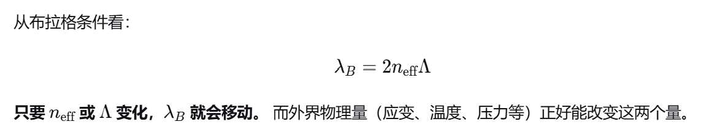
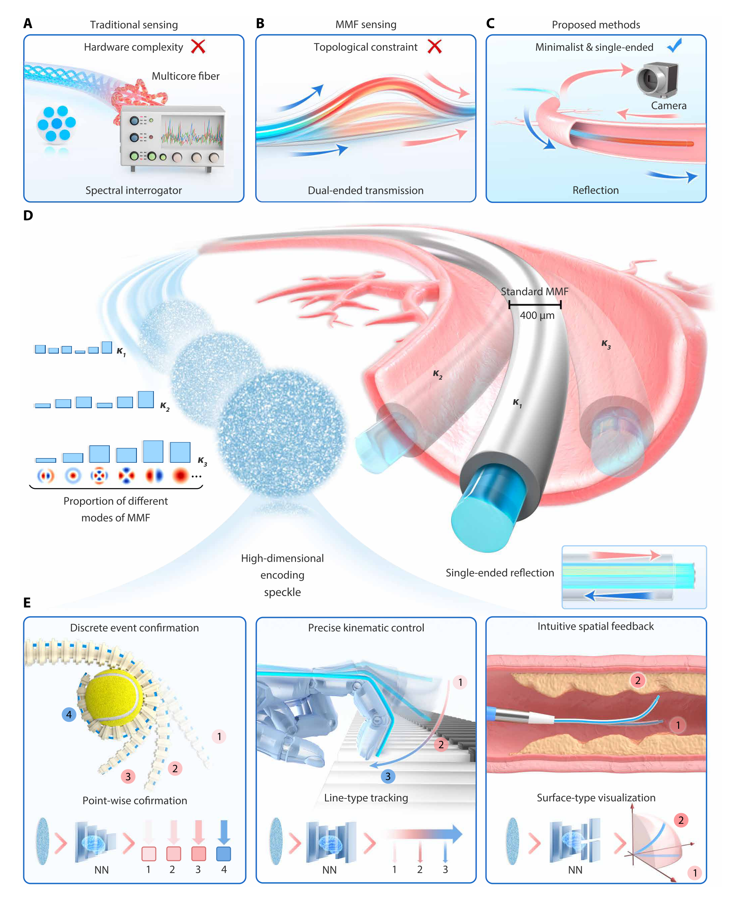
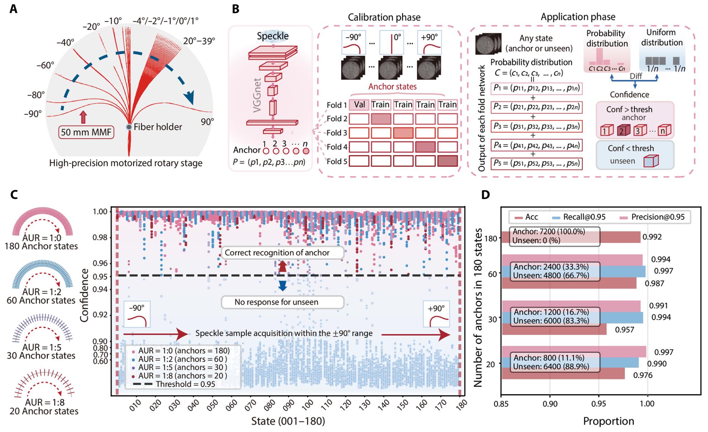
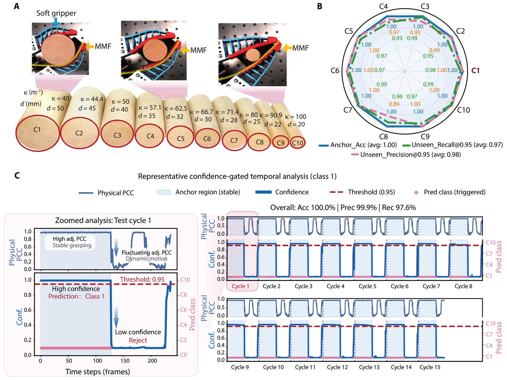
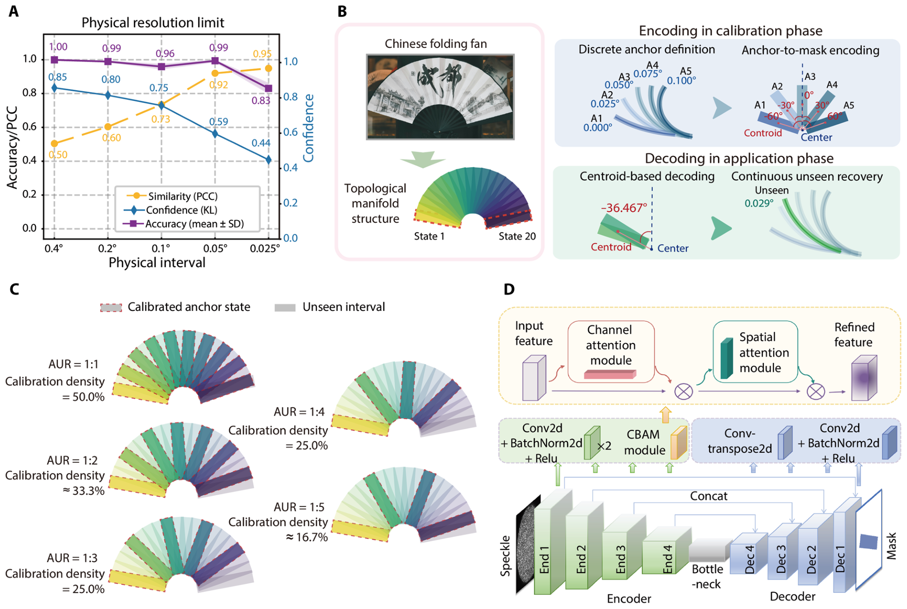
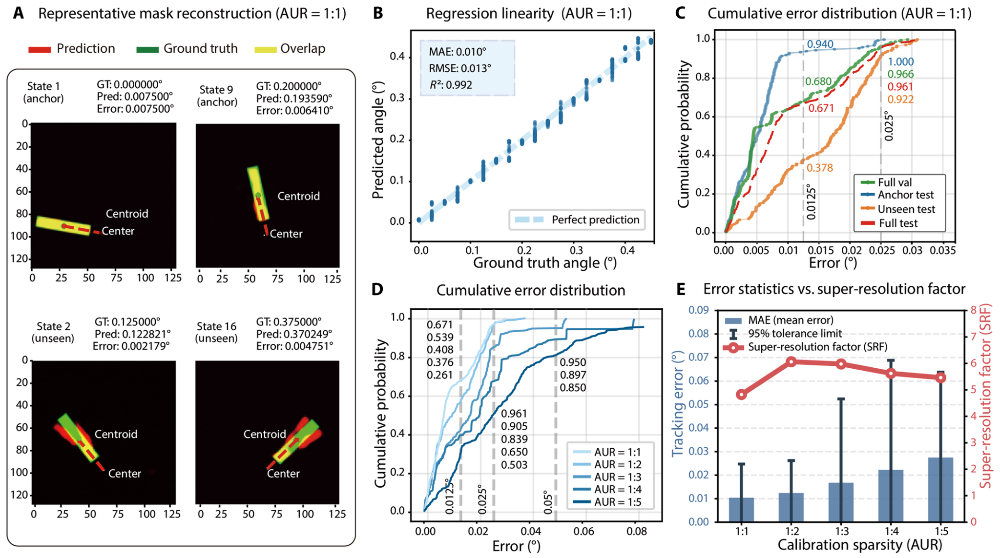
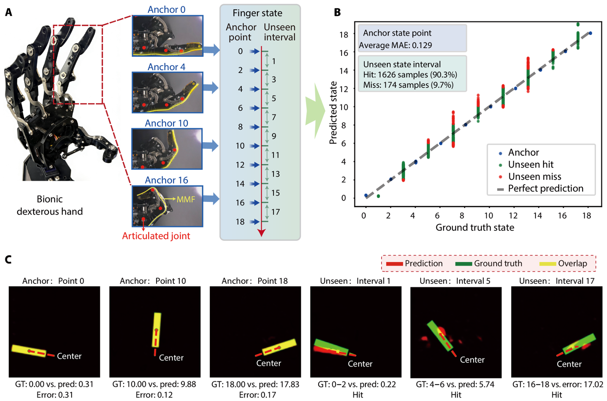
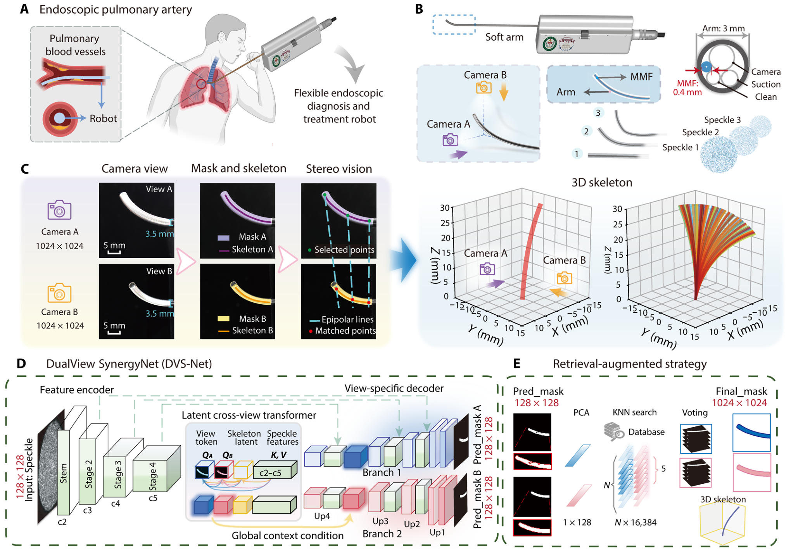
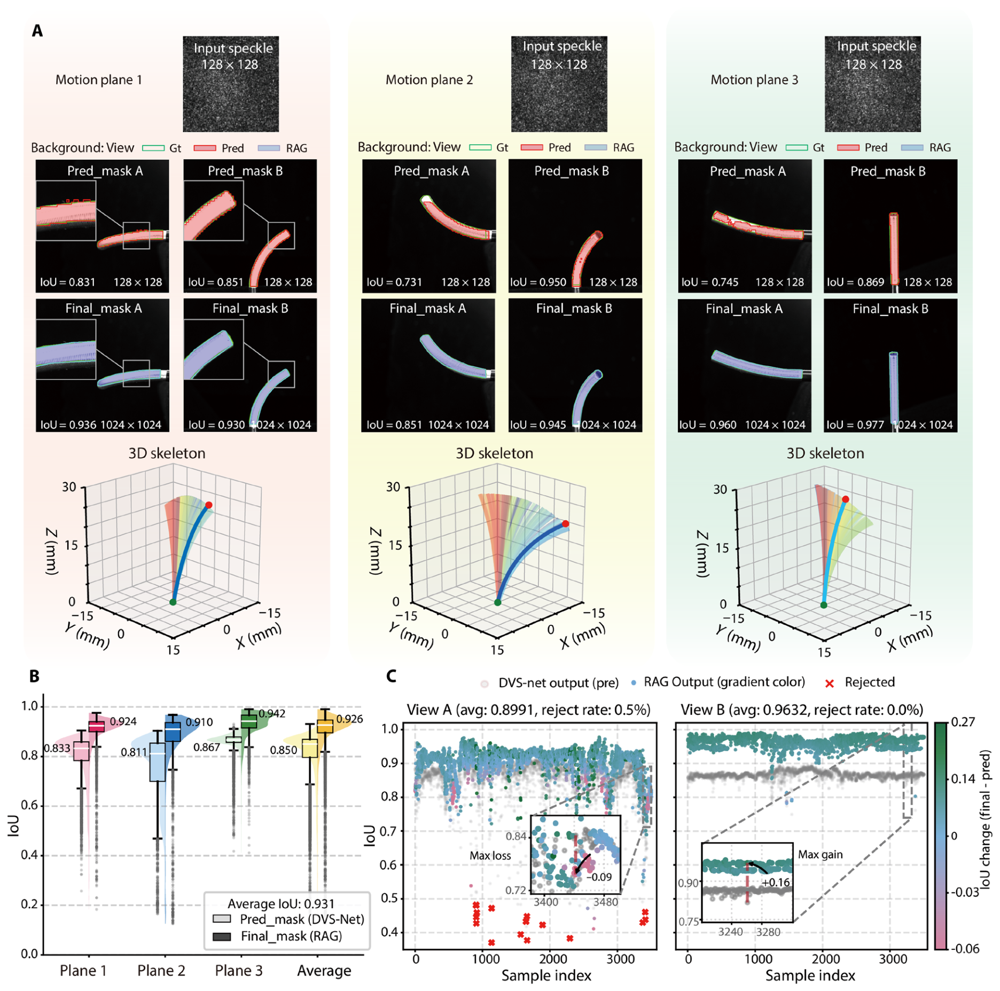

# Deep learning–enabled versatile shape perception for soft robots via single-ended multimode fiber 精读笔记

> **论文**：Deep learning–enabled versatile shape perception for soft robots via single-ended multimode fiber（深度学习赋能的单端多模光纤通用形状感知，面向软体机器人）
> **作者**：Zhaofan He, Lele Wang, Haidi Geng, Zhengyang Lu, Tiantian He, Hongkun Zhong, Hailong Zhang, Runfeng Zhu, Qingxiang Zhao, Yuan Meng, Dan Li, Ping Yan, **Qiang Liu\***, **Qirong Xiao\***（何兆凡等，刘强、肖起榕为通讯作者）
> **期刊**：Science Advances（AAAS），12(24), eaef6263。DOI: [10.1126/sciadv.aef6263](https://doi.org/10.1126/sciadv.aef6263)，**CC BY 4.0 开放获取**
> **投稿时间线**：2026-01-20 收稿 → 2026-04-30 接收 → 2026-06-12 发表
> **单位**：清华大学精密仪器系、时空信息精密感知技术全国重点实验室；清华大学未央书院；四川大学华西医院华西生物医学大数据中心
> **数据与代码**：Zenodo，<https://zenodo.org/records/19601658>
> **阅读对象**：**光学、光纤、深度学习零基础**。
> **数学深度**：只讲原理（每个公式说明"表达什么关系"，不推导）

---

## 一、一句话看懂这篇论文

**一句话**

一根头发丝粗细的玻璃丝（直径约 0.4 mm），弯成什么形状，从它尾端射出来的那团"麻点"花纹就会变；本文用一个神经网络去读这团花纹，从而在一根丝上同时实现了三件事——**认出当前是哪种抓取状态、连续测出手指弯了多少度、重建出三维形状**。

**这条链是怎么走通的**

| 环节    | 发生什么                 | 用到的物理                     |
| ----- | -------------------- | ------------------------- |
| ① 形状  | 光纤被弯成某个形状            | 力学：弯曲 = 一侧拉伸、一侧压缩         |
| ② 折射率 | 应力改变玻璃的折射率           | 光弹效应（photoelastic effect） |
| ③ 模式  | 光在光纤里走的"路径组合"被改写     | 模式耦合（mode coupling）       |
| ④ 散斑  | 几千条"路径"叠加干涉，形成一团亮暗麻点 | 多模干涉                      |
| ⑤ 图像  | 相机拍下这团花纹             | 光电成像                      |
| ⑥ 形状  | 神经网络从花纹反推出形状         | 统计学习                      |
光弹效应：材料原本是各向同性的，光速在各个方向都相同。当施加应力时，材料内部结构发生微小变形，导致不同方向上的分子排列或密度出现差异，进而使折射率发生变化。一束光进入受力材料后，会分解为两束偏振方向互相垂直的光。这两束光在材料中的传播速度不同，因此穿过材料后会产生光程差（相位差）。

这条链的每一环都不是本文发明的新物理——**散斑对形变敏感**是光纤光学几十年前就知道的事。本文的贡献在后两步：**怎么把相机+神经网络做成一个能进人体、能同时干三种活儿的系统**。

**三个关键设计**

1. **单端反射（single-ended reflection）**。传统多模光纤感知要"两头接设备"：一端射光进去，另一端接相机读花纹。这意味着光纤必须在器械里绕成一个圈（去、回各走一根）。本文改成：**光从尾端侧向注入，从光纤最前端的面反射回来，原路返回后在尾端被相机拍下**。前端除了玻璃断面什么都没有——**远端零器件**，光纤在器械里可以直着走。这是全文最重要的结构创新。

2. **把复杂度从硬件搬到算法**。同一套硬件（一根光纤 + 一个激光器 + 一台相机），通过**换神经网络**切换感知模式：要么只回答"是/不是"某几个关键状态，要么连续输出一个角度，要么输出三维形状。论文的说法是 shift complexity from physical integration to neural decoding——**用软件换硬件**。

3. **置信度门控（confidence gating）**。神经网络对自己的输出给出一个 0–1 的"确信度"，低于阈值就直接**拒绝作答**，而不是给一个错的结果。手术场景里，**"知道自己在瞎猜"和"猜对"同样重要**。

**最需要用实验守住的一步**

散斑对形变极度敏感，这是一把双刃剑：**它对温度、振动、光纤接头松动、甚至空气流动同样敏感**。如果做不到"同一种形状永远给出同一团花纹"，整条链就断了。

论文用三层实验来守：
- **刚性转台（图 2）**：把光纤装在高精度电动转台上，用转台的真实角度当基准，证明"同一角度重复出现 40 帧，散斑可分辨地被归到同一类"。
- **软体夹爪（图 3）**：真实软体场景没有绝对真值，改用"花纹的时间稳定性（相邻帧相关系数）"来定义"这一刻算不算抓稳了"，证明系统能在动态过程中抑制误触发。
- **15 轮重复（图 3C）**：证明在反复机械应力下没有漂移。

**学术定位**

本文属于"**新架构 + 多任务系统 + 强算法**"型工作，不是传感原理的首创。论文自述两点来源：(i) 侧耦合注入光的技术来自本课题组此前在多模光纤**成像**领域的积累（作者团队自引 [31]）；(ii) 用深度学习解码散斑，是 2010 年代后期以来的研究路线（引言 [29]）。本文的新意在于**单端反射架构 + 三类异构任务用同一根光纤**。在 Science Advances 这类综合期刊里，这属于"系统与框架"类贡献；相应地，**它的临床验证深度很浅**（见第七节）。

---

## 二、背景与动机：为什么做这个

### 1. 软体机器人的"本体感觉"缺的是什么

**本体感觉（proprioception）**：人能闭着眼睛知道自己的胳膊在哪、弯了多少度。这是肌肉和关节里的感受器给的。机器人要把这件事做出来，传统办法是**在每一个关节装一个角度编码器**——刚体机器人每个关节是独立的、数量有限，所以装得起。

**软体机器人（soft robot）**：用硅胶一类软材料做的机器人，没有"关节"，整条身子可以连续地弯、扭、伸。它的问题在于：

- **自由度是"无限"的**。一根软管可以弯成无穷多种形状，装几个传感器都是"抽样"，中间的部分是瞎的。
- **高度非线性**：材料的应力-应变关系是非线性的，大变形时尤其复杂。
- **形变本身就是状态**。软体机器人被推一下、被拉一下、被压一下，都表现为"形状变了"。所以**形状感知不只是为了控制，它同时也是在感知外部接触力**。

论文引言里有一句话是全文的立论基础：形状（shape）既是软体机器人状态的时空载体，也是推断其它物理量（力、接触）的基本依据。所以**读懂形变 = 让软体机器人从"开环执行器"(只负责"执行命令"，不感知结果、不自我调整。)变成"闭环智能体"(能感知自身状态和环境，根据目标与实际状态的差距，自主调整行为。它是一个"感知—决策—行动"的循环。)**。

### 2. 感知与集成的两难

论文把矛盾说得非常清楚，值得原文摆出来：

- 想要**感知丰富**，就得**堆硬件**（多装传感器、多走线）。
- 想要**硬件极简、容易集成**，就**信息不够**。

这个矛盾在**介入手术**场景被放大到极致：器械本身就是细长柔软的管子（论文举的场景是**肺动脉血栓内膜剥脱术**，器械要进入**直径只有 2.0–4.0 mm** 的肺动脉分支），空间和负载被卡死，既要细、又要软、还要能感知。

### 3. 现有四条路，各自卡在哪

论文引言里逐条点名：

| 路线                  | 代表                | 它的优势    | 论文指出的问题                                       |
| ------------------- | ----------------- | ------- | --------------------------------------------- |
| **电子皮肤 / 触觉阵列**     | 电阻、压电阵列（[10,11]）  | 触觉密度高   | 离散布点，**空间采样不连续**，覆盖不了整条软体                     |
| **液态金属 / 光纤应变传感器**  | 可拉伸波导（[12,18,19]） | 可测应变    | 走线与封装带来**集成刚度**，反而限制了软体本该有的自由形变               |
| **磁定位 / 惯性测量（IMU）** | （[13]）            | 擅长测刚体位姿 | 需要外部磁场或积分漂移；**管腔里视线被遮挡**                      |
| **视觉跟踪**            | 外部相机              | 全局视野    | 在**狭小弯曲的内部腔道**里必然被遮挡（line-of-sight occlusion） |

论文还补了一句更深的话：这些技术都还停留在**信息层面**上不去——无限自由度的连续介质，其信息密度是**高维**的，而上面这些方案给的是**低维、离散、有限个数字**。

### 4. 光纤传感：从 FBG/OFDR 到多模光纤

**为什么选光纤**：玻璃丝（波导）直径可以做得很小、天生柔软、**本质上不导电所以不受电磁干扰**（EMI immunity）( **Electromagnetic Interference**)，这几点在磁共振环境、电刀手术中都是硬优势。

论文把光纤传感分成三代来看：

**第一代：光纤布拉格光栅（FBG）**（**Fiber Bragg Grating**）

- **是什么**：在光纤纤芯里刻上一段**周期性折射率条纹**。光经过时，只有某一个特定波长的光被反射回来。（**它是一段光纤里被“刻”出周期性折射率变化的结构，能像镜子一样只反射某个特定波长的光，其他波长通过**）
- **怎么测**：光纤被拉伸或压缩，条纹间距被改变，被反射的波长随之移动。**测波长移动量 = 测应变量**。精度极高（微应变级）。

- **本文指出的问题**：要**昂贵笨重的光谱解调仪**（论文图 1A 里画的那台带屏幕的机箱）和**特种光纤**（多芯光纤），功能固定、成本高，**塞不进器械**。

**第二代：光频域反射计（OFDR）**

- **是什么**：往光纤里打**频率扫描的激光**，测量沿光纤长度上各点的**背向散射**，从而得到**沿长度分布**的应变/温度曲线。
- **本文指出的问题**：同样依赖复杂解调设备；本质是**分布式**测量，但代价是系统庞大。

**第三代：多模光纤（MMF）的散斑**

这是本文选择的方向。关键词：

- **多模光纤**：纤芯/波导（Waveguide）粗到可以同时容纳**几千条**不同的光传输路径。（**波导是一种能够把波约束在特定路径或结构里传播的物理结构。**）（光纤：**纤芯折射率 > 包层折射率。光从纤芯射向包层时，如果入射角大于**全反射临界角，就会发生**全反射**，光被“弹”回纤芯。这样光就被限制在纤芯里，沿着光纤方向传播。这就是波导约束光的最基本机制：**全反射。**）
- **散斑（speckle）**：这几千条路径的光在出口叠加，相位各不相同，**有的地方相加变亮、有的地方相消变暗**，形成一团麻点状花纹。
- **关键性质**：这团花纹**对光纤受到的扰动极度敏感**。温度、应变、弯曲都会改变各路径的相位，从而完全重排麻点图案。

论文由此提出核心判断：**既然散斑本身就是高维信息库，那就不需要光谱解调，只需要一台普通图像传感器（工业相机）拍下它**。硬件从"光谱仪"降级到"相机"，这是成本与体积的量级差别。
（散斑图案对多个物理量同时敏感，包括振动、温度、光纤弯曲等;传统光谱仪的核心是**把不同波长的光在空间上分开**,分光之后，用探测器阵列测量每个波长位置的强度，**直接得到光谱**。**光谱仪的本质是“硬件分光”，散斑光谱仪的本质是“软件解算”。**)

### 5. 多模光纤已有的两条路，为什么都不够用

论文明确了现有 MMF 感知的两个瓶颈：

**瓶颈一（硬件 / 拓扑）：双端透射架构**

现有的散斑感知大多要**两端各接设备**——一端注入光，另一端拍散斑。这要求光纤在器械里**绕成一个回路（loop）**。对于一根要穿过血管分叉的导丝，**绕回路在物理上是不可能的**。

**瓶颈二（功能）：把散斑当作静态特征，训练单一任务的网络**

现有的研究大多"散斑 → 一个物理量"端到端地训练一个网络，结果是：

- **泛化差**：换一种形状任务、换一根光纤，网络就废了。
- **标定成本极高**：每个任务都要重新采一遍数据。
- **能力天花板低**：只做到"曲率、位移、挠度"这类**单个物理量的定量测量**，满足不了软体机器人"离散状态 + 连续轨迹 + 三维形状"这种异构的需求。

**这两条瓶颈，正好对应本文的两个卖点：单端架构（解决拓扑）+ 可重构神经解码器（解决功能）。**

### 6. 本文的取舍

论文自述的策略是"**divide-and-conquer（分而治之）**"：不为所有任务训练一个万能网络，而是**针对每一类任务的数学性质，设计专门的解码器**，但共用同一套硬件。三个任务、三套解码器：

1. **离散状态确认**（point-wise）：只要回答"是不是这几个关键状态之一"。→ 用**分类网络 + 置信度门控**。
2. **连续形状跟踪**（line-wise）：要连续输出一个角度，而且要"比标定点还细"。→ 用**结构化几何编码 + 回归网络**。
3. **三维形态重建**（surface-wise）：要给出腔道里的三维形状。→ 用**双视角协同网络 + 检索增强（RAG）**。

论文把这一取舍的代价也写在了讨论里：这种分而治之**尚未形成统一的、端到端的自适应流程**（见第七节 A）。

---

## 三、必须先理解的核心概念
### 概念 0：光、波长、激光

- **光**：一种电磁波，可以理解成"在空间里传播的、周期性的电场和磁场抖动"。
- **波长 λ**：相邻两个波峰之间的距离。人眼能看见的波长约 400–700 nm（1 nm = 10⁻⁹ m）。本文用的是 **1064 nm**，属于**近红外**——**人眼看不见**（这一点在第六节的风险里很重要）。
- **激光（laser）**：核心特点是**单一波长、相位整齐、方向集中**。本文需要"相位整齐"的光源，因为散斑本质上是**相位干涉**的结果；如果光源波长杂乱（相位随机），散斑就糊掉了。
- **量级感**：1064 nm 大约是**一根头发丝直径的 1/70**；本文光纤外径约 400 μm ≈ 0.4 mm，大约是**两根头发丝并排**。

### 概念 1：光在光纤里怎么走 —— 全反射、纤芯、包层、数值孔径

**光纤的基本结构**（从里到外）：

```
        包层 cladding（折射率低一点）
   ┌───────────────────────────────┐
   │      ┌───────────────┐        │
   │      │  纤芯 core    │        │     ← 光主要在这里走
   │      └───────────────┘        │
   └───────────────────────────────┘
        涂覆层 coating（塑料，保护用，不导光）
```

- **折射率 n**：光在介质里"变慢"的比例（n = 真空光速 / 介质中光速）。n 越大，光走得越慢。空气 n ≈ 1.00，水 n ≈ 1.33，玻璃 n ≈ 1.45。
- **全反射**：光从"光密"介质（n 大）射向"光疏"介质（n 小）时，只要入射角足够斜，就**完全反射回来，不泄漏出去**。这是光纤能"锁住"光的原理。所以**纤芯的折射率必须略高于包层**。
- **数值孔径（numerical aperture, NA）**：光纤"能收多大角度范围的光"的度量。NA 越大，"眼睛越大"，能同时容纳的传输路径也就越多。

**本文这根光纤的具体参数**（Materials and Methods 给出的）：

| 部位 | 直径 | 数值孔径 NA |
| --- | --- | --- |
| 纤芯 core | 2a = **30 μm** | NA = 0.065（很小） |
| 内包层 inner cladding | 2a = **250 μm** | NA = 0.46（很大） |
| 光纤外径（含涂覆层） | **约 400 μm** | — | 论文摘要里的"~400 μm"指的是这个数 |

型号是 **Nufern LMA-GDF-30/250-M**。它是"双包层（double-clad）"结构——**纤芯外面还裹着一层更粗的玻璃包层，这层包层本身也能当波导用**。

### 概念 2：什么是"模式"（mode）⭐

**这是读懂全文最关键的一个概念。**

想象一根很粗的管子，你从一端往里照手电。光在里面可以走**很多种不同的"路径组合"**：

- 一种走法是**贴着轴心直线走**——这叫**基模**（fundamental mode）。
- 另一些走法是**走"之"字形**，在管壁之间来回反弹，反弹的周期和角度各不相同——每一个这样的稳定走法，就叫一个**高阶模式**。

**模式 = 光在波导里一种自洽稳定的横向分布**。它们像乐器的一根弦上能弹出的很多个泛音：弦长定了，能弹的音（模式）也就定下来了。

**与本文的关系**：光纤里同时存在**几千个模式**，光在各模式之间分配能量。**每一种形状 → 一种特定的能量分配 → 一种特定的散斑**。这就是 "形状编码进高维散斑" 的物理含义。

**关键区分：为什么是"内包层"在导光**

- 如果只用**纤芯**导光：NA = 0.065 很小，能容纳的模式极少（论文算出 **约 17 个**）。
- 本文用**侧耦合**（见概念 8）把光注进**内包层**：NA = 0.46 很大，能容纳的模式极多（论文算出 **约 57,560 个**）。

> 所以论文反复强调 "side coupling 提升了被激发模式的数目，从而丰富了散斑的编码容量"。**从 17 到 57,560，这是全文一切性能的物理本钱。**

### 概念 3：模式数怎么算 —— V 数与 M ≈ V²/2

论文用了一个**教科书公式**：

**V 数（归一化频率）**
```
V = 2πa · NA / λ
```
- **a**：波导半径（单位 m）
- **NA**：数值孔径
- **λ**：波长（单位 m）
- **V 的物理含义**：波导"电学上有多粗"，用波长的倍数来衡量。V 越大，能装下的模式越多。

**模式数**
```
M ≈ V² / 2
```
- 这是**阶跃折射率光纤**在"弱导近似"下的标准估计。
- 为什么是平方？因为模式要用**两个方向**来描述：横向的"形状阶数"（径向 + 角向各一个指标），两个方向各自可达约 V 量级，所以总数是 V² 量级。

**本文的两个数**（Materials and Methods 原文）：
- 只算纤芯：V_core ≈ 5.76 → M ≈ 5.76²/2 ≈ **17 个模式**
- 算内包层：V_clad ≈ 339.3 → M ≈ 339.3²/2 ≈ **57,560 个模式**（我核算过，算术无误）

> ⚠️ **我的批注**：这里有一个概念跳跃需要指出。论文用"**光纤最多能支持多少模式**"（一个理论上限）来论证"**侧耦合实际激发了多少模式**"。这两件事不是一回事——实际激发多少模式取决于注入条件，需要实测（例如测传输矩阵或做模式分解）才能知道。论文全文**没有给出实测的模式数**。这不否定其结论方向（NA 大 7 倍，激发模式数必然大幅增加），但"57,560"应当读作**量级估计**而非测量结果。

### 概念 4：散斑（speckle）—— 多模式干涉的"指纹"

**为什么会有散斑**

把几千个模式想成几千个人同时喊话。每个人喊的频率（波长）一样，但从出发到到达的距离不同，所以**到达时各自的"波峰位置"错开了**。

- 在某些位置上，很多人的波峰正好重叠 → **相加，很亮**。
- 在另一些位置上，一些人的波峰正好撞上另一些人的波谷 → **相消，很暗**。

于是整个横截面上形成**随机分布的亮暗斑点**——这就是**散斑**（也叫"斑图"、"麻点"）。它看起来像电视雪花，但**完全确定**：只要光纤形状和温度不变，散斑图案就一模一样。

**为什么它"高维"**

论文的核心论点之一是：一张散斑图不是"一个数字"，而是**几千个模式相位的集体产物**。如果把散斑图上的每个像素当成一个数据点（本文相机 2048 × 1536 像素），那它是一条**百万维的数据流**。形状信息就藏在这条数据流里。

论文的原话把散斑称作 "high-dimensional data stream"（高维数据流）和 "high-dimensional information library"（高维信息库）。

**本文的预处理管线**（Materials and Methods）：

1. 从 2048 × 1536 的原始图像里**裁出中央 768 × 768**——把边缘梯度不稳定的区域去掉。
2. **3:1 离散下采样**——每 3 个像素取 1 个（保留高频特征，同时减轻计算量）。
3. **缩放到 128 × 128**——作为神经网络的输入。

> 也就是说，网络实际看到的是 128 × 128 = **16,384 个像素**的一张灰度图。这个数字在后面 RAG 的数据库里会再出现（概念 14）。

### 概念 5：弯曲为什么会改变散斑 —— 应变、光弹效应、模式耦合

**第一步：弯曲 = 一侧拉伸、一侧压缩**

把一根橡皮管弯起来：**外侧被拉长，内侧被压短**。这就是**拉伸应变与压缩应变**（tensile / compressive strain）。应变是无量纲的相对形变量（ΔL/L）。

**第二步：应力改变折射率（光弹效应）**

**光弹效应（photoelastic effect）**：材料受力后，**折射率会改变**，而且改变量**取决于受力的方向**。

- 一个生活中的近亲是**透明的塑料尺在偏振光下出现彩色条纹**——那是内应力导致折射率各向异性。原理相同。
- 本文的表述：光纤在三维空间任意形变时，内外层之间产生**分布式的拉伸与压缩应力**，通过光弹效应**转化为介电张量 ε 的"非对称扰动"**。
- **"非对称"这三个字很关键**：只弯不扭时，内侧外侧的扰动是反号的；一旦发生**扭转**，扰动的方向就不再是简单的镜像对称。所以**散斑里同时含有弯曲和扭转的信息**——这也是图 8 里"三个运动平面代表三种轴向扭转状态"的物理依据。

**第三步：折射率改变 → 模式之间的能量重新分配**

折射率分布变了，**光的传播路径也变了**，于是原本待在自己模式里的能量会**窜到别的模式去**。这个现象叫**模式耦合**。

论文给出的完整因果链是：

```
形状（形变）
  → 分布式应力
  → 光弹效应改变介电张量 ε
  → 改变模式耦合
  → 改变各模式的输出系数 c_μ
  → 输出散斑图案改变
```

**"形状 → 散斑"是一一对应的**（对固定环境和固定光纤而言），这就是"编码（encoding）"。

**一个重要的物理后果（论文没有单独强调，但对理解全文的边界很关键）**

散斑是**整根光纤上所有形变的累积结果**。请仔细看论文的表述：evolved mode amplitude vector c(z) **accumulates** various perturbation information **along the fiber path**。

这意味着：

- 输入是"一根光纤的整体形状" → 输出是"一团散斑"，**中间没有"沿着光纤哪一段弯了多少"这个信息**。
- 也就是说，**单根光纤的散斑感知天然没有沿长度方向的空间分辨能力**。它测的是一个**积分量**，不是一个分布量。
- 这正是本文必须依赖神经网络"认出形状"的原因（它不是在解一个逐点反演问题，而是在做模式识别），也是它三维重建只能覆盖**三个预定运动平面**的根本原因（见第七节 B）。

### 概念 6：传输矩阵 —— 把光纤看成一个"黑箱线性系统"

**线性系统**：如果"输入 1 → 输出 1"、"输入 2 → 输出 2"，那么"输入 1+输入 2 → 输出 1+输出 2"。满足这种可加性的系统就叫线性系统，可以用**矩阵**描述。

**传输矩阵（transmission matrix, TM）**：光纤的模式耦合是一个线性过程，所以可以写成一个**矩阵乘法**：

```
输出 = T · 输入
```
- 矩阵 T 把"入口各模式的振幅"映射成"出口各模式的振幅"。
- **光纤形状变了，T 就变了**。所以 MMF 感知可以被理解成"**测量 T 的变化**"。

本文没有去测完整的传输矩阵 T（那需要波前整形等复杂装置），而是**直接让神经网络去学"输入散斑 ↔ 形状"的映射**——跳过显式建模 T。这一取舍的代价是**泛化性和可解释性**（见第七节 B）。

### 概念 7：单端反射 vs 双端透射 ⭐

这是本文相对已有工作最重要的结构区别，值得画清楚。

**双端透射（已有主流做法）**

```
[激光器] ──→ ┐                                    ┌──→ [相机]
             ├──── 传感段（可弯曲）── 穿过器械 ────┤
             └──── 需要第二根光纤把光"送回来" ────┘
                        ↑
                 整根光纤必须在器械里绕成一个回路
```

问题：**器械里必须容纳去、回两条光路**。在血管分叉处、在 2 mm 的细管里，这是做不到的。

**单端反射（本文做法）**

```
[激光器] ──┐
           ├── 侧耦合模块 ──→ 同一根光纤 ──→ 远端端面
[相机]   ──┘         ↑                          │
                     └──────── 反射回来的光 ─────┘
```

- **只有一个端口**：激光从这里进，散斑从这里出（器件上是分开的，但**光纤只有一根、只占一个通道**）。
- **远端没有任何器件**：光靠光纤**最前端那个玻璃断面的自然反射**（Fresnel 反射）返回。
- 论文的表述：reflective design eliminates distal hardware dependencies——**反射式设计消除了对远端器件的依赖**。

**这一改动的物理代价（很关键，值得单独记住）**

1. **回光功率低**。端面自然反射的反射率取决于**玻璃与外界介质的折射率差**。计算见第六节风险 4——在空气中约 3.4%，**浸在血液里只有约 0.13%**，相差约 26 倍。
2. **光要走两遍**。去程和回程各经历一次模式耦合，形变信息**累积两次**，误差也累积两次。
3. **返回光要能和入射光分开**，这靠侧耦合模块实现（见概念 8）。

> ⚠️ **我的批注**：论文正文的数学（公式 2）写的是**单向传播方程** `dc/dz = −j(β + K_deformation)c(z)`，是关于 z 的一阶方程，描述光从尾端走到远端。**但实际系统是往返一次**，回程还要再乘一个（不同的）耦合矩阵。论文没有给出**往返（round-trip）情形的公式**，也没有讨论正反向耦合矩阵是否对称。这是模型与系统之间的一处缺口。

### 概念 8：侧耦合（side coupling）

**问题**：怎么把光"塞进"内包层？正常做法是从光纤**端面**对准射入。但本文的光纤只有远端和近端两个端面：远端要空着（当反射镜用），近端要留给相机拍散斑。**端面被占满了。**

**做法**：不从前端面注入，而是**从侧面注入**——把一根输送光纤（YOFC 135/155，芯径 135 μm）**贴着**传感光纤的侧面，让光从输运光纤**横向"渗"进传感光纤的内包层**。这就是侧耦合。

**"侧耦合"的类比**：像两个并排的秋千，通过中间一根很松的弹簧连起来。你在一个秋千上荡，动能会慢慢传到另一个秋千上。两根光纤贴得足够近时，光的场分布发生重叠，也能横向耦合过去。

**为什么这招是本文前面"57,560 个模式"的来源**：注入点是内包层（NA 0.46，直径 250 μm），而不是纤芯（NA 0.065，直径 30 μm）。

**论文自述该技术的来源**：侧耦合注入来自作者团队此前在 **多模光纤成像** 领域的研究积累（自引 [31]），本文把它移植到传感用途。

> ⚠️ **我的批注**：侧耦合模块的**具体结构、耦合效率、插入损耗、以及"如何把回程光从入射光里分离出来（分离比）"，正文均未给出**，论文指出完整光路见补充图 S1。这几个数字直接决定了**回光能有多强 → 曝光时间能有多短 → 系统的最高时间分辨率**，因此对"能否做闭环控制"这个核心主张是关键的。**本 PDF 不含补充材料，无法核实。**

### 概念 9：神经网络 —— 到底在学什么

**最朴素的说法**：神经网络是一个**可调的、极其复杂的函数**。你给它输入（散斑图），它输出一个答案（是哪个状态 / 角度是多少）。"训练"就是**自动调节这个函数内部的几百万个旋钮**，让它在你的训练数据上给出正确答案。

**几个必须分清的词**：

| 词 | 含义 | 本文对应 |
| --- | --- | --- |
| **分类（classification）** | 输出是"n 选 1"的离散标签 | 任务一（180 个状态中选一个） |
| **回归（regression）** | 输出是一个**连续数值** | 任务二（输出角度） |
| **损失函数（loss）** | "答错的程度"的量化指标；训练 = 让它变小 | 公式 (4)、(5) |
| **训练集 / 验证集 / 测试集** | 调旋钮用的 / 调超参数用的 / **从头到尾没碰过**的考试卷 | 前 8 轮 57,600 张 / 第 9 轮 7,200 张 |
| **过拟合（overfitting）** | 把训练数据"背下来"了，换新数据就崩 | 论文用五折交叉验证 + Dropout 防它 |
| **泛化（generalization）** | 在没见过的数据上仍然答对 | 全文所有"unseen"实验都是在考这个 |

### 概念 10：分类 vs 回归 —— 本文三个任务的分水岭

这个区分是读懂**图 4A 那张最关键曲线**的前提。

- **分类**：网络被要求"在 20 个格子中选一个格子"。当两个相邻状态**长得几乎一样**（散斑几乎相同）时，"选对格子"这个任务在数学上就**变得病态**——因为你要求它把两个几乎相同的输入给出不同的答案。**精度到一定程度后，继续加密标定点只会让准确率下降**（这就是图 4A 里紫线从 0.99 掉到 0.83 的原因）。
- **回归**：网络被要求输出一个连续值。同样的"两个状态几乎一样"不构成困难——**输出一个介于两者之间的值本来就是允许的答案**。

论文在这一点上的论证非常漂亮，是全文最值得学习的部分：

> **不是提高网络能力突破分辨率极限，而是把"分类"问题改写成"回归"问题。**

### 概念 11：卷积、U-Net、注意力（CBAM）、Transformer

本文用到三个现代网络组件，都是"零件级"的，理解它们**做什么**即可。

**卷积（convolution）**
- 用一个**小窗口**（如 3×3）在图像上滑动，每个位置算一次加权和。
- 作用：把"相邻像素的组合模式"提取出来（边缘、纹理、斑点的形状）。
- **为什么适合散斑**：散斑的关键信息在**空间花纹**上，不在单个像素上。

**U-Net**（任务二、任务三用到）
- 一种"**先缩小后放大**"的网络：左边一路反复缩小（编码器），右边一路反复放大回原尺寸（解码器），中间还有**跳线**把左边的细节直接送到右边。
- 输入和输出都是"图"（这里是 128×128 的**掩膜 mask**，见下）。
- **为什么叫 U 形**：因为左右两路的尺寸变化画出来是一个 U。

**掩膜（mask）与结构化几何编码**（任务二的核心思想）
- **掩膜**：一张和输入同样大小的图，其中每个像素上的数值表示"这个像素属于目标的程度"。
- 本文的巧思（图 4B，论文称为"**折扇编码**"）：**把"角度"这个一维数字，变成二维掩膜里"扇形张开的角度"**。
  - **扇骨（fan ribs）**：标定过的离散角度，画成一条一条的"骨"。
  - **扇面（fan surface）**：两根扇骨之间的连续区间。
  - 输出掩膜后，**取质心**，质心相对扇心的方位角就是预测的角度。
- **为什么这样更准**：网络不必"精确画对每一个像素"，只要**整体形状大致对**，质心就已经很准了——**用集体统计量过滤掉了像素级噪声**。

**注意力（attention）与 CBAM**（任务二）
- 注意力 = 网络自己学出来的"**该看哪里**"的权重。
- **CBAM（convolutional block attention module）** 包含两个方向：
  - **通道注意力（channel attention）**："哪些特征通道更重要"（论文的解释是：给有效的光学模式分配权重）。
  - **空间注意力（spatial attention）**："图上哪些位置更重要"（论文的解释：定位形变敏感区域，也就是扇骨的边缘）。
- **论文原话**：注意力抑制背景噪声。

**Transformer 与 Q/K/V**（任务三）
- Transformer 的核心是**注意力机制**：先给每个"元素"生成三个向量——**查询 Q（我要找什么）、键 K（我有什么标签）、值 V（我的内容）**，然后用 Q 和所有 K 做匹配，按匹配度加权取出 V。
- 本文用它做**跨视角协同**：
  - **可学习的视角令牌 Q_A、Q_B**：分别代表"视角 A 需要的几何信息"和"视角 B 需要的几何信息"。
  - **共享骨架隐令牌（shared skeleton latent tokens）**：代表"**两个视角共同对应的那个三维物体**"。
  - **散斑特征作为 K、V**。
- **这个设计要解决的问题**：一根光纤只能给出**一个**二维散斑，却要同时预测**两个正交视角**的掩膜。如果没有"共享骨架"这个约束，网络完全可能给出**两张互相矛盾**的图（论文称之为 geometric hallucination，几何幻觉）。共享令牌的作用是**强制两个视角指向同一个三维实体**。
- 规模：**8 个注意力头、6 层**。

### 概念 12：交叉验证与软投票

- **k 折交叉验证（k-fold cross-validation）**：把训练数据切成 k 份，每次留 1 份做验证、其余 k−1 份训练，轮着来，得到 k 个模型。**目的**：让"性能评估"不依赖于某一次划分的运气。
- **本文用法**：**五折**。
- **软投票（soft voting）**：每个模型不是投一个"硬标签"，而是各自给出一个**概率分布**；把 5 个分布**平均**，再取最大值。这样比"5 个模型各投一票、少数服从多数"更稳，因为它利用了"某个模型有多确信"这个信息。

### 概念 13：熵、KL 散度与"置信度" ⭐

**这是任务一整套机制的核心。**

**概率分布的"尖锐"与"平坦"**

- **尖锐（near one-hot）**：`[1.0, 0, 0, 0]` ——网络非常确信是第 1 类。
- **平坦（uniform）**：`[0.25, 0.25, 0.25, 0.25]` ——网络完全不知道是哪一类。

**熵（entropy）**：衡量"分布有多平坦"的指标。**越平坦，熵越大**。均匀分布的熵最大。

**KL 散度（Kullback–Leibler divergence）**：衡量"两个分布差多远"。本文要的就是：

```
网络输出的分布 p   与   均匀分布 U   之间的距离
```

- **若 p 很尖锐**（`[1,0,0,0]`）→ 与均匀分布差得很远 → **KL 散度大** → 置信度高。
- **若 p 很平坦**（`[0.25,0.25,0.25,0.25]`）→ 与均匀分布几乎一样 → **KL 散度接近 0** → 置信度低。

**为什么要除以 ln N（N = 类别数）**

KL 散度的**最大可能值**恰好是 ln N。所以：

```
置信度 = KL(p ‖ U) / ln N
```

- **除以 ln N 之后，置信度被归一化到 0–1 之间**，而且**与类别数 N 无关**。
- 论文明确说明这样做的动机：**让阈值在不同类别数的任务之间可以通用**（scale invariant）——180 类任务和 10 类任务用同一个 0.95 阈值。
- **本文的阈值是 0.95**：只有归一化置信度 **> 0.95** 的样本才算"有效锚点状态（anchor）"，其余一律**拒绝作答**，判为"未见过（unseen）"。

**这套机制的直观比喻**

它相当于给网络配了一个"**举手回答**"的规则：**不确定就别举手**。手术场景里，医生宁可看到系统"沉默"，也不愿看到它"自信地报错答案"。

### 概念 14：PCA 与 KNN —— RAG 的两个零件

任务三的 RAG（retrieval-augmented generation，检索增强生成）流程，本质上是"**先去库里找几个长得最像的，再投票**"。用到两个经典工具：

**PCA（principal component analysis，主成分分析）**
- **要解决的问题**：一张 128×128 的掩膜展平后有 16,384 个数，直接拿去比对又慢又容易被噪声带偏。
- **做法**：找到这堆数据里"变化最大的少数几个方向"，把它们当成新的坐标轴，只保留最重要的那些。
- **本文用法**：把 16,384 维压缩成 **1 × 128** 的**特征向量**。
- **代价**：压缩必然丢信息；但留下的是"最能区分不同形状"的方向，所以对检索反而更稳。

**KNN（K-nearest neighbor，K 近邻）**
- **做法**：在数据库里找和查询向量**距离最近的 K 个样本**。
- **本文用法**：**K = 5**。

**RAG 的完整流程（图 7E）**

1. DVS-Net 预测出两张**粗糙掩膜**（128 × 128）。
2. 对每张掩膜做 PCA → 得到 1 × 128 的查询向量。
3. 在**预先建好的形态先验数据库**里做 KNN 搜索（K = 5）。
4. 把检索到的 5 个 **1024 × 1024 的真实物理样本**做**加权投票**，合成最终的**精细掩膜**。
5. 由精细掩膜提取三维骨架。

**为什么叫 RAG，为什么它重要**

- 论文的说法是：这把一个"**无约束的生成任务**"变成了一个"**被物理定律严格约束的检索任务**"。
- 通俗地说：**网络不再"凭想象画"一条形状，只能在"以前真实测量过的形状库"里挑几个最像的然后平均**。这从原理上杜绝了"画出一个物理上不可能的弯法"。
- **反过来说，它也决定了系统只能重建库里有的形状**——这是第七节 B 里我要重点讨论的一条。

### 概念 15：评价指标（IoU / MAE / RMSE / R² / CDF / 箱线图 / PCC）

| 指标 | 定义 | 怎么读 |
| --- | --- | --- |
| **IoU**（intersection over union，交并比） | 两个图形的交集面积 ÷ 并集面积 | 形状重合度，1 = 完全重合。>0.9 通常算很好 |
| **MAE**（mean absolute error，平均绝对误差） | 误差取绝对值后求平均 | 单位与测量量相同（本文是"度"） |
| **RMSE**（root mean squared error，均方根误差） | 误差平方求平均再开方 | 比 MAE 更惩罚"个别大错" |
| **R²**（决定系数） | 1 − 残差平方和 / 总平方和 | 1 = 完美线性拟合；0.992 表示 99.2% 的变异被解释 |
| **CDF**（cumulative distribution function，累积分布函数） | "误差 ≤ 某值"的样本比例 | 曲线**越靠左上越好**。读法：在横轴 0.025° 处纵轴是 0.961，意思是"96.1% 的样本误差在 0.025° 以内" |
| **箱线图（box plot）** | 箱子的上下边是 25%/75% 分位，中间线是中位数，须是 1.5 倍四分位距内的极值，外面的点是离群点 | 看**分布**而不只是平均值。本文图 8B 用它展示 RAG 让整个分布上移 |
| **PCC**（Pearson correlation coefficient，皮尔逊相关系数） | 两个信号**形状**的相似度，1 = 完全同形 | **注意**：PCC 高只说明"两团花纹形状相似"，**不说明数值大小**。本文用它判断"相邻帧的散斑像不像" |

> ⚠️ **一个容易读错的点**：图 4A 里 **PCC 一路涨到 0.95，但准确率反而掉到 0.83**。这不是矛盾——它恰恰是全文的核心论点：**两个相邻状态的散斑长得越来越像（PCC 高），硬分类就越来越不可能（准确率低）**。PCC 高在这里是"坏事"，因为它意味着"区分不开"。

### 概念 16：AUR 与 SRF —— 本文自定义的两个指标 ⭐

**AUR（anchor-to-unseen ratio，锚点:未见过 之比）**

- **锚点（anchor）**：**标定过**的状态（网络训练时见过）。
- **未见过（unseen）**：两个锚点**之间**的状态（网络从未训练过）。
- **AUR = 1:1** 表示锚点和未见过的一样多；**AUR = 1:8** 表示每 1 个锚点配 8 个未见过状态——也就是**标定得非常稀疏**。
- **AUR 越小 = 标定越省**。论文用 AUR 来回答"**到底要标定多少才够用**"这个问题。

**SRF（super-resolution factor，超分辨因子）**

```
SRF = 训练间隔 / 实际达到的分辨率（MAE）
```

- **训练间隔**：两个相邻标定点之间的角度距离（本文在 AUR = 1:1 时是 **0.05°**）。
- **MAE**：实际测量误差（本文是 **0.010°**）。
- **SRF = 0.05 / 0.010 = 5**。
- **物理含义**：**系统分辨得比标定网格还细 5 倍**。就像用每 5 mm 一格的尺子，量出了 1 mm 的精度——靠的是"网格之间的连续性被网络学到了"。
- **论文正文的表述**：SRF holds consistently **around 5**，"模型始终能分辨出比标定网格细约 5 倍的角细节"。

---

## 四、逐节精读（图文结合）

### 摘要 + 引言

**摘要给出的三个头条数字**（后面每一项都要单独核对，见"附二"）：

| 平台 | 摘要写的指标 |
| --- | --- |
| 软体夹爪（离散状态确认） | accuracy **>99%** |
| 仿生灵巧手（连续形状跟踪） | **~5 倍**空间分辨率提升 |
| 介入手术软体机器人（三维形态重建） | **IoU > 0.93** |

**引言的论证结构**（四步，值得学）：

1. **立论**：软体机器人的形变就是它的状态，形状感知是"闭环智能"的前提，不是性能加分项。
2. **拆解现有方案**：逐条列出电皮肤、液态金属、IMU/磁定位、视觉跟踪的**具体失效模式**（不连续采样、集成刚度、视线遮挡）。
3. **收敛到矛盾**：**感知丰富 ↔ 硬件极简** 的二选一，在介入场景里被逼到极限。
4. **提出解法**：保留光纤的物理优势（细、软、抗电磁干扰），把"信息密度不够"这个短板**交给计算补**。

**摘要和引言里我最想标出来的一句话**：

> "we no longer require complex wavelength demodulation. By simply using a standard image sensor to capture spatial speckle patterns..."

**这句话是全文的成本论点**：从"光谱仪级"设备降到"工业相机级"设备。对介入器械这种一次性/低成本导向的场景，这是**量级上**的改变，比精度的小幅提升重要得多。

### 系统总览（图 1，讲透）



**图 1A —— 被否定的方案：传统光纤传感**

画的是**多芯光纤（multicore fiber）**（左边那个由多个小圆组成的截面）接一台**光谱解调仪（spectral interrogator）**（右边带屏幕的机箱）。红叉 ✗ 标的是 "Hardware complexity"——**问题不在光纤，在那台机箱**。

**图 1B —— 被否定的方案：双端透射的 MMF 传感**

画的是光在光纤里绕过去又绕回来，蓝色箭头向右、红色箭头向左，形成闭环。红叉 ✗ 标的是 "Topological constraint"——**拓扑约束**。

- **"拓扑"这个词在这里的含义**：不是"形状好不好看"，而是"**连接关系**"——光必须"从一端进、从另一端出"，这个**连接关系**本身要求光纤在器械里形成闭环。器械里没有空间做这个闭环。
- 这是全文最根本的一条动机，也是"单端"两个字的分量所在。

**图 1C —— 本文方案：极简 + 单端**

- 只画了一根光纤、一个侧向入口、一台相机（Camera）。
- 箭头显示：光从侧面注入（蓝），向前走，从**远端端面（Reflection）**反射，原路返回（红），被相机接收。
- 标的是 "Minimalist & single-ended" ✓。
- **远端画面上什么都没有**——这正是"远端零器件"的视觉表达。

**图 1D —— 编码机制（本图的物理核心）**

- 巨大的血管状腔道里，一根标着 **Standard MMF, 400 μm** 的光纤被弯成不同形状。
- 三个形状分别标 **K₁、K₂、K₃**（论文的记法：K 应该是 curvature 曲率的意思，但论文没有明确定义这个符号，我按图形理解为三种不同的弯曲状态）。
- 左边一串小图是 **"Proportion of different modes of MMF"（各模式占比）**：
  - 上面一行是**柱状图**——每个柱子是一个模式，柱高是它的能量占比。
  - 下面一行是**带颜色的圆形图标**——每一种颜色/图案代表一个模式。
- **读图要点**：K₁ 的柱状分布比较均匀（能量分散在很多模式），K₃ 的分布则集中成几根高柱（能量聚到少数模式）。**形状不同 → 模式能量分布不同**。
- 中间那团蓝色的**散斑**，就是这些模式叠加干涉的结果。标着 **"High-dimensional encoding speckle"**。
- 右下角小图 **"Single-ended reflection"** 画的就是概念 7 那个往返光路：红色向右（去），蓝色向左（回）。

**图 1E —— 一张图说清三个任务（全文的路线图）**

| 面板 | 场景 | 物联网示意 | 网络输出 | 输出类型 |
| --- | --- | --- | --- | --- |
| **左：Discrete event confirmation** | 软体夹爪抓住一个黄色球（标了 ①②③④ 四个抓取阶段） | 一维长条 → NN | **几个离散的彩色方块**（1、2、3、4） | **点（point）** |
| **中：Precise kinematic control** | 灵巧手做连续动作（标了 ①②③） | 一维长条 → NN | **一个连续的渐变箭头** | **线（line）** |
| **右：Intuitive spatial feedback** | 介入器械在血管壁里（标了 ①②） | 一维长条 → NN | **三维坐标系里的一条曲线** | **面（surface）** |

**这张图是理解全文的钥匙**：**输入通道永远是一根光纤，输出形态随需求而变**。论文的抽象说法是：把复杂度从"物理集成"转移到"神经解码"（shift complexity from physical integration to neural decoding）。

### 任务一：离散状态确认（图 2、图 3，讲透）



**图 2A —— 测试平台：为什么必须先用刚性转台**

- 一根 **50 mm 的光纤传感段**固定在**高精度电动旋转台**（Hengyang LZP-5，绝对精度 **0.005°**，重复性 **0.002°**）上的 fiber holder 里。
- 转台把光纤的远端弯到 **±90°** 范围内的任意角度。
- 圆盘上标了不同角度的扇区（−90、−80、−60、−40、−20、−10、−4/−2/−1/0/1、20–39、60、90），**注意角度标注是不均匀的**——靠近 0° 的位置画得极密（−4°/−2°/−1°/0°/1°），这是为了表示"在零点附近需要更细的分辨"。
- **论文为什么要先用转台**：软体机器人的形变是耦合的、**没有绝对真值**；刚性转台能提供"精确、解耦的角度标签"，因此它是**评估算法上限的干净基准**。这一步是做算法验证的正确顺序。

**图 2B —— 算法架构（三个框，从左到右）**

1. **Speckle → VGGnet → P**：一个轻量 VGG 风格网络（论文原文：4 个卷积块，每块 = Conv2d + Tanh + MaxPool2d，然后 Dropout + 2 层全连接），输出一个概率向量 `P = (p₁, p₂, …, pₙ)`。
2. **Calibration phase（标定阶段）**：**只有锚点状态**参与训练。图中画了 −90°/0°/+90° 三个锚点示例，以及 **Fold 1–5 的五折交叉验证网格**（每行留一格做 Val，其余做 Train）。
3. **Application phase（应用阶段）**：**任意状态（锚点或未见过）**都送进网络，得到概率分布 → 与均匀分布做 Diff** → 得到 **Confidence** → **大于阈值判为 anchor，小于阈值判为 unseen**。

**这正是概念 13 那套机制的流程图。** 请注意一个容易被忽略的设计：**"未见过"这个能力不是在验证阶段顺便测的，而是被显式训练进去的**——见下面图 3 的说明。

**图 2C —— 置信度散点图（全文最重要的"说服力"图之一）**

- 横轴：状态编号 001–180（对应 −90° 到 +90° 逐度扫描）。
- 纵轴：归一化置信度。
- 四条颜色对应四种 AUR 设置：**AUR = 1:0（180 个锚点）、1:2（60 个）、1:5（30 个）、1:8（20 个）**。
- 图上有一条 **0.95 的水平虚线阈值**。
- **读图要点**：
  - **锚点样本（深色）密集贴在 1.0 附近**——网络对被训练过的状态非常确信。
  - **未见过样本（浅色）被压在 0.95 以下**——这是设计目标。
  - 图中两个文本框写得很直白：上箭头 "Correct recognition of anchor"（✓ 该认的认出来了），下箭头 "No response for unseen"（✓ 不该答的闭嘴了）。
- **这张图的价值**：它展示的不是"分类对不对"，而是"**网络知不知道自己在干什么**"。

**图 2D —— 四个设置下的量化结果（我逐格放大读出的数）**

| 锚点数（占比） | Accuracy | Recall@0.95 | Precision@0.95 | 样本数（锚点/未见过） |
| --- | --- | --- | --- | --- |
| 180（100%） | **0.992** | — | — | 7200 / 0 |
| 60（33.3%） | **0.994** | 0.997 | 0.987 | 2400 / 4800 |
| 30（16.7%） | **0.957** | 0.994 | 0.991 | 1200 / 6000 |
| 20（11.1%） | **0.976** | 0.997 | 0.990 | 800 / 6400 |

> ⚠️ **图-文核对（第一处）**：论文正文写 "even at an extreme ratio of AUR = 1:8 ... The classification accuracy for anchor states reached **98.7%**, while both the recall and precision for rejecting unseen states **exceeded 99%**"。
> 但我从图 2D 读到的 **AUR = 1:8（20 锚点）那一组的 Accuracy 是 0.976，不是 0.987**；Recall 0.990（= 99.0%，勉强算 "exceed"）；Precision 0.997 ✓。图里的 **0.987 出现在 AUR = 1:2 那一组的 Precision** 上。
> **建议**：这条"98.7%"请以原图（或补充材料）为准复核。
>
> ⚠️ **还有一处论文没有讨论的现象**：**准确率不是单调下降的**。AUR = 1:5（30 个锚点）时准确率掉到 **0.957**，比标定更稀疏的 AUR = 1:8（0.976）**更低**。也就是说"标定越少越差"这个直觉在这里不成立——1:5 是四个设置里最差的一档。论文用"即使在 1:8 的极端条件下依然稳定"来叙述，**跳过了中间这一档的凹陷**。



**图 3A —— 软体夹爪平台**

- 一个软体夹爪上贴着 MMF（黄色箭头标注），去抓**10 根不同粗细的木圆柱**。
- 每根圆柱标了**曲率和直径**，两者是一一对应的（因为圆截面半径 r = 1/κ，直径 d = 2r）：

| 编号 | C1 | C2 | C3 | C4 | C5 | C6 | C7 | C8 | C9 | C10 |
| --- | --- | --- | --- | --- | --- | --- | --- | --- | --- | --- |
| κ (m⁻¹) | 40 | 44.4 | 50 | 57.1 | 62.5 | 66.7 | 71.4 | 80 | 90.9 | 100 |
| d (mm) | 50 | 45 | 40 | 35 | 32 | 30 | 28 | 25 | 22 | 20 |

> **单位说明**：κ 是曲率，单位 m⁻¹，读数含义是"每米弯多少弧度"（1 m⁻¹ 对应曲率半径 1 m）。κ = 100 m⁻¹ 对应半径 1 cm，是很明显的弯曲；κ = 40 m⁻¹ 对应半径 25 mm，即直径 50 mm 的圆柱。**10 根圆柱的直径跨 20–50 mm，约 2.5 倍**。

**图 3B —— 雷达图（10 个曲率类的性能）**

- 三个指标（图例）：**Anchor_Acc（平均 1.00）、Unseen_Recall@0.95（平均 0.97）、Unseen_Precision@0.95（平均 0.98）**。
- 多边形整体贴着最外圈，说明三个指标普遍很高。

**图 3C —— 时序分析（本图是任务一最有价值的一张）**

图分左右两半，横轴都是**时间步（帧）**。

- **左：单轮放大分析（Test cycle 1）**
  - 上面板是 **Physical PCC**（相邻帧散斑的相关系数，"物理上稳不稳"）。
  - 下面板是 **Confidence**（网络的置信度）。
  - **读图要点**：前 130 帧左右，PCC ≈ 1.0（"Stable grasping"稳定抓取），同时置信度也贴着 1.0，预测类别标签（图右侧的粉点，标 C1）被触发。**然后**：PCC 开始剧烈波动（"Dynamic motion"动态运动），**置信度随之骤降到接近 0，分类器主动"闭嘴"**，图上标着 "Reject"（拒绝）。
  - **这张图要说的事**：**网络知道"现在正在动，不该给答案"**。这不是靠时间滤波做到的，是网络从散斑的"混乱程度"里自己学出来的。
- **右：15 轮连续测试（Cycle 1–15）**
  - 每一轮重复同样的"稳定 → 运动 → 稳定"过程，触发信号始终干净。
  - 顶部标注总体结果：**Overall: Acc 100.0% | Prec 99.9% | Rec 97.6%**。

> ⚠️ **图-文核对（第三处）**：摘要在这一项上写的是 **accuracy > 99%**。图 3C 的这一组数字里，**Recall 是 97.6%，低于 99%**。"accuracy > 99%" 对应的是 Acc 100.0% / Prec 99.9%。**三项指标里有一项没到 99%**，摘要取的是对结论最有利的那一项。
>
> **另外，这里必须把标签的来源讲清楚**（论文自己写得很诚实，读者也不能忽略）：**软体夹爪这一组实验没有绝对真值**。论文明确说：软体形变"无法用绝对世界坐标量化"，因此采用**数据驱动的标注策略**——用**相邻帧的 PCC** 判断"散斑稳不稳"，**只在光学上高度稳定的时间段上打标为有效锚点状态**，把动态过渡段标为未见过。
> **这意味着**：图 3C 里"物理 PCC"和"网络置信度"会同步，在某种程度上是**同义反复**（两者都源自同一个物理量：散斑的时间稳定性）。真正独立的信息是：**10 类之间能区分开**（图 3B），以及**15 轮无漂移**。

### 任务二：连续超分辨跟踪（图 4、图 5、图 6，讲透）



**图 4A —— 物理分辨率极限（全文我最欣赏的一张图）**

三条曲线，左右两个纵轴：

| 横轴（Physical interval） | 0.4° | 0.2° | 0.1° | **0.05°** | **0.025°** |
| --- | --- | --- | --- | --- | --- |
| **Accuracy（紫方块，左轴）** | 1.00 | 0.99 | 0.96 | **0.99** | **0.83** |
| **Similarity PCC（黄圆点）** | 0.50 | 0.60 | 0.73 | 0.92 | **0.95** |
| **Confidence KL（蓝菱形，右轴）** | 0.85 | 0.80 | 0.75 | 0.59 | **0.44** |

- 横轴是**标定/分类的物理间隔**，从 0.4° 一路缩到 **0.025°**（即 1/40 度）。
- **关键现象（论文称之为 "critical crossover"，临界交叉）**：
  - 间隔缩到 **0.05° 时，准确率触顶 0.99**；
  - 再缩到 **0.025°，准确率暴跌到 0.83**；
  - **与此同时**，PCC（相邻类之间散斑的相似度）**从 0.50 涨到 0.95**，置信度**从 0.85 掉到 0.44**。
- **这段话在说什么**：当角度间隔小到一定程度，**相邻两个状态的散斑图已经几乎一模一样**（PCC 0.95）。此时"把它们分成两类"这件事**在物理上就没有依据了**——不是网络不够强，是输入里没有区分信息。网络也因此变得不确定（置信度掉到 0.44）。
- **论文的结论**：**硬分类（hard classification）在微间隔下是病态问题（ill-posed）**。继续加密标定点，只会让准确率更低。

**图 4B —— 折扇编码（本文对任务二的解法）**

三个子图，讲一个完整的"编码—解码"故事：

1. **左：物的启发**。一张中国折扇的照片（本图来自 Unsplash，CC 许可，论文在图注中标注了来源），旁边写着 "Topological manifold structure"（**拓扑流形结构**）。
   - **为什么是折扇**：折扇有**硬的扇骨**和**软的扇面**。扇骨离散、扇面连续——**这恰好是"离散标定 + 连续内插"的视觉比喻**。
2. **上：标定阶段的编码（Encoding in calibration phase）**。
   - 左：把光纤的角度定义成**从 A1 到 A5 的五条"扇骨"**：A1 = 0.000°、A2 = 0.025°、A3 = 0.050°、A4 = 0.075°、A5 = 0.100°。
   - 右：**锚点到掩膜的编码（anchor-to-mask encoding）**——把每一个标定角度**画成掩膜上的一根扇形条带**，围绕一个中心（Center）和一条控制线（Control），扇骨之间的角度标为 −60°、0°、30°、60°。
3. **下：应用阶段的解码（Decoding in application phase）**。
   - **质心解码（centroid-based decoding）**：网络输出一张 128×128 的掩膜 → 求掩膜上所有亮像素的**质心** → **质心相对扇心的方位角就是预测角度**。图例给出一个具体例子：质心方位角 **−36.467°**。
   - **连续未见过恢复（continuous unseen recovery）**：对未标定的状态，网络输出的掩膜质心落在两根扇骨之间，于是给出一串连续的角度值。图例给出的未见过样本预测值：**0.029°**。

**图 4C —— 稀疏标定协议（AUR 1:1 到 1:5）**

五张折扇图，深绿色 = **标定过的锚点状态**，灰色 = **未见过的区间**：

| AUR | 标定密度（图中标注） |
| --- | --- |
| 1:1 | = 50.0% |
| 1:2 | ≈ 33.3% |
| 1:3 | = 25.0% |
| **1:4** | **= 25.0%** ⚠️ |
| 1:5 | ≈ 16.7% |

> ⚠️ **图-文核对（第四处）**：按同一套算术，AUR = 1:4 对应的标定密度应当是 **1/(1+4) = 20.0%**；1:3 才是 25.0%。图中 **1:3 与 1:4 两行都标注为 25.0%**，看起来是 1:4 那一行的**笔误**（我逐格放大确认过图中文字确实是 "= 25.0%"）。请以原文核对。

**图 4D —— 网络结构（CBAM-UNet）**

- 主体是一个标准 **U-Net**：编码器 **Encoder End1–End4**（逐级下采样）→ **Bottleneck**（最窄处）→ 解码器 **Decoder Dec4–Dec1**（逐级上采样）。
- **Concat（拼接）**：编码器每一级的特征被直接接到解码器对应级别——这就是 U-Net 的"跳线"，用来把丢失的细节补回来。
- **每个编码阶段后插入一个 CBAM 模块**（论文原文：在每个 stage 之后插入一个 CBAM）。
- **上图放大的 CBAM 细节**：
  - Input feature → **Channel attention module（通道注意力）** → ⊗（逐通道相乘）→
  - → **Spatial attention module（空间注意力）** → ⊗（逐位置相乘）→ Refined feature。
  - 注意那个 **⊗ 符号**：代表**乘法**，也就是"**用一个 0–1 的权重去压住不重要的通道/位置**"。
- **Conv2d + BatchNorm2d + Relu ×2**：标准的卷积组合（卷积 → 批归一化 → 激活函数），"×2"表示堆两层。

> **论文对"为什么这招能超分辨"的解释**：扇形的展开在拓扑上是连续的，这个连续性构成了一种**几何先验（geometric prior）**，它**强迫网络学习形变流形的平滑演化，而不是去记住离散的纹理**。换句话说：**用"输出必须是一把张开的扇子"这个约束，替代了"输出必须是某个角度数字"这个约束**，网络因此学到的是**连续函数**而不是**离散查表**。



**图 5A —— 四个代表性样本的重建结果**

图例：**红 = 预测（Prediction），绿 = 真值（Ground truth），黄 = 重叠（Overlap）**。

| 样本 | 角色 | GT | Pred | Error |
| --- | --- | --- | --- | --- |
| State 1 | **anchor（锚点）** | 0.000000° | 0.007500° | 0.007500° |
| State 9 | **anchor（锚点）** | 0.200000° | 0.193590° | 0.006410° |
| State 2 | **unseen（未见过）** | **0.125000°** ⚠️ | 0.122821° | 0.002179° |
| State 16 | **unseen（未见过）** | 0.375000° | 0.370249° | 0.004751° |


**这张图最值得注意的设计细节**：
- 看 State 9 和 State 16 两张图——**红色（预测）和绿色（真值）的掩膜形状并不完全重合**（State 9 的预测比真值更"瘦"），但**黄色重叠区仍然集中在质心附近**，而质心（图中标 Centroid）**准准地落在真值的轴线上**。
- 论文由此得出这一节最重要的一句话：**"即便形态重建略有偏差，预测区域的质心仍与真实角度稳健对齐"**。质心解码**过滤掉了像素级的高频噪声**，用**集体统计量**换来了角度精度。
- **这正是"结构化几何编码"真正的技术含金量**——不是让网络画得更准，而是**让"画得准不准"变得不那么重要**。

**图 5B —— 线性度（回归结果）**

- 横轴真值角度 0.0–0.4°，纵轴预测角度。
- 蓝色散点是每组的预测分布，浅蓝色带是**完美预测线**。
- 结果框：**MAE 0.010°、RMSE 0.013°、R² 0.992**。
- **关键背景**：这一组的训练网格间隔是 **0.05°**，而 MAE 是 **0.010°**——**误差只有网格的 1/5**。论文原文说："系统没有在中间的 0.02° 状态上训练过，但预测角度依然沿着对角线走"。

**图 5C —— AUR = 1:1 的累积误差分布（CDF）**

- 横轴误差（°），纵轴累积概率。
- 两条垂直虚线标出两个容差窗口：**0.0125°** 和 **0.025°**。
- 图例：**Full val（绿）、Anchor test（蓝）、Unseen test（橙）、Full test（红虚线）**。
- **读法示例**：在 0.0125° 那条线上，各条曲线的读数分别是 0.961（红虚线）、0.922（橙）、0.680（绿）、0.671（红）等——即 **未见过样本在 0.0125° 内的比例只有约 38%，而锚点样本约 68%**。
- **论文引用的那个数**：**在 0.025° 容差窗口内，平均 96.1% 的准确率（锚点 100%，未见过 92.2%）**。

**图 5D —— 不同标定密度下的 CDF**

- 五条曲线由浅到深对应 **AUR = 1:1 → 1:5**。
- 在 **0.0125°** 处的读数（我按曲线由浅到深读出）：**0.671、0.539、0.408、0.376、0.261**。
- 在 **0.025°** 处的读数：**0.961、0.905、0.839、0.650、0.503**。
- 在 **0.05°** 处：**0.950、0.897、0.850**（对应较稀疏的三档）。
- **读图要点**：从 1:1 到 1:4，CDF 是**逐步**下降的；但从 **1:3 到 1:4 出现一次明显跌落**（0.025° 处从 0.839 掉到 0.650）。论文的叙述是 "minimal performance degradation even as data is reduced by 80%"，**这句对 1:5 成立（数据减少约 80%），但 1:4 这一档的跌落幅度并不小**。

**图 5E —— 误差统计与 SRF**

- 蓝柱（左轴，Tracking error °）= **MAE**，黑须 = **95% 容差限**。
- 红折线（右轴，Super-resolution factor）= **SRF**。

| AUR | 1:1 | 1:2 | 1:3 | 1:4 | 1:5 |
| --- | --- | --- | --- | --- | --- |
| MAE（我读的柱高） | 0.010 | 0.012 | 0.0165 | 0.022 | 0.027 |
| SRF（我读的红点） | ≈5.0 | ≈5.9 | ≈5.9 | ≈5.5 | ≈5.4 |

- **MAE 从 0.010° 涨到 0.027°（涨约 2.7 倍）**，而训练间隔也在同步变宽，**两者相除得到的 SRF 稳定在 5–6 之间**。
- ⚠️ **一个小的地方**：论文正文说 SRF "remains consistently **around 5**"（稳定在 5 左右），而图 5E 的图注说 "The **rising** SRF curve"（上升的 SRF 曲线）。**我从图上读到的是先升后略降**（5.0 → 5.9 → 5.9 → 5.5 → 5.4）。两种描述都不完全准确，但结论（SRF 大体稳定在 5 上下）成立。

> **本图的战略意义**：论文用 SRF 这个**比值**指标，把"标定变稀疏必然变差"这个常识，转化成一个更有力的论断——**"我始终比标定网格细 5 倍，所以我可以把你的标定工作量砍到 1/5，而精度只损失 2.7 倍以内的误差绝对值"**。对工程落地来说，**标定成本**往往比绝对精度更值钱。

**图 6 —— 仿生灵巧手（从"一根光纤弯一个角度"到"三个关节联动"）**



**图 6A —— 测试空间的定义**

- 灵巧手（bionic dexterous hand）的**食指背面**沿长度方向贴一根 MMF，**跨过 3 个关节**（图中标出 "Articulated joint" 箭头）。
- 采集从**完全伸直**到**最大弯曲**的整个运动过程。
- 中间那张竖条图定义了整个测试空间：
  - **左列：Anchor point（锚点）** —— 0、2、4、6、8、10、12、14、16、18，**共 10 个**。
  - **右列：Unseen interval（未见过区间）** —— 1、3、5、7、9、11、13、15、17，**共 9 个**。
  - 两者**交错排列**：每两个锚点之间夹一个未见过区间。
- **物理解释**：18 个状态代表手指从伸直到弯曲过程中**均匀采样的 18 个姿态**；锚点状态有真值标注，中间的区间没有。

**图 6B —— 双指标评价**

- 横轴真值状态（0–18），纵轴预测状态（0–18），灰色虚线是完美预测线。
- 结果框：
  - **Anchor state point：Average MAE 0.129**。
  - **Unseen state interval：Hit 1626 samples (90.3%)，Miss 174 samples (9.7%)**。
- **两个指标为什么要分开**：
  - **锚点 MAE**：锚点状态是**标定过的**，可以用留出测试集测**绝对精度**。
  - **区间命中率（interval hit rate）**：未见过区间**没有绝对真值**（"手指弯到一半多"无法给出精确角度标签），所以改用**单调性判据**——论文的定义是：**预测值 y_pred 只要落在它两侧相邻锚点的角度范围之内**（y_anchor^(i) ≤ y_pred ≤ y_anchor^(i+1)），就算一次"命中"。
  - **这个指标衡量的不是精度，而是"逻辑正确性"**——预测值有没有跑到别的区间去。

**图 6C —— 六个可视化样本**

| 样本 | 真值 vs 预测 | 结果 |
| --- | --- | --- |
| Anchor: Point 0 | GT 0.00 vs pred **0.31** | Error 0.31（**最大的一处误差，出现在"完全伸直"这个端点**） |
| Anchor: Point 10 | GT 10.00 vs pred 9.88 | Error 0.12 |
| Anchor: Point 18 | GT 18.00 vs pred 17.83 | Error 0.17 |
| Unseen: Interval 1 | GT 0–2 vs pred 0.22 | **Hit** |
| Unseen: Interval 5 | GT 4–6 vs pred 5.74 | **Hit** |
| Unseen: Interval 17 | GT 16–18 vs pred 17.02 | **Hit** |

- **读图要点**：**端点（Point 0）的误差（0.31）明显大于中间点（0.12–0.17）**。论文的解释是"机械抖动（mechanical jitter）"。从物理上看这一点是合理的——**完全伸直的姿态恰好在扇形的边界上**，掩膜质心在这里最容易偏出扇面。
- **三张未见过样本的掩膜图**：Interval 5 那张的红色预测和绿色真值**有可见的错位**，但**质心仍然落在 4–6 号锚点之间**，所以判为命中。**这正是"命中率"这个指标宽松的地方**——它只要求落在区间内。

### 任务三：3D 形态重建（图 7、图 8，讲透）



**图 7A —— 临床场景（注意：这是示意图，不是实验照片）**

- 画面：医生的手在病人胸前操作一根柔性内镜机器人，从口/鼻进入，沿气管深入到**肺动脉**。
- **图注明确写了**：这一图是 "Created in BioRender"（用 BioRender 绘制的示意图），两个 BioRender 链接列在参考文献里。**这不是实验照片，也不是动物实验的影像。**
- 左上角两个小圈画的是解剖：上面的分叉是**肺动脉血管**，下面的同心圆是**"Robot"（机器人）在血管腔内的横截面**。
- 论文在这一段给出的关键数字：**目标血管分支的直径平均只有 2.0–4.0 mm**。


**图 7B —— 硬件与标定系统**

- 一根**软体臂（Soft arm，直径 3 mm）**，集成一根 **MMF（直径 0.4 mm）**和中国某医院标牌上的操作手柄。
- 截面图显示腔内可同时容纳：**MMF（0.4 mm）、Camera、Suction（吸引）、Clean（冲洗）**。**这就是"极简"带来的容量红利**——一根 0.4 mm 的传感元件，在 3 mm 的腔里几乎不占位置。
- **两套相机**：Camera A 和 Camera B 成**正交**布置（左下和右侧各一台），从两个互相垂直的方向拍摄软臂。
- **三个运动平面（Motion plane 1/2/3）→ 三种散斑（Speckle 1/2/3）**：软臂沿三个不同平面弯曲，对应三组不同的散斑。
  - 论文在图 8 的图注里点明了这三个平面的物理含义：**它们代表光纤的三种典型轴向扭转状态（three typical axial torsion states）**。
- **关键声明（论文原文）**："external cameras are used **strictly for data acquisition and database construction during the offline training phase**; intraoperative non-visual perception relies **exclusively on optical fiber signals**."
  - 也就是说：**双相机只在离线建库时用，手术中不用**。这一点论文写得很清楚，读者不要误以为手术器械上要挂两台相机。

**图 7C —— 三维骨架真值是怎么来的**

- 左：两台相机的视野，各 **1024 × 1024**，画面里软臂上有 **3.5 mm** 的标尺。
- 中：对每个视角做**二值化**，提取**掩膜（Mask A / Mask B）**和**骨架（Skeleton A / Skeleton B）**（紫色对应 A，黄色对应 B）。
- 右：**立体视觉（Stereo vision）**——在两个视角上做**极线匹配（epipolar lines 青色虚线，matched points 红点）**，把两幅二维图像三角化，恢复出三维骨架。
- **论文强调的一点**："仅用正交的二维**二值（1-bit）**图像就能恢复精确的三维骨架信息"——也就是说，**不用灰度信息**，只要轮廓。

**图 7D —— DVS-Net（DualView SynergyNet）架构**

从左到右四个部分：

1. **输入**：128 × 128 的散斑图。
2. **Feature encoder（特征编码器）**：Stem → Stage 2 (c3) → Stage 3 (c4) → Stage 4 (c5)。论文给的具体通道数是 **32 / 64 / 128 / 256**（四级）。
3. **Latent cross-view transformer（隐空间跨视角 Transformer）—— 本文的关键模块**：
   - **View token Q_A / Q_B**：两个可学习的"视角查询"，分别代表"视角 A 需要的几何信息"和"视角 B 需要的几何信息"。
   - **Skeleton latent（骨架隐令牌）**：**共享的**，代表"两个视角共同对应的那个三维实体"。
   - **Speckle features 作为 K, V**：从散斑特征里按查询取出信息。
   - **Global context condition（全局上下文条件）**：图中下方那条黄色回路，把全局信息反馈给两个分支。
   - **规模**：**8 个注意力头、6 层**。
4. **View-specific decoder（视角专用解码器）**：Branch 1 和 Branch 2 各自上采样（Up4 → Up3 → Up2 → Up1），经 Sigmoid 输出两张 **128 × 128 的粗糙概率掩膜（Pred_mask A / Pred_mask B）**。

**图 7E —— RAG 工作流**

- Pred_mask A/B（128 × 128）→ **PCA** 提取 **1 × 128** 特征向量 → 在**数据库**（图中标 N × 16,384）里做 **KNN 搜索（K = 5）**→ **Voting（加权投票）** → **Final_mask A/B（1024 × 1024）** → **3D skeleton**。
- **数据库的规模**：图中写作 **N × 16,384**。16,384 = 128 × 128，即每条数据库条目是一个 128×128 的二值掩膜展平后的向量。**论文正文没有给出 N 的具体数值**。



**图 8A —— 三个运动平面的重建对比**

- 顶部一行是**原始输入散斑（128 × 128）**——看起来确实就是"雪花"，肉眼完全无法判断光纤弯成什么样。**这一点值得单独体会：人类的直觉在这里完全失效，所有信息都必须由网络提取。**
- 中间一行是 **DVS-Net 的粗糙预测（Pred_mask，红框）**，图注的说明是"由于分辨率限制呈现**混叠伪影（aliasing artifacts）**"。
- 底部行是 **RAG 之后的精细掩膜（Final_mask，蓝色填充）**，与**真值（绿色轮廓）**对比。

| 运动平面 | Pred_mask A | Pred_mask B | Final_mask A | Final_mask B |
| --- | --- | --- | --- | --- |
| Plane 1 | 0.831 | 0.851 | **0.936** | **0.930** |
| Plane 2 | **0.731** | 0.950 | **0.851** | 0.945 |
| Plane 3 | **0.745** | 0.869 | **0.960** | **0.977** |

- **最值得注意的两行**：
  - **Plane 2 的 A 视角**：0.731 → 0.851，**RAG 提了 0.12**；
  - **Plane 3 的 A 视角**：0.745 → 0.960，**RAG 提了 0.215**——**翻越了 0.93 这条线**。
- **物理含义**：**RAG 对"网络本来就预测得很差"的视角补得最多**。这符合"检索"的逻辑——网络画不出来的时候，从库里找一个物理上合法的形状顶上去。
- 每张图下面的**三维骨架图**显示恢复出的空间轨迹，红点是末端。

**图 8B —— 箱线图（定量对比）**

| 分组 | Pred_mask（浅箱） | Final_mask（深箱） | 提升 |
| --- | --- | --- | --- |
| Plane 1 | 0.833 | 0.924 | +0.091 |
| Plane 2 | 0.811 | 0.910 | +0.099 |
| Plane 3 | 0.867 | 0.942 | +0.075 |
| **Average** | **0.850** | **0.926** | **+0.076** |

- 图例框里写着一行字：**"Average IoU: 0.931"**。

> ⚠️ **图-文核对（第七处）**：**图例框里的 0.931、图注里的 "final average IoU of 0.931 across all planes"、正文里的 "an average IoU of 0.931 on the comprehensive test set of 10,107 frames"——三个 0.931 指的是同一个数**；但**箱线图 "Average" 那一组的深色箱标的是 0.926**。两者相差 0.005。
> 一种可能的解释：0.931 是**把所有 10,107 帧混在一起算**的总体均值，0.926 是**三个平面均值的平均**（(0.924+0.910+0.942)/3 = 0.9253 ≈ 0.926 ✓，这个算式吻合）。**但论文没有说明这个区别。**
>
> ⚠️ **图-文核对（第八处）**：正文还写 "the strategy elevated the average IoU by ~12 to 18% across the datasets (e.g., **boosting IoU from 0.691 to 0.871 in the most challenging second dataset**)"。**0.691 和 0.871 这两个数在图 8B 里都不存在**——图里 Plane 2 是 0.811 → 0.910。这两个数可能来自补充材料里的另一组数据，但从正文无法对应。**请核对原文。**

**图 8C —— 异常帧剔除机制（安全性设计）**

- 两张散点图：左 = **View A（平均 IoU 0.8991，拒绝率 0.5%）**，右 = **View B（平均 IoU 0.9632，拒绝率 0.0%）**。
- 横轴：样本序号（0–3000 左右）；纵轴：IoU。
- 图例：**灰点 = DVS-net 原始输出（pre）**，**彩点 = RAG 输出**，颜色的深浅表示 **IoU 的变化量（final − pred）**，**红色 ✗ = 被拒绝的帧**。
- **拒绝规则**：论文用**检索匹配分数**（预测掩膜与最佳匹配数据库样本的重叠比）作为第二个置信度指标；**重叠低于 50% 就判定"当前预测已经偏离了合法的物理流形"（即可能是幻觉），主动丢弃这一帧**，而不是给医生一个错误的导航提示。
- 图上的具体例子：
  - **Max loss（最大损失）**：红 ✗ 标记的样本，RAG 后 IoU 变化 **−0.09**（变差了）。
  - **Max gain（最大增益）**：变化 **+0.16**。
  - **有趣的是：所有被拒绝的帧（红 ✗）在 View A 里都集中在 IoU 0.4–0.5 这一带**——也就是说，**被拒绝的正是那批本来就很差的预测**。这印证了拒绝机制的合理性。

> **一个小的措辞问题**：论文正文说 "Experimental results on the **third dataset** show that this mechanism successfully identified and filtered out **0.5%** of low-confidence data"。但图 8C 里 **0.5% 是 View A 的拒绝率，View B 是 0.0%**。所以"0.5%"这个数也就是 View A 一个视角的。

### 讨论与结论

**讨论部分的论证骨架**（论文自己分了两层"未来要解决的事"）：

**第一层：物理机制的脆弱性（论文承认的核心瓶颈）**

> "the output speckle patterns are extremely sensitive to external environmental changes such as **temperature fluctuations and mechanical vibrations**"。

论文的态度很坦诚：这**是**从实验室走向临床的**关键瓶颈**（critical bottleneck），因为它让你**分不清"散斑变化"是来自形状改变还是来自环境漂移**。

论文给的现有缓解手段：**基于 KL 散度的在线学习策略**（补充图 S10），声称在长期扰动场景下能抑制漂移，**无需完整离线重标定**。

**第二层：算法上还没有统一（"divide-and-conquer"的自认代价）**

> "While our current 'divide-and-conquer' strategy ensures precision for distinct tasks, it has not yet established a **unified, end-to-end adaptive workflow**."

**结论的一句话**：这项工作"不仅通过计算的重新配置挖掘了标准光纤的感知潜力，还建立了解决软体机器人感知失配的通用、低成本策略"。

### 一张表把全文串起来

| | **任务一** | **任务二** | **任务三** |
| --- | --- | --- | --- |
| **论文的小标题** | Discrete state confirmation | Continuous super-resolution tracking | Intuitive 3D reconstruction via RAG |
| **图** | 图 2（刚性转台）、图 3（软体夹爪） | 图 4（原理）、图 5（性能）、图 6（灵巧手） | 图 7（系统）、图 8（结果） |
| **平台** | 电动旋转台 → 软体夹爪 | 电动旋转台 → 仿生机械手 | 软体臂 + 双正交相机 |
| **输出维度** | 离散类别（180 类 / 10 类） | 连续标量（角度） | 二维掩膜 → 三维骨架 |
| **网络** | 轻量 VGG + 五折软投票 | CBAM-UNet | DVS-Net + RAG |
| **真值来源** | 转台绝对角度 **/** 数据驱动（相邻帧 PCC） | 转台绝对角度 | 双相机 + 极线几何 |
| **核心机制** | 归一化 KL 置信度门控（阈值 0.95） | 折扇结构化几何编码 + 质心解码 | 隐空间跨视角 Transformer + 检索投票 |
| **标定成本** | AUR 1:0 → 1:8 | AUR 1:1 → 1:5 | 三个运动平面（未做稀疏标定实验） |
| **头条结果** | 锚点准确率 0.992–0.994；图 3C 整体 Acc 100.0% | MAE 0.010°，96.1%@0.025°，SRF ≈ 5 | 平均 IoU 0.931（10,107 帧） |
| **我独立发现的疑点** | 正文 98.7% vs 图 0.976；1:5 档反常最差；雷达图有 0.89 | 图 4C 的 1:4 = 25.0% 笔误；表格/正文 SRF 描述不一；灵巧手 0.129"°" 单位存疑 | 0.691→0.871 与图 8B 对不上；平均 0.931 vs 0.926；离体猪肺实验无数据支撑 |

---

## 五、数学建模 / 公式：每个"关系"讲清楚

### 关系来源分类表

| 公式 | 类型 | 回答什么问题 | 谁提出的 |
| --- | --- | --- | --- |
| 原文 (1) | 定义式 | 散斑强度是什么的叠加 | 经典光学 |
| 原文 (2) | 动力学方程 | 形状怎样改变模式 | 经典（耦合模理论） |
| 背景公式 V、M | 经验/理论估计 | 光纤能装多少模式 | 教科书 |
| 原文 (3) | 统计量定义 | 网络有多确信 | 本文设计 |
| 原文 (4) | 损失函数 | 怎么训练"该拒答就拒答" | 本文设计 |
| 原文 (5) | 损失函数 | 怎么训练掩膜回归 | 本文设计 |
| 无编号：质心解码 | 几何关系 | 掩膜怎么变成角度 | 本文设计 |
| 无编号：SRF | 自定义指标 | 超分辨了多少倍 | 本文设计 |
| 无编号：IoU | 集合论定义 | 两个形状有多重合 | 通用指标 |

### 【原文公式 (1)】散斑强度 = 各模式叠加后取模平方

$$I(r,\varphi) = |E_{\text{out}}(r,\varphi)|^2 = \left|\sum_{\mu=1}^{N} c_\mu(L)\, E_\mu^{(t)}(r,\varphi)\right|^2$$

**这个公式表达了什么关系**

**输出平面上某一点 (r, φ) 的亮度，等于所有模式在这一点的电场"先相加、再取模平方"。**

**逐符号解释**

| 符号 | 含义 | 单位/范围 |
| --- | --- | --- |
| $I(r,\varphi)$ | 散斑在极坐标 $(r,\varphi)$ 处的**光强** | 与相机像素灰度成正比 |
| $E_{\text{out}}$ | 输出端的总电场（复数，含相位） | V/m |
| $\sum_{\mu=1}^{N}$ | 对**所有 N 个模式**求和 | 本文 N ≈ 57,560 |
| $c_\mu(L)$ | 第 μ 个模式在走完全长 **L** 之后的**复振幅系数** | 复数，含幅值与相位 |
| $E_\mu^{(t)}(r,\varphi)$ | 第 μ 个模式的**横向电场分布**（它长什么样） | — |
| $L$ | 光纤的**传感段长度** | m（本文刚性平台用 50 mm） |
| $|\cdot|^2$ | 取模后平方 = 光强 | — |

**这个公式里最重要的三个字**

1. **"先求和再平方"**——这一步决定了散斑的存在。如果先平方再求和，结果就是"所有模式的亮度简单相加"，是一张**均匀的灰图**，没有任何花纹。正是因为**先加（含相位）再平方**，相位差才会导致有的地方相长、有的地方相消，才出现麻点。**这就是"干涉"。**
2. **"$c_\mu(L)$ 里的 L"**——系数**依赖光纤长度**，因为模式系数是**沿着光纤一路演化过来**的。这句话就是"整根光纤的信息被累积"的数学表达，也是"单根光纤没有长度方向分辨能力"的根源。
3. **"$N \approx 57{,}560$"**——这是"高维"的量化来源。

### 【原文公式 (2)】模式振幅沿光纤的演化方程 ⭐

$$\frac{dc(z)}{dz} = -j\left(\boldsymbol{\beta} + \mathbf{K}_{\text{deformation}}(\varepsilon)\right)c(z)$$

**这个公式表达了什么关系**

**当光沿着光纤往前走 dz 这么一小段时，各模式的复振幅 c 会按照"理想传播 + 形变扰动"两部分规则发生变化。**

换句话说：**它把"形状"接进了光学的传播方程里**。

**逐符号解释**

| 符号 | 含义 |
| --- | --- |
| $c(z)$ | **一个 N 维列向量**，表示在位置 z 处各模式的复振幅（就是公式 (1) 里的 $c_\mu$ 的集合） |
| $z$ | 沿光纤轴的坐标（m） |
| $j$ | 虚数单位（$\sqrt{-1}$）。出现在传播方程里表示"相位在转"而非"幅度在变" |
| $\boldsymbol{\beta}$ | **对角矩阵** $\text{diag}(\beta_1, \beta_2, \dots, \beta_N)$，对角线上的 $\beta_\mu$ 是第 μ 个模式的**理想传播常数**（即"这根光纤完全笔直、不受力时"该模式走单位长度累积的相位） |
| $\mathbf{K}_{\text{deformation}}(\varepsilon)$ | **N × N 的形变诱导模式耦合矩阵**。**它才是本文的主角**：它的每一个非对角元 $K_{ij}$ 表示"模式 i 的能量有多容易窜到模式 j 去" |
| $\varepsilon$ | 应变（或更一般地，描述形变状态的量）。**矩阵 K 是 ε 的函数**——形状一变，K 就变 |

**这个方程的物理读法（三步）**

1. **如果光纤笔直、不受力**：$\mathbf{K} = 0$，方程退化成 $\frac{dc}{dz} = -j\boldsymbol{\beta}c$。因为 $\boldsymbol{\beta}$ 是对角阵，**各模式各走各的，互不干扰**。此时散斑是"静态"的。
2. **光纤一被弯**：应变 ε 通过**光弹效应**改变介电张量，使得 $\mathbf{K}$ **出现了非零的非对角元**。非对角元意味着**模式之间开始换能量**。
3. **走完全长**：把上面这个过程从 z = 0 积分到 z = L，得到 $c(L)$。**每一个特定的形状 K₁、K₂、K₃ 对应一组独特的光纤模式**（论文原话：each specific shape corresponds to a unique set of fiber mode...）→ 代回公式 (1) → 得到一团**独特的散斑**。

**一句话总结这个方程的用途**：**它证明了"形状 → 散斑"这个映射是良定义的（有物理依据的），而不是碰巧。**

> ⚠️ **我的批注（模型与系统之间的一处缺口）**：这是一个**单向（one-way）**传播方程，描述光从近端走到远端。**但本文的实际系统是"单端反射"，光要跑两遍。** 回程还要再乘一个（方向相反、数值上可能不同的）耦合矩阵。论文**没有给出往返情形的公式**。这不是错误，但意味着"论文的数学描述"与"论文的系统"之间存在一步没有交代的跨越。此外，论文也没有讨论 $\mathbf{K}$ 的具体形式（例如它在弱耦合/强耦合下分别能简化成什么），$\mathbf{K}$ 在这里是一个**形式上写出来但未具体化**的矩阵。

### 【背景公式】V 数与模式数 M ≈ V²/2

$$V = \frac{2\pi a}{\lambda}\,\mathrm{NA}, \qquad M \approx \frac{V^2}{2}$$

**表达了什么关系**：光纤"能装多少种光路"，取决于（波导有多粗 ÷ 波长）和（数值孔径）。

**逐符号解释**

| 符号 | 含义 | 本文取值 |
| --- | --- | --- |
| $a$ | 波导**半径** | 纤芯 15 μm / 内包层 125 μm |
| $\lambda$ | 波长 | 1064 nm = 1.064 μm |
| NA | 数值孔径 | 纤芯 0.065 / 内包层 0.46 |
| $V$ | 归一化频率，无量纲 | 纤芯 **5.76** / 内包层 **339.3** |
| $M$ | 支持的模式总数 | 纤芯 **≈ 17** / 内包层 **≈ 57,560** |

**为什么内包层的 V 比纤芯大 59 倍**

代的数不一样：内包层的半径是纤芯的 **125/15 ≈ 8.3 倍**，NA 是纤芯的 **0.46/0.065 ≈ 7.1 倍**，乘积 ≈ **59 倍**。V 大 59 倍，M ∝ V² 就大 **约 3500 倍**（17 × 3500 ≈ 6 万，与 57,560 吻合）。

**这个公式的战略意义**：它把"**侧耦合**"这个工程操作翻译成了一句量化的话——**侧耦合把信息的载体从 17 个模式换成了 57,560 个模式**。这也是论文说"side coupling 奠定了高灵敏形状感知的基础"的依据。

> ⚠️ **两个前提需要理解**：(i) $M \approx V^2/2$ 是**阶跃折射率**光纤在**弱导近似**下的标准估计，对本文这种大 NA（0.46）的波导是**外推使用**——论文自己写了"基于波导理论和弱导近似"；(ii) 它算的是"**最多能支持**"，不是"**实际激发**"（见概念 3 的批注）。

### 【原文公式 (3)】置信度 = 归一化 KL 散度 ⭐

$$\text{Confidence} = \frac{D_{KL}(p \,\|\, U)}{\ln N} = \frac{\sum_i p_i \ln(p_i N)}{\ln N}$$

**这个公式表达了什么关系**

**网络输出的概率分布 p 离"完全不知道"（均匀分布 U）有多远；把距离除以最大可能值，得到 0–1 的分数。**

**逐符号解释**

| 符号 | 含义 |
| --- | --- |
| $p = (p_1, p_2, \dots, p_N)$ | 网络输出的**类别概率分布**，$\sum p_i = 1$ |
| $U$ | 均匀分布，$U_i = 1/N$ |
| $N$ | 类别数（= 锚点状态数）。本文随 AUR 变化：180 / 60 / 30 / 20 |
| $D_{KL}(p\|U)$ | KL 散度："用 U 来近似 p 会损失多少信息"，**越大表示 p 越不平坦** |
| $\ln N$ | KL 散度的**最大可能值**（当 p 是 one-hot 时取到） |
| 右边的 $\sum_i p_i\ln(p_i N)$ | 把 KL 展开后的形式：$\ln(p_i/U_i) = \ln(p_i N)$ |

**取值范围**

- **p 完全均匀**（$p_i = 1/N$）→ 每一项 $p_i \ln(p_i N) = \frac{1}{N}\ln 1 = 0$ → **Confidence = 0**。
- **p 完全 one-hot**（某个 $p_k = 1$，其余 0）→ $\ln(N)$ → **Confidence = 1**。
- 所以 **Confidence ∈ [0, 1]**，且**与类别数 N 无关**——这就是论文说 "scale invariant" 的含义。

**论文怎么用它**：在应用阶段，**Confidence > 0.95 才判为有效锚点状态**，否则判为未见过、**拒绝作答**。

**一个直观的读法**：0.95 的阈值意味着"**网络输出的分布必须已经非常接近一个确定性答案**"。这不是一个宽松的门槛——它要求网络在散斑上"认得很死"。

### 【原文公式 (4)】离散任务的双损失（训练网络"该拒答就拒答"）

$$L_{\text{total}} = -\sum_{c=1}^{N} y_c \log\left(p_c(x_{\text{anc}})\right) + \lambda \sum_{c=1}^{N} p_c(x_{\text{neg}}) \log\left(p_c(x_{\text{neg}})\right)$$

**这个公式表达了什么关系**

**训练时同时做两件事：让锚点样本被分对，让"硬负样本"的概率分布尽量平坦。**

**逐符号解释**

| 符号 | 含义 |
| --- | --- |
| 第一项 | **交叉熵（cross-entropy）**。"让网络对锚点样本 $x_{\text{anc}}$ 的输出分布 $p$ 尽量贴近真实标签 $y$（one-hot）"。这是一切分类网络的标配损失 |
| $y_c$ | 真实标签的 one-hot 编码（是第 c 类则为 1，否则为 0） |
| 第二项 | **负熵项**。注意它前面是 **加号**，而 $\log(p_c)$ 对 $p_c < 1$ 是**负的**，所以这一项实际上是**负值**；把它加进总损失里最小化总损失，等于**把这一项推向最负**，也就是**把 $p_c$ 推向均匀**（均匀分布时 $\sum p_c \log p_c$ 达到最小值 $-\ln N$） |
| $x_{\text{neg}}$ | **硬负样本（hard negatives）**，见下 |
| $\lambda$ | 权重因子，平衡两项。**论文没有给出 λ 的具体取值** |

**什么是"硬负样本（hard negative）"，怎么选出来的**

论文在 Materials and Methods 里说明了这一招的来源：软体机器人的运动**没有像转台那样清晰的状态边界**，过渡区是模糊的，会带来干扰。于是：

1. **用相邻帧的 PCC 去筛选训练数据**：PCC 快速波动对应的就是**剧烈、混乱的形变瞬间**。
2. 把这些帧标为**硬负样本**。
3. 用上面那个双损失训练，**显式地把这些帧的分布压平**。

**这一招要解决的实际问题**

如果没有第二项，网络只学会了"在锚点上答对"。遇到从没见过的动态过渡帧，它可能**被迫在 10 个类里挑一个**，给出一个高置信度的错误答案——在手术场景里这就是**误触发（false trigger）**。

**第二项的作用就是给网络一个"合法的逃逸出口"：你可以在这些帧上说"我不知道"。**

**这也解释了图 3C 那个漂亮的现象**：动态运动时置信度**主动掉到 0**。这个行为**是被训练出来的**，不是偶然。

### 【原文公式 (5)】回归任务的复合损失（形状对 + 像素对）

$$L_{\text{total}} = L_{\text{MSE}} + \lambda L_{\text{IoU}} = \frac{1}{N}\sum\left(y - y_{\text{pred}}\right)^2 + \lambda\left(1 - \frac{|y \cap y_{\text{pred}}|}{|y \cup y_{\text{pred}}|}\right)$$

**这个公式表达了什么关系**

**训练掩膜预测时，既要每个像素尽量对（第一项），也要整体形状尽量重合（第二项）。论文取 λ = 0.5。**

**逐符号解释**

| 符号 | 含义 |
| --- | --- |
| $y$、$y_{\text{pred}}$ | 真值掩膜、预测掩膜（都是 128×128 的图） |
| $L_{\text{MSE}}$ | **均方误差**，逐像素比对。**管的是"细节"** |
| $\frac{|y \cap y_{\text{pred}}|}{|y \cup y_{\text{pred}}|}$ | 就是 **IoU**（交并比） |
| $1 - \text{IoU}$ | **IoU 损失**。IoU = 1 时损失为 0。**管的是"整体形状"** |
| $\lambda = 0.5$ | **论文明确给出的取值**，用于平衡两项 |

**为什么需要两项**

- **只用 MSE**：网络会把注意力平均分给所有像素。而掩膜里**大部分像素是背景（黑的）**，网络只要"全预测成黑的"就能把 MSE 压得很低，但 IoU = 0。这是典型的**类别不平衡**问题。
- **只用 IoU**：只在"区域层面"约束，可能保留一些局部噪声。
- **两项合用**：论文的原话分别是 "LMSE ensures pixel-wise fidelity（像素级保真）"，"LIoU promotes global shape consistency（全局形状一致性）"。

**一个值得一提的对照**：论文测试了另一种**"梯田式（terrace-type）"编码**——把弯曲角度线性映射成一条**水平色带的垂直位置**，而不是扇形角度。结果 **MAE = 0.012°**（补充图 S6），与折扇的 0.010° 相当。论文由此得出一个很关键的结论：

> **"方法稳健性的来源是'维度扩张'这个策略本身，而不是某一种特定的掩膜几何形状。"**

**这个对照实验做得非常好**——它排除了"折扇这个具体图形有魔法"的可能，把功劳归给了"**把一维标量问题改写成二维结构化问题**"这个更一般的思路。这是我从这篇论文里收获最大的一个方法论。

### 【无编号】质心解码：角度 = 质心相对扇心的方位角

论文没有写出公式，但这里的关系是明确的：

$$\theta_{\text{pred}} = \operatorname{atan2}\left(\bar{y} - y_{\text{center}},\; \bar{x} - x_{\text{center}}\right)$$

其中：
- $(\bar{x}, \bar{y})$ = 预测掩膜上所有亮像素的**质心坐标**（图 4B 里标为 Centroid 的那个点）；
- $(x_{\text{center}}, y_{\text{center}})$ = 扇心（Center）；
- **atan2** 是"给两个坐标差，返回角度"的函数——比普通的 arctan 好在它能**自动分辨四个象限**，返回值域是 (−180°, 180°]，本文用到的范围是 −60° 到 +90°。

**这个公式表达了什么关系**：**把"网络输出的整张图"压缩成"一个角度"。**

**它的巧妙在哪**：这是一个**极其鲁棒**的降维。因为质心是**所有亮像素的平均**，任何一个像素的随机抖动都会被平均掉。所以：

- **网络画得不准**（掩膜边缘毛糙、形状略偏）→ **质心仍然准**。
- 图 5A 的 State 9 就是活生生的例子：红色预测比绿色真值"瘦"，但**质心位置几乎重合**。

**代价也要说清楚**：质心解码把掩膜的所有信息压缩成一个角度，**丢掉了掩膜里的其它一切**（例如形状、面积、宽度）。对"测一个角度"这个任务，这是优点；但如果将来想让掩膜同时承载"弯曲 + 扭转"两个量，**这个解码方式是行不通的**（扇形只能编码一个自由度）。这是"折扇编码"的**天然容量上限（一维流形）**。

### 【无编号】SRF = 训练间隔 / MAE

$$\text{SRF} = \frac{\text{训练网格间隔}}{\text{实际达到的分辨率（MAE）}} = \frac{0.05°}{0.010°} = 5$$

**表达了什么关系**："系统分辨得比标定网格细多少倍"。

**为什么用比值而不是用绝对误差**

因为**比值是与任务尺度无关的**：
- 如果只报 "MAE 0.010°"，读者无法判断这算好算差——取决于你要测的角度范围（本文的量程约 0.475°，0.010° 相当于量程的 **2%**）。
- 报 "SRF = 5" 则直接说明：**用 1/5 的标定点数，就够用了**。这是工程上可以直接用的结论。

**读这个指标时要留心的两件事**

1. **SRF 高不等于精度高**。如果标定网格很粗（例如 0.5°），哪怕 MAE 有 0.1°，SRF 也有 5。所以 SRF 必须和 MAE 一起看。
2. **本文的 SRF = 5 是在"角度范围只有 0.475°"这个前提下得到的**。论文没有测试**大角度范围**下（例如 ±90°，也就是任务一的范围）的 SRF。而任务一恰恰证明了：**在同样的角度范围下加密网格，到 0.025° 时硬分类就崩了**。所以"SRF = 5"能不能推广到"整个 ±90° 范围内都能分辨 0.01°"——**这篇论文没有回答**。

---

## 六、本研究的风险（Risks）

> 这一节讲的是**"用起来会伤到谁、会怎么坏"**，与第七节的"科学结论的边界"是两件事。本文是把光纤伸进人体血管的系统，风险条目比一般软体机器人论文更硬。

### 1. 激光的眼损伤 —— 1064 nm 是最容易被低估的波长

- **1064 nm 属于近红外，人眼完全看不见。**
- 危害机制恰恰因为"看不见"而更危险：
  - **可见光**（400–700 nm）到达视网膜前会被晶状体吸收一部分，且人眼有**眨眼反射**和**瞳孔收缩**两道保护。
  - **1064 nm** 能穿过角膜和晶状体直接到达视网膜，而**视网膜对这个波长几乎不吸收**（吸收发生在更后方的脉络膜）——但**眼球的光学系统仍然会把平行光聚焦成一个极小的点**，能量密度被放大几万倍。
  - **看不见 → 没有眨眼反射 → 不会本能躲避**。
- **本场景的特殊性**：这是一根**从器械尾端一直通到血管腔内的光纤**。任何一处（接头、断裂点、远端端面）都可能变成一个"看不见的手电筒"，直射手术室里的任何一个人的眼睛。
- **论文没有做任何激光安全分析**（正文无相关章节）。

### 2. 光功率全文未报告

- 论文给出了激光器的**型号**（Connet CoSF-D-YB-M-1064-PM-FA）和**波长**（1064 nm），但**没有给出任何功率数字**（正文中 "mW"、"watt" 出现次数均为 0）。
- **为什么这很要紧**：
  - **功率 = 安全上限的下限**。要知道"会不会灼伤组织"，必须知道功率。
  - **功率 = 速度上限的下限**。回光越弱，相机就要曝光越久，系统的**时间分辨率**就越低；而论文主张的"闭环控制"依赖时间分辨率。
- 论文在讨论里说未来要用**同一根光纤传输高能激光做消融**。**在感知模式下必须保证激光功率低于热损伤阈值；在消融模式下必须保证不会在感知模式下误开。这是一条必须显式设计的失效安全（fail-safe）边界，论文没有讨论。**

### 3. 光纤断裂 / 端面出光 —— 不可见的"激光针"

- 石英光纤的最小弯曲半径有物理下限（弯曲过急会产生微裂纹并最终断裂）。
- **论文没有报告所用光纤的最小弯曲半径**，也没有做断裂/疲劳测试。
- **后果不对称**：光纤**断了不会报警**。在传感模式下它表现为"信号丢失"（可以靠置信度检测到）；但如果同一根光纤正被用来传输激光，**断裂意味着激光从断口射出，直射血管壁或体外**。

### 4. 血液污染端面 → 回光功率骤降（论文未讨论，我做的估算）

这是**单端反射架构**的一个结构性风险。整个系统的信号依赖**光纤远端端面的自然反射**，而反射率由**玻璃与外界介质的折射率差**决定。用正常的菲涅耳反射公式（垂直入射）：

$$R = \left(\frac{n_1 - n_2}{n_1 + n_2}\right)^2$$

- **在空气中**（石英 $n_1 \approx 1.45$，空气 $n_2 = 1.0$）：$R = \left(\frac{0.45}{2.45}\right)^2 \approx$ **3.4%**
- **浸在血液里**（全血 $n_2 \approx 1.35$–$1.40$）：
  - 取 $n_2 = 1.35$：$R \approx$ **0.13%**
  - 取 $n_2 = 1.40$：$R \approx$ **0.03%**

**结论**：**从空气进入血液，回光功率会下降约 26 倍到 100 倍。**

> ⚠️ 这是我的**估算**，基于"端面是干净的光纤断面"这一假设，血液折射率取 1.35–1.40。它说明的是一个**必须被回答的问题**：**论文所有实验（转台、夹爪、灵巧手、软臂）里，光纤端面都在空气中。而它最终要去的地方是充满血液的血管腔。** 论文没有做任何液体浸泡实验，也没有说明端面是否镀反射膜（若镀膜，此问题可缓解；论文没有提）。
>
> 另外，如果光纤端面被血液、血栓或蛋白吸附**污染**，端面的光学性质会**随时间漂移**——而散斑对这类漂移是没有免疫力的（它会和"形状变化"混在一起）。论文的软臂里本来就有 **Suction（吸引）和 Clean（冲洗）** 两个通道，天然可以用来做端面清洁，但论文没有提这件事。

### 5. 单个传感器 = 单点失效（single point of failure）

- 一根光纤承担了**全部**的感知功能：光路断了、侧耦合模块松动、相机被遮挡、光纤被压弯到极限——**整个系统的感知一次性全失**。
- 与传统方案对比：如果传统方案是"10 个应变片"，坏 1 个还剩 9 个（性能退化）；本文是"1 根光纤"，坏 1 个就是**全黑**。
- 这是"极简"这个设计哲学**必然要付的代价**，值得在系统设计时正视。论文把它作为优点来说（极简），但没有讨论**冗余与降级策略**。

### 6. 温度与振动 —— 论文自己点名的"关键瓶颈"

- 论文原话：弥散斑输出"对外部环境变化（温度波动、机械振动）**极度敏感**"。
- **手术室恰恰是环境扰动密集的地方**：冲洗液的温度（室温 vs 37 °C 体温）、器械被反复推拉、心跳与呼吸带来的周期振动、C 形臂/CT 等大型设备的移动。
- 论文提出的缓解手段是**基于 KL 散度的在线学习**（补充图 S10），但**正文没有给出任何量化指标**（温度漂移速率、振动的容忍幅度、抑制前后的误差对比）。
- **一个必须警惕的隐患**：散斑感知**无法区分**"形状变了"和"温度变了"。如果环境漂移被网络当成形状变化，就会**悄无声息地给出错误的形状**——这比"报错"更危险。在线学习是"教会网络忽略漂移"，但这需要能够判断"当前到底漂移了没有"，否则可能把真实的形状变化也一起学掉。

### 7. AI 幻觉（hallucination）与"自信的错答案"

- 深度网络可能输出"看起来合理但物理上不成立"的结果（论文称之为 geometric hallucination）。
- 论文用两道闸门来防：
  1. **任务一**：置信度门控（阈值 0.95）——不确定就不作答。
  2. **任务三**：检索重叠率门控（阈值 50%）——预测和数据库里的最佳匹配重叠不足一半，就丢弃这一帧。
- **风险的残留**：
  - **阈值是人为设定的**（0.95 和 0.5），论文说"阈值可依临床安全需求灵活调整"，但**没有给出"阈值取多少时，漏报/误报各是多少"的权衡曲线（ROC 式分析）**。而这正是把阈值写进手术流程说明书时必须有的东西。
  - **图 3C 显示的 Recall 是 97.6%**——也就是说，约 **2.4% 的有效抓取事件没有被触发**。在"抓取确认"这种低风险场景问题不大；如果迁移到"血管壁即将被顶破"这种场景，**漏报（false negative）的代价是灾难性的**，而论文的门控设计主要是在防**误报（false positive）**。**"宁可沉默"这个策略在高危场景里未必是对的策略。**

### 8. 器械力学与组织损伤的间接风险

- 论文的立论是"形状感知让器械避免大幅形变、防止损伤血管壁"。
- 但反过来说：**一旦形状感知给出错误的三维形状，医生可能在"以为器械在安全位置"的情况下继续推进**——错误的空间信息比没有信息更危险。
- 这又回到第 7 点：**系统必须能可靠地知道自己什么时候在瞎猜。**

### 9. 灭菌与生物相容性 —— 完全空白

- 我在全文检索：**"sterilization" 出现 0 次，"biocompatibility" 出现 0 次。**
- 缺失的必答项包括：
  - **一次性还是复用？** 光纤能否承受高温高压灭菌（121 °C）或环氧乙烷？光纤的**聚合物涂覆层**和**侧耦合模块的胶**在这种条件下会怎样？
  - **生物相容性**：与血液接触的部分（光纤外表面、涂覆层材料）是否符合 ISO 10993 系列？有没有做细胞毒性/致敏/血栓性评价？
  - **光纤在血液里的血栓形成风险**——一根直径 0.4 mm 的异物长期置留在血管腔里，是**血栓的核心诱因**。
- 对一篇明确以介入手术为落点的论文，这几项的缺失是**规格上的**缺失，不是细节缺失。

### 10. 一处"好风险"：光纤天然抗电磁干扰

作为对照，也应当指出本文相对电子方案的一个**结构性优势**：光纤是**绝缘的介质波导**，不导电流、不辐射、不受电磁场干扰。这在**磁共振环境（MRI）**、**电刀/射频消融同时工作**的场景里有天然优势。论文在引言里提到了 "inherent electromagnetic immunity"，但没有把它展开成一项验证（例如"在电刀工作时仍然正常"的对照实验）。**这是我补充建议的一个很简单、也很有说服力的补充实验。**

---

## 七、局限性（Limitations）

### A. 论文承认的局限

论文在 Discussion 里明确写了三条，我按原文照录并标注对应的原话：

**A1. 散斑对环境极度敏感，是走向实用的关键瓶颈**

> "the output speckle patterns are **extremely sensitive to external environmental changes** such as temperature fluctuations and mechanical vibrations ... making it **a critical bottleneck** to isolate true state changes from a drift-prone speckle field."

论文给出的缓解手段是**基于 KL 散度的在线学习**（补充图 S10），声称在长期扰动下能抑制漂移而无需完整离线重标定。

**A2. 跨硬件部署与任务迁移尚未解决**

> "when facing **cross-hardware deployment or sensing task migration**, the integration of **online transfer learning** offers a practical technical path."

论文坦然承认：目前光学系统对**特定硬件与特定场景**有"刚性依赖（rigid dependence）"。

**A3. "分而治之"策略尚无统一的端到端自适应流程**

> "While our current **'divide-and-conquer' strategy** ensures precision for distinct tasks, it **has not yet established a unified, end-to-end adaptive workflow**."

**A4. 实时性能的证据被放在补充材料里（论文自己说的"我们测了"）**

> "we have systematically tested and optimized the end-to-end inference latency. Detailed real-time performance analysis ... are provided in **Supplementary Text and fig. S9**."

### B. 我独立发现的局限（论文没明确提、但客观存在）

**B1. 单根光纤的散斑是"沿长度积分"的量，天然没有沿长度的空间分辨能力 —— 这是全文最根本的边界**

- 物理依据：公式 (2) 的 $c(z)$ 是**沿光纤累积**的结果（论文原文用词是 accumulate），最终输出只有一个 $c(L)$。**从一团散斑里无法知道"弯曲发生在光纤的哪一段"。**
- **它带来的直接后果**：论文标题里的 "3D morphological reconstruction" 实际上是在**三个预先指定的运动平面**上重建的（图 7B、图 8A）。这三个平面代表**三种轴向扭转状态**——也就是说，形状空间被限定在一个**低维流形**上，而不是任意的三维形态。
- **论文没有把这个边界说明白**。读者容易误以为"一根光纤可以重建任意三维形状"。**准确的说法是**：**在标定过的形状流形附近**可以重建，而且重建的对象是按三个预设平面运动的一根已知软臂。
- **这和传统分布式光纤传感（OFDR）的分辨能力刚好相反**：OFDR 能给沿长度分布，但那要复杂解调；本文给了极简硬件，代价是丢掉了分布信息。**这是一个明确的取舍，但论文没有把它作为取舍摆出来。**

**B2. RAG 的数据库来自同一套装置、同一根光纤，"检索"不能外推到库外**

- 论文的表述是：RAG 把"无约束生成"变成了"被物理定律严格约束的检索"，从而消除幻觉。**这是对的。**
- **但同一枚硬币的另一面是**：系统**原则上无法给出数据库里没有的形状**。数据库是用**同一套物理装置、同一根光纤**离线采的（图 7B 明确写了两台相机是标定用的）。
- **临床最关心的恰恰是"异常形态"**（器械顶住血管壁、打结、异常扭转）。如果这些形态在标定数据库里样本稀少，检索就会把它们"平均掉"，给出一个**最接近的正常形状**——**这正好是最危险的一类错误**。论文没有讨论数据库的**覆盖度**问题，也没有给出**库外样本的检出机制**（拒绝机制处理的是"预测与库匹配度低"，但如果异常形态在库里恰好有一个"长得像"的正常样本，拒绝机制是抓不住的）。

**B3. 端面反射（单端架构的物理支点）从未被表征**

- 缺席的关键数字：**端面反射率**、**端面处理方式**（是自然切割端面？有没有镀膜？端面是平面还是斜角？）、**回光与入射光的分离比**、**侧耦合模块的耦合效率与插入损耗**。
- 论文把完整光路推给了补充图 S1——**我不否认补充材料里可能有，但从本文正文来看，这个支撑全篇的关键接口是一个黑箱。**
- 更具体的风险已在第六节第 4 条展开：**空气中 3.4% 的反射率，在血液中会降到 0.03%–0.13%**。所有实验都在空气中完成，**没有任何液体环境下的验证**。

**B4. 激光功率、相机帧率、网络推理硬件、端到端延迟——四个关键工程参数全部缺失**

- 这四个数共同决定了系统的**时间带宽**。
- 论文的主张是"支撑**闭环控制**和**数字孪生**"。**闭环控制的第一前提就是时间带宽够。**
- 论文把实时性分析全部放进补充图 S9。**在正文层面，这个主张是不可验证的。**

**B5. 训练集与测试集的"独立性"偏弱**

- 任务一的数据：**9 轮扫描**，前 8 轮（~57,600 张）训练/验证，第 9 轮（7,200 张）测试。
- 这 9 轮是**同一次实验、同一根光纤、同一天、同一个环境温度**下连续采集的。
- **所以"第 9 轮测试集"检验的是"同一次会话内的时间稳定性"，不是"跨设备/跨天/跨温度的泛化"。**
- 论文自己在 A2 里承认跨硬件部署未解决。**但在结果部分，"独立测试集（independent test set）"这个措辞容易让读者高估它的独立性。**

**B6. "57,560 个模式"是理论容量，不是实测量**

- 见概念 3 与公式部分的批注：$M \approx V^2/2$ 算的是"**光纤最多能支持多少模式**"，论文用它来论证"**侧耦合激发了多少模式**"。
- 要真正知道激发了多少模式，需要**传输矩阵测量**或**模式分解**——论文全文没有做。
- **这个数字出现在摘要之外的第一段关键论证里（V_core ≈ 5.76 → 17；V_clad ≈ 339.3 → 57,560），所以值得标注清楚它的性质。**

**B7. 公式 (2) 是单向传播方程，与实际"往返反射"的系统之间存在一步未交代的跨越**

- 系统里光走两遍（去 + 回），回程还要乘另一个耦合矩阵。论文没有给出往返版本，也没有讨论正反向耦合矩阵是否可近似为相同。

**B8. 光纤植入对软臂刚度的影响没有测量 —— 与论文自己批评的问题形成对照**

- 论文在引言里批评现有方案的一句话是："走线与冗余封装引入了**集成刚度（integration stiffness）**，约束了软结构本该有的形变自由度。"
- **但本文的做法是把一根 0.4 mm 的实心玻璃丝放进一根直径 3 mm 的软臂里。**
- 我做了一个量级估算（**这是估算，不是测量**）：石英的杨氏模量约 **70 GPa**，硅胶约 **1 MPa**（差约 4–5 个数量级）。按 250 μm 的玻璃直径算抗弯刚度 $EI = E\pi d^4/64 \approx 1.3\times10^{-5}\ \mathrm{N\cdot m^2}$；一条外径 3 mm、内径 2 mm 的硅胶管约 $3\times10^{-6}\ \mathrm{N\cdot m^2}$。
  - 由于硅胶模量的取值范围很宽（0.05–2 MPa），**两者的比值可能落在"同量级"到"光纤明显更硬"之间**。
  - **结论是**：**"插入光纤后软臂会不会变硬"是一个必须实测的问题，而论文没有测量植入前后的弯曲行为对比。** 这与它批评别人的问题属于同一类。

**B9. 灵巧手的"多关节耦合"实际是一条一维轨迹，不是多自由度组合空间**

- 图 6A 定义的状态空间：**锚点 0、2、…、18（10 个）＋未见过区间 1、3、…、17（9 个）**，共 18 个状态，是**从完全伸直到最大弯曲的一条单调轨迹**。
- 论文的措辞是 "under the complex **multijoint coupling** conditions"，读起来像是"多个关节可以任意组合"。**实际上三个关节是沿着一条预设轨迹联动的**，所以真正的自由度是 1 个，不是 3 个。
- **如果三个关节能独立运动，状态空间会是三维的**，那才是真正的"多关节耦合"测试。论文没有做。

**B10. "unseen"在任务一和任务二里是**相反**的目标，容易被读者串味**

- **任务一**：unseen 状态是**应该被拒绝**的（网络答了就是错）。
- **任务二**：unseen 区间是**应该被内插出来**的（网络答对才算好）。
- 同一个词，两个任务里的正确行为完全相反。**读者如果串了，会把"任务一能识别 unseen"误解成"任务一能测量 unseen"。** 论文没有对这个术语冲突做说明。

**B11. 精度指标的口径不统一（摘要取了最有利的一项）**

| 论文摘要的写法 | 对应的实际数字 | 出处 |
| --- | --- | --- |
| 软体夹爪 accuracy **>99%** | Acc 100.0% / **Prec 99.9%** / **Rec 97.6%** —— 有一项没到 99% | 图 3C |
| 三维重建 **IoU > 0.93** | 混合平均 0.931 ✓，但三个单平面均值为 **0.924 / 0.910 / 0.942**，有两个 < 0.93 | 图 8B |
| ~5 倍空间分辨率提升 | SRF ≈ 5 ✓（但仅在 0.475° 的小量程内验证） | 图 5E |

**这些都不是错误，但读者需要知道摘要的取数口径。**

**B12. 任务二的 AUR 实验与任务三之间缺少桥接**

- 任务二系统性地研究了"标定稀疏到什么程度还能用"（AUR 1:1→1:5）。
- **任务三完全没有做类似的稀疏标定实验**——它只在"三个运动平面"上建库，没有回答"如果要覆盖更多平面，标定成本会怎么涨"。
- 而任务三恰恰是**最贵、最接近临床**的那一个。**这个缺口意味着"稀疏标定"这个卖点还没有在最有价值的任务上被验证。**

**B13. "实时"与"在线学习"的关键证据在补充材料（本 PDF 内不可核实）**

- **图 S9（实时性）、图 S10（在线学习抑制漂移）、图 S11（单纤同时感知 + 成像）、图 S6（梯田式编码对照）、图 S5（更多重建样本）、图 S4（其它类别的时序）、电影 S1–S3** ——**这些全部不在本笔记所依据的正文 PDF 里。**
- 其中**图 S10 和 S9 分别支撑"环境鲁棒性"与"实时性"两条最关键的工程主张**。**在读这篇论文时，必须知道这两个主张的证据你还没有看到。**

**B14. 三份数据集 / 三个平面的编号口径与正文对不上（详见附二）**

---

## 八、可进一步发展的方向（Future Work）

### A. 论文提出的

论文在 Discussion 里铺开了一条相当完整的路线图，我按它的顺序整理：

**A1. 在线迁移学习（online transfer learning）**

> 通过"提取和迁移通用的物理先验"，用**最少的数据开销**和**轻量网络微调**，克服系统漂移与环境扰动，从而"打破光学系统对特定硬件与场景的刚性依赖"。

**A2. 从"被动补偿"到"主动多物理感知"**

> 通过**波分复用（WDM）**或**模式选择激发（mode-selective excitation）**，把环境扰动**反演**成**解耦的温度场测量或振动模态测量**。
> 论文的这句表述很漂亮：把 MMF 的"环境敏感性"从**标定难题**变成**环境自适应多模态感知的资产**。

**A3. 从"分而治之"走向统一的端到端自适应系统**

> 借助**基础模型（foundation models）**与**神经形态计算（neuromorphic computing）**，让下一代的解码器从"若干任务专用网络"演化成"**单一的场景自适应感知系统**"，把多种输出模态综合成一条连贯的认知流，"镜像生物神经系统"。

**A4. 片上光学神经网络（on-chip optical neural networks）**

> 用光子高速传播**直接做特征提取**，有可能把整个解调系统压缩到**毫米尺度**，为**长期植入式生物监测**提供超低延迟、低功耗的支持。

**A5. 柔性光子学融合 → 光电智能皮肤（optoelectronic smart skins）**

> 光纤与柔性电路深度集成，实现"骨骼本体感觉 + 局部触觉反馈"的分布式协同。

**A6. 一根光纤同时做感知与成像**

> 论文指出光纤天然是**成像**的载体（补充图 S11 做了初步演示），这意味着**同一根光纤可以同时完成器械导航与在位病理成像**。

**A7. 诊疗一体化（theranostics）**

> 利用光纤的光谱传输特性，**监测组织微环境**，并且**传输高能激光做消融**，形成"感知—诊断—治疗"的闭环。

### B. 我补充的

**B1. 端面反射工程 + 液体环境标定（我认为这是最优先的一项）**

- 明确端面处理方案：镀高反膜 / 采用斜角端面 / 加一段弱反射光栅。
- 在**空气、生理盐水、模拟血液、真实血液**中分别标定回光功率与散斑的稳定性。
- 加装"端面清洁"流程——**论文的软臂里已经有 Suction 和 Clean 通道，改造成本几乎为零**。

**B2. 把"57,560 个模式"换成实测量**

- 用**传输矩阵测量**或**模式分解**给出"实际激发了多少模式"。
- 进一步，用"**有效模式数**"（考虑到相机只能测强度、不能测相位，真正的独立信息维度远小于模式数）来量化系统的**信息容量上限**，并与实测精度对照。**这能给"高维"这个核心主张一个可证伪的量化形式。**

**B3. 往返（round-trip）耦合模型**

- 把公式 (2) 扩展成去程 + 回程的形式，讨论正反向耦合矩阵的关系，并验证模型给出的预测是否比单向模型更准。

**B4. 一套标准化的泛化测试协议**

- 至少包括：**跨天**、**跨温度**（例如 25 °C vs 37 °C）、**换一根同型号光纤**、**重新拆装侧耦合模块**、**换一台相机**。
- 这是把"跨硬件部署"从未来工作变成可量化结论的唯一办法。

**B5. 沿长度的分辨能力（这是解决 B1 局限最直接的路线）**

- 方案 A：**在光纤上刻多个弱反射点**（类似 OFDR 的思路但只取少数几个点），把"积分量"变成"分段量"，就能知道"弯在哪一段"。
- 方案 B：**多芯光纤**——用一根多芯光纤的多个纤芯做"准分布"测量，这在概念上回到了图 1A 被否定的方案，但**不需要光谱解调**（每个芯各自拍散斑即可），因此可能是一个被本文过早排除的选项。
- 方案 C：**波分复用**——不同波长走不同的模式组合，相当于在光谱维度上增加独立通道。

**B6. 光纤植入对软臂力学的影响（消融实验）**

- 测量植入光纤前后软臂的**弯曲刚度 / 末端力**。
- 如果影响显著，考虑改用**更细的光纤**、**聚合物光纤（POF）**，或把光纤**做成螺旋/波纹状**以降低轴向刚度。

**B7. 完整的实时性预算**

- 报告：**曝光时间 → 相机帧率 → 预处理耗时 → 网络推理耗时 → 后处理（含 KNN 检索）耗时 → 端到端延迟**，以及**算力平台**（GPU 型号）与**功耗**。
- 有了这张表，才能回答"这套东西能不能 30 Hz 闭环"。

**B8. 失效安全（fail-safe）设计**

- 当置信度**连续 N 帧**低于阈值时，应触发**器械限速或停止**，而不是仅仅"不显示预测"。
- 论文的拒绝机制目前是"不出错误提示"，但**"什么都不显示"对正在操作的医生来说也是一种信息缺失**——应该给出**明确的"感知失效"告警**。

**B9. 主动学习（active learning）降低标定成本**

- 目前论文在任务二里是**均匀加密**标定点（AUR 1:1→1:5 是均匀稀疏化）。
- 更有价值的问题是：**在给定的标定预算下，标哪些角度最划算？** 主动学习可以让模型自己挑"最不确定/最有信息量"的状态去标定，理论上能用更少的点达到同样的精度。

**B10. 从形状推出力**

- 形状的导数（曲率）与弯矩直接相关，弯矩又与外载荷相关。**同一根光纤在原理上有望同时给出"形状"和"接触力"**，而不需要额外装力传感器。论文完全没有讨论这个方向，但它是"光纤是形状传感器"这个前提的自然延伸。

**B11. 把"抗电磁干扰"变成一项实验证据**

- 在电刀/射频消融设备工作时做对照实验。这是一个成本极低、说服力极强的补充。

**B12. 数据库覆盖度分析与"库外样本"检测**

- 对 RAG 数据库做**覆盖度分析**：哪些形态在库里样本稀少？
- 设计一个"**库外检测**"指标（例如检索到的 top-5 彼此之间的距离），把"检索结果很一致"和"检索结果互相矛盾"区分开。**top-5 互相矛盾本身就说明当前形态处于库的稀疏区。** 这是对论文现有拒绝机制（只看最佳匹配的重叠率）的一个自然加强。

---

## 九、与相近研究的对比

> **阅读提示**：下表第 2、6 列是**论文引言里点名的对比对象**；标 ✓/✗ 的判断依据来自论文的表述或通用工程常识；**"空间分辨"一栏是我补充的分析维度**。论文引言**没有给出量化对比表格**，因此本表不含论文未提供的数字。

| 方案 | 代表技术 | 传感原理 | 远端要不要器件 | 要不要笨重解调设备 | 能否给出沿长度的分布信息 | 抗电磁干扰 | 能进 2–4 mm 血管 | 论文指出的主要短板 |
| --- | --- | --- | --- | --- | --- | --- | --- | --- |
| **光纤光栅** | FBG | 测布拉格波长的移动 | 不需要（光栅在纤芯内） | **需要**（光谱解调仪） | 可多点（要写多个光栅） | ✓ | ✓（光纤本身很细） | **硬件复杂、设备昂贵、功能固定** |
| **分布式光纤传感** | OFDR | 扫频 + 背向散射定位 | 不需要 | **需要**（更复杂） | **✓✓（最强的分布能力）** | ✓ | ✓ | 系统庞大、成本高 |
| **多模光纤 + 深度学习（已有工作）** | 散斑 + 单任务网络 | 散斑图案 → 一个物理量 | **需要**（双端透射） | 不需要（用相机） | ✗（积分量） | ✓ | **拓扑上做不到**（要绕回路） | **拓扑约束 + 泛化差 + 标定成本高** |
| **电子皮肤 / 触觉阵列** | 电阻、压电阵列 | 电学量 | 不需要远端器件，但**要引线** | 不需要 | △（离散布点） | ✗ | 引线与封装占空间 | **不连续采样 + 集成刚度** |
| **磁定位 / IMU** | 磁场跟踪、惯性积分 | 磁场 / 角速度积分 | 需要（磁铁/电路） | 需要（场发生器） | ✗（刚体位姿） | ✗（磁/电敏感） | 磁铁体积受限 | **视线遮挡、漂移、精度随深度下降** |
| **外部视觉跟踪** | 相机 | 图像 | 不需要 | 不需要 | ✓（可见范围内） | ✓ | ✗ | **遮挡、狭腔里不可用** |
| **本文：单端反射 MMF + 可重构神经解码** | 侧耦合 + 散斑 + 三个解码器 | 散斑图案 → 形状 | **不需要（远端零器件）** | 不需要（一台普通相机） | **✗（积分量，最基本的边界）** | ✓ | ✓（一支 0.4 mm 光纤） | 环境敏感、跨硬件泛化未解决、无统一流程 |

**这张表读出来的三个结论**

1. **本文真正不可替代的价值在"能不能进得去"这一列**。在"远端零器件 + 不需要解调仪 + 抗电磁干扰 + 能进 2–4 mm 血管"这四项同时成立的方案里，本文是目前唯一的一个。**这四项的组合才是它的护城河，而不是精度。**
2. **它的定位是"OFDR 的极简替代"**：把分布式的空间分辨能力**主动放弃**，换来硬件复杂度降低好几个量级。
3. **"空间分辨"这一栏是所有对比方案里本文最弱的一项**——这也是我在 B1 里最想强调的边界。**论文的对比叙事回避了这一项**，读者应当自己补上。

---

## 十、Q&A

### 第一层：理解原理

**Q1：为什么一团"麻点"能代表形状？这听起来不像测量，像玄学。**

**A**：麻点不是随机噪点，它是**几千个模式之间的干涉**。每一个模式走的路程不同，到达出口时的相位就不同。"光纤被弯成什么样"决定了各模式之间交换了多少能量（公式 2 里的耦合矩阵 K），也就决定了每个模式的相位和幅度，最终决定了干涉图样。

关键点在于：**这个映射是确定的、可重复的**。你把光纤弯成完全相同的形状，散斑就完全一样（在固定温度下）。所以散斑是一种**高维的、形状的"指纹"**。它不是玄学，只是**人类肉眼读不懂**——这就是为什么必须用神经网络。

**Q2：光纤被弯了，为什么散斑会变？光的"路径"不是一样的吗？**

**A**：两点变化。

1. **几何变化**：光纤弯曲改变了各模式实际走过的**光程长度**，相位就变了。
2. **材料变化（更重要）**：弯曲在玻璃里产生**应力**（外侧拉伸、内侧压缩），应力通过**光弹效应**改变**折射率**，折射率分布一变，模式之间的耦合就变了——**能量从一些模式跑到另一些模式去了**。

第二点才是"高灵敏"的来源，因为**折射率的变化对模式分布的影响比几何变化大**。

**Q3：为什么"单端"这么重要？双端不就是多绕一圈吗？**

**A**：不是"多绕一圈"这么简单。双端透射要求光"从 A 端进、从 B 端出"，这意味着**光纤必须在器械里形成一根"去线 + 回线"的闭合回路**。

- 器械的可用空间只有几毫米，而且内部已经塞了吸引、冲洗、成像等通道。
- 更关键的是**形状**：血管是分叉的、弯曲的。**一根要有"去"和"回"两条路径的光纤，在分叉处必须做出一个 U 形回头**——这在力学上会导致局部急剧弯曲（可能超过光纤的最小弯曲半径），在空间上也根本安排不下。

单端反射把"回路"变成了"一根线"，这才是它被称为"解决拓扑约束"的原因。

**Q4：为什么要在"内包层"里导光，而不是"纤芯"？**

**A**：因为**模式数**。

- 纤芯：直径 30 μm、NA 0.065。NA 这么小（说明"收光的锥角"很窄），能容纳的模式只有约 **17 个**。
- 内包层：直径 250 μm、NA 0.46。又粗、NA 又大，能容纳约 **57,560 个**模式。

**17 个模式能携带的信息量，和 57,560 个模式差三个半数量级。** 论文把整套方法的性能基础建立在"侧耦合把光注入内包层"这一个操作上。

**Q5：为什么网络要通过"置信度"来拒绝回答，直接输出最可能的类别不行吗？**

**A**：因为**"最可能的类别"永远存在**。

softmax 输出永远是一个归一化的概率分布，总有最大值。**即使输入是一团完全没见过的散斑，网络也会给出某个类别的最高概率**——问题只在于这个最大值是 0.99 还是 0.15。

论文的做法是：**不看"谁最大"，而看"整个分布有多尖锐"**。分布平坦 → 网络实际上是在瞎猜 → 拒绝作答。这是把**"输出层假装很自信"**这个神经网络的老问题，用一个可解释的统计量（归一化 KL 散度）量化出来。

**Q6：图 4A 里"PCC 越高、准确率越低"是不是自相矛盾？**

**A**：不矛盾，而且这正是全文最深刻的观察。

- **PCC 高** 意味着"相邻两个状态的散斑长得几乎一样"。
- **"长得几乎一样"意味着"分类这件事做不了"**——因为分类要求你把两个（几乎相同的）输入映射到两个不同的输出。

所以：**PCC 在这里不是"好事"，而是"区分度不足"的度量。** 论文用这个指标说明：当间隔缩到 0.025° 时，**问题本身在物理上就病态了**，不是网络不行。

论文的解法不是"训练一个更强的分类器"，而是**换问题**——改成回归。

### 第二层：追问细节

**Q7：为什么"折扇编码"能突破物理分辨率极限？它到底做了什么？**

**A**：它做了三件事：

1. **把一维问题变成二维问题**。原来是"预测一个数字"，现在是"预测一张图"。二维输出空间里，相邻角度的**掩膜**是**连续地转过去的**（扇骨角度慢慢变），而**分类标签**是**跳变的**。**连续的东西可以插值，跳变的东西不能。**
2. **引入了强几何先验**。扇形必须从扇心张开、扇骨必须有序排列——这些约束**排除了大量"物理上不可能"的输出**，等于把搜索空间缩小了。
3. **用质心做最终降维**。即便掩膜画得有噪声，**质心的统计平均效应**会把噪声抹掉。

论文自己用"梯田式编码"做了对照实验（MAE 0.012° vs 折扇 0.010°），证明**关键在第 1 条（维度扩张），而不是折扇这个具体图形**。

**Q8：MAE 0.010° 是什么概念？这算厉害吗？**

**A**：要**看量程**才谈得上厉害。

- 论文这一节的量程是大约 **0.475°**（20 个状态 × 0.025° 步长）。
- 0.010° 相当于**量程的 2%**。
- 换个说法：**这是在 1/40 度这个尺度上做测量**。作为对照，人眼能分辨的最小角度大约是 1 角分 = 1/60 度 ≈ 0.017°——**也就是说，这个系统分辨的角度比人眼的分辨极限还细**。

**但必须同时记住**：这个量程只有 0.475°，而任务一的工作量程是 **±90°**（180° 范围）。**论文没有证明在 180° 量程上也能达到 0.01° 的分辨率。** 所以"0.010°"这个数字要连着"0.475° 量程"一起读。

**Q9：RAG 到底解决了什么问题？"检索"听起来比"生成"低级。**

**A**：它解决的是一类特定的失败：**形状看起来很合理，但在物理上不可能**。

神经网络的生成是"无约束"的——它输出 128×128 个数，只要损失函数下降就行。结果可能是**一根在物理上弯不出那种弧度的光纤**，或者**两个视角的投影互相矛盾**（因为镜头畸变、遮挡、噪声导致的伪影）。

RAG 的做法是：**不许你凭空画，只能从"以前真实测到过的形状库"里挑 5 个最像的，加权平均。** 结果的每一个像素都来自真实测量的样本，因此**物理上必然合法**。

**"低级"恰恰是它的优点**：**它把"对不对"这个问题，从"需要验证的生成质量"变成了"由构造成立的检索合法性"。** 这是工程上非常聪明的一招。

**代价**：只能重建库里有（或有"近邻"）的形状（见 B2）。

**Q10：图 3C 里"物理 PCC"和"网络置信度"看起来高度同步，这是不是循环论证？**

**A**：**部分是的，论文自己写得很诚实。**

- 软体夹爪实验**没有绝对真值**（软体形变无法用世界坐标量化）。
- 论文的标注方式是：**用相邻帧的 PCC 判断"散斑稳不稳"，只在稳定的时间段打标为锚点**。
- 所以"PCC 高的时刻"就是"被标为锚点的时刻"。而网络的训练目标**正是"在锚点上给出高置信度"**。**两者同步，有一半是同义反复。**

**真正独立的信息有两条**：
1. **10 个不同的曲率类能被区分开**（图 3B）——这需要网络从散斑里提取"是哪根柱子"的信息，不是时间稳定性给的。
2. **15 轮反复操作无漂移**（图 3C 右）——这是真正的稳定性证据。

**读这类"数据驱动标注"的实验时，一定要把"标签来自哪里"这件事先问清楚。**

**Q11：为什么任务一要拒绝"未见过"的状态，任务二却要预测"未见过"的状态？**

**A**：因为两个任务的**目的不同**。

- **任务一的目的**是"确认事件"——医生要的是"夹稳了没有"这个**是/否**的判断。这时候**任何介于两者之间的状态都应该被拒绝**，因为系统没有能力对它们负责。**拒绝 = 安全。**
- **任务二的目的**是"连续跟踪"——要的就是**连续角度**。如果也拒绝中间状态，那系统就只能报告 20 个离散角度，等于自废武功。

**同一个词（unseen），在两个任务里的正确行为是相反的。** 论文没有专门提示这一点，是阅读时容易掉进去的坑。

### 第三层：挑刺批判

**Q12：论文说"远端零器件"，但相机、激光器、侧耦合模块都在近端。这算不算把复杂度"藏"起来了？**

**A**：**不算藏，但要看清搬到了哪里。**

单端架构确实把远端清空了，代价是**把复杂度集中到了近端的一个模块里**：

- 侧耦合模块（如何把 135/155 的光稳定地注入 250 μm 的内包层、如何分离回光）
- 一台相机 + 一个 1064 nm 单模激光器
- 一套图像预处理 + 神经网络推理的算力

**关键问题是**：**这台近端设备离病人有多远？** 对介入手术来说，近端的机柜可以放在手术台旁边——**这完全可接受**。所以论文的取舍是**方向正确**的：**近端的复杂度可以用空间换，远端的复杂度没法换**（远端就是那 2–4 mm 的血管腔）。

**但我认为论文有一处表述偏强**："physically eliminates the dependence on complex demodulation units"。**它没有消除，而是从"光谱解调仪"换成了"相机 + GPU"。** 相对上一代是量级上的简化（这是真的、也是重要的），但"eliminate"这个词用得过了。

**Q13：所有实验都在空气里、在实验台上做，凭什么说能用于血管？**

**A**：**目前没有证据能这么说，这在论文里是一个明显的落差。**

具体清单：

| 论文的实验 | 真实临床会遇到的 |
| --- | --- |
| 光纤端面在空气中（反射率 3.4%） | **端面浸在血液里（反射率降到 0.03%–0.13%）** |
| 室温、静止的实验台 | 37 °C 体温、心跳呼吸振动、冲洗液温度变化 |
| 光纤固定在转台/夹爪/软臂上，两端都不动 | 器械被反复推拉、扭转 |
| 一次性连续采集（9 轮 / 15 轮） | 连续几十分钟到几小时的手术 |
| 光纤表面干净 | 血液、血栓、蛋白吸附 |
| 软臂在**空气**中按三个平面运动 | 软臂在**充满血液的血管腔**里，有接触和摩擦 |
| 未提灭菌 | 必须灭菌、必须生物相容 |

论文**唯一**提到临床验证的那一句是"已通过离体猪肺实验验证"，而**正文没有任何对应数据**（见"附二"）。

**所以对这一条的正确表述是**：这是一项**原理验证（proof of concept）**，落点选得很准（介入手术确实需要这个能力），但**离临床还有相当大的距离**，而论文的标题、摘要和图表（图 7A 的临床插图）在**观感上比实际证据走得更远**。

**Q14：图 8B 里说 RAG 把 IoU 从 0.850 提到 0.926，但它的"数据库"就是用同一套装置采的。这是不是一种"作弊"？**

**A**：**不是作弊，但要理解它在什么意义上成立。**

- **成立的部分**：在**离线标定过的场景**下（同一根光纤、同一套装置、同一批形态），把生成问题转成检索问题，确实能**稳定地**提升 IoU 并杜绝物理上的不可能形状。这是真实的工程价值，也是它能在手术这种**要求确定性**的场景里被接受的前提。
- **不成立的部分**：如果把它当作一个**通用的三维形状重建方法**，那它的能力完全由**数据库的覆盖度**决定。**数据库里没有的形态，它给不出来。**

**所以正确的理解是**：**RAG 不是"更强的重建算法"，而是"把重建能力牢牢锁在已验证范围内的机制"。** 它用**泛化能力**换了**可靠性**。

**在手术场景里这个交换很可能是对的**（宁可只做已验证过的事）。但**论文把它包装成"突破分辨率极限"，读起来像是能力提升，实际上是能力约束。** 这两者的区别，对一个要判断"这套系统能不能用在没见过的解剖结构上"的读者来说，是决定性的。

**Q15：论文的摘要数字都偏乐观，这是一种普遍现象吗？**

**A**：**相当普遍**，而且有结构性原因。

- 摘要的篇幅有限，只能放"最好看的数"。
- 三个任务里各自取一个指标，很容易凑出 ">99% / 5 倍 / >0.93" 这样一组朗朗上口的数。
- **而正文里同一组的其它指标可能没那么好看**（例如 Recall 97.6%、单平面 IoU 0.910）。

**阅读策略**：**看完摘要，一定要回到正文里找"同一组的其它指标"和"这个数字在什么条件下取得的"。** 本文的三个数字，条件分别是：

- ">99%"：软体夹爪、10 个**离散**类别、标签**来自数据本身**；
- "5 倍"：量程只有 **0.475°**；
- ">0.93"：**混合平均**，数据库用**同一套装置**采的。

**这不否定论文的价值**——它的价值在架构创新和系统整合上，那是实打实的。**只是要把它放在正确的刻度上读。**

---

## 十一、几个体现"设计巧妙"的细节

**1. 把"必须存在的通道"变成"信息通道"**

单端反射的精髓在于：光纤**本来就必须有一个远端**。传统的思路会在那个远端加一个反射镜（增加一个零件）。本文用**端面的自然反射**——**零零件**。这与磁导管论文里"把必须存在的相机信号线变成挡光元件"是同一类思路：**不新增零件，让已有零件的副效应来干活。**

**2. 用"拒答"换可靠性**

一般的分类网络只优化"答对率"。本文的损失函数里**显式加了一项，专门训练网络"在该说不知道的时候说不知道"**（公式 4 的负熵项）。

**这在方法论上是一个漂亮的转换**：把"可靠性"这个看起来要靠后处理（阈值、滤波、规则）来实现的东西，**直接写进了训练目标**。

**3. 把病态问题改写成良态问题，而不是硬碰硬**

图 4A 显示：加密到 0.025° 时硬分类崩溃。绝大多数论文的反应会是"我的网络不够强"。本文的反应是：**"这类问题在物理上就不能用分类来做。"**

然后它换了问题——**从分类换到回归**。这个"识别出问题的性质、并重新表述问题"的能力，是这篇论文最值得学习的地方，比任何一个网络结构都更有价值。

**4. 质心解码：主动放弃精度，换取鲁棒性**

**网络画得不准没关系，质心准就行。** 这是一个**反直觉但极其有效**的设计——它承认"掩膜的形状重建是有噪声的"，然后把最终指标建立在一个**对噪声不敏感的统计量**上。

**注意它也有代价**：质心只能编码**一个**自由度（一个角度）。如果将来想用一张掩膜同时表达"弯曲 + 扭转"，质心解码就不够用了。

**5. 用"比值"而不是"绝对值"来汇报超分辨能力**

SRF = 训练间隔 / MAE。这个指标的回答方式是：**"我给你 1/5 的标定数据，你还我 1/5 的精度损失以内的能力。"**

对工程落地来说，**标定成本往往比绝对精度更值钱**——尤其是散斑这种方法，标定要反复弯折光纤、逐角度采集。**用一个比值指标把"省了多少标定"讲清楚，比堆精度数字更有说服力。**

**6. 用一个"对照编码"证明功劳不在具体图形上**

论文额外做了"梯田式编码"的实验（MAE 0.012° vs 折扇 0.010°），**证明提升来自"维度扩张"这个策略本身，而不是折扇的形状**。

**这是一个"消融实验（ablation study）"的典范**：它把读者可能的怀疑（"是不是折扇恰好合适？"）提前堵住了，并且给出了一个**可推广的设计原则**——**换成其它能把一维问题二维化的编码，应该也能work。**

**7. 用共享骨架令牌强制两个视角一致**

一根光纤只能给一团散斑，却要输出两个正交视角的掩膜。这里有一个**原理上的矛盾**：从一团散斑推两个视角，本来就欠定。

论文的解法是引入**共享的骨架隐令牌**——它代表"两个视角共同指向的那个三维实体"。这等于给网络加了一条**硬约束：你不能给出两个互相矛盾的世界。**

**这是"用结构约束代替更多数据"的典型做法**，和折扇编码的思路是同一个哲学（先验 > 数据量）。

**8. RAG 把"生成质量"问题转成"检索合法性"问题**

这一点在 Q9 里已经展开。**值得再强调一次它的思想价值**：当"让网络学会画对"很难时，可以换一个思路——**"不许画，只许从已验证的库里挑"**。这把一个**需要事后验证的开放问题**，变成了一个**由构造成立的封闭问题**。

**9. 阈值被设计成"可调"而不是"最优"**

论文明确说：50% 的重叠阈值"设计用于平衡重建保真度和导航连续性，并且可以根据具体的临床安全要求灵活调整"。

**这是一个成熟的设计态度**：不宣称自己找到了最优阈值，而是**把一个安全边界暴露成可配置的参数**，让最终使用者（医院、监管）来决定保守到什么程度。

**10. 在没有绝对真值的场景里，用"物理量自身的时间稳定性"来定义标签**

软体场景无法给出绝对真值。论文用**相邻帧 PCC** 作为"事件是否发生"的判据，把连续的、模糊的运动过程，切成了"稳定抓取"和"动态过渡"两类。

**这不是一个完美的方案（见 Q10 的循环论证问题），但它是一个诚实且可操作的方案**——**而且论文明确写出了这一点**，而不是悄悄地把数据驱动标签当成绝对真值来用。**这种透明度本身就值得肯定。**

---

## 十二、自测清单（检验你是否真的懂了）

读完这篇论文，你应该能不看笔记回答下面每一条。**打勾之前，先试着开口讲一遍。**

**物理层**

- [ ] 我能解释"模式"是什么，以及为什么一根光纤里能同时存在几千个模式。
- [ ] 我能说出纤芯模式数（约 17）和内包层模式数（约 57,560）差在哪个参数上（提示：半径和 NA 各差几倍）。
- [ ] 我能解释散斑为什么会出现（提示：先求和再平方）。
- [ ] 我能画出"形状 → 应力 → 光弹效应 → 折射率改变 → 模式耦合 → 散斑变化"这条链，并说出每一环的关键词。
- [ ] 我能解释为什么"单端反射"在介入场景里比"双端透射"有决定性的优势（提示：回路 vs 单线）。
- [ ] 我知道光纤端面在空气中的反射率约 3.4%，并知道浸在血液里会降到什么量级。

**架构层**

- [ ] 我能说清"把复杂度从物理集成搬到神经解码"这句话的具体含义。
- [ ] 我能说出三个任务分别用什么网络、输出什么形式。
- [ ] 我能解释为什么三个任务不共用同一个网络。

**算法层**

- [ ] 我能解释"置信度 = 归一化 KL 散度"在度量什么，并说出为什么要除以 ln N。
- [ ] 我能解释公式 (4) 的第二项在训练什么行为，以及为什么需要它。
- [ ] 我能解释为什么"硬分类"在 0.025° 间隔下会崩溃，而"回归"不会。
- [ ] 我能解释折扇编码的三个作用，并说出"梯田式编码"这个对照实验证明了什么。
- [ ] 我能解释质心解码为什么鲁棒，以及它的容量上限在哪里。
- [ ] 我能解释 RAG 里的 PCA 和 KNN 各自解决什么问题。

**指标层**

- [ ] 我能正确解释 MAE、RMSE、R²、IoU、CDF、PCC 这六个指标。
- [ ] 我能解释 AUR 和 SRF 这两个自定义指标，并说出 SRF ≈ 5 的确切含义。
- [ ] 我能说出 SRF = 5 是在**多大量程**上取得的（0.475°），以及为什么这一点很重要。
- [ ] 我能举出至少三个"摘要数字比正文数字乐观"的例子。

**批判层**

- [ ] 我能说出单根光纤散斑感知最根本的边界（沿长度无空间分辨）。
- [ ] 我能解释为什么"三个运动平面的三维重建"不等于"任意三维形状重建"。
- [ ] 我能说清 RAG 在"提高可靠性"和"限制泛化"这两件事上是一体两面的，并说出在什么场景下这个交换是对的。
- [ ] 我能列出至少五项"实验室里有、临床里没有"的条件差异。
- [ ] 我能说出这篇论文里"未见过（unseen）"在任务一和任务二里的含义是相反的。
- [ ] 我能指出论文中至少三处图-文数字对不上的地方。

**迁移层**

- [ ] 如果让我把这个方法用在一根内窥镜上，我会先补做哪三个实验？（提示：液体环境、时间带宽、灭菌）
- [ ] 如果我要提高沿长度的分辨能力，我能说出至少两条技术路线。
- [ ] 我能说出"用比值指标代替绝对指标来汇报性能"这一招为什么值得在自己的工作里用。

---

## 附一：核心概念词汇表

### 光学与光纤

| 中文 | 英文 | 一句话定义 |
| --- | --- | --- |
| 波长 | wavelength (λ) | 相邻波峰的距离；本文用 1064 nm，属近红外，人眼不可见 |
| 折射率 | refractive index (n) | 光在介质中变慢的比例；空气 ≈1.00，水 ≈1.33，玻璃 ≈1.45 |
| 数值孔径 | numerical aperture (NA) | 光纤"能收多大锥角的光"的度量；越大则能容纳的模式越多 |
| 全反射 | total internal reflection | 光从光密射向光疏且角度足够斜时被完全反射回来，光纤锁光的原理 |
| 纤芯 / 包层 / 涂覆层 | core / cladding / coating | 导光核心 / 低折射率外层 / 机械保护的塑料外层 |
| 双包层光纤 | double-clad fiber | 纤芯外层还有一层可作波导的玻璃包层；本文用其内包层导光 |
| 大模场光纤 | large mode area (LMA) fiber | 纤芯面积很大的特种光纤，主要用于高功率光纤激光器 |
| 模式 | mode | 光在波导里一种自洽稳定的横向分布；类比为一根弦上的不同泛音 |
| 归一化频率 | normalized frequency (V number) | $V = 2\pi a\,\mathrm{NA}/\lambda$；衡量波导"电学上有多粗" |
| 模式耦合 | mode coupling | 能量在不同模式之间转移的现象 |
| 散斑 | speckle | 多个模式干涉形成的随机亮暗斑点图案 |
| 光弹效应 | photoelastic effect | 材料受力后折射率改变，且改变量取决于受力方向 |
| 应变 | strain | 相对形变量（ΔL/L），无量纲 |
| 介电张量 | dielectric tensor (ε) | 描述材料电磁响应的量；形变造成其"非对称扰动" |
| 传播常数 | propagation constant (β) | 某模式走单位长度累积的相位 |
| 传输矩阵 | transmission matrix (TM) | 把"入口各模式振幅"映射成"出口各模式振幅"的矩阵 |
| 侧耦合 | side coupling | 从光纤侧面把光注入，而非从端面 |
| 菲涅耳反射 | Fresnel reflection | 光在两种折射率不同的介质界面上必然发生的一部分反射 |
| 单端反射 / 双端透射 | single-ended reflection / dual-ended transmission | 光从同一端进出的构型 / 光从一端进另一端出的构型 |
| 1064 nm 激光 | 1064 nm laser | 本文光源；近红外、不可见、眼危害大（会被角膜聚焦到视网膜） |

### 深度学习与统计

| 中文 | 英文 | 一句话定义 |
| --- | --- | --- |
| 分类 / 回归 | classification / regression | 输出离散类别 / 输出连续数值 |
| 卷积神经网络 | CNN | 用小窗口滑动提取局部图案的网络 |
| 交叉验证 | cross-validation | 把数据分 k 份轮流当验证集，减少划分运气的影响 |
| 软投票 | soft voting | 多个模型各自给出概率分布再平均，取最大 |
| 损失函数 | loss function | "答错的程度"；训练就是让它变小 |
| 交叉熵 | cross-entropy | 分类任务的标准损失，衡量预测分布与标签的差距 |
| 负熵项 | negative entropy term | 本文用来把负样本的分布压平、迫使网络"拒答"的那一项 |
| 硬负样本 | hard negative | 容易被误判成正类的负样本；本文用相邻帧 PCC 筛选 |
| 熵 | entropy | 分布有多平坦；均匀分布熵最大 |
| KL 散度 | Kullback–Leibler divergence | 两个分布差多远；本文用它度量"网络有多确信" |
| 置信度（本文） | confidence | $D_{KL}(p\|U)/\ln N$，归一化到 0–1，阈值 0.95 |
| U-Net | U-Net | "先缩小再放大"的编解码网络，靠跳线补回细节 |
| 注意力机制 | attention | 网络自己学出的"该看哪里"的权重 |
| CBAM | convolutional block attention module | 通道注意力 + 空间注意力，本文插在每个编码阶段之后 |
| Transformer | transformer | 以 Q/K/V 注意力为核心的网络结构 |
| 令牌 | token | Transformer 里被注意力处理的基本单元 |
| 掩膜 | mask | 与输入同尺寸的图，像素值表示"属于目标的程度" |
| 质心 | centroid | 所有亮像素的平均位置；本文用它把掩膜降维成角度 |
| 几何幻觉 | geometric hallucination | 网络输出看似合理但物理上不可能的形状 |
| PCA | principal component analysis | 找数据变化最大的几个方向，用来降维 |
| KNN | K-nearest neighbor | 找距离最近的 K 个样本 |
| RAG | retrieval-augmented generation | 先检索再生成；本文用它把生成限制在物理合法的样本库内 |

### 指标与实验方法

| 中文 | 英文 | 一句话定义 |
| --- | --- | --- |
| AUR | anchor-to-unseen ratio | 标定过的锚点数 : 未标定的区间数；越小表示标定越省 |
| SRF | super-resolution factor | 训练间隔 ÷ MAE；本文 ≈5，表示分辨得比标定网格细 5 倍 |
| 锚点状态 | anchor state | 有真值、参与训练的状态 |
| 未见过状态 | unseen state | 两个锚点之间的状态；**任务一里应被拒绝，任务二里应被内插** |
| 命中率 | interval hit rate | 预测值是否落在两侧相邻锚点的角度范围内（单调性判据） |
| MAE / RMSE | mean absolute / root mean squared error | 平均绝对误差 / 均方根误差 |
| R² | coefficient of determination | 拟合优度，1 = 完美 |
| IoU | intersection over union | 交并比，两个形状的重合程度 |
| CDF | cumulative distribution function | 累积分布；读法："误差 ≤ X 的样本占多少" |
| PCC | Pearson correlation coefficient | 两个信号形状的相似度；注意它不管数值大小 |
| 箱线图 | box plot | 展示分布（四分位 + 中位数 + 离群点）的图 |
| 极线几何 | epipolar geometry | 双目视觉里用于匹配同名点的几何约束 |
| 骨架 | skeleton | 把形状细化成一条中心线 |
| 消融实验 | ablation study | 去掉/替换某个设计再测一次，用来证明"是这个设计起了作用" |
| 体模 / 离体 / 在体 | phantom / ex vivo / in vivo | 模拟组织 / 离体器官 / 活体 |

### 临床与工程

| 中文 | 英文 | 一句话定义 |
| --- | --- | --- |
| 本体感觉 | proprioception | 感知自身各部位的位置与姿态 |
| 介入手术 | interventional procedure | 通过自然腔道或小孔把器械伸进体内操作 |
| 肺动脉血栓内膜剥脱术 | pulmonary thromboendarterectomy | 本文瞄准的临床场景；器械需进入直径 2–4 mm 的肺动脉分支 |
| 电磁干扰免疫 | EMI immunity | 光纤不导电，天然不受电磁场干扰 |
| 单点失效 | single point of failure | 一个部件坏了导致整套系统全失 |
| 失效安全 | fail-safe | 出故障时自动进入安全状态 |
| 生物相容性 | biocompatibility | 材料与人体组织/血液接触时的安全性（ISO 10993 系列） |
| 激光安全等级 | laser safety class | 按激光危害程度的分级；1064 nm 属高危波长 |
| 波分复用 | wavelength division multiplexing (WDM) | 在同一根光纤里用多个波长传多路信息 |
| 数字孪生 | digital twin | 现实对象的实时数字镜像，用于监控与预测 |
| 诊疗一体化 | theranostics | 诊断与治疗在同一平台上完成 |

---

## 附二：图-文核对

### 我逐格放大核对后发现的图-文不一致（共 8 处）

| # | 位置 | 论文正文/图注的说法 | 我从图上读到的 | 性质 |
| --- | --- | --- | --- | --- |
| 1 | 图 2D | AUR = 1:8 时锚点分类准确率 **98.7%** | 该组 Accuracy = **0.976**（0.987 出现在 AUR = 1:2 的 Precision 上） | 数字对不上 |
| 2 | 图 2D | （正文称在 1:8 极端条件下依然稳定） | **AUR = 1:5 的 Accuracy = 0.957，是四组里最低**，比 1:8 的 0.976 更低 | 非单调，正文未提 |
| 3 | 图 3B | 每一类的 accuracy / precision / recall 都 **> 0.95** | 图上有 **0.93 和 0.89** 两个低于 0.95 的数；且图例只有 3 条曲线，图中有 4 种颜色的数字 | 数字对不上 + 图例不全 |
| 4 | 图 3C | 摘要称软体夹爪 accuracy **> 99%** | Acc 100.0% / Prec 99.9% / **Rec 97.6%** | 口径取了对结论有利的一项 |
| 5 | 图 4C | AUR 1:1→1:5 的标定密度 | 1:3 与 **1:4 都写成 25.0%**；按同样算术 1:4 应为 **20.0%** | 疑似笔误 |
| 6 | 图 5A | 由 State 1 = 0.000°、State 9 = 0.200° 推得步长 0.025° | **State 2 标为 GT 0.125000°，应为 0.025°**（0.125° 对应 State 6）；State 1/9/16 均自洽 | 单处笔误 |
| 7 | 图 6 图注 | "MAE of **0.129°** on anchors" | 图 6B 两个轴都是**无量纲的状态编号 0–18**，图中未给出"状态编号 → 角度"的换算 | 单位存疑 |
| 8 | 图 8B / 图注 / 正文 | 图例框、图注、正文均称 **average IoU 0.931** | 箱线图 "Average" 组的深色箱标的是 **0.926**（= (0.924+0.910+0.942)/3，算式吻合）；另正文引用的 **0.691 → 0.871** 在图 8B 中不存在 | 口径不明 + 数字对不上 |

### 我看不到的内容（诚实声明）

- 本笔记所依据的 PDF 是**正文 16 页**（含参考文献、作者贡献、版权页），**不包含补充材料**。
- 论文明确列出但**不在本 PDF 内**的内容：
  - **补充正文（Supplementary Text）**——含实时性分析
  - **图 S1**——完整光路系统结构（**本文最关键的一个黑箱**）
  - **图 S4**——其它类别的时序分析
  - **图 S5**——更多重建样本
  - **图 S6**——"梯田式"编码的对照结果（MAE 0.012°）
  - **图 S9**——端到端推理延迟与可视化开销（**支撑"实时"主张**）
  - **图 S10**——基于 KL 散度的在线学习抑制环境漂移（**支撑"环境鲁棒性"主张**）
  - **图 S11**——单根光纤同时感知 + 成像的初步演示
  - **电影 S1–S3**
- 因此，本笔记中凡涉及"实时性""在线学习抑制漂移""单纤成像"的表述，**都只能引用论文的说法，无法独立评估**。
- 所有图上的数字，都是我**用 4–14 倍放大逐格渲染后人工读取**的。极小字号处（如雷达图分支上的标签、图 5D 中堆叠的数字）可能存在读错，**关键数字请回原文复核**。
- 论文中若干处 "unseen" 与 "anchor" 的定义、三个数据集的编号，散见于正文与图注，我按论文原文引用，未做改写。

---

*本笔记中的插图来自 He et al., Sci. Adv. 12, eaef6263 (2026)，依 CC BY 4.0 许可转载。*

